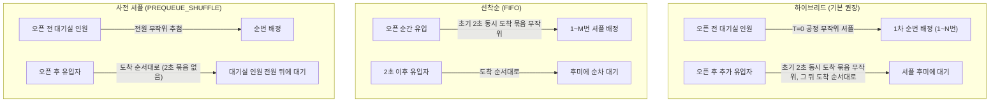
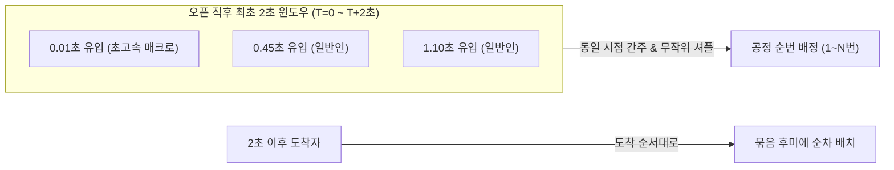
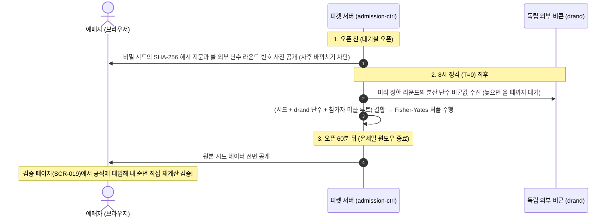
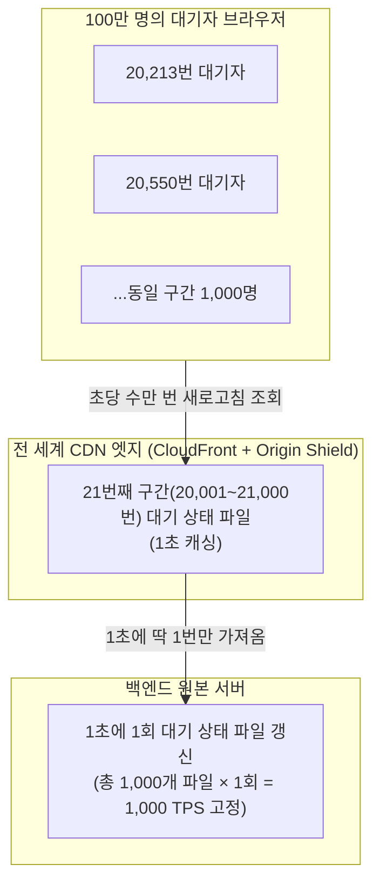
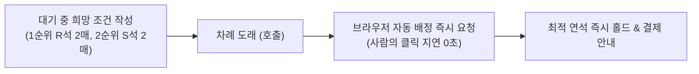

# 2. 대기실과 줄 서기

> [← 1편: 큰 그림](01-big-picture.md) | [목차로 돌아가기](README.md) | [3편: 차례와 입장 →](03-admission.md)

---

## 1. 상황: 8시 10분 전, 지민 씨의 예매 화면

저녁 8시 정각에 티켓 판매가 시작되는 공연이다. 지민 씨는 오픈 10분 전인 7시 50분에 사이트에 접속했다. 화면에는 다음과 같은 안내만 보일 뿐, 대기 번호 숫자는 나타나지 않는다.

> **"현재 대기실입니다. 8시 정각에 순번이 배정됩니다."**

8시 정각이 되자 화면이 자동으로 바뀌며 안내 문구가 뜬다.

> **"앞에 20,212명이 기다리고 있습니다. 예상 대기 약 12분"**

지민 씨는 브라우저를 닫고 설거지를 하다가 10분 뒤 다시 사이트에 접속한다. 화면에 번호가 보이지는 않지만 지민 씨의 순번(20,213번)은 그대로이고, 앞선 대기 인원만 3,200명으로 줄어 있다. 화면에는 앞에 몇 명이 있는지와 예상 대기 시간만 보인다. 내 번호와 지금 부르는 번호를 함께 보여 주면 중간에 빠진 번호 때문에 두 번호의 차이가 실제 앞 인원과 달라 오히려 헷갈리기 때문이다.

이 짧은 과정에 피켓(PEAKET) 시스템이 가장 공들인 **세 가지 핵심 엔지니어링**이 모두 녹아 있다.

---

## 2. 왜 어려운가: 대규모 티케팅의 3대 난제

대규모 티케팅 대기열에서는 전통적으로 세 가지 치명적인 난제가 발생한다.

| 핵심 난제 | 원인과 시스템적 위협 | 피켓의 해결 장치 |
| :--- | :--- | :--- |
| **1. 8시 정각 트래픽 폭발** | 100만 명이 8시 0분 0초에 동시에 버튼 클릭. 초당 20만 건 이상의 쓰기 요청이 쏟아져 웹 서버 즉시 마비 | **대기실 분산 입장** & **2초 묶음 무작위화** |
| **2. 새로고침 연타 폭주** | "내 앞에 몇 명 남았나" 확인하려 100만 명이 몇 초 간격으로 새로고침. 대기자가 많을수록 서버 부하 기하급수 폭증 | **1,000명 단위 대기 상태 파일** & **CDN 엣지 캐싱** |
| **3. 공정성에 대한 불신** | 순번 배정 과정이 불투명하면 "조작 의혹" 제기. 반대로 단순 선착순이면 초고속 매크로가 티켓 독점 | **공개 암호학 검증 (Commit-Reveal)** & **외부 분산 난수 비콘(drand)** |

---

## 3. 어떻게 푸는가: 6가지 핵심 엔지니어링

### ① 줄 서는 방식을 공연 성격에 맞춰 선택한다

피켓은 파트너(기획사)가 공연 성격에 맞춰 세 가지 대기열 정책 중 하나를 선택할 수 있도록 지원한다 ([POL-003](../planning/03-policies-glossary.md), [ADR-0012](../docs/adr/0012-queue-ordering-hybrid-shuffle-default.md)).

| 대기열 방식 | 동작 방식 | 적용 대상 및 특징 |
| :--- | :--- | :--- |
| **하이브리드 (기본 권장)** | 오픈 전 대기실 인원을 **1차 무작위 추첨**해 순번을 매긴다. 8시 이후 들어온 사람은 그 뒤에 세우되, 오픈 직후 2초 안에 온 사람끼리는 무작위로 섞고(②의 2초 묶음) 그 뒤로는 도착 순서대로 줄을 세운다. | **일반 대중 콘서트 및 대형 페스티벌의 기본값** |
| **선착순 (FIFO)** | 오픈 순간 먼저 도착한 순서대로 배정한다. 단, 오픈 직후 2초 안에 유입된 요청은 동시 도착으로 간주해 무작위로 섞는다 ([ADR-0041](../docs/adr/0041-fifo-speed-bot-countermeasures.md)). | 전통적 선착순을 고수하려는 공연. *(파트너 콘솔에 "고속 매크로에 취약하다"는 경고 표시)* |
| **사전 셔플(로비 추첨) (PREQUEUE_SHUFFLE)** | 오픈 시각 전에 대기실에 들어온 인원을 8시 정각에 무작위로 추첨한다. 8시 이후 온 사람도 들어올 수 있고, 대기실 인원 전원 뒤에 도착 순서대로 선다. 하이브리드와 다른 점은 오픈 직후 2초 동시 도착 묶음이 없다는 것뿐이다(2026-10-14 소유자 결정, [ADR-0064](../docs/adr/0064-sales-end-24h-before-start.md)). | 팬클럽 선예매처럼 대기실 추첨을 앞세우는 티케팅. 누가 살 수 있는지는 선예매 명단 같은 판매 규칙이 가린다 |

> [!TIP]
> **하이브리드 추첨 방식의 핵심: "일찍 들어와도 아무런 특혜가 없다"**  
> 7시 50분에 온 사람이나 7시 59분에 들어온 사람이나 당첨 확률과 조건이 완전히 같습니다. 따라서 수십만 명이 8시 정각에 맞춰 한 번에 접속할 이유가 사라지고, 트래픽은 로비가 열려 있는 오픈 전 10분 동안 자연스럽게 분산됩니다.  
> 대기실에 미리 들어온 사람끼리는 추첨이라 0.001초 빨리 누르는 매크로도 앞서지 못합니다. 다계정 생성 시도는 **휴대폰 본인확인 기반의 1인 1계정 체계(9편)**로 막지만, 다른 사람 명의를 빌린 계정은 남습니다(9편).

---

### ② 오픈 직후 속도 경쟁을 줄이는 '2초 묶음 무작위화'

선착순(FIFO) 방식이나 오픈 이후 도착 흐름에서는 밀리초(ms) 단위의 클릭 경쟁이 남을 수밖에 없다. 피켓은 이를 방어하기 위해 **'2초 묶음(동시 도착 구간)'** 전략을 사용한다 ([ADR-0041](../docs/adr/0041-fifo-speed-bot-countermeasures.md)).

* **동작 원리**: 오픈 직후 최초 2초 동안 들어온 모든 요청은 동일한 시각에 도착한 것으로 간주하여 한 바구니에 담은 뒤, 내부에서 무작위로 순번을 섞습니다.
* **효과**: 0.01초 만에 광속으로 누른 매크로와 0.8초에 침착하게 누른 사람이 같은 당첨 확률을 갖게 됩니다.
* **남는 차이**: 2초가 지난 뒤 도착한 요청은 묶음 전원의 뒤에 도착 순서대로 섭니다. 그래서 오픈 직후 2초 안에 들어오느냐는 여전히 중요합니다.
* **참여 자격**: 이 묶음에 참여하려면 오픈 전에 미리 '사람 확인(Turnstile)'을 완료해 두어야 합니다. 오픈 뒤에야 사람 확인을 마친 사용자는 이 2초 묶음의 뒤쪽부터 도착 순서대로 줄을 서게 됩니다.

---

### ③ 추첨 결과는 누구나 수학적으로 검증할 수 있게 공개한다

추첨의 공정성을 말로만 설득하지 않는다. 피켓은 누구나 조작 여부를 사후 검증할 수 있는 **'검증 가능한 난수 추첨 체계(Commit-Reveal)'**를 제공한다 ([POL-005](../planning/03-policies-glossary.md)).

| 공개 시점 | 공개 데이터 | 공정성 보장 원리 |
| :--- | :--- | :--- |
| **대기실 오픈 시점** | 추첨 알고리즘에 사용할 비밀 값(시드)의 **암호학적 해시 (SHA-256 지문)**, 쓸 외부 난수의 라운드 번호, 계산 방식 버전 | 운영진이 나중에 결과를 입맛대로 바꾸기 위해 시드 값이나 난수 라운드를 바꿀 수 없다. |
| **8시 정각 직후** | 대기실 참가자 명단 해시값(머클 루트) 및 독립 외부 공개 난수 서비스(**drand**)에서 미리 정한 라운드의 값 | 그 라운드 값이 나오기 전에는 시드를 아는 피켓 운영진도 결과를 미리 알 수 없다. 명단을 확정한 뒤에 나오는 첫 라운드(정각 3초 뒤 이후)를 쓰므로, 명단을 정할 때는 아무도 난수를 모른다. |
| **오픈 60분 뒤 (온세일 윈도우 종료 직후)** | 사용된 **시드 원본 데이터** | 공개된 계산식을 실행해 자신의 순번이 조작 없이 산출되었는지 누구나 직접 재현해 볼 수 있다. |

> [!NOTE]
> 외부 난수가 늦게 오면 이미 공개된 다른 값으로 대신하지 않고, 미리 정한 라운드가 올 때까지 기다립니다(여러 공개 중계 주소를 차례로 시도). 이미 공개된 값을 쓰면 시드를 아는 내부자가 결과를 미리 계산할 수 있기 때문입니다. 기다리는 동안 대기실 화면에는 '순서 계산 중'이 보입니다.
> 60초(운영 전 잠정값)를 넘기면 셔플을 멈추고 가장 높은 단계의 비상 경보(SEV1)를 냅니다. 이때 시드만으로 셔플하는 비상 처리는 관제 콘솔의 12개 명령에 들어 있지 않고, 비상 절차서(런북 RB-35)에 따라 서로 다른 관제 책임자 두 명이 각자 자기 키로 서명해야 실행됩니다. 실행한 뒤에는 사유와 '이 경우 시드를 아는 내부자가 결과를 미리 알 수 있다'는 한계를 [검증 페이지(SCR-019)](../planning/04-ia-flows-screens.md)에 공개합니다 ([ADR-0050](../docs/adr/0050-crypto-corrections-and-key-management.md) 결정 7, 2026-10-20 추천 적용, ADR-0073).

> [!TIP]
> **내 순번은 몇 초에 나눠서 받는다**  
> 100만 명이 정각 직후 같은 순간에 결과 파일을 받으면 CDN 한 곳이 받을 수 있는 양을 넘는다. 그래서 사람마다 0~8초 사이의 정해진 순간에 나눠서 받는다(토큰마다 정해져 있어 새로고침해도 빨라지지 않는다). 순서는 이미 정해졌으므로 늦게 받아도 순서는 바뀌지 않고, 첫 입장은 모두가 받을 수 있는 시간이 지난 뒤 시작한다([ADR-0058](../docs/adr/0058-cdn-distributions-quotas-and-shuffle-fetch-spread.md)).

---

### ④ 100만 명이 상태를 조회해도 서버는 초당 1,000번 이하로만 일한다

은행 창구를 생각하면 이해하기 쉽다. 대기실에 손님 1,000명이 있을 때, 손님 각자가 창구 직원에게 1초마다 *"지금 몇 번까지 불렀나요?"*라고 묻는다면 직원은 업무를 전혀 보지 못하고 마비된다.  
대신 벽에 커다란 디지털 전광판을 걸어두고 1초에 한 번만 숫자를 갱신하면 된다. 1,000명의 손님은 전광판의 숫자만 바라보며 자기 차례를 스스로 계산한다.

피켓의 **'대기 상태 파일(Status File)'**이 바로 이 전광판 역할을 한다. 전 세계에 분산된 캐시 서버(CDN)는 이 전광판을 수많은 엣지 서버에 복사해두고 사용자에게 즉시 응답한다 ([ADR-0003](../docs/adr/0003-waiting-room-adaptive-polling.md)).

#### 1. 대기 상태 파일의 구조
순번 1,000개 단위마다 작은 텍스트 파일 하나씩 생성된다. 20,213번인 지민 씨의 브라우저는 20,001번부터 21,000번 구간을 담은 파일 하나만 조회한다. 이 파일에는 다음 여덟 가지 정보만 들어 있다. 사람마다 다른 값은 없다.

| 파일에 담긴 데이터 | 예시 값 | 설명 |
| :--- | :---: | :--- |
| **현재 serving 번호** | `20,000` | 시스템이 현재 호출 중인 순번 |
| **차례 진행 속도** | `28번/초` | 초당 다음 대기열을 호출하는 속도 |
| **공연 판매 상태** | `판매 중` | 판매 중, 판매 일시정지(관제 명령 3), 등급별 매진, 전체 매진, 판매 종료(공연 시작 24시간 전) 중 하나 |
| **매진된 등급 목록** | `[]` | 등급별 매진일 때 매진된 좌석 등급. 대기 화면에 등급별 현황으로 보이지는 않고, 자동 배정 공연에서 1순위 등급이 매진되면 희망 조건 줄에 알리는 데만 쓴다 |
| **serving까지 빠진 번호 누계** | `120명` | serving 번호까지 줄을 섰다가 나간 사람 수. 아래 앞선 구간 누계에서 빼면 serving과 내 구간 사이에서 나간 사람 수가 된다 |
| **앞선 구간 누적 이탈자 수** | `120명` | 현재 구간 앞에 줄을 섰다가 나간 사람 수 |
| **현재 구간(1,000명) 내 이탈 비트맵** | `1,000비트` *(125바이트)* | 1,000명 중 취소하거나 이탈한 번호를 0과 1로 압축 표기 |
| **긴급 공지** | `(없음)` | 운영자가 띄운 대기실 안내 문구(관제 명령 7) |

* **클라이언트 연산**: 사용자의 개인 순번은 브라우저 로컬 저장소가 이미 알고 있으므로 파일에 넣을 필요가 없다. 지민 씨의 스마트폰은 파일 데이터를 받아 단순한 뺄셈 연산만 수행한다:
  $$\text{앞선 대기자} = 20,213\ (\text{내 번호}) - 20,000\ (\text{현재 호출}) - 10\ (\text{내 앞 이탈자}) - 1 = \mathbf{202\text{명}}$$
* 파일 하나의 크기는 불과 수백 바이트로, 문자 메시지 한 통보다도 작다.

#### 2. 왜 서버 요청이 초당 1,000건 안으로 묶이는가?
* 서버는 1초에 한 번씩 입장 번호와 이탈 목록을 반영해 1,000명 단위 대기 상태 파일을 새로 만들어 CDN 원본에 게시한다. 대기자가 100만 명이면 대기 상태 파일은 1,000개다.
* CDN 캐시 서버는 각 파일을 캐시 수명(기본 1초)마다 1번만 원본 서버에서 가져오고, 그 사이 몰려드는 요청에는 자신이 캐싱한 복사본으로 응답한다. 차례에서 먼 구간의 수명을 늘려(5초·10초) 갱신을 더 줄이는 방식은 부하 시험 뒤에 정한다. 늘리면 먼 구간은 매진 같은 판매 상태 변화를 그만큼 늦게 본다.
* 따라서 백엔드 원본 서버가 처리하는 요청은 많아야 **$1,000\text{개 파일} \times 1\text{초당 } 1\text{회} = \mathbf{1,000\text{ TPS}}$**다(먼 구간의 캐시 수명을 늘리면 더 적다). 사용자가 1초마다 새로고침을 해도 이 숫자는 늘지 않는다. 다만 대기 인원이 늘면 파일 수(1,000명당 1개)만큼 늘어, 200만 명이면 많아야 2,000건이다.

> [!IMPORTANT]
> **개인화 API(`/api/queue/me`)를 쓰지 않는 이유**  
> "내 앞에 몇 명 남았는가"를 개인별 API로 응답하면 사용자마다 데이터가 달라 CDN 캐시를 전혀 쓸 수 없습니다. 100만 명이 5초마다 이를 호출하면 서버는 초당 20만 건의 동적 쿼리를 감당해야 해 필연적으로 다운됩니다.  
> 반면 대기 상태 파일 방식은 공통 데이터를 내려주고 마지막 연산(뺄셈)만 각자의 브라우저에 맡깁니다. 이때 요청에 로그인 쿠키나 사용자 토큰을 일절 붙이지 않는데, 개인 식별 헤더가 들어가면 CDN이 동일 캐시로 응답하지 못하기 때문입니다.

#### 3. 동적 적응형 폴링 (Adaptive Polling)
브라우저는 예상 대기 시간에 따라 대기 상태 파일을 요청하는 간격을 지능적으로 조절한다.

| 예상 대기 시간 | 조회 간격 | 설계 근거 |
| :--- | :---: | :--- |
| **1분 이내 (입장 직전)** | **1초마다** | 본인 차례 도래를 2초 이내에 인지해야 좌석 풀 유휴를 최소화함 |
| **1분 ~ 5분** | **5초마다** | 트래픽 절감과 체감 대기 시간 갱신의 균형 |
| **5분 이상 (여유 있는 대기)** | **20초마다** | 불필요한 네트워크 대역폭과 CDN 비용을 획기적으로 절약 |

#### 4. 설계 용량과 확장 한계

| 설계 지표 | 설계 목표 (100만 명, 외삽으로 판정) | 200만 명 확장 시 (이론적 예측) |
| :--- | :---: | :---: |
| **동시 대기 인원** | 100만 명 | 200만 명 |
| **백엔드 원본 서버 조회 부하** | **초당 약 1,000건** | **초당 약 2,000건** (파일 2,000개) |
| **CDN 엣지 수신 요청량** | 초당 약 5.3만 건 | 초당 약 10만 건 |
| **70분 누적 CDN 요청량** | 약 2.2억 건 | 약 4.4억 건 |

대기자가 늘어나더라도 원본 서버의 부하는 $\mathbf{(\text{대기 인원} \div 1,000)\text{ TPS}}$로만 증가하므로 아키텍처 자체는 수백만 명 규모로 쉽게 확장된다.

> [!NOTE]
> **CDN 내부 갱신량**: 서울의 CDN 거점 몇 곳이 파일 1,000개를 1초마다 받아 가면 CDN 내부 요청은 초당 수천에서 1만 건 수준입니다. 이는 CDN이 일상적으로 감당하는 규모이며, Origin Shield가 한 번 더 묶어 원본 서버에는 파일당 1초에 단 1번만 도달합니다. 기본은 모든 구간이 1초입니다. 차례가 먼 구간의 캐시 시간을 5초·10초로 늘려 1초 갱신 대상을 수십 개로 줄이는 방식은 Phase 2 부하 시험 뒤에 채택 여부를 정합니다.

#### 5. 대기 화면에는 네 가지만 보인다

2026-10-14 소유자가 대기 화면을 줄이기로 정했다(ADR-0063, [queue-admission §4](../docs/features/queue-admission.md)). 지민 씨가 보는 기본 화면은 이것뿐이다.

1. **내 앞 대기 인원**: 크게 "앞에 3,214명".
2. **진행 막대**: 처음 줄을 받았을 때보다 얼마나 앞으로 왔는지. 계산은 "(처음 앞 인원 − 지금 앞 인원) ÷ 처음 앞 인원"이다. 처음 앞 인원이 3,214명이고 지금 1,607명이면 절반이 찬다. 새 숫자가 올 때 막대가 부드럽게 차오르고 '나' 표시가 앞으로 움직이며 숫자도 굴러가듯 바뀐다. 움직임을 줄이도록 설정한 기기에서는 효과 없이 값만 바뀐다.
3. **남은 예상 시간**: "약 2분".
4. **[대기 취소]** 버튼.

그 밖의 안내(운영 공지, 판매가 잠시 멈춤, 순서를 정하는 중, 곧 입장, 대기표 만료, 다른 기기에서 취소함, 연결 확인 중, '현재 순번으로는 구매가 어려울 수 있습니다' 등)는 그 일이 생길 때만 뜬다. 등급별 매진 현황은 보이지 않는다. 줄 세우는 방식 안내와 부정구매 처벌 안내는 화면 아래 '순번 안내 ›'를 누르면 열리는 시트에서 읽는다(공연 상세에서 이미 미리 알렸다).

* **처음 앞 인원은 어디에 있나**: 서버가 새로 보내는 값이 아니다. 브라우저가 처음 계산한 앞 인원을 그 탭의 임시 저장소(세션 저장소)에 적어 둔다. 같은 탭에서 새로 고침해도 남지만, 탭을 닫았다 다시 열거나 다른 탭·기기에서 열면 그때의 앞 인원이 새 출발점이 되어 막대가 0%부터 다시 찬다. 순번은 그대로다.
* **막대가 뒤로 갈 때**: 조금 오래된 대기 상태 파일을 받아 앞 인원이 잠깐 늘면 막대도 그만큼 물러난다. 숨기거나 멈추지 않고 실제 값을 보인다.

---

### ⑤ 브라우저 화면을 닫아도 순번은 안전하게 보존된다

대기 번호표는 서버가 HMAC으로 암호 서명한 가벼운 토큰 형태로 발급된다 ([ADR-0011](../docs/adr/0011-token-lifecycle-and-login-responsibilities.md)). 토큰 안에는 대기 번호, 공연 ID, 기기 식별값(deviceId)이 들어 있다. 기기 식별값은 같은 브라우저에서 이어 쓰게 하는 표시일 뿐, 그 기기만 쓸 수 있게 묶는 열쇠는 아니다.

* **창을 닫아도 순번 유지**: 사용자가 실수로 창을 닫거나 스마트폰 화면을 끄더라도, 차례가 오기 전에는 언제 돌아와도 이 토큰으로 원래 순번에 복귀한다. 차례가 온 뒤에는 15분 안에 돌아오면 다음 빈자리로 입장하고, 15분이 지나면 대기표가 만료된다([POL-008](../planning/03-policies-glossary.md)).
* **불필요한 핑(Ping) 제거**: 사용자가 살아있는지 확인하려고 서버가 주기적으로 핑을 날리거나 연결을 유지할 필요가 없으므로 시스템 자원이 절약된다.

---

### ⑥ 자동 배정 공연은 기다리는 동안 원하는 좌석 조건을 미리 적는다

파트너가 좌석 자동 배정(4편)을 고른 공연에서는 대기 화면에 **'희망 조건' 한 줄**(예: "희망 R석 2매 [바꾸기]")이 나타나고, [바꾸기]를 누르면 조건을 고치는 시트가 열린다 ([ADR-0043](../docs/adr/0043-auto-seat-preferences-before-turn.md), [POL-035](../planning/03-policies-glossary.md)).

1. **사전 결정으로 손 빠르기 경쟁 줄이기**:
   * 입장한 뒤에 등급과 매수를 고르면 사람은 10초가 걸리고 매크로는 0.1초면 끝나서 매크로가 항상 앞서갑니다.
   * 대기실에서 미리 조건을 적어 두면, 차례가 오는 순간 **브라우저가 0초 만에 자동으로 배정을 요청**하므로 손의 빠르기가 배정 순서에 끼어들지 않습니다. 남는 차이는 0.2초마다 serving 번호를 올리는 주기 안의 도착 시각 차이와 네트워크 지연 정도입니다.
2. **차례 임박 10초 직전 직접 확인**:
   * 차례가 10초 안으로 다가오면 브라우저는 전광판(대기 상태 파일)의 1초 지연을 보완하기 위해 서버에 1초에 1회 직접 차례를 확인하여 매크로와 동일한 출발선에 섭니다.
3. **한계와 주의사항**:
   * 희망 등급이 전석 매진되었거나 조건을 적지 않은 사용자는 직접 골라야 합니다.
   * 차례가 지난 뒤 15분 유예 안에 늦게 돌아온 사람은 그 사이 뒷순번이 먼저 좌석을 받아갈 수 있고(15분을 넘기면 대기표가 만료된다), 희망 조건은 해당 브라우저 로컬에 저장되므로 기기를 바꾸면 다시 입력해야 합니다.

---

## 4. 대기열 핵심 운영 규칙

| 운영 규칙 | 상세 내용 |
| :--- | :--- |
| **1인 1순번 원칙** | 본인확인(CI) 기준 단 1개의 대기 순번만 허용한다. 탭을 여러 개 열어도 새 번호를 주지 않고, 다른 기기로 다시 들어오면 처음 기기에서 이어 가라고 안내한다(대기표는 처음 기기의 브라우저 저장소에 있다). 처음 기기를 쓸 수 없으면 기존 참가를 취소하고 새 기기에서 다시 참가할 수 있다. 오픈 전 대기실이라면 추첨 전이라 손해가 없고, 오픈 뒤라면 맨 뒤에 다시 선다. 드물게 대기열 저장소가 장애로 예비 서버로 넘어가는 순간에 들어온 사람은 순번을 하나 더 받을 수 있지만, 입장할 때 한 번 더 확인해 한 사람은 한 번만 들여보내고 남은 번호는 빈 번호로 돌린다. |
| **사전 본인확인 의무화** | 본인확인을 정상적으로 통과한 계정만 대기실 및 대기열에 입장할 수 있다. |
| **오픈 전 순번 미노출** | 오픈 시각 전 대기실 화면에는 어떠한 대기 번호나 대기 순위도 표시하지 않는다. 추첨 전에는 숫자의 의미가 없기 때문이다. |
| **고지 문구의 통일성** | 공연 상세, 대기실, 결제 직전 화면에 정렬 방식을 같은 표준 문구로 알린다. 하이브리드 공연의 문구는 `"오픈 전에 들어온 분은 오픈 시각에 무작위로 순번을 받습니다. 일찍 들어와도 유리하지 않습니다. 오픈 후에 오신 분은 그 뒤에 도착 순으로 섭니다."`이고, 선착순·사전 대기실 추첨 공연은 그 방식의 표준 문구를 쓴다([POL-004](../planning/03-policies-glossary.md)). 대기열 화면에서는 화면 아래 '순번 안내 ›'를 누르면 열리는 시트에 이 문구를 싣는다. 추첨제 공연에는 '선착순'이라는 용어를 금지한다. |
| **대기열 자동 이탈 4대 요건** | ① 사용자가 직접 대기 취소, ② 비정상 봇 의심으로 추가 검증 대기 상태 전환, ③ 1인 1순번 규칙 위반 적발, ④ 발급 오류로 인한 결번 처리. |
| **구매 가망 알림** | 앞선 대기 인원에 1인당 평균 구매 티켓 수를 곱한 값이 남은 총 좌석 수를 초과할 경우, `"현재 순번으로는 구매가 어려울 수 있습니다"`를 사전에 투명하게 안내한다. |
| **판매는 70분에 끝나지 않는다** | 오픈 10분 전부터 60분 뒤까지의 '온세일 윈도우'는 배포를 멈추고 관제가 집중하며 첫 리포트(R0)의 기준이 되는 운영 구간일 뿐이다(2026-10-14 추천 적용, ADR-0063). 판매와 대기열은 그 회차의 판매 종료나 매진까지 같은 대기실·대기열로 이어지고, 앞에 기다리는 사람이 없으면 바로 입장한다. 셔플 시드 공개(윈도우 직후)와 R0 리포트 시각은 그대로다. |
| **판매 종료는 공연 시작 24시간 전** | 10/25(일) 18:00 공연이면 10/24(토) 18:00에 판매가 끝난다(2026-10-14 소유자 결정, [ADR-0064](../docs/adr/0064-sales-end-24h-before-start.md)). 정렬 방식과 관계없이 그 뒤에는 대기열에 새로 들어올 수 없고(410 `sale-ended`), 기다리던 사람의 화면은 '판매 시간이 끝났습니다'로 바뀌며, 좌석을 새로 고를 수도 없고 취소표 알림 신청도 끝난다. 그 전에 좌석을 잡아 둔 사람은 남은 홀드·결제 시간 안에 결제를 마칠 수 있다. 예매 취소는 지금처럼 공연 시작 전까지 되지만, 판매 종료 뒤 취소된 좌석은 다시 팔지 않아 빈 좌석으로 남는다. |
| **줄 서기 버튼은 '먼저 물어보기' 없이 보낸다** | 브라우저는 다른 주소의 서버로 요청을 보낼 때 보통 먼저 "이 요청을 받아 줄래요?" 하고 한 번 물어본다(CORS 사전 요청). 오픈 순간 20만 명이 동시에 [줄 서기]를 누르면 이 질문도 같은 수만큼 붙어 요청이 두 배가 될 수 있고, 회차마다 주소가 달라 미리 답을 받아 둘 수도 없다. 그래서 줄 서기와 입장 확정은 질문이 붙지 않는 형식으로 보내고, 위조 방지는 본문의 사전 검증 토큰과 출처 확인이 맡는다(2026-10-15 추천 적용, [ADR-0065](../docs/adr/0065-web-frontend-security-after-asvs-v3.md)). 브라우저에서 정말 질문이 없는지는 Phase 2에서 확인한다. 아직 실측 전이다. |
| **단계적 매진 전파** | 티켓이 소진되면 CDN 엣지가 공연 페이지 및 신규 진입을 즉시 '매진'으로 전환하고, 대기 상태 파일에 매진 플래그를 실어 보낸다. 기다리던 사람은 다음 조회 때 매진을 알고 조회를 멈춘다. 20초마다 조회하는 먼 구간은 조회 간격(20초에 ±20%를 무작위로 흩뜨림)에 파일 캐시 1초를 더해 최대 약 25초 안에 안다. |

---

## 5. 한 줄 요약

> **대기실 참가자는 암호학적으로 검증 가능한 공정 추첨으로 순번을 배정받고, 대기 현황은 1,000명 단위의 가벼운 대기 상태 파일로 CDN에서 응답하므로, 100만 명이 동시에 접속해도 원본 서버는 초당 1,000건의 부하만 받는다.**

---

## 더 알아보기

* [docs/features/queue-admission.md §2, §3, §4](../docs/features/queue-admission.md): 대기실, 무작위 추첨, 대기표 서명, 대기 상태 파일의 기술 구현 명세
* [ADR-0050](../docs/adr/0050-crypto-corrections-and-key-management.md) 결정 7: 추첨 재현 규격, 외부 난수가 늦을 때 기다리는 규칙과 비상 처리
* [planning/01-overview.md §1](../planning/01-overview.md), [POL-003, POL-004, POL-005](../planning/03-policies-glossary.md): 대기열 정책 비교와 선정 기준
* [POL-002, POL-007](../planning/03-policies-glossary.md): 1인 1순번 보장 정책 및 대기 인원 산정 공식
* [docs/features/queue-admission.md §8](../docs/features/queue-admission.md), [POL-015](../planning/03-policies-glossary.md): 매진 판정 및 분산 전파 절차
* [docs/architecture.md §9.1](../docs/architecture.md): 서버 용량 산정 근거 ("왜 초당 1,000건인가")
* [docs/architecture.md §9.2](../docs/architecture.md): 200만 명 대기열 확장 시 시스템 한계 및 이론적 대응점
* [ADR-0041](../docs/adr/0041-fifo-speed-bot-countermeasures.md): 선착순 공연의 속도형 봇 방어를 위한 2초 묶음 무작위화 의사결정
* [ADR-0043](../docs/adr/0043-auto-seat-preferences-before-turn.md), [POL-035](../planning/03-policies-glossary.md): 자동 배정 공연의 희망 조건 사전 입력과 차례 직전 직접 확인
