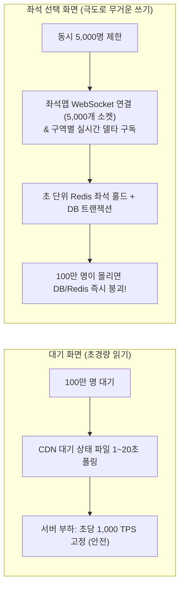
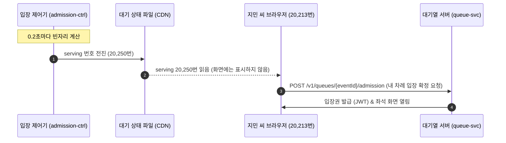
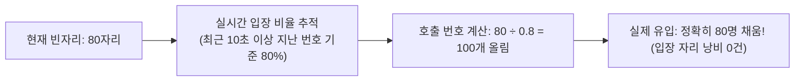
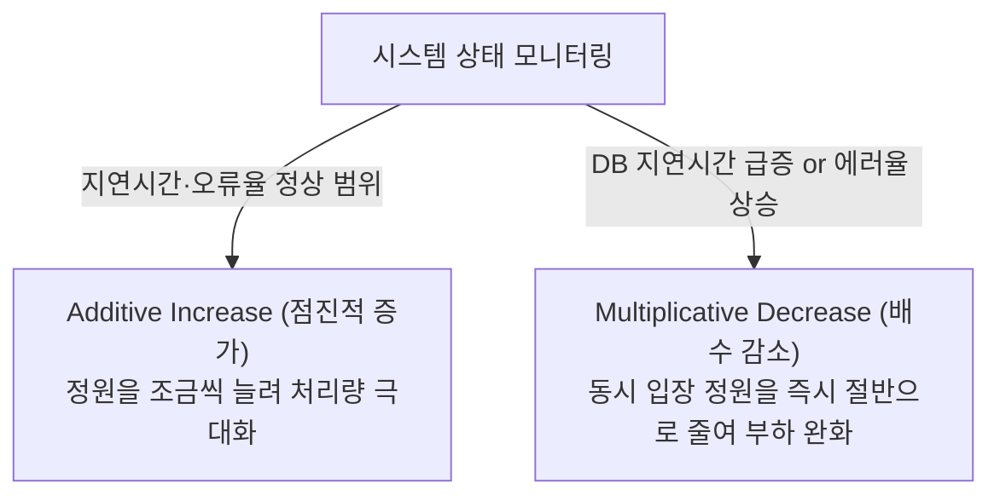
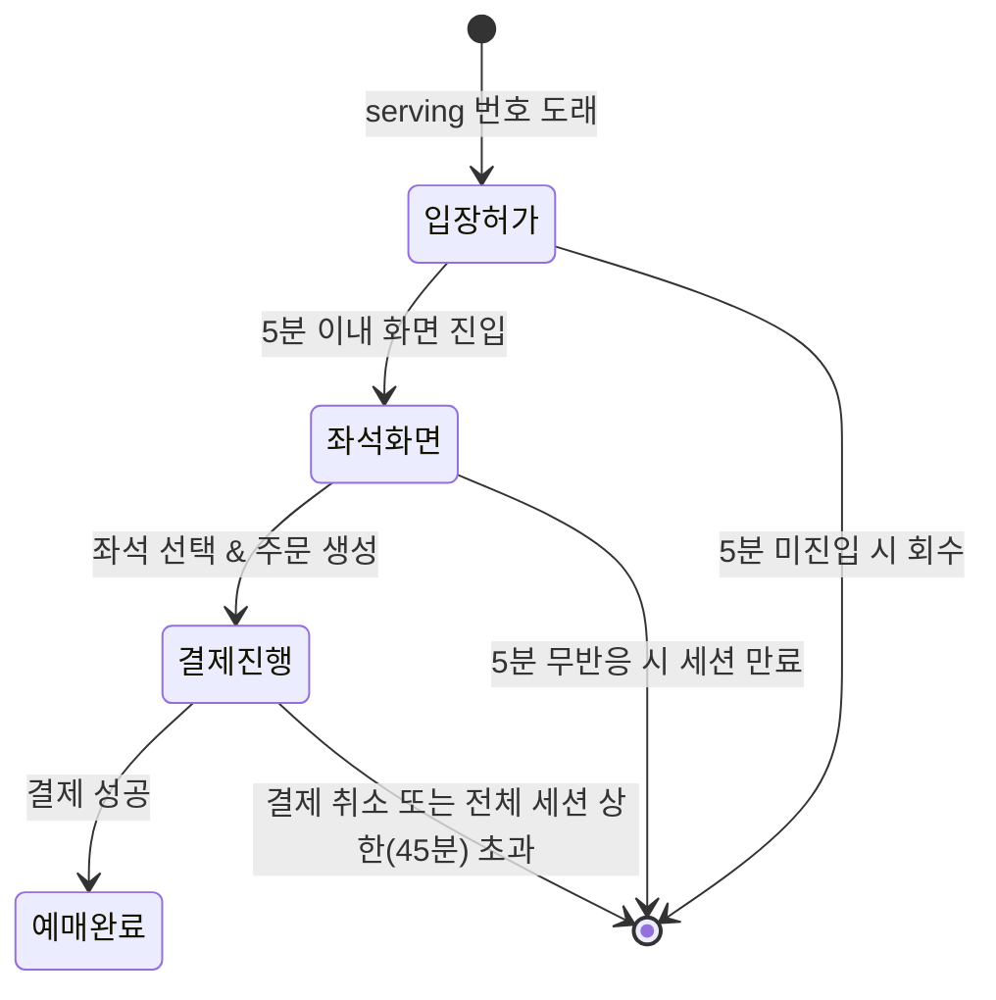

# 3. 차례와 입장

> [← 2편: 대기실과 줄 서기](02-waiting-room.md) | [목차로 돌아가기](README.md) | [4편: 좌석 고르기와 홀드 →](04-seat-hold.md)

---

## 1. 상황: 화면에 번호가 없어도 차례는 온다

지민 씨의 대기 순번은 20,213번이다. 화면에는 앞 인원과 예상 시간만 보이고 번호는 보이지 않는다. 브라우저가 주기적으로 읽는 대기 상태 파일의 호출 번호(serving)가 20,250번으로 올라 지민 씨의 순번을 넘자, 브라우저는 화면에 번호를 띄우지 않고 자동으로 입장을 확정한 뒤 실시간 좌석 선택 화면을 연다.

하지만 좌석 선택 화면에는 한 번에 들어갈 수 있는 동시 접속자가 **5,000명 안팎**으로 엄격히 제한되어 있다. 만약 5,000개의 입장 자리가 꽉 차 있다면 `"곧 입장합니다"`라는 안내 문구가 나타나며 시스템이 몇 초 간격으로 입장을 자동으로 재시도한다.

---

## 2. 왜 어려운가: 대기 화면과 좌석 화면의 부하 차이

대기 화면과 좌석 선택 화면은 시스템 부하 측면에서 차원이 전혀 다르다.

* **대기 화면 (Read-only)**: CDN에 저장된 작은 텍스트 파일을 1~20초마다 단순히 읽기(Read)만 하므로 서버에 부담을 주지 않습니다.
* **좌석 선택 화면 (Heavy Write & Pub/Sub)**: 5만 개 좌석의 실시간 점유 상태를 WebSocket으로 끊임없이 주고받으며, 초 단위로 좌석을 홀드하고 결제 트랜잭션을 일으키는 고비용의 쓰기(Write) 작업이 발생합니다.

> [!IMPORTANT]
> **대기열의 진짜 목적**  
> 대기열의 목적은 사용자를 무작정 기다리게 만드는 것이 아니라, **먼저 들어간 5,000명이 오류나 튕김 없이 쾌적하게 예매를 마칠 수 있도록 뒤쪽 통로를 정밀하게 조절(Rate Limiting & Admission Control)**하는 데 있습니다.

---

## 3. 어떻게 푸는가: 5가지 입장 제어 공학

### ① 서버가 먼저 "다음 분 들어오세요"를 외친다 (Push형 Serving)

은행 창구 직원이 전광판을 통해 "20,250번 손님까지 들어오세요"라고 번호를 띄우면, 손님은 자신의 번호표를 보고 창구로 걸어 들어간다. 손님들이 직원에게 쉼 없이 다가가 "제 차례인가요?"라고 묻지 않는 것과 같다. 피켓에서는 이 전광판(대기 상태 파일)을 사람 대신 브라우저가 읽고, 화면에는 번호 대신 앞 인원과 예상 시간만 보인다([2편](02-waiting-room.md)).

| 역할 | 담당 주체 | 동작 내용 |
| :--- | :--- | :--- |
| **입장 호출 번호 갱신 (Serving)** | 입장 제어기 (`admission-ctrl`) | **0.2초마다** 빈자리를 계산해 "몇 번까지 입장 가능" 숫자를 올려 잡는다. |
| **호출 번호 확인** | 사용자의 브라우저 | '대기 상태 파일'에서 호출 번호를 읽어와 내 순번과 비교한다. *(자동 배정 공연은 차례가 10초 안으로 다가오면 서버에 직접 확인, 2편)* |
| **입장권 발급 및 입장 자리 배정** | 대기열 서버 (`queue-svc`) | 자기 차례가 된 사용자가 좌석 화면을 실제로 열 때 입장 자리를 정식으로 배정한다. |

> [!NOTE]
> **핵심 원칙**: "실제 좌석 화면에 들어오는 순간에만 입장 자리를 내어준다."  
> 차례가 왔음에도 화면을 보지 않고 자리를 비운 사용자 때문에 귀중한 입장 자리가 낭비되지 않습니다.

---

### ② 호출 인원은 '실제 입장 비율(Arrival Rate)'을 반영해 계산한다

현재 빈자리(입장 자리)가 80개라고 해서 호출 번호를 정확히 80개만 올리면 문제가 생긴다. 호출된 사람 중 일부는 이미 이탈했거나 화면을 보지 않아 실제로 들어오는 인원이 60명에 그칠 수 있기 때문이다. 그러면 20개의 입장 자리가 놀게 된다.

* 시스템은 **"호출했을 때 실제로 입장하는 비율(입장 비율)"**을 실시간으로 추적합니다.
* 예를 들어 최근 입장 비율이 80%라면, 80명을 채우기 위해 호출 번호를 100개 올립니다.
* 이때 방금 막 호출된 사용자는 아직 화면을 누를 시간이 없으므로, **호출된 지 최소 10초 이상 지난 번호들을 기준**으로 입장 비율을 정밀하게 계산합니다.

---

### ③ 동시 입장 정원은 시스템 부하에 따라 자동 조절된다 (AIMD)

기본 동시 입장 목표 정원은 **5,000명**이다. 하지만 뒤쪽 핵심 시스템(좌석 홀드 DB, 결제 게이트웨이)의 부하 상황에 따라 정원이 유연하게 바뀐다 ([POL-010](../planning/03-policies-glossary.md)).

* **AIMD 알고리즘 (Additive Increase Multiplicative Decrease)**:  
  뒤쪽 시스템이 여유롭고 응답이 빠르면 입장 정원을 조금씩 점진적으로 늘립니다. 반대로 데이터베이스 지연이 길어지거나 오류율이 증가하면 정원을 즉시 절반으로 줄여 시스템 붕괴를 막습니다. (인터넷 TCP 혼잡 제어의 표준 알고리즘).
* **사람의 안전 통제 (Human in the Loop)**:  
  운영자가 관제 콘솔에서 동시 입장 목표를 수동으로 고정하면 **15분 동안 자동 조절이 멈추고 타이머가 작동**합니다. 다만 운영자가 정한 뒤에 오류 예산 경보가 새로 울리면, 이 15분 안에도 정원을 절반으로 줄이고 자동 조절 멈춤을 끝냅니다(줄이는 쪽으로만). 또한 결제 실패 같은 오류가 허용량(오류 예산)을 빠르게 깎아 자동으로 정원을 줄인 뒤에는, 지표가 잠깐 좋아져도 자동 알고리즘이 **정원을 스스로 다시 늘리지 않습니다**. 원인이 풀렸는지 사람이 확인하고 정원을 다시 정합니다([10편](10-control-tower.md)).

---

### ④ 차례를 잠시 놓쳐도 15분의 유예 시간을 준다

| 상황 | 시스템 처리 방식 |
| :--- | :--- |
| **차례 지난 뒤 15분 이내 재접속** | 기존 순번을 인정받아 다음 빈자리로 **우선 입장**한다. |
| **차례 지난 뒤 15분 초과** | 대기표가 만료되어 대기열 맨 뒤로 다시 줄을 서야 한다. 이 회차에 이미 입장했던 사람은 다시 줄을 설 수 없다. 사전 대기실 추첨(PREQUEUE_SHUFFLE) 공연도 다른 공연처럼 맨 뒤로 다시 줄을 설 수 있다(2026-10-14, [ADR-0064](../docs/adr/0064-sales-end-24h-before-start.md)). |
| **판매 종료(공연 시작 24시간 전)가 옴** | 차례가 오기 전이거나 차례가 왔어도 아직 입장하지 않았다면 대기는 끝나고 '판매 시간이 끝났습니다'가 보인다. 다시 줄을 설 수도 없다. 이미 입장해 좌석을 잡아 둔 사람은 남은 홀드·결제 시간 안에 결제를 마칠 수 있다(2026-10-14 소유자 결정, ADR-0064). |
| **입장 순간 입장 자리 5,000개가 꽉 찬 경우** | "곧 입장합니다" 메시지와 함께 몇 초 간격으로 빈자리를 확인하며 자동 입장한다. |

> [!TIP]
> **왜 15분(900초)인가?**  
> 사용자가 브라우저 탭을 백그라운드로 내려두면 크롬 등 최신 브라우저는 탭 타이머를 1분에 1회 수준으로 스로틀링합니다. 이로 인해 화면 갱신이나 알림을 몇 분 늦게 확인할 수 있으므로, 15분이라는 충분한 유예 시간을 두어 억울하게 자리를 잃지 않도록 배려합니다. 차례가 다가오면 브라우저 탭 타이틀 변경, 경고음, 웹 푸시 알림으로 사용자를 깨웁니다.

---

### ⑤ 좌석 선택 화면 머무름 시간(타임아웃) 제한

입장 자리는 한정되어 있으므로 특정 사용자가 자리를 무한정 차지할 수 없다 ([POL-009](../planning/03-policies-glossary.md)).

| 시간 제한 항목 | 제한 기준 | 설정 이유 |
| :--- | :---: | :--- |
| **입장권 수령 후 좌석 화면 진입 시한** | **5분** | 입장 허가를 받고도 화면에 들어오지 않는 미접속자의 자리를 회수하기 위함 |
| **화면 진입 후 무반응(Inactivity) 시한** | **5분** | 좌석 화면을 켜둔 채 자리를 비운 사용자 대신 뒷사람을 들여보내기 위함 |
| **1회 세션 최대 체류 시간** | **45분** | 결제창 체류(최대 30분) 및 복수 좌석 탐색을 여유 있게 마칠 수 있는 절대 상한선 |

---

## 4. 입장 통제 핵심 운영 규칙

| 핵심 규칙 | 상세 내용 |
| :--- | :--- |
| **시스템 안전 한계선 고정** | 동시 입장 정원의 절대 상한선과 하한선, 초당 호출 번호 최대치는 코드 및 설정 파일에 하드코딩되어 있다. 긴급 상황이라도 운영자가 임의로 이 한계를 넘어설 수 없으며, 설정을 바꾸려면 정식 배포 절차를 거쳐야 한다. |
| **사람의 통제권 우선** | 운영자가 현장에서 동시 입장 목표를 수동 설정하면 **15분간 자동 변경 알고리즘이 멈추고 지정값이 유지**된다. 예외는 하나다. 지정한 뒤에 오류 예산 경보가 새로 울리면 정원을 절반으로 줄이고 자동 조절 멈춤을 끝낸다(지정 전부터 울리던 경보로는 줄이지 않는다). |
| **복수 공연 통합 상한 관리** | 여러 공연의 온세일이 겹치면(대형 공연끼리는 오픈을 30분 이상 떼어 동시에 하나만 연다) 공연별 동시 입장 목표의 합이 플랫폼 합산 상한을 넘지 않게 나눈다. 결제 대행사(PG사)가 감당할 수 있는 초당 결제 승인 한계(TPS)가 정해져 있기 때문이다 ([5편](05-payment.md)). |
| **긴급 입장 일시정지** | 심각한 시스템 장애 발생 시 운영자는 호출을 일시 중단할 수 있다. 10분마다 운영자가 사유를 적고 연장해야 이어지며, 연장하지 않으면 10분 뒤 호출이 자동으로 다시 시작된다. 기존 대기열 순번은 그대로 유지된다. |

---

## 5. 한 줄 요약

> **서버가 0.2초마다 입장 호출 번호를 갱신하고, 좌석 화면에는 한 번에 5,000명 안팎만 유지하며, 이 인원은 백엔드 부하에 따라 자동으로 줄어들고 안전한 범위에서 사람의 판단에 따라 조절된다.**

---

## 더 알아보기

* [docs/features/queue-admission.md §5](../docs/features/queue-admission.md), [POL-010](../planning/03-policies-glossary.md): 입장 제어 루프 및 AIMD 알고리즘 구현
* [docs/features/queue-admission.md §6](../docs/features/queue-admission.md), [POL-008, POL-009](../planning/03-policies-glossary.md): 입장 확정 프로세스와 구매 세션 라이프사이클
* [POL-008](../planning/03-policies-glossary.md): 입장 차례 및 15분 유예 정책
* [docs/features/queue-admission.md §9](../docs/features/queue-admission.md): 비상 상황 및 다운스트림 장애 시 완화 절차
