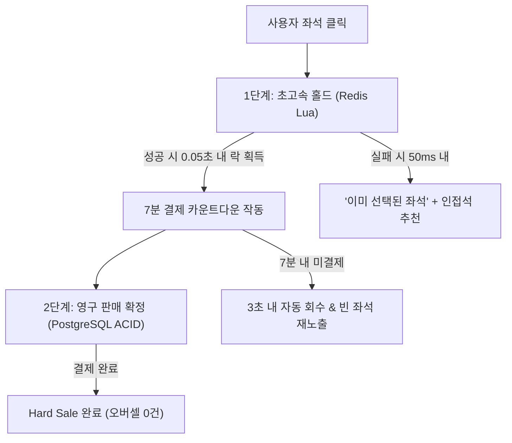
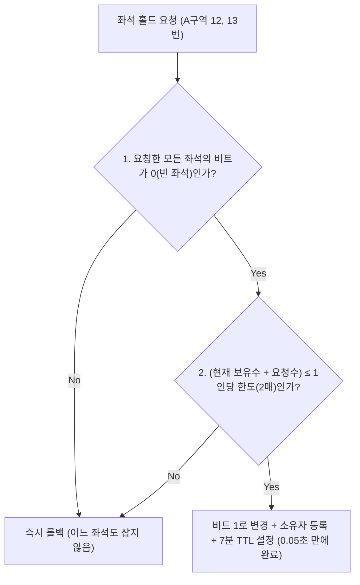
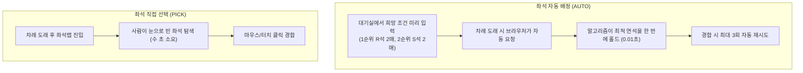

# 4. 좌석 고르기와 홀드

> [← 3편: 차례와 입장](03-admission.md) | [목차로 돌아가기](README.md) | [5편: 결제 →](05-payment.md)

---

## 1. 상황: 0.05초 만에 갈리는 "홀드 완료"와 "이선좌"

지민 씨가 마침내 좌석 선택 화면에 들어왔다. 5만 석 규모의 거대한 좌석 배치도가 1초 만에 화면에 나타나고, 다른 예매자가 홀드한 좌석들은 0.3초 이내에 실시간으로 회색으로 바뀐다.

지민 씨가 A구역 12번과 13번 좌석을 재빠르게 클릭하자, 두 좌석이 "홀드 완료" 상태로 바뀌며 **7분짜리 결제 카운트다운 타이머**가 작동한다.  
같은 시각, 다른 999명도 거의 동시에 A구역 12번을 눌렀지만, 그들에게는 **0.05초(50ms) 만에 `"이미 선택된 좌석입니다"`**라는 안내와 함께 인접한 추천 좌석이 즉시 화면에 제시된다.

---

## 2. 왜 어려운가: 티켓팅에서 가장 치열한 4대 데이터 충돌

티켓팅 시스템에서 가장 치열한 데이터 충돌과 동시성 경합이 발생하는 곳이 바로 좌석 선택 단계다.

| 핵심 난제 | 원인과 기술적 한계 | 피켓의 해결책 |
| :--- | :--- | :--- |
| **1. 수백~수천 명의 동시 클릭 경합** | VIP 명당 좌석 하나에 순식간에 1,000명이 몰려 단 1명만 성공하고 999명은 즉각 실패해야 함 | **Redis In-Memory Lua 단일 트랜잭션** (50ms 내 원자적 판정) |
| **2. 기존 RDBMS 락(Lock)의 한계** | DB 행 잠금(Row Lock) 시 지연 폭증, 여러 좌석 선택 시 서로 자원을 물고 늘어지는 교착 상태(Deadlock) 발생 | **고속 메모리 홀드 + DB 최종 확정** (2단계 일관성 모델) |
| **3. 홀드 후 미결제 방치** | 좌석을 잡아두고 결제하지 않고 나가버리면 정작 구매를 원하는 다른 팬의 기회 상실 | **7분 엄격한 TTL 자동 회수** (3초 내 빈 좌석 재노출) |
| **4. 5만 석 렌더링 부하** | 5만 개 좌석을 일반 HTML 태그(DOM)로 그리면 스마트폰이나 저사양 브라우저 즉시 멈춤 | **HTML5 캔버스 + Web Worker** (60fps 부드러운 확대/축소) |

---

## 3. 어떻게 푸는가: 6대 좌석 홀드 엔지니어링

### ① 2단계 아키텍처: 고속 메모리 홀드 + 엄격한 DB 최종 확정

피켓은 성능과 무결성을 모두 잡기 위해 좌석 처리를 두 단계로 나눴다 ([ADR-0014](../docs/adr/0014-soft-hold-hard-sale.md)). 이것이 피켓 데이터 설계의 가장 중요한 원칙이다.

| 처리 단계 | 저장소 | 수행 작업 | 특징 및 역할 |
| :--- | :---: | :--- | :--- |
| **1단계: 홀드 (Hold)** | **Redis** *(인메모리)* | 좌석 클릭 순간 **0.05초(50ms) 만에** 홀드 성공/실패 판정 | 초고속으로 대규모 경합을 처리한다. 극히 드문 인프라 장애 시 일시 휘발될 수 있다. |
| **2단계: 판매 확정 (Hard Sale)** | **PostgreSQL** *(RDBMS)* | 결제 승인 직전에 판매 예약(PENDING)으로, 승인 뒤 판매 완료(SOLD)로 *"이 좌석은 이 주문의 소유"*임을 원자적으로 기록 | **절대 오버셀을 허용하지 않는 최종 방어선**이다. |

> [!IMPORTANT]
> **오버셀 0건의 수학적 보장**  
> Redis 캐시 계층에서 일시적 데이터 불일치가 일어나더라도, 최종 관문인 PostgreSQL의 **부분 유니크 인덱스(Partial Unique Index)** 제약조건이 같은 좌석의 두 번째 판매를 막으므로 시스템 전체의 오버셀은 0건으로 유지됩니다. 다만 Redis가 통째로 멈추면 막 잡은 홀드가 사라져 그 좌석이 다시 빈 좌석으로 보일 수 있고, 그 홀드의 주인도 결제할 때 좌석이 비어 있으면 그대로 살 수 있습니다. 반대로 DB만으로 초당 수천 건의 경합을 받으면 서버가 버티지 못합니다. 두 저장소의 장점을 결합한 이중화 설계가 정답입니다.

---

### ② 홀드는 '원자적(All-or-Nothing)'으로 단번에 처리한다

피켓은 좌석 5만 석의 실시간 점유 상태를 **6.25KB 크기의 초경량 압축 비트맵(Bitmap)**으로 관리한다. 좌석을 잡는 로직은 Redis 내부에서 **단일 Lua 스크립트**로 실행되어 세 가지 검증을 단 한 번의 원자적 연산으로 끝낸다.

* **데드락(Deadlock) 막기**: 여러 좌석을 선택할 때 항상 **좌석 번호 오름차순(Index 순)**으로 정렬해 요청하고, 장애 때 쓰는 데이터베이스 경로도 같은 순서로 잠급니다. 그래서 두 사용자가 서로의 좌석을 잡으려고 맞물려 멈추는 교착 상태가 생기지 않게 하고, 그래도 잠금을 오래 기다리면 짧은 대기 한도에서 요청을 실패로 끝냅니다.
* **친절한 실패 피드백**: 홀드에 실패한 사용자에게는 *"어느 좌석이 겹쳤는지"*를 명확히 안내하고, 동일 구역 내에 비어 있는 인접 좌석을 자동으로 추천합니다.

---

### ③ 7분 안에 결제하지 않으면 자리는 즉시 회수된다

| 시간 정책 | 기준값 | 상세 설명 |
| :--- | :---: | :--- |
| **홀드 유효 시간** | **7분** | 결제 수단을 입력하고 인증을 마치기에 충분한 표준 시간 |
| **유효 시간 연장** | **1회, 3분 연장 가능** | 손이 느린 고령자나 보조기기 사용자를 위한 접근성 배려다. 홀드는 다른 사람이 살 좌석을 묶는 실시간 경쟁의 제한이라 웹 접근성 기준(WCAG 2.2.1)의 실시간 예외로 본다(ADR-0060) |
| **만료 좌석 복구 속도** | **3초 이내** | 7분이 지나 미결제된 좌석은 3초 안에 전체 좌석 배치도에 빈 좌석으로 재노출된다. |
| **결제창 유지** | **최대 30분** | PG사 결제창에 진입한 상태라면 홀드 시간이 만료되더라도 타인이 채가지 않은 한 결제를 정상 완료할 수 있다. |

---

### ④ 1인당 매수 한도는 이중으로 검증한다

* "1인당 2매"와 같은 예매 제한은 **Redis 홀드 단계에서 1차 검증**하고, **결제 직전 PostgreSQL 데이터베이스에서 2차로 재검증**합니다.
* 사용자가 브라우저 탭을 10개 띄워 동시에 여러 좌석을 누르더라도, 동일 계정(`pid`)의 요청은 단일 큐로 직렬화되어 한도를 단 1장도 초과할 수 없습니다.
* 휴대폰 본인확인 기반의 1인 1계정 원칙([9편](09-identity-and-bots.md))이 적용되므로, 같은 명의로 계정을 늘려 한도를 넘기는 길은 막힙니다. 다만 다른 사람 명의를 빌린 계정은 이 방법으로 가려내지 못합니다(9편).

---

### ⑤ 취소된 좌석은 실시간으로 재판매된다

* 기존 예매자가 티켓을 취소하면([7편](07-transfer-cancel-refund.md)), 시스템은 해당 좌석에 즉시 '취소 반환' 플래그를 달고 좌석 지도에 다시 빈 좌석으로 노출합니다.
* 데이터베이스의 고유 제약조건은 현재 유효한 판매 레코드에만 적용되는 **'부분 유니크 인덱스(Partial Unique Index)'** 구조를 취하고 있어, 동일한 좌석이 취소된 후 새 구매자에게 안전하게 재판매될 수 있습니다.
* 다만 판매는 **공연 시작 24시간 전**에 끝납니다(2026-10-14 소유자 결정, [ADR-0064](../docs/adr/0064-sales-end-24h-before-start.md)). 그 뒤에는 새로 좌석을 잡을 수 없으므로(410 `sale-ended`), 그때 취소되거나 홀드가 풀린 좌석은 다시 팔리지 않고 빈 좌석으로 남습니다. 판매 종료 직전에 좌석을 잡아 둔 사람은 위 표의 홀드·결제 시간 안에 결제를 마칠 수 있습니다.

---

### ⑥ 5만 석을 쾌적하게 렌더링하는 프론트엔드 최적화

* **HTML5 캔버스 좌표 렌더링**: 좌석 하나하나를 무거운 HTML DOM 태그로 그리지 않고, 고성능 Canvas 위에 좌표 기반으로 렌더링합니다.
* **백그라운드 Web Worker 분리**: 대규모 좌석 연산과 렌더링 작업을 메인 UI 스레드가 아닌 백그라운드 웹 워커가 전담하여 화면 스크롤이나 확대·축소가 **60fps로 매끄럽게 동작**합니다.
* **웹 접근성 모드**: 색각 이상자를 위해 색상 외에 패턴(빗금, 점선 등)을 병행 표기하며, 시각장애인 스크린 리더 사용자를 위한 **'구역-열-번호 접근성 테이블 모드'**를 함께 제공합니다.
* **전체 배치에서 확대해 고르기**(2026-10-14 소유자 결정, ADR-0063): 좌석 화면을 열면 먼저 무대와 구역 배치도 전체가 화면 가득 보인다. 구역마다 등급 색과 '남은 좌석 많음·적음·매진'이 칠해져 있어 어디가 비었는지 한눈에 본다. 손가락으로 벌리거나 [+]를 누르거나 구역을 누르면 확대되고, 구역이 화면 폭의 1/3쯤으로 커지면 그 구역의 좌석이 하나하나 나타나 고를 수 있다. 다시 줄이면 좌석이 구역 색으로 합쳐진다. 작은 지도(미니맵)가 지금 보는 범위를 보여 주고 [전체 보기]로 돌아간다.
* **보이는 구역만 실시간으로 받는다**: 다른 사람이 좌석을 잡는 소식은 좌석이 보이도록 확대한 구역 것만 실시간으로 받는다. 전체 배치를 볼 때는 구역 색만 5초마다 새로 칠한다. 5천 명이 모두 전체 좌석의 실시간 소식을 받지 않아도 되어 서버와 휴대폰이 덜 바쁘다. 대신 전체 보기의 구역 상태는 최대 몇 초 늦을 수 있다.
* **좌석 지도 파일**: 무대·구역 모양과 좌석 위치는 공연마다 한 파일로 미리 받아 둔다. 배치를 고치면 파일 이름이 바뀌므로 CDN이 오래 보관해도 옛 배치가 섞이지 않는다.

---

## 4. 좌석 직접 선택(PICK) vs 자동 배정(AUTO) 비교

기획사는 공연 등록 시 좌석 배정 방식을 선택할 수 있습니다 ([FR-050](../planning/02-requirements.md), [POL-035](../planning/03-policies-glossary.md), [ADR-0043](../docs/adr/0043-auto-seat-preferences-before-turn.md)).

| 구분 | 직접 선택 (`PICK`, 기본값) | 자동 배정 (`AUTO`) |
| :--- | :--- | :--- |
| **진행 방식** | 좌석 지도에서 원하는 자리를 직접 보고 클릭 | 희망 등급과 매수만 고르면 시스템이 최적 연석 배정 |
| **매크로 방어력** | 광클 매크로에 다소 취약할 수 있음 | **사람이 고르는 시간(약 10초)을 배정 순서에서 빼서 매크로와 같은 출발선에 섬**(0.2초 안팎의 도착 차이는 남음) |
| **웹 접근성** | 마우스 조작이 힘든 사용자에게 높은 장벽 | **화면 낭독기 및 모바일 환경에서 매우 편리** |
| **서버 부하** | 수만 명이 캔버스를 새로고침하며 락 경합 유발 | **1회 알고리즘 호출로 끝나 서버 부하 획기적 절감** |

---

## 5. 좌석 홀드 핵심 운영 규칙

| 운영 규칙 | 상세 내용 |
| :--- | :--- |
| **홀드 실패는 정상 비즈니스 응답** | 1,000명 중 999명이 받는 "이미 선택된 좌석" 메시지는 시스템 에러가 아니라 정상적인 비즈니스 응답으로 분류한다. 관건은 0.05초 이내에 지연 없이 응답하는 것이다. |
| **홀드 요청의 멱등성 보장** | 네트워크 불안정으로 클라이언트가 중복 클릭하더라도, 고유 멱등키(Idempotency Key)를 통해 중복 홀드가 발생하지 않도록 1회만 처리한다. |
| **비상 킬스위치 (Kill-Switch)** | 중대한 가격 오류나 시스템 장애 발견 시, 운영자 2인의 상호 승인(한 명이 요청하고 다른 한 명이 승인)을 거쳐 그 회차의 신규 홀드와 결제 시작·접수를 즉시 중단하고 입장도 멈춘다. 이미 접수된 결제는 끝까지 처리된다. 결제창에서 인증을 마쳤어도 접수 전이면 승인을 요청하지 않으므로 돈이 빠져나가지 않는다. 고른 좌석은 홀드 시간이 지나면 풀린다. |
| **Degraded Mode(감내 모드)** | Redis 클러스터 장애 시 PostgreSQL 레코드 잠금을 사용하는 '감내 모드'로 자동 전환된다. 처리 속도는 다소 느려지지만 오버셀 0건의 무결성은 어떤 상황에서도 지켜진다. |

---

## 6. 한 줄 요약

> **좌석 홀드는 인메모리 저장소(Redis)에서 0.05초 만에 원자적으로 끝내고, 최종 판매 확정은 데이터베이스의 고유 제약조건이 같은 좌석의 두 번째 판매를 막으며, 7분 내 결제되지 않은 좌석은 즉시 회수되어 다른 팬에게 재판매된다.**

---

## 더 알아보기

* [docs/features/seat-hold.md §1, §3](../docs/features/seat-hold.md): 2단계 일관성 모델 및 좌석 홀드 상세 시퀀스
* [docs/features/seat-hold.md §4](../docs/features/seat-hold.md), [POL-011](../planning/03-policies-glossary.md): 1인당 구매 매수 제한 및 취소 좌석 재판매 정책
* [docs/features/seat-hold.md §5](../docs/features/seat-hold.md), [POL-012](../planning/03-policies-glossary.md): 홀드 타임아웃과 3분 연장 접근성 명세
* [docs/features/seat-hold.md §6](../docs/features/seat-hold.md): PostgreSQL 최종 확정(Hard Sale) 트랜잭션 격리
* [docs/features/seat-hold.md §7, §10](../docs/features/seat-hold.md): 캔버스 기반 5만 석 렌더링 성능 최적화
* [FR-050, POL-035](../planning/02-requirements.md): 좌석 자동 배정 기능 요구사항 및 운영 정책
* [ADR-0043](../docs/adr/0043-auto-seat-preferences-before-turn.md): 희망 조건 사전 입력과 차례 도래 자동 배정, 남는 한계
