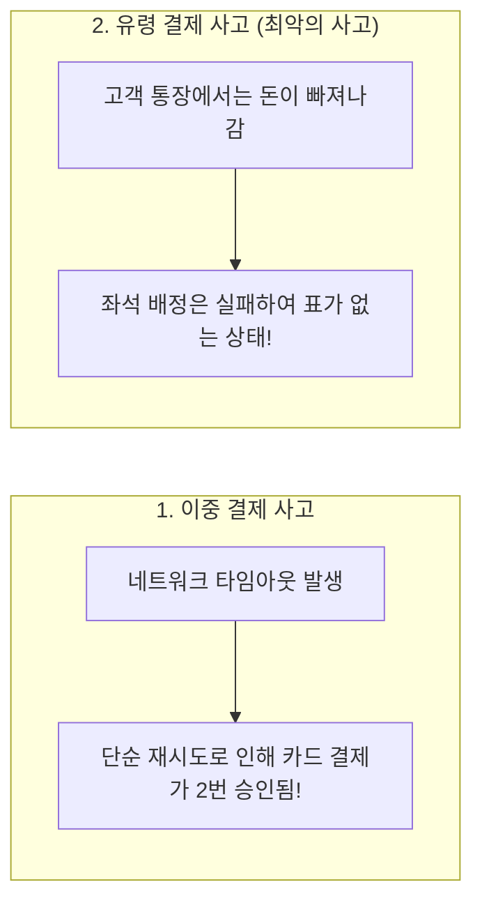
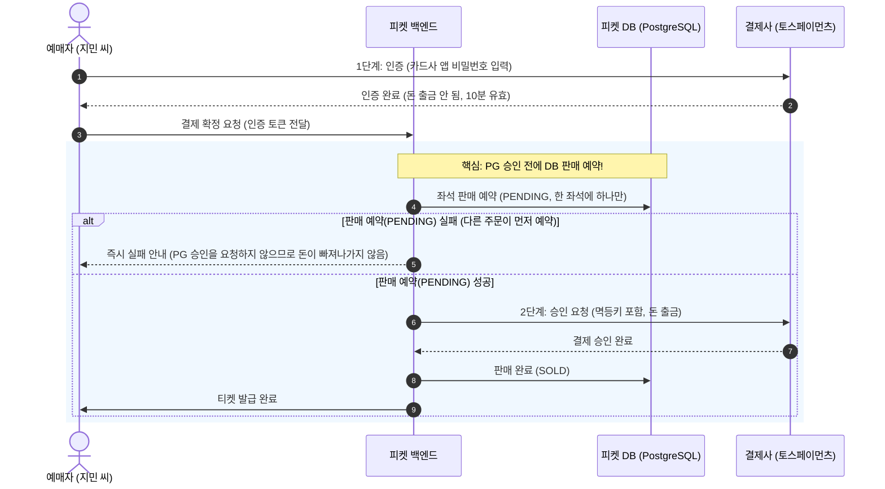
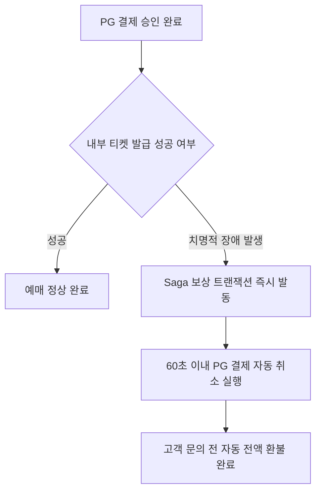

# 5. 결제

> [← 4편: 좌석 고르기와 홀드](04-seat-hold.md) | [목차로 돌아가기](README.md) | [6편: 모바일 티켓과 공연장 입장 →](06-ticket-and-gate.md)

---

## 1. 상황: 3초 안에 끝나는 결제, 그 뒤의 두 가지 치명적 공포

지민 씨가 좌석 2자리를 홀드한 후 결제하기 버튼을 누른다. 카드사 본인인증 팝업창이 뜨고 간편결제 비밀번호를 입력하자, **0.15초 만에 `"결제가 안전하게 접수되었습니다"`**라는 알림이 뜬다. 이어 **3초 이내에 `"결제가 정상 완료되어 티켓이 발급되었습니다"`**라는 안내와 함께 완료 화면으로 전환된다.

이 짧은 순간에 티켓팅 시스템이 가장 경계하는 치명적인 결제 사고는 두 가지다.

---

## 2. 왜 어려운가: 통제 불가능한 외부 금융망과의 사투

결제 연동이 기술적으로 가장 까다로운 이유는 시스템의 통제권이 외부 결제 대행사(PG사)에 있기 때문이다.

| 핵심 난제 | 원인과 아키텍처적 위험 | 피켓의 해결책 |
| :--- | :--- | :--- |
| **1. 통제 불가능한 외부 PG사 네트워크** | 승인 요청 후 타임아웃 발생 시 실제 결제 여부 불명확. 재시도하면 이중 결제, 포기하면 고객 돈 묶임 | **헤더 멱등키 (Idempotency Key)** & **3시간 내 한정 재시도** |
| **2. 이종 데이터 저장소 간의 불일치** | '좌석 소유권'은 자체 DB에, '돈'은 외부 카드사에 있어 단일 트랜잭션으로 묶을 수 없음 | **DB 판매 예약(PENDING) 후 PG 승인** & **60초 자동 보상 취소 (Saga)** |
| **3. 피크 타임 초당 300건의 트래픽** | 오픈 직후 결제 요청 폭주. 느린 PG사 응답을 동기식으로 기다리면 웹 서버 스레드 즉시 고갈 | **접수(0.15초)와 확정(3초)의 비동기 분리** & **Long Polling** |

---

## 3. 어떻게 푸는가: 7대 금융 정합성 엔지니어링

### ① 국내 PG사의 '인증-승인 2단계 분리 구조'를 역이용한다

토스페이먼츠나 포트원 같은 국내 결제 대행사는 결제 프로세스를 명확히 두 단계로 구분한다 ([ADR-0029](../docs/adr/0029-pg-adapter-toss-default-portone-compatible.md)).

* **1단계: 인증 (사용자 브라우저)**: 카드사 앱/비밀번호로 서명만 하며 실제 돈은 출금되지 않습니다 (10분 유효).
* **2단계: 승인 (피켓 백엔드)**: 서버가 PG사에 최종 승인을 요청하는 순간 돈이 빠져나갑니다.

> [!IMPORTANT]
> **유령 결제를 막는 핵심 역발상**  
> 피켓은 사용자 인증이 끝나면, **PG사에 승인을 요청하기 전에 자체 데이터베이스에 좌석 판매 예약(PENDING)을 먼저 기록**합니다. 한 좌석에는 유효한 예약이 하나만 들어갈 수 있어, 같은 좌석을 노린 주문 가운데 하나만 성공합니다.  
> 만약 판매 예약에 실패하면 **PG사 승인 API 자체를 아예 호출하지 않고 즉시 종료**합니다. 따라서 좌석 경쟁에서 져서 *"돈은 빠져나갔는데 좌석은 없는 상태"*가 되는 일은 생기지 않습니다. 승인이 끝나면 예약을 판매 완료(SOLD)로 바꾸고 티켓을 발급합니다. 승인 뒤 발권이 실패하는 드문 경우에는 같은 멱등키로 결제를 자동 취소하며, 이런 어긋남이 60초 넘게 남지 않게 하는 것이 목표입니다.

---

### ② '빠른 접수(0.15초)'와 '안전한 확정(3초)'의 비동기 분리

| 단계 | 소요 시간 | 처리 내용 |
| :--- | :---: | :--- |
| **접수 단계** | **0.15초 이내** | 주문 레코드를 생성하고 사용자에게 "접수 완료"를 즉시 응답한다. 외부 PG사 통신 대기로 브라우저가 멈추지 않는다. |
| **확정 단계** | **약 3초 이내** | 백그라운드 워커가 `DB 판매 예약(PENDING) → PG사 승인 요청(타임아웃 2초) → 판매 완료(SOLD)·티켓 발행`을 순차 처리한다. 브라우저는 롱 폴링(Long Polling, 최대 30초)으로 진행 상황을 수신한다. |

외부 카드사 응답이 일시적으로 지연되더라도 접수 창구는 초고속으로 열려 있으며, 사용자는 튕김 현상 없이 안심하고 결제 완료를 기다릴 수 있습니다.

---

### ③ 이중 결제를 방지하는 고유 번호표: 멱등키 (Idempotency Key)

* 모든 승인 요청 헤더에는 주문 번호 기반으로 생성된 유일무이한 **멱등키**를 붙여 전송합니다.
* 네트워크 일시 단절로 응답을 받지 못해 피켓 서버가 동일한 요청을 재전송하더라도, PG사는 멱등키를 대조하여 *"이미 처리된 주문"*임을 인식하고 중복 결제 없이 기존 승인 결과를 그대로 반환합니다.
* 피켓은 토스(15일)와 포트원(3시간)의 공통 안전 기준인 **3시간 이내에서만 자동 재시도**를 수행합니다. 3시간이 지난 건은 임의로 재요청하지 않고 PG사 결제 내역 조회 API를 호출해 사실관계를 먼저 대조합니다.

---

### ④ 사후 정합성 보장: 60초 자동 보상 취소와 일일 대사 (Saga 패턴)

* **60초 자동 보상 취소**: 만약 PG사 결제 승인은 성공했는데 피켓 내부 발권 시스템에서 장애가 터지면, 사가(Saga) 패턴을 통해 **60초 이내에 해당 결제를 자동 취소(보상 트랜잭션)**합니다.
* **자정 일일 대사 (Reconciliation)**: 매일 자정, PG사의 당일 전체 거래 원장과 피켓 내부 데이터베이스 원장을 1:1로 전수 대조하여 단 1원의 오차도 남지 않도록 검증합니다.

---

### ⑤ 위조 방지: PG사 웹훅(Webhook)은 보조 수단으로만 활용

* 토스의 결제 알림 웹훅에는 위조 방지 서명이 없습니다. 따라서 피켓은 **웹훅 데이터만 믿고 주문 상태를 변경하지 않습니다**.
* 웹훅을 수신하면 반드시 피켓 서버가 PG사 정식 조회 REST API를 역호출하여 결제 진위를 최종 확인한 후 상태를 확정합니다.

---

### ⑥ 결제사 두 곳을 함께 쓰고, 결제창을 열 때마다 고른다

피켓은 **토스페이먼츠와 포트원 두 결제사를 함께 운영**합니다 ([ADR-0044](../docs/adr/0044-dual-pg-selection-and-switchover.md)). 결제사마다 API 모양이 달라서, 결제사별 '어댑터'가 각자의 API를 피켓 공통 규격으로 바꿔 줍니다 ([ADR-0029](../docs/adr/0029-pg-adapter-toss-default-portone-compatible.md)). 어느 결제사를 쓸지는 '결제사 선택기'가 정합니다. 어댑터가 통역사라면, 선택기는 이번 손님에게 어느 통역사를 붙일지 정하는 배정 담당자입니다.

지민 씨가 결제 버튼을 누르면 결제창이 열리기 직전에 결제사가 정해집니다. 평소에는 공연마다 운영자가 정해 둔 기본 결제사(보통 토스페이먼츠)의 결제창이 열립니다. 토스페이먼츠에 장애가 나면 운영자 두 명이 승인해 '결제사 전환'을 켜고, 그 뒤로 결제창을 여는 사람은 포트원 결제창을 받습니다.

| 순간 | 정하는 것 | 이유 |
| :--- | :--- | :--- |
| 결제창을 열기 직전 | 이번 결제를 어느 결제사로 할지 | 결제창 인증이 그 결제사에서 이루어지기 때문입니다 |
| 결제창을 닫고 다시 시도할 때 | 그 순간의 규칙으로 다시 고릅니다 | 승인 요청 전에는 돈이 움직이지 않아 결제사를 바꿔도 안전합니다 |
| 결제 접수 뒤 | 바꾸지 않습니다. 승인·조회·취소·환불은 모두 같은 결제사로 갑니다 | 같은 구매가 두 결제사에서 승인되면 이중 결제가 되기 때문입니다 |

> [!NOTE]
> **시스템이 인정하는 솔직한 한계**
> 1. **포트원 공연은 느릴 수 있습니다**: 포트원이 받아 줄 수 있는 양을 채널 하나에 초당 50건으로 낮게 잡았습니다. 그래서 포트원으로 결제하는 공연은 한 번에 입장하는 인원이 약 830명으로 줄고, 판매가 토스 공연보다 약 6배 느릴 수 있습니다.
> 2. **전환은 사람이 승인합니다**: 장애를 알아채고 두 사람이 승인하는 동안 새 결제가 잠시 멈춥니다. 그동안 주문서까지 온 사람의 홀드 시간은 멈췄다가 다시 열리면 이어 셉니다(ADR-0085).
> 3. **전환 직전에 결제창을 연 사람**: 그 결제창에서 실패할 수 있습니다. 같은 주문에서 다시 시도해야 하고, 좌석을 잡아 둔 시간이 지나면 좌석을 잃습니다.

실제 결제사 샌드박스의 호출 제한(토스 분당 100건)을 고려해, 대규모 부하 검증(k6)은 고성능 가짜 결제기(Mock PG) 환경에서 수행합니다. 가짜 결제기는 토스형과 포트원형 두 가지로 띄워 결제사 전환도 연습합니다.

---

### ⑦ 결제 회사의 TPS 한계와 대기 큐 안전 마진

토스페이먼츠가 실제 운영에서 초당 몇 건을 받아 주는지는 비공개이므로, 피켓은 **초당 300건으로 보수적 추정**하고 100건밖에 못 받는 극한 상황도 시험합니다 ([ADR-0036](../docs/adr/0036-external-limits-estimates.md)). 포트원은 채널 하나에 초당 50건으로 잡고, 포트원으로 결제하는 공연은 그만큼 한 번에 입장하는 인원을 줄입니다.  
초과된 승인 요청은 10분 기한 내에서 안전하게 큐에 대기하며, 기한을 넘기면 결제를 승인하지 않고 안전 종료되므로 금전 사고는 0건으로 통제됩니다.

---

## 4. 결제 핵심 운영 규칙

| 운영 규칙 | 상세 내용 |
| :--- | :--- |
| **결제 금액 서버 단독 검증** | 클라이언트가 전달한 결제 금액을 일절 신뢰하지 않는다. 서버가 좌석 정가와 할인 정책으로 금액을 직접 계산하여 1원이라도 다르면 즉시 결제를 거부한다(별도 예매 수수료는 받지 않는다). |
| **카드 정보 무저장 원칙 (PCI-DSS)** | 카드 번호, CVC, 비밀번호 등 민감 금융 정보는 PG사의 보안 결제창에서만 입력된다. 피켓 서버에는 카드 정보가 절대 전송되거나 저장되지 않는다. |
| **피크 타임 무통장(가상계좌) 차단** | 접속이 크게 몰리는 고수요 공연은 무통장 입금(가상계좌)을 아예 끄고, 일반 공연에서만 허용한다(공연 등록 때 '가상계좌 허용'으로 정한다). 입금 대기 시간 동안 좌석이 잠겨 전체 회전율이 떨어지는 문제를 방지하기 위함이다. |
| **환불 계좌 정보 미보관** | 가상계좌(무통장 입금) 결제를 취소할 때 받는 환불 계좌 정보는 DB에 저장하지 않고 PG사 취소 API 파라미터로 즉시 넘겨 처리한다. 환급을 바로 할 수 없을 때(입장 시작 뒤 취소라 입장 기록 마감 뒤 환급, 결제사 장애로 다시 시도)는 계좌를 미리 받아 두지 않고 환급할 때 알림으로 다시 받는다. 계좌번호를 잠시라도 보관하면 암호화해 지켜야 할 정보가 하나 더 생기기 때문이다([ADR-0050](../docs/adr/0050-crypto-corrections-and-key-management.md)). |
| **PG사 전면 장애 비상 절차** | 결제사 장애 발생 시 동일 멱등키로 대기 큐에 보류하고, 좌석 홀드 시간을 그 결제의 승인 기한(결제창 인증 뒤 10분)까지 자동으로 늘린다(2026-10-20 추천 적용, ADR-0073). 승인 기한 10분을 넘긴 건은 승인하지 않고 안전 종료한다. 그동안 새 결제 진입은 잠시 멈추고, 주문을 만들었지만 아직 결제 접수 전인 홀드는 남은 시간을 세지 않다가 다시 열리면 이어 센다(그 구매 세션의 최대 체류 시각까지, 2026-10-22 소유자 결정, ADR-0085). 시스템이 지연될지언정 금전 사고는 0건을 엄수한다. 장애가 이어지면 운영자 두 명이 승인해 새 결제를 다른 결제사로 돌린다. 이미 접수된 결제는 원래 결제사에서 끝낸다. |

---

## 5. 한 줄 요약

> **좌석 판매 예약(PENDING)을 데이터베이스에 먼저 기록한 후에만 외부 PG사에 결제 승인을 요청하고, 모든 요청에 고유 멱등키를 부여해 이중 결제를 차단하며, 예외 상황 발생 시 60초 이내에 자동 보상 취소로 안전하게 복구한다.**

---

## 더 알아보기

* [docs/features/payment.md §2, §3](../docs/features/payment.md): 결제 트랜잭션 시퀀스 및 상태 머신 전이도
* [docs/features/payment.md §4](../docs/features/payment.md), [POL-013](../planning/03-policies-glossary.md): 20가지 결제 실패 시나리오별 보상 및 과금 처리 정책
* [docs/features/payment.md §5](../docs/features/payment.md): PG사 웹훅 수신 및 멱등 검증 절차
* [docs/features/payment.md §8](../docs/features/payment.md): 일일 정산 및 결제 원장 대사(Reconciliation) 배치 설계
* [ADR-0029](../docs/adr/0029-pg-adapter-toss-default-portone-compatible.md): 토스페이먼츠 및 포트원 결제 어댑터 표준화 결정
* [docs/features/payment.md §2.2](../docs/features/payment.md), [ADR-0044](../docs/adr/0044-dual-pg-selection-and-switchover.md): 결제사 선택·고정·전환 규칙과 솔직한 한계
* [ADR-0036](../docs/adr/0036-external-limits-estimates.md): 결제 대행사 TPS 한계 추정과 안전 마진 설계
