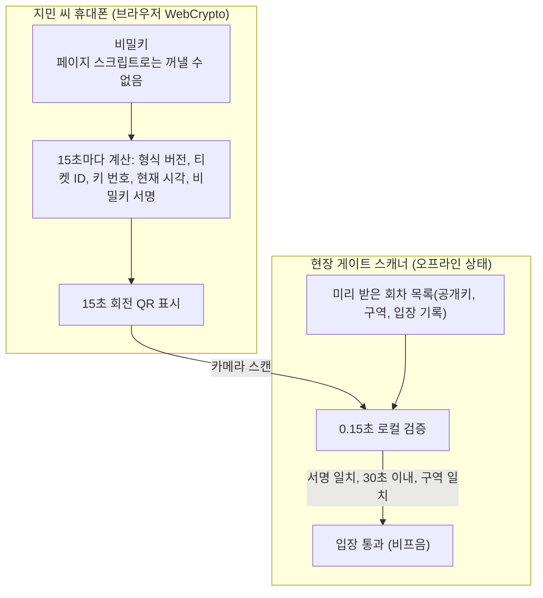
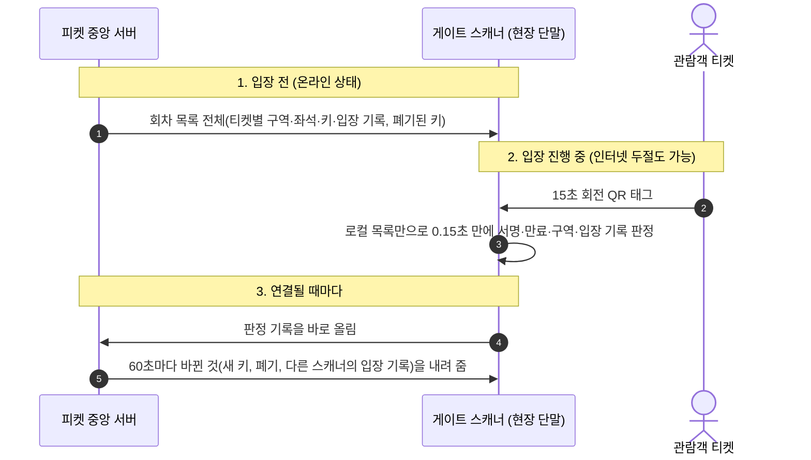
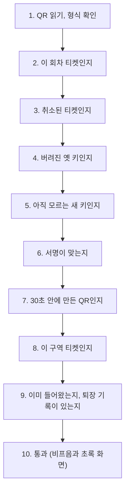

# 6. 모바일 티켓과 공연장 입장

> [← 5편: 결제](05-payment.md) | [목차로 돌아가기](README.md) | [7편: 양도·취소·환불 →](07-transfer-cancel-refund.md)

---

## 1. 상황: 통신이 끊긴 5만 명의 현장, 0.15초 만에 울리는 통과 비프음

결제가 완료되자 지민 씨의 마이 티켓에 티켓이 생긴다. 지민 씨는 공연 전날 휴대폰으로 티켓을 열어 **'이 휴대폰을 입장용으로 등록'** 버튼을 누른다. 그때부터 티켓 화면의 QR 코드는 **15초마다 새로운 모양으로 바뀐다**.

공연 당일, 수만 명이 모인 공연장 입구는 기지국이 붐벼 인터넷이 거의 터지지 않는다. 하지만 지민 씨의 QR은 인터넷 없이도 15초마다 새로 만들어지고, 게이트의 스캐너는 **0.15초(150ms) 만에 비프음과 함께 "입장 통과" 화면**을 띄운다.

같은 시각 게이트 뒤편에서는 아르바이트생 도윤 씨가 스캐너를 켠다. 도윤 씨는 며칠 전 파트너(기획사)가 보낸 초대 메일을 자기 피켓 계정으로 받아 두었다. 스캐너 화면의 QR을 자기 휴대폰 카메라로 찍고, 두 화면의 확인 코드가 같은 것을 본 뒤 '승인'을 누르자 스캐너가 도윤 씨 이름으로 일을 시작한다.

---

## 2. 왜 어려운가: 오프라인 게이트의 다섯 가지 난제

| 핵심 난제 | 원인과 위협 | 피켓의 해결책 |
| :--- | :--- | :--- |
| **1. 티켓 캡처(스크린샷) 복제** | 정지된 이미지 QR은 스크린샷 한 장으로 여러 명이 돌려보며 들어갈 수 있다 | **휴대폰 안의 키로 서명한 15초 회전 QR** & **30초가 지나면 무효** |
| **2. 현장 통신 두절** | 기지국이 마비되면 중앙 서버에 물어볼 수 없어 게이트가 멈춘다 | **입장 전에 회차 목록을 미리 받아 두고** **0.15초 오프라인 단독 판정** |
| **3. 스캐너 단말기 도난·분실** | 단말기 안에 위조용 비밀이 들어 있다면 분실 때 대량 위조가 된다 | **스캐너에는 공개키만 둔다** & **운영자가 기기를 바로 폐기** |
| **4. 같은 티켓으로 두 번 입장** | 서로 모르는 스캐너 두 대가 같은 티켓을 통과시킬 수 있다 | **구역 분리** & **다른 스캐너의 입장 기록 공유** & **기록이 올라오면 서버가 찾아냄** |
| **5. 하루만 일하는 현장 인력** | 수백 명에게 비밀번호를 나눠 주면 새고, 누가 들여보냈는지 모른다 | **본인 계정으로 초대 수락** & **휴대폰으로 스캐너 승인** |

---

## 3. 어떻게 푸는가

### ① 비밀 서명키는 휴대폰 브라우저 안에서 만들고 밖으로 보내지 않는다

지민 씨가 휴대폰에서 '이 휴대폰을 입장용으로 등록'을 누르는 순간, 브라우저 안에서 서명용 열쇠 한 쌍(비밀키와 공개키)이 생긴다 ([ADR-0025](../docs/adr/0025-rotating-qr-device-key-signature.md), [ADR-0051](../docs/adr/0051-gate-process-end-to-end.md)).

* **비밀키**: 브라우저의 암호 기능(WebCrypto)으로 만들고, 페이지 스크립트가 꺼낼 수 없게(`extractable=false`) 표시해 브라우저 저장소(IndexedDB)에 둡니다. 피켓 서버로는 보내지 않습니다. 다만 휴대폰의 하드웨어 보안 칩에 들어가는 것은 아니어서, 브라우저 프로필을 통째로 복사하면 함께 옮겨집니다.
* **공개키**: 피켓 서버로 보내 그 티켓의 검증용으로 등록합니다. QR에는 어떤 공개키로 검증할지 알려 주는 짧은 **키 번호**가 함께 들어가서, 스캐너가 '양도·취소로 버려진 옛 QR'과 '위조된 QR'을 나눠 알려 줍니다.
* **왜 버튼을 눌러야 만드나**: PC로 예매하고 PC에서 티켓을 열었을 때 키가 PC에 생기면, 공연 당일 휴대폰으로 처음 열 때 '다시 받기'가 되어 횟수 제한에 걸립니다. 그래서 키는 입장할 휴대폰에서 버튼을 눌러야만 만들고, PC로 보이면 "입장 QR은 휴대폰에서 등록하세요"를 먼저 보여 줍니다. 아이폰은 홈 화면에 추가한 피켓 앱에서 등록하라고 안내합니다.
* 서명을 만들려면 그 브라우저 속 비밀키가 있어야 합니다. 그래서 **스크린샷이나 키가 없는 다른 기기로는 새 QR을 만들 수 없습니다**. 막지 못하는 경우는 아래 '솔직한 한계'에 적었습니다.

> [!NOTE]
> **시스템이 인정하는 솔직한 한계(티켓 키)**
> 1. **키가 하드웨어에 있지 않습니다**: 루팅한 휴대폰이나 컴퓨터의 브라우저 프로필을 통째로 복사하면 키도 함께 옮겨집니다. 키를 하드웨어 보안 칩에 넣는 일은 설치형 앱에서만 되는데, 피켓은 설치 없이 쓰는 웹앱(PWA)을 택해서 하지 않습니다.
> 2. **화면을 실시간으로 보여 주면 통과합니다**: 영상통화나 화면 공유로 QR을 중계하면 늘 새 QR이 보이기 때문입니다.
> 3. **계정째 넘기면 막지 못합니다**: 계정을 넘겨받은 사람이 입장 시작 전에 티켓을 다시 받으면 새 키가 그 사람 기기에 생깁니다. 판매자가 입장용 휴대폰을 한 번도 등록하지 않은 채 계정을 넘기면, 산 사람의 첫 등록은 다시 받기 제한이나 부스를 거치지 않습니다. 다시 받는 횟수 제한과 알림(⑤)으로 줄일 뿐입니다.
>
> 이런 경우는 다른 스캐너의 입장 기록 공유, 서버의 이상 표시와 현장 확인(④)으로 대응합니다 ([ADR-0050](../docs/adr/0050-crypto-corrections-and-key-management.md), [ADR-0051](../docs/adr/0051-gate-process-end-to-end.md)).

---

### ② 캡처된 스크린샷은 30초가 지나면 무효화된다

* 스캐너는 QR 코드에 담긴 생성 시각이 스캐너 자체 시계 기준으로 **앞뒤 30초 이내일 때만 입장을 승인**합니다 ([POL-018](../planning/03-policies-glossary.md)).
* 스크린샷은 찍은 뒤 30초가 지나면 스캐너가 거절하므로 나중에 돌려 쓸 수 없습니다. 다만 찍자마자 바로 넘기면 그 창 안에서는 통할 수 있습니다. 같은 티켓이 두 번 들어오는 것은 스캐너끼리 나누는 입장 기록과 서버의 사후 판정(중복 입장 이상 표시)으로 잡습니다.
* 휴대폰과 스캐너는 인터넷이 될 때 서버 시계와의 차이를 재 두고 그만큼 보정합니다.
* 웹에서는 화면 밝기를 앱이 마음대로 올릴 수 없어서, 밝기를 올리라고 안내하고 QR을 보이는 동안 화면이 꺼지지 않게만 합니다.

---

### ③ 스캐너는 미리 받아 두고, 현장에서는 혼자 판정하고, 서로의 입장 기록을 나눈다

* 스캐너는 화면이 켜져 있는 동안 60초마다 바뀐 것을 받습니다. 휴대폰 브라우저의 '주기적 백그라운드 동기화' 기능은 크롬에서 최소 간격이 12시간이라 쓰지 않습니다.
* 바뀐 것에는 **다른 스캐너가 들여보낸 기록**도 들어 있습니다. 두 스캐너가 모두 인터넷이 되면 1~2분 안에 서로의 입장을 알게 되어, 같은 티켓을 두 번째로 찍으면 "이미 입장한 티켓입니다(19:02, 동문)"로 막습니다.
* 받은 목록에는 이름이나 연락처가 없습니다. 티켓 번호, 구역, 좌석 표시, 키, 입장 기록뿐입니다.

> [!NOTE]
> **스캐너 단말기를 잃어버리면**
> 스캐너에는 공개키만 있어서, 단말기를 잃어버려도 그 안의 정보로는 가짜 QR을 만들 수 없습니다. 운영자가 관제 콘솔에서 그 기기를 폐기하면, 그 기기의 다음 요청부터 막히고 로그인해 있던 스태프도 로그아웃됩니다. 다만 그 기기에 남아 있던, 아직 올리지 못한 입장 기록은 잃습니다.

---

### ④ 같은 티켓으로 두 번 들어오는 것: 나누고, 공유하고, 찾아내고, 확인한다

1. **구역 나누기**: 모든 티켓에는 들어갈 게이트 구역(예: 동문)이 정해져 있습니다. 다른 구역 스캐너에서 찍으면 거부하고 맞는 문을 알려 줍니다. 스캐너가 어느 구역을 맡을지는 현장 책임자나 파트너만 정할 수 있어서, 서로 다른 문의 스캐너를 같은 구역으로 잘못 두는 일을 줄입니다.
2. **입장 기록 공유**: 인터넷이 되는 스캐너끼리는 1~2분 안에 서로의 입장 기록을 받아, 두 번째 입장을 그 자리에서 막습니다.
3. **서버가 찾아내기**: 인터넷이 끊긴 스캐너 두 대가 서로 모르고 같은 티켓을 통과시켰다면, 두 기록이 모두 서버에 올라오는 순간 서버가 '중복 입장' 표시를 붙입니다. 기록마다 '판정할 때 서버 기록을 어디까지 알고 있었는지'가 남아서, 몰랐던 것인지 알고도 통과시킨 것인지도 가립니다. 올라오지 않은 기록(잃어버린 기기 등)은 찾지 못합니다.
4. **현장에서 확인하기**: 이상 표시는 그 구역 현장 책임자의 스캐너와 파트너 콘솔로 갑니다. 책임자가 좌석으로 가서 관객의 QR을 **확인 스캔**(입장 기록을 남기지 않는 스캔)으로 보고, 결과를 '정상 확인', '부정 의심', '판단 불가' 중 하나로 남깁니다. 내보낼지는 파트너의 현장 규정을 따릅니다. 관제는 지켜보기만 합니다.
5. **재입장**: 재입장이 허용된 공연은 퇴장 스캔 뒤에만 다시 들어올 수 있습니다. 퇴장은 '퇴장 모드'로 둔 스캐너에서 찍고, 이 기록도 다른 스캐너와 공유되어서 퇴장한 문과 다시 들어오는 문이 달라도 정상으로 봅니다.

---

### ⑤ 아이폰 사파리의 7일 저장소 삭제와 다시 받기

애플 사파리는 7일 동안 방문하지 않은 사이트의 저장소를 비울 수 있습니다(ITP). 공연 당일 티켓 키가 지워지는 일을 줄이려고 다음을 합니다:
* **홈 화면에 추가(PWA)**: 예매 직후 홈 화면에 피켓을 추가하라고 권합니다. 애플은 홈 화면에 추가한 웹앱의 데이터는 지워질 것으로 보지 않는다고 밝혔습니다.
* **공연 전 안내**: 공연 전날과 당일 아침에 알림톡을 보내 입장 시작 전에 티켓을 열어 보게 합니다. 열어 보는 것만으로 키를 새로 만들지는 않습니다. 입장 시작 24시간 전까지 입장용 휴대폰을 등록하지 않았다면 등록하라는 안내도 보냅니다.
* **다시 받는 규칙** ([ADR-0050](../docs/adr/0050-crypto-corrections-and-key-management.md)):
  * 입장 시작 전에는 가입할 때 쓴 소셜 계정으로 다시 로그인한 뒤 받습니다. 티켓 한 장에 24시간에 한 번까지이고, 다시 받으면 계정 이메일과 이전 기기로 알림이 갑니다.
  * 입장이 시작된 뒤에는 지갑에서 다시 받을 수 없고 **현장 부스**로 갑니다(⑧).
  * '24시간에 한 번'과 '부스 재발급이 관람객의 0.5%를 넘으면 기준을 다시 본다'는 운영해 보기 전에 정한 잠정값입니다.
* **로그아웃해도 키는 남겨 둡니다**: 지우면 다시 받아야 하고 횟수 제한에 걸리기 때문입니다. 여럿이 쓰는 기기라면 로그아웃할 때 '이 기기의 입장 키 지우기'를 고르면 됩니다.

---

### ⑥ 현장 스태프: 아이디·비밀번호 없이, 내 휴대폰으로 스캐너에 로그인한다

**장면**: 공연 당일 오후 1시 30분, 도윤 씨가 동문 입구의 스캐너 '동문-03' 앞에 섭니다. 화면 맨 위에는 '현장 스태프 로그인'이라고 쓰여 있지만 아이디나 비밀번호를 넣는 칸은 없습니다. 대신 큰 QR 하나와 'WDJB-MJHT' 같은 확인 코드, 그리고 세 줄짜리 안내가 보입니다. 도윤 씨는 자기 휴대폰 카메라로 QR을 찍습니다. 휴대폰 브라우저에 피켓의 '스캐너 승인' 화면이 열리고, 거기에도 같은 확인 코드와 '동문-03'이라는 기기 이름이 보입니다. 두 코드가 같은 것을 확인하고 [동문-03에 로그인 승인]을 누르자, 5초 안에 스캐너 화면이 '로그인했습니다'로 바뀌고 근무 준비가 시작됩니다.

**왜 비밀번호가 없나요?** 스캐너는 하루에도 여러 사람이 돌려 쓰는 공용 기기입니다. 비밀번호를 쓰면 옆 사람이 입력하는 손을 엿볼 수 있고, 바쁜 현장에서는 비밀번호를 서로 알려 주게 되며, 기기에 비밀번호가 남을 수도 있습니다. 그래서 스캐너에는 아무것도 입력하지 않고, 이미 본인확인을 마친 '내 휴대폰의 피켓 계정'으로 승인합니다. 스마트 TV처럼 글자를 넣기 불편한 기기를 휴대폰으로 로그인시킬 때 쓰는 인터넷 표준(RFC 8628)의 방식입니다. 승인으로 받은 로그인 증표는 그 스캐너의 기기 키에 묶여 있어, 증표만 빼내 다른 기기에서 쓰면 서버가 받지 않습니다. 기기 키는 스캐너를 처음 등록할 때 스캐너 안에서 만들고, 스캐너는 요청을 보낼 때마다 이 키로 서명한 짧은 증명(DPoP라는 인터넷 표준)을 함께 보냅니다. 처음에는 기기 인증서(mTLS)를 쓰려 했지만, 스캐너 화면과 서버 주소가 달라 브라우저가 먼저 보내는 허락 요청(사전 요청)에 인증서를 싣지 않는 웹 표준 규칙 때문에 기본안을 바꿨습니다(기술 검토 중간-057) ([ADR-0030](../docs/adr/0030-gate-staff-event-scoped-role-device-approval.md), [ADR-0051](../docs/adr/0051-gate-process-end-to-end.md)).

로그인까지는 여덟 단계입니다. 앞의 셋은 공연 며칠 전에, 나머지는 공연 당일에 합니다.

| 단계 | 언제 | 어디서 | 무엇을 하나 | 화면 |
| :--- | :--- | :--- | :--- | :--- |
| ① 초대 보내기 | 공연 며칠 전 | 파트너 사무실(파트너 콘솔) | 파트너가 도윤 씨 이메일로 회차 초대를 보낸다 | SCR-037 |
| ② 초대 받기 | 공연 며칠 전 | 도윤 씨 휴대폰 | 초대 메일의 링크를 열어 휴대폰 본인확인과 이메일 일치를 거치고, 동의 두 가지를 한 뒤 받는다 | SCR-050 |
| ③ 배정 확인 | 공연 며칠 전 | 도윤 씨 휴대폰 | '내 현장 배정'에서 회차와 근무 시간을 확인한다 | SCR-061 |
| ④ 스캐너 앱 열기 | 당일 입장 시작 3시간 전(13:30)부터 | 스캐너(공용 기기) | 운영자가 등록한 스캐너의 로그인 화면이 QR과 확인 코드를 띄운다 | SCR-036 |
| ⑤ QR 찍기 | 당일 | 도윤 씨 휴대폰 | 휴대폰 카메라로 QR을 찍으면 스캐너 승인 화면이 열린다 | SCR-051 |
| ⑥ 코드 대조와 승인 | 당일 | 도윤 씨 휴대폰 | 두 화면의 확인 코드가 같은지 보고 [로그인 승인]을 누른다 | SCR-051 |
| ⑦ 근무 준비 | 당일 | 스캐너 | 5초 안에 '로그인했습니다'로 바뀌고 구역 확인·목록 받기·시계 맞추기를 한다 | SCR-033 |
| ⑧ 스캔 시작 | 당일 | 스캐너 | 관객의 회전 QR을 찍기 시작한다 | SCR-034 |

* **승인 화면은 내 휴대폰에 뜹니다**: 스캐너 승인 화면은 스캐너의 QR을 찍은 그 휴대폰에서 열립니다. 현장 책임자(팀장)의 계정에 저절로 뜨는 화면이 아닙니다. 휴대폰에서 피켓에 로그인돼 있지 않으면 먼저 로그인하고, 로그인이 끝나면 같은 화면으로 돌아와 이어 갑니다.
* **코드가 바뀌거나 거부했을 때**: 확인 코드는 5분마다 새로 바뀝니다. 바뀌면 스캐너에 '확인 코드가 바뀌었습니다. 휴대폰에서 QR을 다시 찍어 주세요'가 나옵니다. 휴대폰에서 [거부]를 누르면 스캐너가 새 코드를 띄웁니다. 두 코드가 다르면 승인하지 않습니다. 남의 기기를 내 계정으로 승인하게 만드는 속임수를 줄이려고 코드를 맞춰 보게 하는 것입니다.
* **로그인이 끝나는 때**: 근무 시간이 끝났을 때, 파트너가 권한을 해제했을 때, 운영자가 기기를 폐기했을 때, 다음 사람이 같은 스캐너에서 승인했을 때(교대), 같은 계정으로 다른 스캐너를 승인했을 때, 휴대폰의 '로그인된 기기'에서 끝냈을 때, 계정을 탈퇴했을 때입니다. 스캐너에는 '근무 시간이 끝나 로그아웃되었습니다'처럼 끝난 이유가 나옵니다.

과정마다의 규칙은 이렇습니다.

1. **초대 받기**: 파트너가 회차별로 이메일 초대를 보냅니다(한 번에 여러 명). 도윤 씨는 휴대폰 본인확인을 마친 자기 피켓 계정으로 받는데, 계정의 확인된 이메일(구글·카카오)이 초대 이메일과 같아야 합니다. 그래서 초대 링크가 다른 사람에게 전달돼도 그 사람은 받을 수 없습니다. 받을 때 두 가지에 따로 동의합니다: 피켓이 배정과 스캔 기록에 계정을 남기는 것, 파트너에게 닉네임·역할·스캔 건수를 보여 주는 것.
2. **스캐너 승인**: 운영자가 등록해 둔 스캐너가 QR과 8자 확인 코드(예: WDJB-MJHT)를 띄웁니다. 도윤 씨가 휴대폰 카메라로 QR을 찍으면 기기 이름과 같은 확인 코드가 보이고, 두 화면이 같을 때 '승인'을 누릅니다. 오늘 맡은 공연이 둘이면(낮·저녁) 여기서 고릅니다.
3. **근무 준비**: 스캐너는 책임자가 정해 둔 구역과 모드(입장·퇴장)를 확인하고, 회차 목록을 다 받고, 시계를 맞춘 뒤 '준비 완료'를 알립니다. 구역이 정해지지 않았으면 스캔을 시작하지 않습니다.
4. **교대와 끝**: 다음 사람이 같은 스캐너에서 승인하면 앞사람은 자동으로 로그아웃됩니다. 권한은 입장 시작 3시간 전부터 공연 종료 2시간 뒤까지만이고, 그때가 되면 스캐너가 스스로 로그아웃합니다. 로그아웃해도 아직 올리지 못한 기록은 남아 있다가 연결되면 올라갑니다.
5. **해제**: 파트너가 도윤 씨의 배정을 해제하면, 그 스캐너의 다음 요청부터 서버가 거부합니다. 인터넷이 끊긴 스캐너에는 연결될 때까지 반영되지 않지만, 그사이 찍은 기록은 '세션 밖 기록'(로그인 시간 밖에 찍은 기록)으로 표시됩니다.
6. **대리 승인**: 도윤 씨 휴대폰 배터리가 나갔다면 현장 책임자 하늘 씨가 자기 휴대폰으로 같은 QR을 찍고, 승인 화면에서 '휴대폰 없는 스태프 대신 승인'을 켠 뒤 승인합니다. 이때 그 스캐너는 '하늘 씨 계정의 대리 승인(일반 스태프 권한)'으로 로그인됩니다. 계정은 하늘 씨 것이지만 권한은 일반 스태프로 낮아져 책임자 권한이 넘어가지 않고, 그 스캐너로 찍은 기록도 하늘 씨 이름으로 남습니다. 스캐너는 실제로 기기를 들고 찍는 사람이 도윤 씨라는 것을 모릅니다. 스캐너 화면에는 '로그인했습니다 · 하늘(현장 책임자)의 대리 승인 · 일반 스태프 권한 · 22:00까지'처럼 대리 승인이라는 것과 승인한 사람이 함께 보입니다.

스캐너 화면에는 관람객의 이름이나 연락처가 나오지 않습니다. 판정 결과, 좌석, 구역만 보입니다.

---

### ⑦ 공연 당일 하루

| 언제 | 누가 | 무엇을 |
| :--- | :--- | :--- |
| 며칠 전 | 운영자, 파트너 | 운영자가 스캐너 기기를 등록해 파트너에 배정한다. 파트너가 스태프를 초대하고 기기마다 구역을 정한다 |
| 입장 3시간 전부터 | 현장 스태프 | 스캐너를 휴대폰으로 승인하고 근무 준비를 마친다 |
| 입장 30분 전쯤 | 현장 책임자 | 모든 스캐너의 준비, 예비 기기, 부스 회선을 확인한다 |
| 입장 시작 | 시스템 | 티켓을 돌려주거나 양도를 받는 일을 막는다. 들어간 뒤 돌려줘서 한 장에 두 명이 들어가는 길을 닫기 위해서다 |
| 입장 중 | 스태프, 책임자 | 찍고, 이상 표시를 확인하고, 부스와 예외 통과를 처리한다 |
| 공연 종료 2시간 뒤 | 시스템 | 스태프 권한이 끝나고 남은 기록이 올라온다 |
| 그 뒤 하루 안 | 시스템 | 모든 스캐너의 기록이 모이면 '입장 기록 마감'을 하고, 입장 뒤 취소한 티켓 가운데 들어오지 않은 것을 환불한다 |

스캐너가 몇 대 필요한지는 '가장 붐비는 구간에 1분에 오는 사람 수 ÷ 스캐너 한 대가 1분에 처리하는 사람 수 × 1.2(예비)'로 정합니다. 예를 들어 5만 명 중 절반이 마지막 30분에 오면 1분에 약 830명이고, 한 명에 3~4초가 걸리면 스캐너 한 대가 1분에 15~20명이라 42~56대에 예비(1.2배)를 더합니다. 한 명에 걸리는 시간은 실제로 재 보기 전의 예시입니다.

---

### ⑧ 현장 예외: 부스, 예외 통과, 확인 스캔

* **부스 재발급**: 입장이 시작된 뒤 휴대폰의 티켓 키가 지워진 관객은 부스로 갑니다. 관객이 자기 휴대폰 피켓에서 '부스 재발급'을 누르고 대조에 동의한 뒤 휴대폰 본인확인을 다시 하면, 그 결과가 티켓 주인 계정과 같을 때만 부스 코드 QR이 나옵니다. 책임자가 그 QR을 스캐너로 찍으면 10분 안에 관객 휴대폰에서 새 키를 등록할 수 있습니다. 이름을 화면에 보여 줄 필요가 없고, 양도받은 사람도 같은 방법으로 됩니다.
* **예외 통과**: QR을 확인할 수 없는 관객(휴대폰 방전 등)은 책임자만 들여보낼 수 있습니다. 좌석 표시로 스캐너 안 목록에서 티켓을 찾고, 이유를 고르고 짧은 메모를 남깁니다. 모든 예외 통과는 나중에 CS가 다시 봅니다. 예전의 '티켓 번호 직접 입력'은 번호만 알면 들어갈 수 있어서 없앴습니다.
* **카메라 고장**: 일반 스태프는 예비 기기로 바꾸거나 책임자를 부릅니다.

---

## 4. 스캐너의 판정 순서

스캐너는 0.15초 안에 다음을 차례로 확인합니다. 판정 중에 오류가 나면 통과가 아니라 '다시 찍어 주세요'로 끝냅니다.

---

## 5. 입장 검표 핵심 운영 규칙

| 검표 규칙 | 상세 내용 |
| :--- | :--- |
| **오프라인 최우선 원칙** | 티켓 구매는 온라인 무결성이 중요하지만, 공연장 입장은 네트워크가 완전히 마비되어도 관람객 줄이 멈추지 않아야 한다. |
| **취소·양도 전파** | 티켓이 취소되거나 양도되면 옛 키는 인터넷이 되는 스캐너에 약 1분 안에 전해져 거부된다. 인터넷이 끊긴 스캐너에는 연결될 때 전해진다. |
| **입장 중 소유권 동결** | 입장이 시작되면 돌려주기·양도 받기·양도 회수를 막는다. 입장 뒤 취소는 환불을 입장 기록 마감 뒤로 미룬다. |
| **카메라 고장** | 일반 스태프는 예비 기기나 책임자 호출, 책임자는 예외 통과(좌석으로 찾고 이유를 남김). |
| **티켓 재발급 제한** | 입장 시작 전에는 소셜 계정 재로그인 뒤 티켓당 24시간에 한 번, 입장 시작 뒤에는 현장 부스에서 본인확인 대조 뒤에만 다시 발급한다. 다시 발급하면 옛 키는 바로 폐기 목록에 오른다. |
| **스태프 권한** | 구역 배치, 예외 통과, 이상 표시 처리, 부스 허용, 확인 스캔은 현장 책임자만 한다. |

> [!NOTE]
> **시스템이 인정하는 솔직한 한계(현장 입장)**
> 1. **인터넷이 끊긴 스캐너는 최근 소식을 모릅니다**: 마지막으로 받은 뒤의 양도·취소·새 키·다른 스캐너 입장을 모릅니다. 그동안 옛 QR이 통하고, 입장 직전에 등록한 새 키는 거부될 수 있습니다.
> 2. **잃어버린 스캐너의 기록은 사라집니다**: 그 기록 속의 두 번 입장이나 취소 뒤 입장은 찾지 못합니다.
> 3. **해제된 스태프도 끊긴 스캐너에서는 계속 찍을 수 있습니다**: 권한이 끝나는 시각까지입니다. 그 기록은 올라오면 표시됩니다.
> 4. **부스 회선까지 끊기면 본인 확인 없이 책임자 판단으로 들여보냅니다**: 나중에 CS가 다시 봅니다.
> 5. **두 사람이 모두 유효한 QR을 내면 좌석에서도 가리지 못합니다**: 키를 복사했거나 화면을 실시간으로 보여 준 경우입니다. '판단 불가'로 남깁니다.
> 6. **스캐너의 구역은 인터넷이 될 때만 바꿀 수 있습니다**: 끊긴 상태에서 바꿔야 하면 기기를 바꿉니다.

---

## 6. 한 줄 요약

> **티켓의 비밀키는 입장할 휴대폰에서 버튼을 눌러 만들고 15초마다 회전 QR에 서명하며(하드웨어 보관은 아니어서 화면 중계와 계정 넘기기는 남는다), 운영자가 등록한 스캐너는 현장 스태프가 휴대폰으로 승인해 쓰고, 미리 받은 목록으로 인터넷 없이 0.15초 만에 판정하며, 서로의 입장 기록을 나누고, 그래도 겹친 입장은 기록이 올라오면 서버가 찾아내 현장 책임자가 좌석에서 확인한다.**

---

## 더 알아보기

* [docs/features/offline-gate.md §0](../docs/features/offline-gate.md), [ADR-0051](../docs/adr/0051-gate-process-end-to-end.md): 공연 당일 타임라인과 스캐너 대수 산정
* [docs/features/offline-gate.md §2](../docs/features/offline-gate.md), [ADR-0025](../docs/adr/0025-rotating-qr-device-key-signature.md): 입장용 휴대폰 등록과 기기 키
* [docs/features/offline-gate.md §2, §4](../docs/features/offline-gate.md), [ADR-0050](../docs/adr/0050-crypto-corrections-and-key-management.md) 결정 1·2: 기기 키 보관의 한계와 티켓 재발급 규칙
* [docs/features/offline-gate.md §3](../docs/features/offline-gate.md), [POL-018](../planning/03-policies-glossary.md): 회전 QR 규격과 타임스탬프 허용 오차
* [docs/features/offline-gate.md §6](../docs/features/offline-gate.md): 스캐너 기기 등록, 근무 준비, 목록과 변경분, 판정 순서, 업로드
* [docs/features/offline-gate.md §7](../docs/features/offline-gate.md): 서버 판정 표, 이상 표시와 현장 확인, 입장 기록 마감
* [docs/features/offline-gate.md §9](../docs/features/offline-gate.md): 부스 재발급, 예외 통과, 확인 스캔
* [docs/features/identity.md §6.1](../docs/features/identity.md), [POL-031](../planning/03-policies-glossary.md), [ADR-0030](../docs/adr/0030-gate-staff-event-scoped-role-device-approval.md): 현장 스태프 초대 수락과 기기 승인 로그인
* [planning/04-ia-flows-screens.md](../planning/04-ia-flows-screens.md) F-09, [design/d5-screen-blueprint.md](../design/d5-screen-blueprint.md) §8.1·§5.27, [ADR-0066](../docs/adr/0066-screen-feedback-12-items.md): 현장 스태프 로그인 화면(SCR-036·051)과 여덟 단계 흐름
* [docs/security/asvs/offline-gate.md](../docs/security/asvs/offline-gate.md): 현장 입장 보안 요구사항 판정
