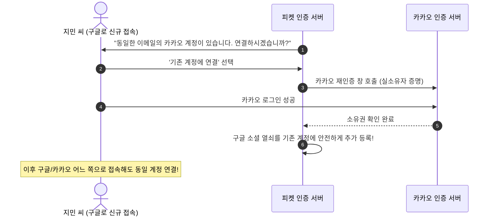
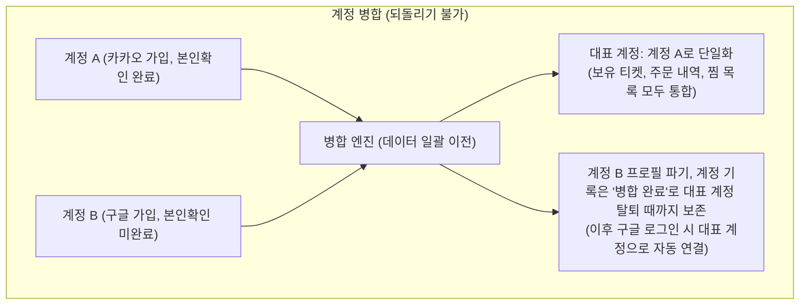

# 8. 계정과 로그인

> [← 7편: 양도·취소·환불](07-transfer-cancel-refund.md) | [목차로 돌아가기](README.md) | [9편: 본인확인과 봇 방어 →](09-identity-and-bots.md)

---

## 1. 상황: 비밀번호 없는 로그인과 이메일 연동 안내

지민 씨는 피켓에서 별도의 비밀번호를 외울 필요가 없다. 카카오, 네이버, 구글 중 자주 쓰는 소셜 간편 로그인 버튼만 누르면 된다.

어느 날 평소와 달리 무심코 구글 로그인 버튼을 눌렀더니 다음과 같은 안내 화면이 나타난다:

> **"이 이메일로 이미 가입된 카카오 계정이 있습니다. 두 로그인을 하나로 연결할까요?"**

지민 씨가 카카오 로그인을 한 번 더 거쳐 본인임을 증명하자, 이후에는 구글로 로그인하든 카카오로 로그인하든 언제나 동일한 내 계정으로 안전하게 접속된다.

---

## 2. 왜 어려운가: 편의성과 보안 사이의 까다로운 줄타기

사용자 인증(Authentication) 시스템에서는 편의성과 보안 사이의 균형이 늘 까다롭다.

| 핵심 난제 | 원인과 보안 위협 | 피켓의 해결책 |
| :--- | :--- | :--- |
| **1. 비밀번호를 직접 운영하는 부담** | 비밀번호를 받으면 유출 대응, 재설정, 다른 곳에서 새어 나간 비밀번호로 들어오려는 대입 공격(크리덴셜 스터핑) 방어를 모두 직접 해야 한다. 비밀번호 로그인이 약해서가 아니라, 이 일을 제대로 하려면 손이 많이 든다 | **팬 비밀번호는 받지 않고 소셜 로그인 제공자에게 맡김** (카카오·네이버·구글) |
| **2. 불안정한 이메일 식별자** | "이메일이 같으니 같은 사람"이라고 단정하면 타인 계정 무임승차 탈취 발생 | **이메일 대신 OIDC `sub` 고유키 채택** & **기존 소셜 실소유권 입증 강제** |
| **3. 1인 다계정 어뷰징** | 계정을 여러 개 만들어 1인당 구매 한도와 추첨 공정성을 훼손하는 행위 | **휴대폰 본인확인(CI) 연계 고유 식별자(`pid`)** ([9편](09-identity-and-bots.md)) |

---

## 3. 어떻게 푸는가: 5대 계정 및 세션 공학

### ① 일반 팬은 간편한 소셜 로그인, 관리자는 강력한 다중 인증 (MFA)

사용자의 역할과 권한에 따라 로그인 보안 수준을 차등화했다 ([ADR-0001](../docs/adr/0001-fan-social-login-single-factor.md), [POL-020](../planning/03-policies-glossary.md)).

| 사용자 역할 | 인증 방식 | 적용 이유 |
| :--- | :--- | :--- |
| **일반 팬** | **카카오·네이버·구글 소셜 간편 로그인** *(비밀번호 없음)* | 피켓은 팬 비밀번호를 보관하지 않아 비밀번호가 피켓에서 새어 나갈 일은 없다. 대신 카카오·네이버·구글 계정이 털리면 피켓 계정도 위험해지므로 새 기기 로그인 알림과 '로그인한 기기' 화면으로 보완한다. 티켓 예매 때는 휴대폰 본인확인(CI)을 따로 한다 ([9편](09-identity-and-bots.md)). |
| **파트너 (기획사)** | **업무용 이메일 + 15자 이상 비밀번호 + 인증 앱 코드(TOTP)** | 외부에서 예매자 개인정보가 담긴 시스템에 들어오는 권한자라서 안전한 인증수단(2차 인증)이 법적 의무다(개인정보의 안전성 확보조치 기준 §6②, POL-020). |
| **시스템 운영자** | **위 조건 + 사내 보안 VPN이나 허용 IP(화이트리스트)** | 시스템 전체를 통제하는 명령 권한을 가지므로 최상위 접근 제어를 적용한다. |

> [!NOTE]
> **큰 예매처는 비밀번호 로그인을 지원하는데, 그럼 보안이 약한 걸까?**
> 아니다. NOL 인터파크, 예스24, 멜론티켓, 티켓링크는 모두 아이디·비밀번호 로그인을 지원한다(2026-10-13 각 로그인 화면 확인. 티켓링크는 같은 그룹의 PAYCO 아이디, 멜론티켓은 카카오계정과 멜론아이디).
> 비밀번호 보안은 비밀번호가 있느냐보다 주변 장치로 정해진다. 실패 횟수 제한, 봇 차단, 유출 비밀번호 대조, 새 기기 알림, 선택형 2단계 인증을 겹쳐 쓰면 된다. NIST SP 800-63B-4도 이런 조건(15자 이상, 흔하거나 유출된 비밀번호 차단, 연속 실패 100회 이하 제한)에서 비밀번호 하나로 로그인하는 수준을 허용한다.
> 피켓이 팬 비밀번호를 받지 않는 것은 1인 프로젝트에서 이 운영을 소셜 제공자에게 맡기려는 선택이다. 대가도 있다. 제공자 계정이 털리면 피켓 계정도 위험하고, 제공자가 멈추면 그 제공자로는 새로 로그인할 수 없다(이미 로그인한 팬은 계속 예매할 수 있다). 티켓링크도 2024-02-16 공지에서 PAYCO 로그인 오류를 안내한 적이 있다.

---

### ② 계정의 고유 식별자는 이메일이 아니다

피켓은 사용자의 계정을 **"어느 소셜 제공자(IdP)의 몇 번 고유 식별자(OIDC `sub`)"**로 인식한다 ([POL-034](../planning/03-policies-glossary.md)).  
이메일 주소는 티켓 예매 안내를 발송하기 위한 연락처일 뿐, 계정의 영구 고유 식별자가 아니다. 글로벌 표준(OpenID Connect Core §5.7)에서도 이메일 주소는 변경되거나 제3자에게 재할당될 수 있으므로 고유 키로 삼지 말 것을 권고한다.

---

### ③ 동일 이메일 계정 연결: 기존 소유권을 입증해야만 합친다

열쇠 비유를 들면 이해하기 쉽다. 지민 씨의 방(계정) 문에는 현재 '카카오 열쇠'가 걸려 있다. 지민 씨가 "구글 열쇠도 함께 달아달라"고 요청하면, 시스템은 **지금 가지고 있는 '카카오 열쇠'로 방문을 먼저 열어보라고 요구**한다.

> [!TIP]
> **네이버와 구글/카카오의 차이점**  
> 이 자동 연동 제안은 새로운 소셜 제공자가 `"이 이메일은 검증이 완료된 이메일(email_verified: true)"`이라고 보증할 때만 노출됩니다. 구글과 카카오는 이 값을 제공하지만 네이버는 제공하지 않습니다.  
> 따라서 네이버로 처음 접속한 사용자는 제안 창 없이 독립 계정으로 생성되며, 이후 마이페이지 설정에서 안전하게 수동 연결할 수 있습니다. 검증되지 않은 이메일에 무작정 연동을 제안하면 타인의 가입 여부를 캐내는 정보 정찰 공격에 악용될 수 있기 때문입니다.

---

### ④ 이미 두 개로 쪼개진 계정의 통합 (계정 병합)

과거에 카카오 계정과 구글 계정을 따로따로 만들어 둔 경우, 설정 메뉴에서 두 계정을 하나로 합치는 **'계정 병합(Account Merge)'**을 지원한다 ([ADR-0038](../docs/adr/0038-account-linking-and-merge.md)).

* **대표 계정 기준**: 휴대폰 본인확인(CI)을 마친 계정이 대표 계정으로 남습니다.
* **병합 불가 조건**: ① 어느 한쪽이라도 좌석 홀드·구매 세션·결제 승인 대기 주문이 진행 중인 경우, ② 두 계정 티켓 합산이 1인당 구매 한도를 초과하는 경우, ③ 두 계정 모두 본인확인을 마친 경우, ④ 흡수될 계정에 탈퇴나 이상 거래 이의 제기가 진행 중인 경우.

---

### ⑤ 세션 관리 및 다중 접속 제어

| 세션 관리 정책 | 일반 팬 계정 | 파트너 및 관리자 계정 |
| :--- | :---: | :---: |
| **절대 세션 만료 시한 (Max Age)** | **최대 30일** | **최대 24시간** |
| **비활성 자동 로그아웃 (Idle Timeout)** | 미사용 14일 경과 시 만료 | 미사용 1시간 경과 시 만료 (재인증 필요) |
| **동시 허용 단말기 수** | **최대 5대** *(초과 시 오래된 기기 자동 로그아웃)* | **최대 2대** *(초과 시 가장 오래 쓰지 않은 세션 종료, 보안 알림)* |
| **원격 로그아웃 전파** | 수 초 이내 전체 분산 서버 토큰 무효화 | 수 초 이내 전체 분산 서버 토큰 무효화 |

---

## 4. 회원 탈퇴 및 온세일 어뷰징 방지

| 탈퇴·재가입 규칙 | 상세 내용 |
| :--- | :--- |
| **가입만큼 쉬운 탈퇴** | 탈퇴 절차를 숨기지 않는다. 소셜 로그인 재인증 한 번으로 즉시 탈퇴가 완료된다. 결제 결과나 가상계좌 환급을 기다리는 티켓이 있으면 그 처리가 끝난 뒤 완료된다. |
| **미사용 티켓 사전 정산** | 미사용 티켓이 남아 있다면 보유 현황과 환급 예상액을 안내하며, 동의 시 내가 결제한 티켓은 환급표(소비자분쟁해결기준 공제율)에 따라 취소·환불하고 양도받은 티켓은 결제한 분에게 돌려준 뒤 계정을 삭제한다([7편](07-transfer-cancel-refund.md) ⑦). |
| **개인정보 파기 원칙** | 계정 프로필과 본인확인(CI) 연결 정보는 지체 없이(늦어도 5일 안에) 파기된다. 단, 전자상거래법에 따라 주문·결제 기록은 5년, 소비자 분쟁 기록은 3년간 분리 보관된다. |
| **즉시 재가입 보장** | 탈퇴 후 언제든 즉시 재가입할 수 있다. 탈퇴자의 개인정보를 불법 보관할 수 없기 때문이다. |

> [!IMPORTANT]
> **온세일 순번 세탁 차단 원리**  
> 진행 중인 공연의 중복 참여 기록은 그 대기가 끝나거나 그 회차의 판매가 끝날 때(공연 시작 24시간 전, [ADR-0064](../docs/adr/0064-sales-end-24h-before-start.md))까지 **사람 식별값(pid, 비밀 키를 건 HMAC 지문)**으로 메모리에 남습니다. 탈퇴 후 다시 가입해 본인확인을 하면 같은 사람 식별값이 다시 계산됩니다(온세일 중에는 이 키를 바꾸지 않습니다. 판매 기간은 온세일보다 길어서, 그 사이에 키를 바꾸면 남은 기록을 새 값으로 옮기는 절차를 따로 둡니다).  
> 탈퇴 뒤 5일 안에 다시 가입하는 꼼수로는 같은 공연에서 순번을 중복으로 받을 수 없습니다. 다만 탈퇴 계정의 중복 참여 기록은 법정 파기 기한(5일) 안에 지우므로, 그 뒤에는 판매가 남은 회차에 다시 줄을 설 수 있습니다(남는 한계. 탈퇴 때 쓰지 않은 티켓은 모두 취소·환급됩니다).

---

## 5. 한 줄 요약

> **일반 팬은 비밀번호 없이 안전한 소셜 로그인만 사용하고, 동일 이메일 계정은 기존 소셜 계정의 소유권을 직접 입증해야만 연동되며, 자유로운 탈퇴 권리를 보장하되 탈퇴 뒤 5일 안에 다시 가입해 같은 공연에서 순번을 또 받는 일은 막는다(그 뒤의 재참여는 남는 한계로 둔다).**

---

## 더 알아보기

* [docs/features/identity.md §2](../docs/features/identity.md): 소셜 간편 로그인 OIDC 시퀀스 다이어그램
* [docs/features/identity.md §2.1](../docs/features/identity.md), [POL-034](../planning/03-policies-glossary.md), [ADR-0038](../docs/adr/0038-account-linking-and-merge.md): 계정 연결 및 계정 병합 상세 아키텍처
* [docs/features/identity.md §3, §4](../docs/features/identity.md), [POL-019](../planning/03-policies-glossary.md): 토큰과 쿠키(JWT 수명 주기), 세션 정책과 다중 기기 세션 제어
* [docs/features/identity.md §8](../docs/features/identity.md), [POL-033](../planning/03-policies-glossary.md): 회원 탈퇴 및 재가입 시 개인정보 파기 정책
* [docs/features/identity.md §6](../docs/features/identity.md), [POL-020](../planning/03-policies-glossary.md): 관리자 MFA 및 사내 IP 접근 제어 규정
* [ADR-0001](../docs/adr/0001-fan-social-login-single-factor.md): 팬 계정 단일 요소 인증 채택 및 위험 수용 결정
