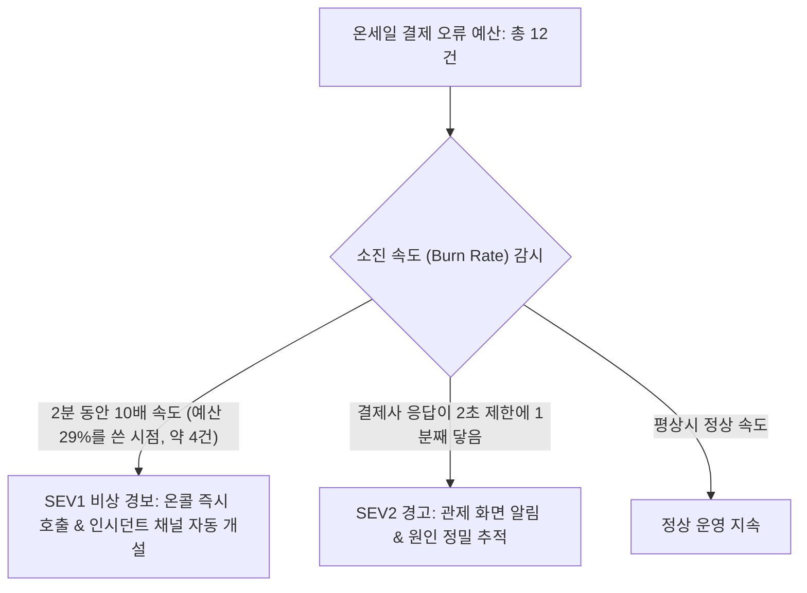
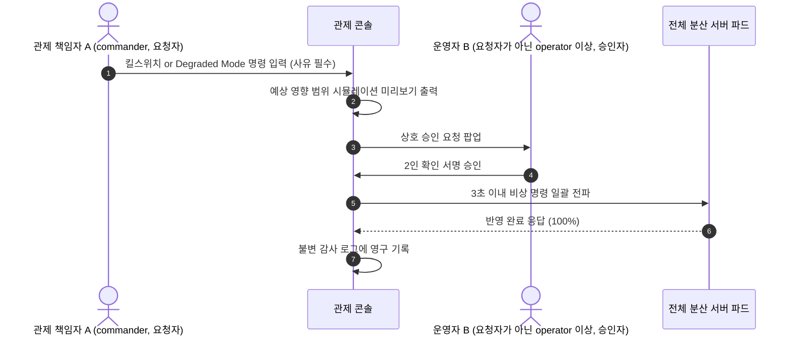

# 10. 관제실

> [← 9편: 본인확인과 봇 방어](09-identity-and-bots.md) | [목차로 돌아가기](README.md) | [11편: 파트너 콘솔 →](11-partner-console.md)

---

## 1. 상황: 8시 3분의 노란색 경보와 3초 만의 비상 개입

티켓 오픈 3분 뒤인 8시 3분, 관제실 모니터에 노란색 주의 경보가 울린다.

> **"결제사 승인 응답이 1분째 제한 시간(2초)에 닿고 있습니다. 결제 확정 허용 실패 12건 중 2건 사용."**

운영자가 세부 대시보드를 확인하니 외부 카드사 응답 지연이 원인이다. 운영자는 '동시 입장 목표'를 기존 5,000명에서 3,000명으로 하향 조정하는 명령을 입력한다. 명령 사유를 명시하고, 예상 영향 범위 미리보기를 확인한 뒤 실행 버튼을 누른다.

**3초 이내에 분산 서버들로부터 `"명령 반영 완료"` 응답**이 돌아온다. 이 모든 제어 이력은 감사 로그에 영구 기록되고, 누가 나중에 고치거나 지우면 검증에서 드러난다.

---

## 2. 왜 어려운가: 온세일 70분의 초압축 관제 난제

피크 트래픽이 집중되는 온세일 환경의 시스템 관제는 평상시 모니터링과 완전히 다르다.

| 핵심 난제 | 원인과 운영상 위험 | 피켓의 해결책 |
| :--- | :--- | :--- |
| **1. 70분의 초압축 피크 타임** | 오픈 10분 전부터 60분 뒤까지 총 70분 안에 승패 판가름. 다음 날 로그 분석하면 이미 늦음 | **1초 단위 실시간 메트릭 스트리밍** & **즉각적 오류 예산 소진율 감지** |
| **2. 평균 지표의 함정** | 전체 평균 0.2초라도 상위 1%(p99) 수백 명은 10초 타임아웃 겪으며 분통 터뜨림 | **평균 배제, p99 지연시간 모니터링** |
| **3. 비상 상황 사람 실수** | 당황한 엔지니어가 잘못된 제어 명령을 내리면 단순 장애가 대형 참사로 번짐 | **사전 검증된 12개 통제 명령만 허용** & **영향 시뮬레이션 + 2인 승인제** |
| **4. 자동 제어의 출렁임** | 정원을 줄인 뒤 지표가 잠깐 좋아졌다고 자동 제어가 다시 늘리면, 카드사 지연 같은 원인이 그대로여서 실패가 다시 쏟아지고 줄이기와 늘리기를 되풀이함 | **오류 예산이 줄어드는 동안 자동은 줄이기만** (다시 늘리기는 사람이 원인을 확인한 뒤) |

---

## 3. 어떻게 푸는가: 5대 SRE 관제 엔지니어링

### ① "얼마나 나빠져도 괜찮은가"를 숫자로 통제한다: 오류 예산 (Error Budget)

시스템의 모든 사용자 여정마다 명확한 정량 서비스 수준 목표(SLO)를 부여한다 ([POL-022](../planning/03-policies-glossary.md)).  
예를 들어 결제 확정 단계의 SLO는 "성공률 99.95%"다. 피크 70분 동안 2.5만 건의 결제가 시도된다면, 시스템이 감내할 수 있는 허용 실패 건수는 최대 12건이다. 이 12건의 허용량을 **오류 예산**이라고 부른다.

* **CPU 사용률로 사람을 깨우지 않는다**: 2차 지표 대신 "오류 예산을 10배 속도로 쓰고 있다"는 증상이 2분 동안 이어질 때 온콜을 호출한다. 예외는 결제사 응답 지연처럼 확실하고 곧 터질 원인과, 법정 기한이 걸린 보안 사고다.
* **경보는 예산의 30%를 쓰기 전에 울린다**: 경보가 울릴 때 이미 쓴 예산은 '속도 배수 × 지켜본 시간 ÷ 예산 기간'이다(구글 SRE 워크북 5장). 예전 규칙은 5분을 지켜본 뒤 울려서 10 × 5 ÷ 70 = 71%, 곧 결제 12건 중 9건이 사라진 뒤였다. 지금은 2분만 보고 울려 29%(약 4건)에서 사람을 부른다. 대신 우연한 실패 몇 건으로 울리는 헛경보가 조금 늘어난다. 모의 계산으로는 결제가 허용 한도만큼 실패해도 70분 동안 헛경보가 날 확률이 약 5%다. 온세일 중에는 운영자가 이미 화면 앞에 있어 받아들일 만하다.
* **결제 경고는 원인을 보고 낸다**: 허용 실패가 12건뿐이라 '몇 배 속도인가'를 가리기엔 건수가 너무 적다. 5분 동안 3배를 보면 결제가 허용 한도만큼 실패할 때 헛경보 확률이 81%다. 그래서 노란 경고는 결제사 응답이 2초 제한에 1분째 닿는 것처럼 직접 원인을 보고 낸다. 건수가 많은 여정(대기열 진입, 좌석 홀드 등)은 5분 동안 3배(예산 21%)로 경고한다.
* **남은 건수를 숫자로 보인다**: 관제 화면에 "결제 확정 12건 중 3건 사용"처럼 남은 허용 실패를 숫자로 띄운다.

| 오류 예산 소진 상태 | 시스템의 자동 방어 조치 | 사람(운영자)의 역할 |
| :--- | :--- | :--- |
| **온세일 중 50% 소진** | 동시 입장 정원을 한 단계 보수적으로 하향 조정. 그 뒤로는 정원을 스스로 다시 늘리지 않음 | 경보 원인 및 결제사·DB 지표 정밀 확인. 원인이 풀리면 정원을 다시 정함 |
| **온세일 중 100% 소진** | Degraded Mode 전환 후보 자동 제안 | **관제 책임자(commander) 요청과 요청자가 아닌 운영자 1인 승인(2인 상호 승인)**을 거쳐 모드 전환 승인 |
| **월간(28일) 예산 조기 소진**| 신규 기능 배포 파이프라인 자동 잠금 (배포 프리즈) | 기능 개발을 멈추고 시스템 안정성 강화 작업에만 집중 |

---

### ② 4대 황금 신호 (Golden Signals) 통일

모든 대시보드 최상단에는 구글 SRE의 4대 황금 신호가 통일되어 배치된다:
1. **지연 시간 (Latency)**: 최악의 경험을 모니터링하기 위해 **p99 (상위 99번째 백분위)** 기준으로 집계.
2. **트래픽 (Traffic)**: 초당 처리 요청 건수 (TPS).
3. **오류율 (Errors)**: 5xx 서버 에러 및 비즈니스 예외 발생 비율.
4. **포화도 (Saturation)**: DB 커넥션 풀, Redis 메모리, CPU 큐 등 시스템 자원의 한계 도달률.

---

### ③ 비상 개입 명령의 2인 상호 승인 워크플로우

> [!NOTE]
> **감사 로그를 나중에 고치면 드러나는 이유**
> 기록을 하나 남길 때마다 '직전 기록의 확인값과 이번 기록 내용'을 비밀 키로 섞은 확인값을 함께 적습니다(키를 건 해시 체인). 비밀 키는 클라우드 키 관리 서비스(KMS) 밖으로 나오지 않아, DB만 고칠 수 있는 사람은 맞는 확인값을 만들 수 없습니다. 그리고 5분마다 마지막 확인값을 지울 수 없는 저장소에 따로 적어 두고, 1시간마다 지난번 검증 지점부터 다시 계산해 맞춰 봅니다. 그래서 지난 기록을 고치면 다음 검증에서 드러납니다.
> 다만 마지막으로 적어 둔 뒤 5분 안의 맨 끝 기록을 지우는 것은 알아채지 못합니다. 5분과 1시간은 운영해 보기 전의 잠정값입니다 ([ADR-0053](../docs/adr/0053-crypto-hardening-pseudonyms-webhooks-stores-runbook-audit.md)).
>
> **피켓 밖에서도 확인할 수 있게(공개 앵커)**
> 위의 확인은 피켓만 할 수 있어서, 파트너나 규제기관은 '피켓이 확인했다'를 믿어야 합니다. 그래서 하루에 한 번과 온세일이 끝날 때마다 그때까지의 기록을 요약값 하나로 묶어 피켓의 서명을 붙이고, 그 요약값을 비트코인에 시각을 새겨 주는 무료 공개 서비스(OpenTimestamps)에 찍은 뒤 누구나 볼 수 있는 곳에 올립니다. 기록 원문과 개인정보는 나가지 않고 요약값만 나갑니다.
> 그러면 누구든 공개된 검증 도구로 '그 시각에 그 기록 묶음이 있었고 그 뒤로 바뀌지 않았다'를 피켓을 믿지 않고 확인할 수 있습니다. 다툼이 생기면 문제의 기록 하나와 '이 기록이 그 요약값에 들어 있다'는 증명만 당사자에게 건넵니다.
> 블록체인을 직접 운영하지는 않습니다. 노드를 피켓 혼자 돌리면 블록체인의 장점(서로 믿지 않는 여럿이 같은 장부를 나눠 가짐)이 사라지기 때문입니다. 또 처음부터 적지 않거나 거짓으로 적은 기록은 어떤 장부도 막지 못합니다([ADR-0075](../docs/adr/0075-public-audit-anchor-signed-merkle-checkpoints.md)).

---

### ④ 원인 쪽 신호: 바깥 서비스, 시계, 백업, 인증서, 스캐너, 대기 순서

사람을 부르는 기준은 증상이지만, 원인을 빨리 찾으려면 아래 신호를 함께 본다.

| 신호 | 왜 보는가 | 기준 |
| :--- | :--- | :--- |
| **결제사·본인확인·사람 확인·소셜 로그인** | 오픈 10분 전에 본인확인 업체가 느려지면 대기열 입장 자체가 막힌다. 우리가 고칠 수 없는 곳이라 빨리 아는 것이 전부다 | 결제사가 '한도 초과'를 한 번이라도 돌려주면 경고. 결제사 처리 한도는 추정값이라, 실제로 어디서 막히는지가 추정을 바꿀 근거가 된다. 결제사가 느려지는 기준은 두 단계다. 승인 요청(재시도 전 한 번의 호출)이 1분 동안 1% 이상 2초 기한에 닿으면 먼저 경고하고, 다시 시도까지 합쳐 결과가 정해지는 데 5초가 넘거나(느린 쪽 1% 기준) 결제사로 가는 요청을 자동으로 끊는 장치(서킷 브레이커)가 열리면 다른 결제사로 바꿀지 검토한다(런북 RB-07) |
| **서버 시계** | 오픈 직후 2초 묶음, 토큰 만료, 감사 기록 시각이 모두 서버 시계에 기댄다 | 표준시와 20ms 넘게 어긋나면 오픈 전 점검 실패 |
| **백업** | 리전 장애 때 하루치 데이터를 되살리는 계획이 백업에 기댄다 | 교차 리전 백업이 26시간 넘게 없으면 경고 |
| **인증서** | 자동 갱신이 실패하면 스캐너를 포함해 연결이 끊긴다 | 만료 30일 전 알림, 7일 전 경고 |
| **스캐너 동기화** | 양도한 사람의 옛 QR이 통하는 시간을 1분으로 잡은 설계는 스캐너가 계속 바뀐 것을 받을 때만 맞다 | 입장 시간대에 2분 넘게 바뀐 것을 받지 못한 스캐너가 있으면 관제와 그 구역 현장 책임자에게 알림 |
| **중복 입장** | 인터넷이 끊긴 스캐너끼리는 같은 티켓을 둘 다 통과시킬 수 있다 | 같은 회차에서 10분에 10건을 넘으면 관제에 경고 |
| **대기 순서** | 차례가 오기 전에 입장한 사람이 있으면 공정성이 깨진다 | 1건이라도 있으면 경고 |

이 기준값들은 측정 뒤 확정한다.

공연 당일에는 관제 화면의 **입장 탭**에서 준비된 스캐너 수, 2분 넘게 바뀐 것을 받지 못한 스캐너, 올리지 못한 기록 수, 이상 표시, 부스 재발급과 예외 통과 건수를 본다. 관제는 지켜보기만 하고, 이상 표시 하나하나는 그 구역 현장 책임자가 좌석에서 확인한다([ADR-0051](../docs/adr/0051-gate-process-end-to-end.md)).

### ⑤ 법이 시간을 정한 일: 보안 사고와 접속기록 점검

| 할 일 | 기한 | 근거 |
| :--- | :--- | :--- |
| **해킹이나 서비스 거부 공격 같은 침해사고 신고** | 알게 된 때부터 24시간 | 정보통신망법 §48의3 |
| **공격으로 장애가 2시간 넘게 이어지거나 이용자 정보가 새었을(새었을 수 있는) 때 이용자에게 알림** | 지체 없이 | 같은 조, 같은 법 시행령 §58의9 |
| **개인정보 유출을 정보주체에게 알림, 1천 명 이상 등이면 신고** | 72시간 | 개인정보 보호법 §34 |
| **관리 계정의 접속기록과 다운로드 점검** | 월 1회(2026-11-01부터는 내부 관리계획에서 정한 주기) | 개인정보의 안전성 확보조치 기준 §8② |

운영자는 사고를 알게 되면 관제 콘솔에 등록하고, 콘솔이 의무마다 남은 시간을 센다. 해당하는지 판단이 서지 않으면 신고하는 쪽으로 한다. 매크로 봇 공격이 침해사고에 드는지는 법률 검토에서 확인한다. 보안 사고 훈련은 Game Day에 1년에 한 번 넣는다.

### ⑥ 자동 제어와 경보도 스스로를 지킨다

8시 4분, 결제 서버의 숫자를 모으는 수집이 잠깐 끊겼다고 하자. 입장 정원을 자동으로 조절하는 장치는 그 숫자를 보고 정원을 늘리거나 줄인다. 숫자가 없는 것을 '오류 0건'으로 읽으면, 장애가 났는데도 아주 건강하다고 보고 정원을 늘린다. 구글도 비슷한 사고를 겪었다. 지울 대상이 없다는 빈 목록을 '전부'로 읽은 자동화가 CDN 서버의 디스크를 거의 다 지웠다(구글 SRE 책 7장). 그래서 자동 장치와 경보에도 스스로를 지키는 규칙을 둔다(2026-10-20 소유자 승인, [ADR-0069](../docs/adr/0069-ops-control-principles-audit-self-safety-alert-hygiene-wide-events.md)).

| 규칙 | 무엇을 막나 | 기준 |
| :--- | :--- | :--- |
| **숫자가 끊기면 멈춘다** | 낡은 숫자로 정원을 늘리는 일 | 30초 넘게 새 숫자가 없으면 '입력 없음'으로 보고 정원을 그대로 둔다. 콘솔 위쪽에 '입력 없음'을 띄워 운영자가 판단하게 한다. 숫자가 돌아오면 줄이기는 바로 다시 하고, 늘리기는 운영자가 확인한 뒤에 한다 |
| **한 번 줄이면 효과를 기다린다** | 같은 신호에 거듭 줄여 1초 만에 정원이 바닥나는 일 | 줄인 뒤에는 예매 단계 인원이 새 정원 아래로 내려오거나 2분이 지날 때까지 다시 줄이지 않는다. 이미 들어온 사람은 평균 3분 머물러 효과가 늦게 보이기 때문이다 |
| **큰 경보가 울리면 작은 경보는 접는다** | 장애 하나에 알림이 여러 개 쏟아지는 일 | 같은 공연·같은 여정에서 큰 경보(SEV1)가 울리면 작은 경보(SEV2)는 알림을 보내지 않고 화면에서 큰 경보 아래에 접어 둔다. 지우지는 않는다 |
| **경보도 시험한다** | 기준을 고쳤다가 경보가 안 울리는 일 | 가짜 숫자를 넣어 '10배면 울리고 그보다 조금 낮으면 안 울린다'를 고칠 때마다 확인한다 |
| **무엇을 인시던트로 볼지 미리 정한다** | 큰일인데 기록 없이 넘어가는 일 | 큰 경보, 돈·좌석 이상 의심, 입장 일시정지·판매 일시정지·Degraded 전환 명령, 15분 넘게 안 풀리는 경보, 온세일 오류 예산의 절반 이상을 쓴 때, 평소(상시 기능)에 사고 하나가 28일 예산의 20%를 넘게 쓴 때, 사람이나 손님이 경보보다 먼저 알아챈 장애. 정원 조절(명령 1)은 흔한 일상 조작이라 넣지 않는다. 포스트모템에는 누가 먼저 알아챘는지(경보, 사람, 외부)를 적는다 |
| **서버 자동 증설도 멈출 수 있다** | 고장 난 판이 쓸데없이 서버를 계속 늘리는 일 | 미리 만든 '자동 증설 멈춤' 설정을 긴급 변경으로 적용한다(런북 RB-30) |
| **바쁜 시간에는 뒤에서 도는 일을 미룬다** | 일괄 환불이나 정산 지급이 오픈 시간에 DB와 결제사 한도를 나눠 쓰는 일 | 대형·중형 공연의 오픈 시간에는 새 묶음을 시작하지 않고 끝난 뒤에 한다. 발권·결제 결과 알림처럼 손님에게 바로 필요한 일은 미루지 않는다 |

### ⑦ 장애가 난 순간 손으로 다루는 일

8시 10분, 결제 서버 한 대가 점점 느려지고 메모리가 한도에 가까워졌다고 하자. 다시 띄우면 빨라지지만, 왜 느려졌는지 알려 줄 단서(메모리 안의 상태)도 함께 사라진다. 소유자가 붙여 준 Release It!의 장애 대응 지침에 지금 설계를 대 보니, 이렇게 장애 순간 사람이 손으로 다루는 부분이 비어 있었다(2026-10-20 소유자 승인, [ADR-0070](../docs/adr/0070-incident-response-evidence-probes-timeouts-throughput-soak.md)).

| 규칙 | 무엇을 막나 | 기준 |
| :--- | :--- | :--- |
| **다시 띄우기 전에 단서를 남긴다** | 재시작으로 원인이 사라지는 일 | 서버 하나만 트래픽에서 빼고 메모리 상태(진단 보고서, 힙 스냅샷)를 떠 전용 저장소에 둔 뒤 다시 띄운다(RB-31). 나머지 서버는 기다리지 않고 바로 다시 띄운다. 메모리 사본에는 손님 정보가 섞일 수 있어 14일 뒤 지우고, 긴급 접근으로만 연다 |
| **'살아 있나'와 '받을 수 있나'를 따로 묻는다** | DB 하나가 죽었을 뿐인데 서버가 모두 빠져 서비스 전체가 멈추는 일 | 쿠버네티스가 서버에 묻는 검사(프로브)는 그 서버 자신의 상태만 본다. DB·Redis가 죽어도 서버는 빠지지 않고 '지금은 안 된다'고 바로 답하거나 다른 길로 처리한다 |
| **기다림에 상한을 둔다** | 느린 DB를 기다리다 연결이 모두 묶이는 일 | 예매 핵심 경로의 DB 문장은 1초, 연결을 기다리는 시간은 0.1초, Redis 명령은 0.1초를 넘기면 끊는다. 사람이 느린 쿼리를 직접 끊는 절차(RB-32)도 둔다 |
| **오류 없이 줄어드는 것도 잡는다** | 결제 화면이 뜨지 않아 결제 요청이 아예 오지 않는데 경보가 조용한 일 | 좌석을 잡은 사람에 견줘 결제를 시작한 사람이 평소의 절반 아래로 떨어지면 알린다(RB-33). 실패한 요청이 없으면 오류 예산 경보는 울리지 않기 때문이다 |
| **몇 시간 돌려 본다** | 며칠 지나야 드러나는 메모리·연결 누수 | 출시 전에 서비스마다 6시간 돌려 메모리와 연결이 늘지 않는지 본다. 운영에서는 추세로 보아 하루 안에 한도에 닿을 것 같으면 알린다 |
| **처리 끝난 것은 치운다** | 다 보낸 이벤트가 쌓여 저장 공간을 채우는 일 | 보낸 이벤트 표는 3일 뒤 지우고, 이벤트를 붙잡아 둔 복제 슬롯이 커지면 알린다 |

---

## 4. 12대 비상 개입 명령과 승인 체계

관제 콘솔에서 실행할 수 있는 비상 개입 명령은 엄격히 통제된 12가지로 한정되며, 임의의 셸 스크립트 실행은 차단된다 ([POL-021](../planning/03-policies-glossary.md)).

| 통제 명령 | 승인 요건 | 상세 규칙 및 제약 |
| :--- | :---: | :--- |
| **1. 동시 입장 목표 정원 조절** | 1인 | 설정된 안전 범위 안에서만 변경 가능. 상한은 8,000명과 공연 결제사 상한 중 낮은 값, 하한은 1,000명과 결제사 상한의 절반 중 낮은 값(포트원 공연은 약 415~830명) |
| **2. 대기열 입장 일시정지** | 1인 | 10분 뒤 자동으로 풀려 입장이 다시 시작된다. 계속 멈춰야 하면 끝나기 1분 전에 뜨는 확인 창에서 사유를 적고 연장하며, 연장한 때부터 10분이 다시 시작된다. 대기열 순번은 그대로 유지 |
| **3. 판매 일시정지 (킬스위치)** | **commander 1인 실행(재개는 2인)** | 고른 회차(또는 전체)의 신규 좌석 홀드와 결제 시작·접수를 막고 입장도 멈춤(대기 순번은 그대로). 이미 접수된 결제는 끝까지 처리. 굿즈는 대상이 아니고, 만료 없이 2인 승인으로 재개. 멈추는 쪽은 안전한 쪽이라 혼자 바로 걸고, 다시 여는 쪽만 두 사람이 확인한다(ADR-0095) |
| **4. 비정상 네트워크 대역 차단** | 1인 (ASN 단위 차단과 대규모 대역 차단은 2인) | 차단 만료 시간(최대 24시간) 설정 필수. 실행 뒤 10분 동안 차단 비율, 추가 검증 통과율, 이의 제기 수가 실행 전 5분과 견줘 어떻게 바뀌었는지 보여 주고, 사람을 막고 있는 것 같으면 경고한다 |
| **5. 봇 탐지 판정 강도 변경** | **2인 상호 승인** | 완화 / 기본 / 강화 모드 중 전환. 기다리는 동안 다시 보는 재평가(끔·그림자·적용, 기본은 그림자)도 이 명령에서 강도와 따로 고르고, '적용'으로 바꾸는 것은 관제 책임자만 한다([9편](09-identity-and-bots.md), 2026-10-20 추천 적용, ADR-0071·ADR-0073). 명령 4처럼 실행 뒤 효과를 보여 준다 |
| **6. Degraded Mode 전환** | **2인 상호 승인** | 사전에 설계된 축소 아키텍처 모드로 전환. 결제사 장애 때 새 결제를 다른 결제사로 돌리는 결제사 전환도 여기에 속함 |
| **7. 대기실 비상 공지 배너 게시** | 1인 | 사전 승인된 표준 문구 템플릿 내에서 선택 |
| **8. 로그 상세도 (Debug) 임시 변경** | 1인 | 30분 경과 시 운영 기본 레벨로 자동 복귀 |
| **9. 비핵심 보조 기능 비활성화** | 1인 | 관람 후기, 찜, 인접 좌석 추천 등 부가 기능만 즉시 OFF(기대평은 2026-10-14에 없앴다, ADR-0063). 일괄 환불의 새 묶음, 파트너 알림 재시도 같은 뒤에서 도는 일을 멈추는 스위치도 여기에 있다 |
| **10. 부정거래 게시물 노출 차단** | 1인 | 신고기관·수사기관 공문으로 통보된 게시물에 한하여 24시간(문화체육관광부 고시 사항은 10시간) 안에 차단. 같은 내용의 게시물은 이후 명령 없이 자동으로 숨김 |
| **11. 긴급 자동화 정지 스위치** | 1인 (비상용, 다시 켤 때는 2인) | 입장 제어의 자동 조절(AIMD 조정, 오류 예산 연동 감축, Degraded 후보 추천)을 일제히 정지 (사후 검토 필수: 실행한 사람이 48시간 안에 보고서를 쓰고 다른 commander가 7일 안에 검토). 서버 자동 증설은 멈추지 않음. 자동 증설이 잘못 움직이면 따로 멈춘다(⑥) |
| **12. 공연 결제사 지정** | 1인 | 온세일 시간 밖에서만 실행. 공연의 기본 결제사와 대체 결제사를 정함 ([ADR-0044](../docs/adr/0044-dual-pg-selection-and-switchover.md)). 지정하지 않은 공연은 판매 승인 때 그때의 기본값이 이 공연의 지정으로 고정되어, 나중에 기본값을 바꿔도 이미 승인한 공연의 결제사는 바뀌지 않음 |

> [!NOTE]
> **홈 화면 꾸미기는 명령이 아니다**: 홈의 큰 배너와 테마 추천은 운영자가 관제 콘솔의 [홈 구성](공지 관리 화면의 탭)에서 정한다(2026-10-14 추천 적용, ADR-0063). 이 자리는 돈을 받고 팔지 않는다. 판매 승인된 공연만 고를 수 있고, 운영자 한 명이 사유를 적어 저장하면 감사 기록에 무엇이 바뀌었는지 남는다. 시스템을 멈추거나 되돌리는 비상 명령이 아니라 화면 내용 설정이라 2인 승인이 없고, 되돌리려면 이전 구성을 다시 저장한다.

---

## 5. Degraded Mode: 무엇을 포기하고 무엇을 지키는가

심각한 장애 상황에서도 피켓은 전체 서비스를 다운시키지 않고 **가장 중요한 핵심 가치(불변식)**를 끝까지 사수한다 ([POL-029](../planning/03-policies-glossary.md)).

| 핵심 사용자 여정 | 성능 저하를 감수하는 영역 | 어떠한 상황에서도 사수하는 영역 |
| :--- | :--- | :--- |
| **대기열 진입** | 대기열 진입 처리(진입 확정)가 1초까지 늦어짐 | **도착 순서와 추첨 순번의 공정성** |
| **좌석 홀드** | 좌석도 응답 0.3초 지연, 입장 정원 절반 축소 | **중복 좌석 판매 (오버셀) 0건** |
| **결제 승인** | 결제 승인 확정 최대 60초 지연, 신규 결제 일시정지, 운영자 2인 승인 시 새 결제는 다른 결제사로 | **이중 출금 0건, 10분 초과 결제 차단, 접수된 결제의 결제사 변경 금지** |
| **공연장 검표** | 게이트 스캔 기록의 클라우드 동기화 지연 | **오프라인 0.15초 판정, 위조 통과 0건** |
| **관제 명령** | 명령 전파 속도가 최대 10초까지 지연됨 | **2인 승인 절차 준수, 감사 로그 보존** |

> [!NOTE]
> **온세일 종료 후 자동 리포트 (ClickHouse)**  
> 70분 온세일 윈도우가 끝나고 30분 뒤, 마감 실행기(close-runner, dbt 잡)가 ClickHouse에 모인 원본 이벤트로 유입 인원, 등급별 매진 소요 시간, 좌석 경합도, 결제 실패 원인, 봇 공격 추정치, 운영 명령 이력을 계산해 **'잠정 공연 리포트(R0)'**의 숫자를 자동으로 만듭니다. ops-svc는 그 지표 뷰를 읽어 리포트로 보여 줄 뿐 직접 계산하지 않습니다 ([ADR-0042](../docs/adr/0042-analytics-store-and-decision-rules.md), [ADR-0052](../docs/adr/0052-analytics-medallion-star-schema-close-stages.md)). 결제·봇 숫자는 다음 영업일(R1)과 오픈 7일 뒤(R2) 같은 단계별 마감에서 확정되며, 읽는 법과 결정하는 법은 [15편](15-analytics-and-decisions.md)에 있습니다.

---

## 6. 지표로 판단하는 법

### 숫자의 등급부터 본다

| 등급 | 뜻 | 예 | 바꿀 수 있나 |
| :--- | :--- | :--- | :--- |
| **공인 숫자** | 기관이 목표값까지 정함 | 화면 반응 INP 200ms(구글 웹 지표) | 바꾸지 않는다 |
| **법정** | 법이 정함 | 침해사고 신고 24시간 | 바꾸지 않는다 |
| **자체 기준** | 공인 숫자가 없어 우리가 근거를 적고 정함 | 대기열 진입 p99 200ms, 결제 확정 99.95% | 측정한 뒤 ADR로 바꾼다 |
| **측정 뒤 확정** | 아직 재지 않은 값 | 경보 창 2분, 시계 기준 20ms | 측정 결과로 정한다 |
| **관측** | 목표 없이 추세만 봄 | 배포 빈도 같은 DORA 지표 | 목표로 만들지 않는다 |

공신력 있는 기관은 대부분 '무엇을 어떻게 잴지'까지 정해 주고, 백엔드 응답 시간이나 가용성 목표 숫자는 정해 주지 않는다. 그래서 자체 기준이 많은 것은 결함이 아니다. 지표마다의 근거는 관측 문서의 근거 표에 모아 두었다.

### 언제 무엇을 판단하나

| 시점 | 판단할 것 | 판단 기준 |
| :--- | :--- | :--- |
| **지금(설계)** | 경보를 언제 울릴지, 어떤 지표를 둘지 | 예산 30%를 쓰기 전에 울린다(2026-10-13 소유자 결정) |
| **측정 단계** | 자체 기준 숫자를 확정할지 | 아래 세 질문 |
| **오픈 30분 전** | 열지 말지 | 필수 항목이 하나라도 실패하면 열지 않는다. 오픈 시각에 입장을 멈추고 공지한 채 시작하고, 회복되면 입장을 재개한다. 로비 셔플은 예정대로 해서 순서는 바뀌지 않는다 |
| **온세일 중** | 개입할지, 어떤 명령을 쓸지 | 아래 읽는 순서 |
| **끝난 뒤** | 다음 공연에서 무엇을 바꿀지 | 공연 리포트에서 결정 규칙에 걸린 항목만 검토한다. 한 번의 결과로 정책을 바꾸지 않는다 |
| **평소(28일)** | 기능 개발을 멈출지 | 28일 예산이 바닥나면 배포를 멈춘다 |

### 온세일 중 화면을 읽는 순서

1절의 8시 3분 장면에 적용하면 이렇다.

1. **돈과 좌석은 안전한가**: 오버셀, 이중 결제, 60초 넘게 남은 결제와 발권의 어긋남, 위조 통과를 본다. 의심이 1건이라도 있으면 판매 일시정지(명령 3)부터 검토한다. 오버셀·이중 결제·결제와 발권의 어긋남이면 불변식 위반 의심 대응 절차서(런북 RB-36)를 따른다(2026-10-20 추천 적용, ADR-0073). 장면에서는 이상 없음.
2. **사용자가 얼마나 아픈가**: 여정별 남은 허용 실패와 소진 속도를 본다. 장면에서는 결제 12건 중 2건을 썼다.
3. **어디가 아픈가**: 4대 황금 신호로 구간을 찾는다. 결제 확정 p99가 올라가 있다.
4. **어느 손잡이를 쓸까**: 몇 분 안에 세 가지만 가린다. 최근에 바꾼 것이 있나, 바깥 서비스 문제인가, 서버가 꽉 찼나. 장면에서는 카드사 응답 지연이라 바깥 서비스 쪽이다. 왜 그렇게 됐는지 깊이 파는 일은 안정된 뒤 포스트모템에서 한다.
5. **무엇을 할까**: 약하고 되돌릴 수 있는 것부터 쓴다. 최근 변경(배포 등)이 원인이면 먼저 되돌린다(긴급 변경, 런북 RB-23). 그다음은 정원 조절(명령 1), 입장 일시정지(명령 2), Degraded Mode와 결제사 전환(명령 6), 판매 일시정지(명령 3) 순서다. 서버를 다시 띄워야 하면 하나만 먼저 단서를 남긴다(⑦). 장면에서는 정원을 5,000명에서 3,000명으로 줄였다.
6. **누구에게 알릴까**: 매진 예상 시각이 흔들리면 대기실 공지(명령 7)와 상태 페이지를 쓰고, 공격이나 유출이면 보안 사고로 등록한다.

### 측정 뒤 목표를 정하는 세 질문

1. 이 숫자를 정한 사용자 쪽 이유가 아직 맞는가.
2. 지키는 비용이 그 가치보다 작은가.
3. 여러 번 쟀을 때 예산이 꾸준히 남는가, 바닥나는가.

남으면 유지하거나 조이고, 바닥나면 설계를 고치거나 목표를 풀되 이유와 다시 볼 조건을 ADR에 적는다. 0건 불변식, 공인 숫자, 법정 기한은 이 질문의 대상이 아니다. 탐지 시간도 평균 대신 장애마다 60초 안에 잡았는지를 본다. 장애 몇 건의 평균은 크게 흔들리기 때문이다.

### 관제 콘솔, Grafana, Sentry는 어떻게 다른가

8시 3분 장면을 세 도구로 나눠 보면 이렇다.

| 도구 | 누가 보나 | 무엇을 묻나 | 장면에서 한 일 |
| :--- | :--- | :--- | :--- |
| **관제 콘솔** | 운영자 | 지금 정원을 줄일까, 판매를 멈출까 | 결제사 응답 지연과 "결제 12건 중 2건 사용"을 보고 정원을 5,000명에서 3,000명으로 줄였다 |
| **Grafana** | 엔지니어 | 어디가 왜 느린가 | 결제 요청 기록을 열어 어느 구간에서 느려지는지 확인했다 |
| **Sentry** | 개발자 | 어떤 코드가 왜 깨졌고 어느 배포부터인가 | 코드 오류가 아니어서 열 일이 없었다 |

* **콘솔도 같은 창고를 읽는다**: 숫자와 기록이 쌓이는 창고(Prometheus·Loki·Tempo)는 하나다. 콘솔은 판단에 필요한 숫자를 거기서 받아 직접 그린다. 다만 판매 누적, 잔여석, 등급·구역별 상세 퍼널, 봇 잠정 숫자처럼 갈래가 많거나 계속 쌓아 가는 숫자는 관제 실시간 표에서 받는다. 작은 프로그램(스트림 작업자)이 사건을 ClickHouse에 쌓고, 관제 서버가 읽을 때 센다(아래 마지막 줄). 위젯마다 '자세히 보기'를 누르면 같은 공연·같은 시간대의 Grafana(오류는 Sentry)가 새 탭으로 열린다. Grafana 화면을 콘솔 안에 끼워 넣지는 않는다.
* **Datadog 같은 상용 서비스로 콘솔을 대신하지 않은 이유**: 버튼은 상용 서비스에서도 만들 수 있다. 하지만 "8,000명을 넘으면 거절", "판매 재개는 다른 사람이 다시 로그인해 승인"처럼 버튼 뒤의 안전장치는 어차피 우리 서버가 확인해야 한다. 관측 서비스가 멈출 때 손잡이까지 같이 멈추면 안 된다(2023년 3월 Datadog은 여러 리전의 서비스가 한꺼번에 장애를 겪었다). 손님 개인정보를 다루는 업무를 해외 서버에 두지 않으려는 이유도 있다.
* **창고를 직접 운영할지는 재어 본 뒤 정한다**: 창고와 경보기를 우리가 직접 돌릴지 남에게 맡길지는 아직 숫자가 없다. 맡길 후보는 둘이다. 하나는 같은 도구를 AWS가 서울에서 대신 돌려 주는 관리형 서비스(AMP·AMG)이고, 다른 하나는 Datadog이다. Phase 4에서 같은 데이터를 후보마다 보내 우리 규모의 비용, 지난 기록을 한도 안에서 다시 볼 수 있는지, 직접 돌리는 데 든 시간을 잰다. 그다음 미리 적어 둔 규칙으로 고른다.
* **숫자마다 할 일을 적는다**: 위젯 아래에 '판단:' 한 줄로 이 숫자를 보고 할 일(명령 번호나 '엔지니어 호출')을 적는다. 운영자가 할 일이 없는 숫자(화면 반응 속도, 느린 쿼리, 네트워크)는 '진단 힌트'로 따로 모아 판단 숫자와 섞이지 않게 한다.
* **입장 정원을 조절하는 숫자는 늘 클러스터 안에서 읽는다**: 어느 쪽을 고르든 입장 제어와 자동 확장, 그리고 콘솔의 판단·제어 숫자(입장 속도, 퍼널 다섯 단계, 오류율, 결제 성공률, 오류 예산)는 클러스터 안 Prometheus에서 읽는다. 자동 제어와 콘솔이 같은 값을 보고, 바깥 서비스가 느려지거나 멈춰도 정원 조절이 흔들리지 않게 하려는 것이다. 판매 누적, 잔여석, 등급·구역별 상세 퍼널, 봇 잠정 숫자는 관제 실시간 표(스트림 작업자가 ClickHouse에 쌓은 사건을 읽을 때 센다)에서 읽는다. 이 표가 늦어지면 그 패널은 Prometheus 숫자로 바꿔 보인다(관측 문서의 지표 출처 표). '잠정' 표시는 출처가 아니라 아직 확정 전인 숫자라는 뜻이다.

### 기록은 어떤 길로 모이나

8시 3분에 엔지니어가 Grafana에서 연 '느린 결제 요청 기록'은 이런 길로 모였다.

1. **서버마다 붙은 수거 담당(에이전트)**: 서버마다 하나씩 있다. 그 서버에서 도는 프로그램의 요청 기록과 로그를 모으고, 어느 서버·어느 프로그램에서 왔는지 이름표를 붙인다. 숫자, 요청 기록, 로그에 같은 이름표가 붙어 있어서 엔지니어는 느린 숫자 → 그 요청 기록 → 같은 요청의 로그를 클릭 몇 번으로 오간다.
2. **가운데 분류 담당(게이트웨이 수집기)**: 셋이 나눠 일한다. 요청 기록을 다 남기면 창고가 넘치므로, 오류가 났거나 느렸던 요청은 모두 남기고 정상 요청은 일부만 남긴다. 그래서 8시 3분의 느린 결제 요청은 하나도 빠짐없이 남아 있었다. 이 판단을 하려면 한 요청의 조각이 한곳에 모여야 해서, 수거 담당은 요청 번호를 보고 늘 같은 분류 담당에게 보낸다. 개인정보를 한 번 더 지우는 일도 여기서 한다.
3. **숫자는 창고가 직접 가져간다**: 입장 속도, 오류율 같은 숫자는 수거 담당을 거치지 않고 Prometheus가 프로그램마다 와서 읽어 간다. 그래서 수거·분류 담당이 멈춰도 정원 조절과 경보는 그대로다. 잃는 것은 원인을 찾을 때 보는 요청 기록과 로그이고, 수거·분류 담당이 멈추면 그것도 경보로 알린다.
4. **손님 화면의 기록은 같은 주소로**: 화면 반응 속도와 보안 정책 위반 보고는 피켓 주소 안의 `/_t/rum`·`/_t/csp`로 보낸다. 다른 주소로 보내면 브라우저가 확인 요청을 하나 더 보내야 하기 때문이다. 같은 주소라 브라우저가 쿠키를 붙여 보낼 수 있어서, 입구 서버(API 게이트웨이)가 쿠키를 지우고 넘긴다. 누구나 보낼 수 있는 주소라 가짜 숫자가 섞일 수 있으므로, 이 숫자로는 사람을 부르거나 자동으로 손잡이를 돌리지 않는다.
5. **법이 정한 접속기록은 처음부터 따로**: 출입 기록은 수거 담당이 두 벌로 나눈다. 원본은 접속기록 전용 창고로 가고, IP 뒷부분을 지운 사본만 일반 로그 창고로 간다. 원본 IP가 서버 밖 일반 길로 나가지 않는다.

**기계가 이상을 알아서 찾아 주면 안 되나?** 지금은 쓰지 않는다. 이상을 찾는 기계는 보통 "이번 화요일 저녁 8시는 지난 화요일 저녁 8시와 비슷하다"는 식으로 몇 주치 기록에서 평소 모습을 배운다. 그런데 화요일 저녁 8시에 대형 콘서트가 열리면 지난주 같은 시각에는 없던 100만 명이 몰린다. 기계는 이 정상적인 오픈을 '이상'으로 울리거나, 오픈이 자주 있으면 그 폭주를 평소로 배워 오픈 중 결제가 조용히 반으로 줄어도 들쭉날쭉한 값 속에 묻어 버릴 수 있다. 게다가 포트폴리오에는 진짜 손님이 없어 기계가 배울 것은 우리 시험 스크립트뿐이다. 판매 오픈 때 이유를 설명할 수 없는 경보나 자동 조치가 나면 손해도 크다. 구글 SRE 책도 기준을 스스로 배우거나 원인을 자동으로 찾는 시스템을 피하라고 한다. 그래서 사람을 부르거나 자동으로 줄이는 일은 "오류 예산이 이 속도로 줄고 있다", "메모리가 24시간 안에 찬다"처럼 이유를 말할 수 있는 규칙으로만 한다. 원인 찾기는 사람이 하고, 시스템은 단서와 미리 채운 조회 링크를 준다. 규칙에 없는 장애를 사람이 먼저 찾은 일이 분기에 두 번 넘게 생기면, 사람을 부르지 않는 '힌트'로 기계 학습을 써 볼지 다시 정한다. 이 판단은 한 번 재 보기로 했다. Phase 4에서 Datadog을 14일 무료로 써 볼 때 그 회사의 이상 탐지를 사람을 부르지 않는 힌트로 켜 두고, 장애 훈련에서 넣은 장애를 우리 규칙보다 먼저 잡는지와 엉뚱하게 울린 횟수를 센다. 다만 그 기계는 숫자 쪽 이상을 찾으려면 기록을 2주는 봐야 해서, 14일 안에서는 오류 로그 쪽과 짧은 기록으로 도는 방식으로 견준다. 우리 규칙이 놓친 장애를 잡고 엉뚱한 경보가 드물면 그때 힌트 화면을 다시 정한다. 봇을 가려내는 일은 다르다. 정답을 아는 시험용 봇으로 성적을 잴 수 있고, 걸린 사람도 추가 확인으로 돌아올 길이 있어서, 그쪽은 새 모델을 그림자로 먼저 돌려 본 뒤 쓴다. 기계 학습이 나중에 제값을 할 곳은 경보보다 "이번 공연에 몇 명이 올까" 같은 수요 예측이다.

### 숫자를 정확히 재고, 창고도 무너지지 않게

관측 책과 대조해 다음을 더했다.

1. **자의 눈금을 목표에 맞춘다**: 대기열 진입 목표는 '0.2초 안에 끝난 비율'이다. 그런데 응답 시간을 담는 칸이 0.1초 다음에 0.25초로 넘어가면 0.2초 눈금이 없어 이 비율을 정확히 셀 수 없다. 그래서 모든 서버가 목표 기준값(0.05초, 0.15초, 0.2초, 3초 등)을 빠짐없이 눈금으로 품은 같은 칸 목록을 쓰고, 눈금이 빠지면 배포 전 검사가 막는다.
2. **요청 기록 창고 앞에도 대기 줄을 둔다**: 요청 기록 창고(Tempo)는 운영에서 Kafka라는 대기 줄을 앞에 둬야 한다. 이 줄은 거래용·텔레메트리용과 다른 관측 전용으로 따로 둔다. 거래 쪽에 문제가 생긴 바로 그때 요청 기록까지 끊기면 원인을 볼 수 없기 때문이다. 숫자 창고(Mimir)와 로그 창고(Loki)는 같은 내용을 AZ마다 한 벌씩 세 벌 두고, AZ 하나를 끄는 훈련(G-26)으로 확인한다.
3. **오래된 숫자는 줄여서 보관한다**: 숫자는 원래 해상도로 90일만 두고, 5분 단위로 줄인 요약은 13개월 둔다. 숫자 창고는 오래된 데이터를 알아서 줄여 주지 않아 원본을 오래 두면 저장비와 조회 부담이 크다. 작년 같은 규모 공연과의 비교는 이미 분석 창고(골드)에 2년치가 있다.
4. **정원을 크게 줄이는 자동 조치는 꼭 알린다**: 오류 예산을 절반 쓰면 시스템이 정원을 줄이는데, 지금까지는 콘솔 화면에 문구만 떴다. 이제 다른 보호 조치처럼 SEV2 경보로도 알린다. 평소의 작은 조절이나 서버 늘리기는 기록만 남긴다.
5. **처리 중인 요청 수와 손님 쪽 시간도 본다**: 서버마다 지금 처리 중인 요청 수를 재고, '처리 중 요청 ≈ 초당 처리량 × 처리 시간'이 어긋나면 어딘가 줄이 서고 있다고 본다. 부하 시험에서는 손님 쪽(k6)이 잰 시간과 서버가 잰 시간을 나란히 적어, 서버는 괜찮다는데 손님은 느린 경우를 잡는다.

### 몇 명이 올지 어림하고, 자동 조치의 끝도 정해 둔다

운영 자동화(AIOps)를 다룬 장과 대조해 다음을 더했다.

1. **몇 명이 올지 어림한다**: 공연을 대형·중형·소형으로 나누는 등급이 정비 금지 시간, 대형 공연끼리 30분 띄우기, CDN 준비량을 정하는데, 지금까지는 운영자가 근거 숫자 없이 골랐다. 이제 '오픈 알림 신청자 수 × 지난 비슷한 공연에서 신청자 한 명당 실제로 들어온 사람 수'로 예상 인원을 어림한다. 예를 들어 신청자가 8만 2,400명이고 비슷한 공연의 배수가 2.1~3.4배면 17만~28만 명이라 중형을 권한다. 기계 학습이 아니라 곱셈 하나다. 승인할 때는 신청이 아직 덜 모였으므로 운영자가 더 높게 고를 수 있고, 승인 뒤에도 매일 아침과 오픈 30분 전에 다시 계산해 등급을 넘으면 "규모 올리기를 검토하세요"라고 알린다. 등급은 오픈 30분 전 점검 전까지 올리기만 한다. 내리면 준비가 줄어 위험하기 때문이다. 공연이 끝나면 어림이 얼마나 맞았는지 남겨 다음 어림에 쓴다.
2. **자동 조치마다 끝을 정한다**: 시스템이 알아서 결제 버튼을 잠깐 막거나 실시간 표를 다른 숫자로 바꾸는 일은 이미 많았다. 그런데 언제 원래대로 돌아오는지 정하지 않은 것이 다섯 개 있었다. 이제 조치마다 '언제, 누가 푸는가'를 표로 둔다. 예를 들어 결제사 장애로 막은 결제 버튼은 결제사 연결이 회복되고 결제 확인 시간이 5분 동안 5초 아래면 저절로 다시 열린다. 대기 순번 파일을 S3 사본으로 돌리는 일도 둘로 나눴다. 원본이 실패한 요청만 그때그때 사본으로 넘기는 것은 CDN이 자동으로 하고, 원본이 살아 있어도 사본으로 고정하는 것은 운영자 명령이다.
3. **그래프에 운영자의 손길도 찍는다**: 배포 시점은 그래프에 표시됐지만, 운영자가 정원을 바꾸거나 판매를 멈춘 시점은 감사 기록에만 있었다. 이제 명령마다 로그 한 줄을 남겨 그래프 위에 표시한다. "8시 3분에 결제가 느려졌고, 8시 4분에 정원을 줄였다"가 한 화면에 보인다. 서비스끼리 누가 누구를 부르는지도 요청 기록으로 지도를 그린다. 요청 기록은 일부만 남기므로 지도에서는 선만 보고, 요청 수와 속도는 숫자 그래프로 본다.
4. **장애를 종류로 묶는다**: 포스트모템마다 원인을 변경, 바깥 서비스, 내부 저장소·메시지, 용량, 코드, 데이터, 보안, 운영 실수, 기반 아홉 가지 가운데 하나로 적는다. 분기마다 종류별로 세면 같은 종류가 되풀이되는지 보이고, 런북도 이 종류로 찾는다.
5. **경보가 쓸모 있었는지 매달 센다**: 한 달 동안 울린 경보 가운데 아무 조치로 이어지지 않은 것을 목록으로 뽑아, 기준을 고칠지, 지울지, 이유를 적고 둘지 하나씩 정한다.
6. **민감한 화면은 따로 둔다**: Grafana 무료판은 '이 데이터는 이 사람만'을 정할 수 없다. 그래서 개인정보가 섞일 수 있는 DB 쿼리 문장 화면은 다른 조직(별도 공간)에 두고 DB 담당만 들어가게 한다.
7. **클러스터 크기와 구역을 적어 둔다**: 서버 묶음(클러스터) 하나가 얼마나 커져도 되는지 기준(공식 한계의 20%)을 정하고, 팀별 구역(네임스페이스) 지도를 그렸다. 데이터와 관측 구역에만 자원 상한을 걸어, 밤사이 도는 집계 작업이 실시간 작업의 자리를 다 쓰지 못하게 한다. 오픈 때 늘어나야 하는 서비스 구역에는 상한을 걸지 않는다.

---

## 7. 솔직한 한계

| 한계 | 할 수 있는 것 |
| :--- | :--- |
| 결제처럼 허용 실패가 12건 정도인 곳은 통계로 빠른 경고를 만들 수 없다. 원인이 결제사 바깥에 있으면 예산 29%를 쓴 뒤에야 호출된다 | 결제사 지연과 한도 초과 같은 원인으로 먼저 경고하고, 남은 건수를 화면에 띄운다 |
| 결제사, 본인확인 업체 같은 바깥 서비스는 우리가 고칠 수 없다 | 빨리 알아차리고, 두 결제사 전환과 사전 본인확인으로 피해를 줄인다 |
| 보안 사고인지는 사람이 판단한다. 판단이 늦으면 남은 신고 기한이 줄어든다 | 판단이 서지 않으면 신고하는 쪽으로 한다 |
| 경보 창과 기준값은 아직 재지 않은 값이다 | Game Day 재실행(Phase 6)에서 평소 실패율을 잰 뒤 확정한다 |
| 장애 훈련과 보안 사고 훈련은 내 PC의 시험 환경에서만 한다(운영·스테이징은 띄우지 않음) | 실제 운영 환경 결과가 아니라고 밝히고, 클라우드 서비스 자체의 장애는 비슷한 장애로 바꿔 연습한다 |
| 포트폴리오에는 실제 팬이 없어 분석 저장소에는 시험용 데이터만 들어간다. 공연 리포트로 가격이나 판매 정책이 옳은지는 확인할 수 없다 | 시험 데이터에 미리 넣어 둔 정답과 리포트 숫자를 맞춰 보고, 정책 비교는 같은 조건의 부하 시험으로 한다 |
| 원본 기록은 90일 뒤 지워져, 그 뒤에는 새 기준으로 지난 회차를 다시 나눠 볼 수 없다 | 개인정보를 줄이려고 고른 대가다. 새 기준은 그 뒤 회차부터 쌓는다 |
| 같은 회차 안에서 사람을 나눠 다른 규칙을 시험하지 않으므로, 회차끼리 비교한 결과로 원인을 단정하기 어렵다 | 비슷한 규모끼리 비교하고, 한 번의 결과로 정책을 바꾸지 않는다 |
| 운영자의 판단과 조작은 콘솔 한 화면에서 하지만, 원인을 파고들 때는 Grafana·Sentry를 새 탭으로 연다 | 위젯마다 같은 공연·시간대로 맞춘 '자세히 보기' 링크를 둔다. 훈련에서 창을 오가느라 판단이 늦었다면 그 지표를 콘솔로 올린다 |
| 관측 창고를 AWS 관리형이나 Datadog 대신 직접 돌리는 편이 나은지는 아직 숫자가 없다 | Phase 4에서 같은 데이터를 후보마다 보내 재고, 미리 적어 둔 규칙으로 고른다 |
| 숫자 수집이 끊긴 동안에는 자동으로 정원을 줄이지 않는다. 그 사이 진짜 과부하가 겹치면 게이트웨이의 처리 한도와 사람의 명령만 남는다 | 끊긴 것을 곧바로 콘솔에 띄워 운영자가 정원 조절과 입장 일시정지로 판단하게 한다. 끊김이 잦으면 판정 시간과 수집 경로를 다시 본다 |
| 큰 경보 아래 접어 둔 작은 경보는 늦게 볼 수 있다. 원인이 다른 장애 둘이 겹치면 둘째를 늦게 알 수 있다 | 접은 경보도 화면에 남기고, 포스트모템에서 알아채기를 늦춘 원인으로 나오면 접는 규칙을 좁힌다 |
| 운영 원칙 책 두 권(Release It!, Observability Engineering)은 목차와 저자의 공개 글로만 대조했다 | 원문을 확인한 구글 SRE 책을 주 근거로 두고 두 책은 참고로 쓴다 |
| 서버 하나의 단서를 남기는 데 1분쯤 걸릴 수 있고, 메모리가 모자라면 힙 스냅샷을 뜨지 못한다. 갑자기 강제 종료된 서버는 단서를 남기지 못한다 | 나머지 서버는 기다리지 않고 다시 띄워 피해를 먼저 막는다. 메모리 부족은 강제 종료되기 전에 프로그램이 먼저 알아채 보고서를 남기게 설정한다 |
| 오류 없는 장애 경보는 비교할 지난 공연이 없는 초기에 고정 기준에 기대 놓칠 수 있고, 작은 공연은 보지 않는다 | 장애 훈련(G-25)과 측정으로 기준을 다시 정하고, 작은 공연은 공연 리포트로 사후에 본다 |
| 6시간 시험은 서버 한 대로 하므로 여러 대가 함께 돌 때만 생기는 누수는 출시 전에 못 본다 | 운영에서 추세 경보가 이어서 본다 |
| 분류 담당의 수를 바꾸는 순간, 진행 중이던 요청 기록 일부가 반쪽으로 남을 수 있다 | 한 번에 하나씩 바꾸고, 얼마나 잃는지 Phase 4에서 잰다 |
| 손님 화면의 기록을 받는 주소는 누구나 보낼 수 있어 가짜 숫자가 섞일 수 있다 | 크기·횟수 제한과 표본으로 줄이고, 이 숫자로는 사람을 부르거나 자동 조치하지 않는다 |
| 기계 학습 이상 탐지를 쓰지 않아 규칙에 없는 새 유형의 장애는 늦게 잡힐 수 있다 | 사람이 먼저 찾은 장애를 분기마다 세어, 두 번 넘으면 사람을 부르지 않는 힌트로 써 볼지 다시 정한다 |
| Datadog 이상 탐지와의 비교는 14일 체험과 시험 데이터로만 하고, 훈련 장애는 우리 규칙에 맞춰 만든 것이라 우리 쪽에 유리하다 | 그 조건에서 나온 결과라고 밝히고, 결과가 좋아도 사람을 부르거나 자동으로 손잡이를 돌리는 데는 쓰지 않는다 |
| 응답 시간 칸 목록을 목표 기준값에 맞춰 고정해, 기준값을 바꾸면 모든 서버를 다시 배포해야 한다 | 기준값을 바꿀 때 칸 목록부터 고치고, 배포 전 검사가 어긋남을 막는다 |
| 관측 전용 대기 줄(Kafka)이 멈추면 새 요청 기록이 쌓이지 않는다. 90일보다 오래된 숫자는 서버·경로 단위로 다시 볼 수 없다 | 대기 줄이 멈추면 경보로 알리고, 정원 조절과 경보는 그 길을 타지 않는다. 오래된 비교는 5분 요약과 분석 창고로 한다 |
| 예상 인원은 오픈 알림 신청자 수에 기대므로, 신청하지 않고 몰려오는 수요(갑자기 화제가 된 공연)는 늦게 잡힌다 | 매일 다시 어림하고 빗나간 정도를 공연마다 남겨 배수를 고친다. 실제 인원이 어림 상단을 넘는 일이 분기에 두 번 넘으면 계산 방식을 다시 정한다 |
| 운영 명령 표시는 로그 보관 기간(30일) 동안만 그래프에 보이고, 서비스 지도는 연결만 보여 준다 | 오래된 명령은 감사 기록과 사고 재현 화면에서 보고, 요청 수와 속도는 숫자 그래프로 본다 |

---

## 8. 한 줄 요약

> **관제 콘솔은 오류 예산의 30%를 쓰기 전에 사람을 부르고, 결제처럼 건수가 적은 곳은 결제사 지연 같은 직접 원인으로 먼저 경고하며, 운영자는 검증된 12개 비상 명령으로만 개입하고, 자동 제어는 오류 예산이 소진되는 동안 축소하는 방향으로만 움직이고 숫자가 끊기면 멈추며, 장애 순간에는 다시 띄우기 전에 단서를 남기고 오류 없이 줄어드는 장애도 잡으며, 법이 정한 보안 사고 기한과 접속기록 점검까지 같은 화면에서 챙기고, 모든 과정은 감사 로그로 보존되어 사후 개선에 쓰인다.**

---

## 더 알아보기

* [docs/features/control-tower.md §2, §3](../docs/features/control-tower.md), [POL-021](../planning/03-policies-glossary.md): 관제 콘솔 화면 레이아웃 및 12대 비상 제어 명령 명세
* [docs/features/control-tower.md §6](../docs/features/control-tower.md): 사람의 통제권과 자동화 제어 사이의 우선순위 규칙
* [docs/observability.md §4, §5](../docs/observability.md), [POL-022](../planning/03-policies-glossary.md): SLO 정의, 오류 예산(Error Budget), 알림 단계 설계
* [POL-029](../planning/03-policies-glossary.md), [docs/architecture.md §7](../docs/architecture.md): 단계별 Degraded Mode와 불변식
* [docs/observability.md §12](../docs/observability.md): 26가지 장애 대응 훈련(Game Day) 시나리오(장애 주입 10, 관제 자체 감시 4, 장애 격리 3, 보안 사고 1, 변경 안전 3, 자동 제어 안전 2, 장애 대응 3)
* [docs/observability.md §14](../docs/observability.md), [ADR-0049](../docs/adr/0049-onsale-alert-windows-and-ops-metrics.md): 지표마다의 근거와 출처, 경보 창을 정한 이유
* [docs/features/control-tower.md §2, §9](../docs/features/control-tower.md): 오픈 전 점검 판정, 보안 사고 신고·통지와 접속기록 점검 화면
* [docs/observability.md §13](../docs/observability.md), [ADR-0042](../docs/adr/0042-analytics-store-and-decision-rules.md): ClickHouse 기반 사후 분석 저장소 및 공연 리포트 자동 생성 구조
* [ADR-0067](../docs/adr/0067-console-vs-observability-tools-and-measured-backend-choice.md), [docs/observability.md §1](../docs/observability.md): 관제 콘솔·Grafana·Sentry의 역할 경계와 관측 창고를 재 보고 고르는 규칙
* [ADR-0068](../docs/adr/0068-observability-stack-rationale-and-managed-alternatives.md): 관측 스택을 고른 기준과 대안(AWS 관리형, Grafana Cloud, Datadog, OpenSearch, ClickHouse 기반) 비교
* [ADR-0076](../docs/adr/0076-observability-reference-alignment-collector-tiers.md), [docs/observability.md §1, §11, §13](../docs/observability.md): 관측 레퍼런스 구조와 대조한 결과, 기록이 모이는 길(수거·분류 담당), 손님 화면 기록의 주소, 기계 학습 이상 탐지를 쓰지 않는 이유
* [ADR-0077](../docs/adr/0077-observability-book-review-buckets-storage-retention.md), [docs/observability.md §8, §9, §12](../docs/observability.md): 응답 시간 칸을 목표 기준값에 맞추기, 관측 전용 대기 줄과 AZ 장애 훈련(G-26), 원본 90일·5분 요약 13개월, 정원을 줄이는 자동 조치 알림
* [ADR-0078](../docs/adr/0078-aiops-review-demand-forecast-action-exits-correlation.md), [docs/architecture.md §5, §9.5](../docs/architecture.md), [docs/observability.md §5, §7, §9](../docs/observability.md): 예상 인원 어림과 규모 올리기, 자동 조치의 끝내는 조건 표, 운영 명령 그래프 표시와 서비스 지도, 원인 아홉 가지와 런북 색인, 월간 경보 점검, Grafana 조직 나누기, 클러스터 규모 기준과 네임스페이스 지도
* [ADR-0069](../docs/adr/0069-ops-control-principles-audit-self-safety-alert-hygiene-wide-events.md), [docs/architecture.md §5](../docs/architecture.md): 구글 SRE·Release It!·Observability Engineering 원칙 대조, 자동 제어와 경보를 지키는 규칙, 부하를 다루는 자동 장치의 순서
* [ADR-0070](../docs/adr/0070-incident-response-evidence-probes-timeouts-throughput-soak.md), [docs/architecture.md §5](../docs/architecture.md), [docs/infra.md §10](../docs/infra.md): Release It! 장애 대응 지침 대조, 재시작 전 단서 남기기(RB-31), 프로브 규칙, 기다림의 상한과 느린 쿼리 끊기(RB-32), 오류 없는 장애 경보(RB-33), 6시간 시험
