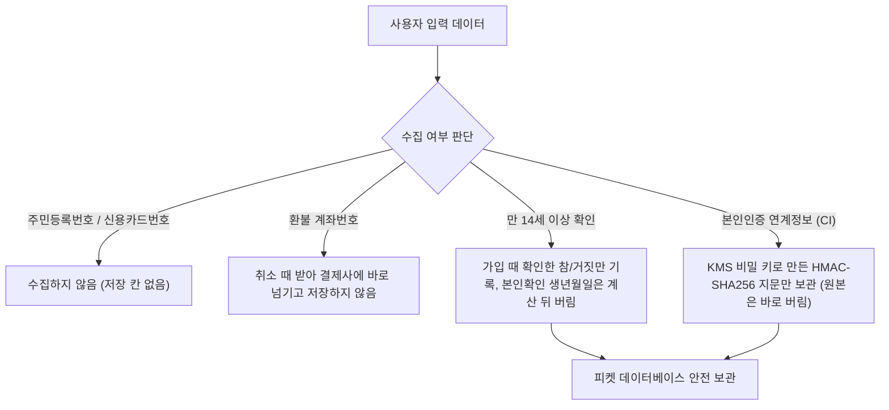
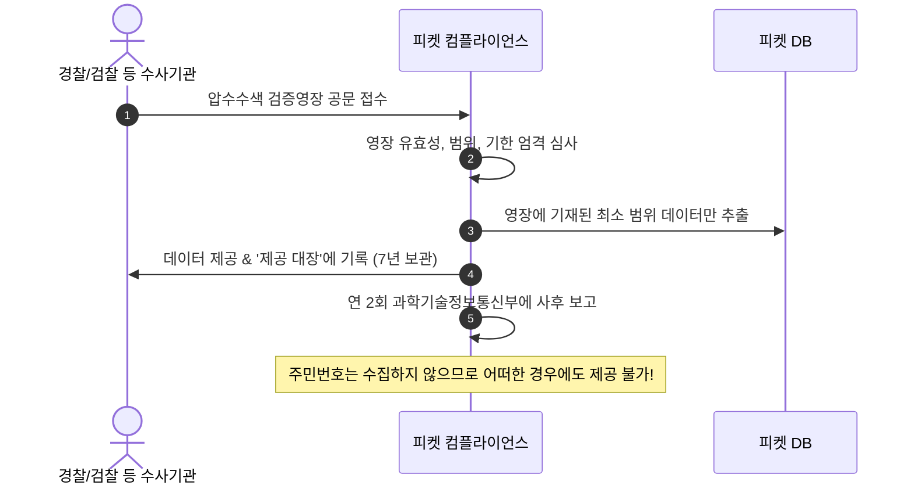

# 13. 법과 개인정보

> [← 12편: 숫자로 증명하기](12-measure-and-prove.md) | [목차로 돌아가기](README.md) | [14편: 서버 구조와 운영 →](14-architecture-and-ops.md)

---

## 1. 상황: 포트폴리오를 넘어선 상용 수준의 컴플라이언스

피켓은 엔지니어링 포트폴리오 프로젝트이지만, 실제 상용 서비스가 마주하는 국내 법적 의무를 지키도록 설계했고 정식 출시 전에 법률 검토를 받는다. 아직 확인하지 못한 것은 ④ 끝에 따로 적었다.

**2026년 8월 28일부터 시행된 개정 공연법**은 입장권을 파는 곳(판매를 맡은 곳 포함)과 통신판매중개업자에게 부정구매·부정판매를 막는 조치(구매자 본인확인, 신고 기능, 처벌 고지, 게시물 차단 등)를 하라고 정한다. 개인정보 보호법은 어떤 데이터를 수집하고 언제 영구 파기해야 하는지 규정하며, 전자상거래법과 공정거래위원회 기준은 환불 수수료의 법적 상한선을 명시한다.

---

## 2. 왜 어려운가: 법률 조문의 모호성과 데이터 수집의 양날의 검

법률 컴플라이언스는 단순히 기능 하나를 추가하는 것보다 훨씬 정교한 해석을 요구한다.

| 핵심 난제 | 원인과 리스크 | 피켓의 해결책 |
| :--- | :--- | :--- |
| **1. 법조문의 모호성과 구현 공백** | "본인확인을 거쳐야 한다"고만 되어 있고 세부 방식이 없음 | **국가법령정보센터 조문 원문 대조** & **합리적 공학 설계** |
| **2. 데이터 수집의 양날의 검** | 보안 추적을 위해 로그를 많이 남기면 그 자체가 개인정보 유출 표적이 됨 | **"수집하지 않은 데이터는 유출될 수도 없다"** (최소 수집 원칙) |
| **3. 공정성과 환불 분쟁** | 임의로 과다한 수수료를 부과하면 약관규제법 위반에 해당 | **공정위 소비자분쟁해결기준 엄격 준수** ([7편](07-transfer-cancel-refund.md)) |

---

## 3. 어떻게 푸는가: 5대 법적 컴플라이언스 공학

### ① 개정 공연법 의무 사항과 피켓의 엔지니어링 대응

| 개정 공연법 법적 의무 | 피켓 시스템의 구체적 대응 방안 |
| :--- | :--- |
| **구매자 본인확인 의무** | 티켓을 구매하려는 모든 계정에 대해 통신사 휴대폰 본인확인을 계정당 1회 필수화 ([9편](09-identity-and-bots.md)) |
| **암표 및 매크로 신고 창구 운영** | 후기마다 [신고] 버튼을 두고, 신고 이유로 '암표·부정판매'나 '매크로·부정 예매 프로그램'을 고르면 정부의 '공연 및 스포츠 암표 통합 신고 누리집'(온라인 암표신고센터)으로 가는 버튼이 함께 나온다. 후기 목록 위에도 같은 곳으로 가는 링크가 있다. 피켓에 보낸 신고는 정부 신고기관에 저절로 넘어가지 않아서 그 점도 함께 알린다. 공연 분야 신고는 한국콘텐츠진흥원이 처리(⑤) |
| **부정구매·부정판매 처벌 사전 고지** | 공연 상세, 대기실, 양도 화면, 이용약관에 `"매크로 등으로 판매자가 정한 공정한 구입 과정을 우회하거나 방해하여 되팔 목적으로 입장권을 구매하는 부정구매와, 판매자의 동의 없이 상습 또는 영업으로 자신이 구입한 가격보다 비싸게 입장권을 판매하거나 알선하는 부정판매는 1년 이하의 징역 또는 1천만원 이하의 벌금에 처해질 수 있습니다(공연법 §41). 부정판매에는 판매금액의 50배 이하의 과징금이 부과될 수 있습니다(공연법 §4의4)."` 문구 명시 |
| **불법 게시물 24시간(고시 사항은 10시간) 내 차단** | 공공기관 서면 통보 접수 시 관제 콘솔 1클릭 명령으로 즉시 차단 ([10편](10-control-tower.md)). 10시간 기준이 붙는 고시는 아직 찾지 못해 확인 중이다 |
| **중개 플랫폼의 추가 조치** | 공연법으로 보면 피켓은 표 판매를 위탁받은 곳이면서 중개 플랫폼이라 두 종류의 조치를 모두 한다(해석). 판매자(기획사) 사업자 확인, 웃돈 재판매 게시물 신고, "웃돈 재판매는 판매금액의 50배까지 과징금" 사전 고지, 차단된 글과 똑같은 내용으로 다시 올린 글의 자동 차단이 더해진다. 글자를 조금 바꾼 글은 이 방법으로 막지 못해 신고와 통보로 처리한다 |
| **공연예술통합전산망 전송** | 공연 명칭, 기간, 예매·결제 금액, 관람자 수 같은 10개 항목을 하루 단위로 정부 전산망에 보낸다(공연법 §4). 일부러 빠뜨리거나 조작하면 과태료 대상이다 |

> [!IMPORTANT]
> **대원칙: "판매자가 정한 공정한 구입 절차"**  
> 개정 공연법은 대기열의 세부 기술 방식을 직접 규정하지 않고 **"판매자가 정한 공정한 구입 절차"**를 기준으로 삼습니다. 따라서 피켓은 대기실 추첨 알고리즘, 1인 1순번 보장, 1인당 매수 한도를 약관과 예매 안내문에 사전 명시해 법적 정당성의 근거를 마련합니다.

---

### ② 개인정보 최소 수집과 비밀 키를 건 지문 보관

* **수집 최소화**: 회원 가입 시 소셜 식별자(`sub`), 닉네임, 이메일만 필수로 받습니다. 주민등록번호와 신용카드 번호는 받지 않고, 환불 계좌번호는 취소할 때 받아 결제사에 바로 넘길 뿐 저장하지 않습니다. 환급이 늦어지는 경우에도 미리 받아 두지 않고 환급할 때 다시 묻습니다([ADR-0050](../docs/adr/0050-crypto-corrections-and-key-management.md)).
* **만 14세 미만 가입 차단**: 가입 화면에서 만 14세 이상임을 확인받아 참/거짓(Boolean) 값만 기록하고 생년월일은 받지 않습니다. 소셜 계정의 연령대는 받지 않습니다(14세를 가르지 못해서). 대신 예매 전 휴대폰 본인확인 때 생년월일로 한 번 더 보고, 만 14세 미만이면 계정을 지웁니다.

---

### ③ 수사기관의 데이터 제공 요청 대응 절차

---

### ④ 피켓은 판매자가 아니라 중개자다

수아 씨가 피켓에서 산 콘서트 표의 판매자는 누구일까? 공연을 올린 파트너(기획사)다. 피켓은 파트너가 피켓에서 표를 팔 수 있게 해 주는 **통신판매중개자**다. 다만 표 주문을 피켓 사이트에서 받기 때문에, 법(공정거래위원회 지침)으로 보면 판매업자의 의무도 일부 함께 지는 '통신판매업자인 통신판매중개자'에 해당한다고 본다(해석, [ADR-0045](../docs/adr/0045-intermediary-legal-status.md)).

| 누가 | 무엇을 책임지나 |
| :--- | :--- |
| 판매자(기획사) | 공연을 실제로 여는 일, 공연 내용, 공연 취소·변경과 그에 따른 배상 |
| 피켓과 판매자가 함께 | 주문 확인, 예매 취소와 환불(피켓이 직접 처리한다) |
| 피켓 | 판매자 정보 표시, 중개자라는 사실 알리기, 문의·분쟁 처리 |

* **알리는 곳 네 군데**: 첫 화면, 공연 상세, 결제 직전 화면, 예매 확인서. 결제 직전과 예매 확인서의 안내 글씨는 판매자 이름보다 작으면 안 된다. 사이트 맨 아래에만 작게 적는 것은 충분하지 않다는 것이 공정위 지침이다.
* **판매자 정보 7가지**: 상호, 대표자, 주소, 전화, 전자우편, 사업자등록번호, 통신판매업 신고번호. 공연을 열기 전 피켓의 판매 승인 때 확인한다.
* **문의·분쟁 처리 기한**: 분쟁은 접수 뒤 3영업일 안에 진행 경과, 10영업일 안에 결과를 알린다(법정 기한, 전자상거래법 시행령 §25의2, POL-037). 분쟁이 아닌 일반 문의는 3영업일 안에 답하는 것이 목표다(법정 기한이 아니라 운영해 보며 정할 잠정값, POL-038).
* **다른 예매처는?** NOL(인터파크·야놀자)은 사이트 아래에 '통신판매 중개자로서 통신판매의 당사자가 아니며…'라고 적는 중개형이다. 티켓링크와 멜론티켓은 약관에서 회사 이름으로 예매·취소를 처리하는 판매형에 가깝다(2026-10-13 확인). 둘 다 쓰이며, 파트너가 직접 공연을 올리는 피켓은 중개형이다.
* **돈을 맡아 정산하는 일**: 피켓은 표 값을 직접 받아 나눠 주지 않는다. 결제사가 표 값을 맡아 두었다가 공연이 끝난 뒤 파트너 계좌로 바로 보낸다(지급대행, [ADR-0047](../docs/adr/0047-settlement-payout-via-pg-agency.md)). 피켓은 얼마를 보낼지 계산해 결제사에 알리는 일만 한다. 이 일이 결제대행업에 해당하지 않는다는 것은 해석이다.
* **결제대금 예치(에스크로)**: 모바일 티켓은 인터넷으로 전달되어 결제대금 예치 대상이 아니라고 본다(해석). 택배로 받는 굿즈는 토스페이먼츠 결제대금 예치를 고를 수 있다.

> [!NOTE]
> **아직 확인 중인 열한 가지**
> 1. 공연법 시행령의 '10시간 안 차단'에 붙는 문화체육관광부 고시의 내용
> 2. 매크로 봇 공격이 정보통신망법의 '침해사고'에 드는지(판단이 서지 않으면 신고하는 쪽으로 운영한다)
> 3. 상업 목적의 통계가 개인정보 보호법의 '통계작성'에 드는지(분석 저장소의 가명 처리 근거, [15편](15-analytics-and-decisions.md))
> 4. 미성년자가 계약을 취소할 때, 이미 본 공연이나 쓴 이용권이 법(민법 §141)이 말하는 '남아 있는 이익'인지, 그리고 다른 분께 양도를 마친 티켓은 어떻게 할지
> 5. 무통장 입금으로 결제한 분이 환불 계좌를 알려 주지 않아 환급이 3영업일을 넘기면 법이 정한 지연배상금을 줘야 하는지(그래서 계좌 요청을 3영업일 안에 세 번 보낸다)
> 6. 판매자가 피켓에 넘기는 팬클럽 선예매 명단(회원 코드)이 '제3자 제공'인지 '처리 위탁'인지, 그리고 피켓이 팬에게 명단을 어디서 받았는지 알려야 할 의무가 생기는지(의무와 관계없이 공연 상세에서 알린다)
> 7. 피켓이 신고로 알게 된 불법 촬영물을 지체 없이 지우거나 막아야 하는 '조치의무사업자'(전기통신사업법 §22의5①)에 해당하는지(해당 여부와 관계없이 신고되면 바로 가린다, ⑤)
> 8. 불법 촬영물을 미리 막는 기술·관리 조치(사전조치) 의무 대상인지(전기통신사업법 §22의5②, 시행령 §30의6. 대상 서비스를 정한 별표를 아직 확인하지 못했다)
> 9. 공연 포스터·상세 이미지·홈 배너에 나오는 출연자 사진을 피켓이 게시하는 근거(사람을 알아볼 수 있는 사진은 출연자의 개인정보일 수 있다. 법률 검토 전까지는 판매자가 홍보용으로 쓰라고 준 이미지만 쓴다)
> 10. 팬이 문의에 스스로 적은 건강 정보 같은 민감정보(예: '아이가 아파서 취소')가 문의 기록에 남을 때 어떤 근거로 보관하는지(문의 화면에는 이런 내용을 적지 않아도 된다고 안내한다)
> 11. 봇 방어에 쓰는 최초 방문 쿠키를 개인정보 처리방침의 '자동으로 수집하는 장치' 안내에 어떤 방식으로 넣을지
> 9~11번은 다른 문서에 '확인 필요'로 적혀 있었지만 이 목록에서 빠져 있던 것을 2026-10-20 점검에서 더했다(추천 적용, ADR-0073).
> 처음에는 '2026-12-16까지 피켓이 정산을 대행할 수 있는지'도 있었지만, 결제사가 파트너에게 직접 보내기로 해서 이 질문은 생기지 않는다.
> 실제 판매를 열기 전에 법률 검토로 확인한다. 결과가 달라지면 책임 표와 안내 문구만 바꾸면 되도록 설계했다.

---

### ⑤ 후기 신고와 임시조치: 신고만으로 지우지 않고, 판단이 어려우면 잠시 가린다

**장면**: 지민 씨가 공연 후기를 읽다가, 자기 실명이 적히고 얼굴이 드러난 사진이 붙은 후기를 발견합니다. 후기 옆 [신고]를 누르자 신고 창이 열립니다. 지민 씨는 이유로 '개인정보 노출·명예훼손'을 고르고, '이 후기로 권리를 침해받은 본인인가요?'에 '네, 저에 대한 글입니다'를 고른 뒤, 어느 부분이 왜 문제인지 적고 결과를 앱 알림으로 받겠다고 고릅니다. [신고 보내기]를 누르면 바로 가지 않고 '이 내용으로 신고할까요?' 확인 창이 한 번 더 나옵니다. [신고합니다]를 누르자 '신고를 접수했습니다. 검토 결과는 알림으로 알려 드립니다.'가 뜹니다.

피켓 운영팀은 이 신고를 **권리 침해 삭제 요청**으로 받아 지체 없이 처리합니다. 사진 속 사람이 정말 지민 씨인지 바로 가리기 어려우면, 그 후기를 정한 날까지(30일 이내) 가리는 **임시조치**를 합니다. 가린 자리에는 '권리 침해 신고로 임시조치된 후기입니다(11/18까지)'가 보이고, 지민 씨와 글쓴이에게 알림이 갑니다. 글쓴이에게는 누가 신고했는지 알리지 않습니다. 글쓴이가 억울하면 고객 문의의 '게시물 조치 이의'로 이의를 냅니다([POL-044](../planning/03-policies-glossary.md), [ADR-0066](../docs/adr/0066-screen-feedback-12-items.md)).

| 무엇을 | 어떻게 하나 | 근거 |
| :--- | :--- | :--- |
| **신고 이유 8가지** | 암표·부정판매, 매크로·부정 예매 프로그램, 욕설·비방·혐오 표현, 개인정보 노출·명예훼손, 음란물·불법 촬영물, 광고·도배, 공연과 관계없는 내용, 기타 중 하나를 고른다. 같은 후기는 한 번, 하루 10건까지(잠정값). 보내기 전에 확인 창을 한 번 더 거치고, 보낸 신고는 고치거나 취소할 수 없다 | 운영 규칙(POL-044) |
| **암표·매크로 신고** | 이 두 이유를 고르면 정부 신고기관(한국콘텐츠진흥원)의 온라인 암표신고센터로 가는 버튼이 나온다. 피켓 신고와 정부 신고는 따로다 | 공연법 시행령 §3의3 1호 나목·2호 나목 |
| **권리 침해 삭제 요청** | 침해받은 본인이 요청하면 결과를 받을 곳(앱 알림, 계정 이메일)을 고르게 하고 지체 없이 처리한다. 판단이 어려우면 30일 이내 임시조치를 하고 신청한 사람과 글쓴이에게 알리며, 가린 자리에 그 사실을 보인다. 이 절차는 이용약관·운영정책에도 미리 싣는다 | 정보통신망법 §44의2 |
| **불법 촬영물** | '음란물·불법 촬영물'로 신고된 후기는 확인할 때까지 바로 가리고 1영업일(잠정값) 안에 판단한다. 판단이 어려우면 방송미디어통신심의위원회에 심의를 요청할 수 있다 | 전기통신사업법 §22의5, 시행령 §30의5(피켓이 의무 대상인지는 확인 중) |
| **신고만으로 지우지 않음** | 운영팀이 운영정책에 따라 검토해 '조치 없음', '임시조치', '노출 차단' 중 하나로 처리하고, 결과는 3영업일(잠정값) 안에 알린다. 사실과 다른 신고나 괴롭히려는 반복 신고는 처리하지 않는다 | 운영 규칙(POL-044) |
| **신고 기록** | 처리가 끝나고 1년(잠정값) 보관한 뒤 지운다 | 운영 규칙(POL-044) |

**고객 문의 기록은 왜 3년 남기나요?** 법(전자상거래법 시행령)은 소비자의 불만이나 분쟁을 처리한 기록을 3년 동안 보존하게 합니다. 피켓은 분쟁이 아닌 일반 문의도 이 기록으로 보아 처리가 끝나고 3년 보관한 뒤 지웁니다(일반 문의까지 넣는 것은 해석입니다). 문의에는 첨부 파일을 받지 않고, 증빙이 필요하면 담당자가 상담 중 화면으로 확인할 뿐 사본은 남기지 않습니다. 답한 사람은 개인 이름 대신 '피켓 고객센터'로 보입니다([FR-069](../planning/02-requirements.md)).

> [!NOTE]
> **신고와 후기 사진에 남는 한계**
> 1. 후기 사진에서 입장 QR이나 바코드를 찾아 거르지만, 일부만 보이거나 흐린 코드는 놓칠 수 있습니다. 사진에는 글자 금칙어 검사도 듣지 않아 신고로 보완합니다.
> 2. 피켓이 불법 촬영물의 조치의무사업자나 사전조치 의무 대상에 해당하는지는 아직 확인 중입니다(④ 끝의 7·8번). 해당 여부와 관계없이 불법 촬영물 신고는 바로 가립니다.

---

## 4. 법정 데이터 보관 주기와 영구 파기 기준표

| 보관 대상 데이터 | 법정 보관 기간 | 법적 근거 |
| :--- | :---: | :--- |
| **계약 및 주문·결제 기록** | **5년** | 전자상거래 등에서의 소비자보호에 관한 법률 |
| **소비자 불만 및 분쟁 처리 기록** | **3년** | 전자상거래 등에서의 소비자보호에 관한 법률 |
| **고객 문의 기록 (일반 문의 포함)** | **처리 뒤 3년** | 전자상거래법 시행령 §6①4호 (일반 문의까지 넣는 것은 해석) |
| **후기 신고 기록** | **처리 뒤 1년 (잠정값)** | 내부 운영 규칙 (POL-044) |
| **서버 접속 기록 (로그인, IP, 기기 정보)** | **3개월** | 통신비밀보호법 (프로젝트 자체 간주 기준) |
| **봇 탐지용 행동 신호 요약값 (원시 좌표·키 값 없음)** | **30일** | 개인정보 보호법 §15 (이후 비식별 집계치만 보존) |
| **회원 프로필 및 본인확인 지문** | **탈퇴 즉시 영구 파기** | 개인정보 보호법 제21조 |
| **관리자 개인정보 열람 감사 로그** | **2년 이상** | 개인정보의 안전성 확보조치 기준 |

---

## 5. 투명한 법률 메타데이터 5단계 표기법

피켓은 기술 문서 내에서 법률이나 규격을 언급할 때, 자의적인 주장을 배제하고 근거의 확인 수준을 5가지 메타데이터 태그로 엄격히 명시한다 ([POL-027](../planning/03-policies-glossary.md)).

| 태그 표기 | 의미와 기준 | 관리 방식 |
| :---: | :--- | :--- |
| **[확인됨]** | 대한민국 국가법령정보센터의 공식 조문 원문과 1:1 대조 완료 | 확정된 법적 근거 |
| **[확인 필요]** | 조문 실물이나, 해당 여부를 가를 고시·가이드라인·판례를 확인하지 못해 출시 전 법률 검토로 정할 항목 | 현재 11건(④ 끝의 '아직 확인 중인 열한 가지') |
| **[해석]** | 법 조문은 확인했으나 티켓팅 시스템에 적용되는 유권해석이 없어 합리적으로 판단함 | 변호사 자문 체크리스트 관리 |
| **[간주]** | 법이 세부 방식을 정하지 않아 프로젝트가 자체 운영 규칙으로 수립함 | 문체부 가이드라인 제정 시 재검토 |
| **[추정]** | 외부 시스템 스펙(PG사 TPS 한계 등)을 공개 자료를 통해 추정한 수치 | 공식 자료나 실계약으로 확인하면 확정값으로 바꾼다(그 전에는 값이 틀려도 돈이 어긋나지 않게 설계) |

---

## 6. 테스트 수행 시의 4대 윤리 기준

| 윤리 규칙 | 이유와 엔지니어링 원칙 |
| :--- | :--- |
| **1. 자체 시험 환경 한정** | 실제 외부 티켓팅 예매처에 매크로나 부하를 쏘는 행위는 공연법 및 정보통신망법 위반이므로 엄격히 금지한다. |
| **2. 테스트 결제 키만 사용** | 실제 결제 사고와 카드 정보 보관 책임을 없애기 위해 PG사 샌드박스 키만 사용한다. |
| **3. 가짜 합성 데이터만 사용** | 부하 시험에는 실제 사람의 개인정보를 쓰지 않는다. 봇 탐지 평가의 사람 세션은 동의를 받아 이름·전화 없이 행동 기록만 가명으로 모으고 30일 안에 지운다(ADR-0048). |
| **4. 클라우드 정책 사전 확인** | 클라우드 서비스 제공자(AWS 등) 정책을 준수하여 자체 할당된 리소스에만 부하를 주입한다. |

---

## 7. 한 줄 요약

> **개정 공연법의 부정구매 방지 의무를 시스템 아키텍처로 구현하고, 개인정보는 주민번호와 카드번호를 받지 않고 연계정보(CI)는 비밀 키를 건 지문으로만 보관하며, 환불은 소비자 기준표를 상한으로 적용하고, 법률적 근거는 5단계 메타데이터로 원문 확인 수준을 투명하게 밝힌다.**

---

## 더 알아보기

* [ADR-0045](../docs/adr/0045-intermediary-legal-status.md): 피켓이 통신판매중개자라는 판단과 법률 검토(전자상거래법, 공연법, 전자금융거래법)

* [POL-024, POL-025](../planning/03-policies-glossary.md): 개정 공연법 부정구매 방지 및 불법 게시물 24시간 차단 절차
* [POL-044](../planning/03-policies-glossary.md), [FR-069·FR-070](../planning/02-requirements.md), [ADR-0066](../docs/adr/0066-screen-feedback-12-items.md): 후기 신고·권리 침해 삭제 요청·임시조치, 고객 문의와 문의 기록 보관
* [POL-023](../planning/03-policies-glossary.md): 개인정보 수집·이용·제공·파기 총괄 운영 정책표
* [POL-026](../planning/03-policies-glossary.md): 테스트·윤리 규칙(자체 환경 한정, 합성 데이터, 봇 평가 사람 세션은 동의·가명·30일 삭제)
* [docs/data.md §6](../docs/data.md): 개인정보 데이터 보관 주기 및 필드별 암호화 방식
* [docs/security/data-classification.md](../docs/security/data-classification.md): 개인정보 항목별 보안 등급 분류 및 법률 원문 대조표(번호별 항목 전체)
* [POL-027](../planning/03-policies-glossary.md): 법률 메타데이터 5단계 표기 규칙([확인됨]·[해석]·[간주] 등) 및 관리 현황
* [docs/architecture.md §8](../docs/architecture.md): OWASP Top 10 및 ASVS 표준 품질·보안 준수 절차
