# 04. IA, 유저 플로우, 화면설계서

- **독자와 용도**: 제품 디자이너(`design/d3`), 프론트엔드 엔지니어, QA 엔지니어가 와이어프레임 수준의 정보 구조(IA), 유저 플로우, 화면 동작 규칙(SCR)을 확인할 때 기준으로 삼는 화면설계서다. 시각적 스타일과 디자인 토큰은 디자인 트랙(`design/d2`)에서 다룬다.
- **원문 출처**: 초기 설계서 §3(4개 클라이언트 앱·타임라인), §4(한 사람의 예매 흐름), §6(대기열·입장·매진·좌석·결제·관제·오프라인·계정), §7(대고객 고지 문구), 5장 라우트 표, 7장 입력 폼 목록, 13장 웹 접근성 (전체 이관표는 [00-diagnosis.md](../00-diagnosis.md#31-설계서d) §3.1).
- **기획 버전**: v1.0 (2026-10-09, §4 기준선 점검 참조).
- **표시 규칙**: 정보 구조(IA)의 메뉴 계층 트리, 유저 플로우의 세부 예외 분기, 화면설계서의 5대 상태 정의와 문구 초안은 원문에 빠진 것을 정리해 채운 것이라 전체에 [보완] 표시를 붙인다. 원문에 이미 있던 화면·동작·문구는 원래 모양을 그대로 두었다.

## 1. IA (Information Architecture)

### 1.1 소비자 웹 (`apps/web`)

```
홈 /                                        SCR-001
├─ 공연 탐색·검색 /search?q=&page=           SCR-003 (검색 입력은 전역 머리 검색창 하나, 자동완성 창)
├─ 공연 상세 /events/[id] (id는 회차)         SCR-002
│  ├─ 외부 브라우저 전환 안내(인앱 브라우저)    SCR-058
│  ├─ 로비·대기열 /queue/[eventId]            SCR-007(오픈 전) · SCR-008(오픈 후) · SCR-018(매진)
│  ├─ 추가 검증 /queue/[eventId]/verify       SCR-009
│  ├─ 좌석 선택 /booking/[eventId]/seats      SCR-010 (입장 토큰 게이트)
│  ├─ 주문·결제 /booking/[eventId]/checkout   SCR-011 (결제창 복귀 …/checkout/return)
│  ├─ 결제 결과 /booking/[eventId]/result     SCR-012
│  ├─ 셔플 검증 /events/[id]/shuffle-proof    SCR-019
│  └─ 후기 모달 /events/[id]?reviews=all · ?review=new · ?report=[reviewId]   SCR-016 (공연 상세 위 전체 모달·쓰기 모달·신고 모달, 전체 모달에서 연 신고는 ?reviews=all&report=[reviewId])
├─ 굿즈 스토어 /shop, /shop/[productId], /shop/[productId]/queue, /shop/cart, /shop/checkout   SCR-015
├─ 마이 티켓 /my/tickets, /my/tickets/[ticketId]   SCR-013
│  ├─ 양도 /my/tickets/[ticketId]/transfer    SCR-014
│  ├─ 예매 취소·연기 환급 /my/tickets/[ticketId]/cancel SCR-038
│  ├─ 양도 받기 /my/transfers/[offerId]        SCR-041
│  ├─ 배상금 계좌 입력 /my/compensations/[id]  SCR-043
│  └─ 티켓 연동 부가 상품 /my/tickets/[ticketId]/addons SCR-015(티켓 연동 부가 상품 모드)
├─ 예매·주문 내역 /my/orders, /my/orders/[orderId]   SCR-055
│  └─ 환불 계좌 입력(지연 환급) /my/refunds/[refundId]/account   SCR-060
├─ 관심 공연·알림 신청 /my/likes               SCR-054
├─ 계정 설정 /my/settings                    SCR-017
│  └─ 로그인 수단·병합 /my/settings/providers  SCR-040
├─ 본인확인 복귀 /verify/return         SCR-006 (본인확인 흐름: 부르는 화면 위 기관 창과 결과 대화상자. 이 화면이 보이는 것은 기관이 페이지 이동으로 처리하거나 팝업이 막힌 때만)
├─ 소명 제출 /my/appeals/[id]                 SCR-042
├─ 내 현장 배정 /staff                        SCR-061
│  ├─ 현장 스태프 초대 수락 /staff/invitations#token=…   SCR-050
│  └─ 스캐너 승인 /staff/approve#code=…          SCR-051
├─ 로그인 /login                             SCR-004
│  └─ 계정 연결 제안 /login/link              SCR-039
├─ 가입 완료·동의 /signup/consent             SCR-005
├─ 고객센터·문의 /help, /help/inquiries/new, /help/inquiries, /help/inquiries/[id]   SCR-056 (FAQ · 문의하기 · 내 문의 내역 · 문의 상세, 문의 세 페이지는 로그인)
├─ 약관·정책 문서 /policy/[slug]              SCR-057 (이용약관, 개인정보 처리방침, 분쟁 해결 기준, 판매 조건 공통, 운영정책, 사업자 정보)
└─ 시스템 안내 404·500·429·판매 일시 중단·오프라인·미지원   SCR-059
```

- 언어: 한국어는 위 주소를 그대로 쓰고, 영어·일본어·중국어 간체는 앞에 `/en`·`/ja`·`/zh`를 붙인다. 페이지마다 hreflang을 둔다. 브라우저 언어에 따라 다른 언어 주소로 자동 이동하지 않는다(ADR-0060).
- 전역 머리: 로고 · 통합 검색창(소비자 웹에서 하나뿐인 검색 입력) · 찜 · 마이 티켓 · 계정으로 이루어진다. 그 아래 줄에 '전체 장르' 버튼과 주 메뉴(홈 · 공연 · 오픈 예정 · 굿즈 스토어)를 둔다(소유자 결정 2026-10-14, ADR-0063). '공연'·'오픈 예정'·'전체 장르'와 홈의 장르 바로가기·공연장은 새 화면 없이, SCR-003에 필터를 건 주소(예: `/search?status=UPCOMING`, `/search?genre=`, `/search?placeId=`)로 간다(추천 적용 2026-10-14, ADR-0063).
- 본인확인은 따로 된 화면이 없다. 본인확인이 필요한 화면(SCR-002·005·007·008·009·011·013·017·050 등)의 본인확인 버튼이 본인확인기관 창을 바로 연다. 결과는 그 화면 위 대화상자로 보여 준다. `/verify/return`은 기관이 결과를 돌려주는 짧은 복귀 화면이다. 팝업이면 팝업 안에서 결과를 넘기고 닫히므로, 사용자가 이 화면을 보는 것은 기관이 새 창 대신 페이지 이동으로 처리하거나 팝업이 막힌 때뿐이다(소유자 결정 2026-10-14, ADR-0063).

### 1.2 파트너 콘솔 (`apps/partner`)

```
로그인 /login (TOTP 기반 2단계 인증), 초대 수락 /invite#token=…   SCR-020
공연 관리(파트너 홈) /events                   SCR-062
├─ 공연 등록 위저드 /events/new               SCR-021
└─ 공연 개요(회차 허브) /events/[id]           SCR-063
   ├─ 등록 정보 /events/[id]/edit             SCR-021
   ├─ 좌석맵 에디터 /events/[id]/seatmap      SCR-022 (시작·템플릿 고르기, 배치 그리기·좌석 채우기·좌석 다듬기·미리보기)
   ├─ 판매 정책 /events/[id]/policy           SCR-024
   ├─ 판매 승인 요청 /events/[id]/sale-review SCR-021(5단계)
   ├─ 회차 취소·연기 요청 /events/[id]/cancellation  SCR-044
   ├─ 실시간 판매 현황 /events/[id]/live      SCR-026
   ├─ 정산·예매자 명단 /events/[id]/settlement SCR-027(정산서·판매 요약·예매자 명단·다운로드 이력 탭)
   └─ 현장 스태프·현장 운영 /events/[id]/staff SCR-037(스태프 탭, 현장 운영 탭)
상품 빌더 /products (상품 만들기·상품 목록·굿즈 주문 현황·배송·반품 처리·상품 정산 탭)     SCR-023
설정 /settings/account·seller·payout·team, /settings/webhooks   SCR-020(내 계정·판매자 정보·정산 계좌·팀 계정), SCR-025
```

데스크톱에 더해 태블릿과 휴대폰에서도 쓴다. 휴대폰에서는 보기, 공연 당일 현장 운영(SCR-037), 정산서 내려받기·정산 이의 제기, 반품 도착 확인, 내 계정 보안 설정(재인증)까지만 한다. 나머지는 '태블릿이나 데스크톱에서 합니다' 안내로 대신한다(소유자 결정 2026-10-14, ADR-0061, 화면별 범위는 design/d5 §3.9).

### 1.3 관제 콘솔 (`apps/console-host`, Module Federation)

```
로그인 /login (다중 인증 필수, 허용 IP 및 VPN 제어), 초대 수락 /invite#token=…, 내 계정 /me   SCR-028
대시보드 /dashboard (T-30분 · T=0 · 판매 중 · 종료 후 · 입장 탭), 결정 기록 /dashboard/decisions   SCR-029
운영 명령 /commands                          SCR-030
감사 로그·인시던트 리플레이 /audit             SCR-031
법정 조치 /compliance (게시물 노출 차단, 자료 요청 대응, 보안 사고 신고·통지, 접속기록 점검)  SCR-032
CS 처리함 /cs/inbox                          SCR-045
승인 업무 /cs/approvals (예외 환불, 미성년자 계약 취소, 양도 회수, 예매 제한, 지급 묶음, 정산서 수기 조정, 계약 수수료율·보증 변경, commander 역할 부여·회수)  SCR-046
팬 조회 /customers                           SCR-066
회차 취소 판정·일괄 환불 /cancellations      SCR-047
판매 승인 /sale-reviews                     SCR-048
정산 지급 /settlements                      SCR-049
스캐너 기기 관리 /scanner-devices            SCR-053
파트너사·계약 관리 /partners                  SCR-065
관리 계정·세션 관리 /accounts (초대, 역할, 잠금 해제, 강제 세션 종료)  SCR-064
봇 판정 표본 검토 /bot-review                 SCR-067
공지 관리 /notices (대기실 공지 템플릿, 파트너 긴급 공지, 홈 구성)  SCR-068
포렌식 리플레이 /forensics (2단계·선택, 새 탭으로 여는 별도 페이지. 1단계는 별도 데모 앱)  SCR-069
```

데스크톱에 더해 태블릿과 휴대폰에서도 쓴다. 휴대폰에서는 보기, 이미 요청된 일의 승인·반려(재인증), 안전 쪽 조치(세션 강제 종료, 스캐너 기기 즉시 폐기, 일괄 환불 일시정지, 명령 11 자동화 정지 스위치. 명령 11은 추천 적용 2026-10-28, 기술 검토 낮음-155), 내 계정 보안 설정(재인증)까지만 한다. 나머지는 '태블릿이나 데스크톱에서 합니다' 안내로 대신한다. 이 범위는 화면에서 거는 장치이고, 권한은 서버의 역할·재인증·2인 승인이 막는다(소유자 결정 2026-10-14, ADR-0061, 화면별 범위는 design/d5 §3.9).

### 1.4 게이트 스캐너 PWA (`apps/scanner`)

```
현장 스태프 로그인(기기 승인) /login, 기기 등록 /enroll#code=…               SCR-036
근무 준비 /setup                             SCR-033
티켓 스캔 /scan                               SCR-034
동기화 상태 /sync                            SCR-035
현장 관리(현장 책임자) /manage                 SCR-052
```

관리형 Android 휴대폰(세로·가로)과 관리형 Android 태블릿(세로)에서 같은 일을 한다(ADR-0061).

## 2. 핵심 유저 플로우

### F-01 팬 예매 전체(하이브리드 공연, 원문 §4의 '지민' 시나리오)

공연 오픈 알림을 받는 데서 시작해 T-10분 사전 로비 입장, 순번을 무작위로 섞는 셔플로 순번 받기, 정해진 간격으로 다시 묻는 구간 폴링, 좌석 홀드(결제하는 동안 다른 사람이 가져가지 못하게 좌석을 잠시 잡아 두는 것), 결제 Saga(여러 서비스에 걸친 일을 단계별로 처리하고, 중간에 실패하면 앞 단계를 되돌리는 방식) 완결까지 가는 표준 예매 여정이다.

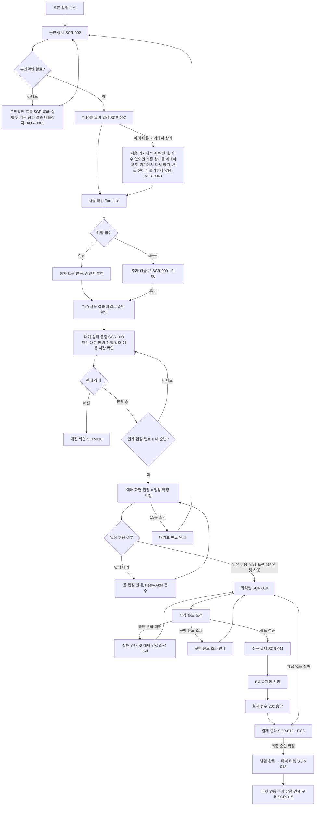

### F-02 오픈 후 도착자(FIFO 공연, 하이브리드·사전 셔플 공연의 오픈 후 도착자)

오픈 시점 이후에 도착한 팬은 오픈 전 로비 참여자들의 무작위 셔플 순번 뒤에, 도착한 순서대로 대기 번호를 받는다. 사전 셔플 공연도 오픈 뒤 진입을 받는다. 이 진입은 동시 도착 묶음 없이 도착 순이다(소유자 결정 2026-10-14, 세부는 추천 적용 2026-10-14, ADR-0064). 모든 공연에서 그 회차의 판매 종료(공연 시작 24시간 전) 뒤에는 진입을 받지 않는다(POL-030).

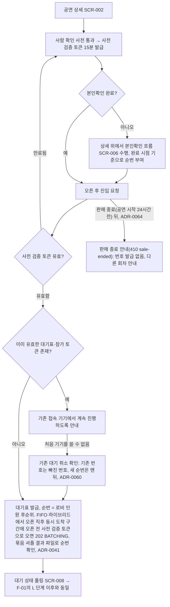

### F-03 결제 Saga 분기(원문 §6 결제 연동)

PG사(온라인 결제를 대신 처리해 주는 결제사)에서 결제 인증이 끝나면, Saga로 좌석 확정(PENDING → SOLD)과 발권을 안전하게 마무리한다. 결제 승인 앞에서 실패하면 보상 트랜잭션(앞서 반영한 변경을 한꺼번에 되돌리는 작업 단위)으로 되돌린다. 결제 승인은 되돌리기 어려운 고비 단계라, 승인 뒤의 발권 실패는 결제를 취소하지 않고 앞으로 다시 시도한다(추천 적용 2026-10-28, ADR-0106). 결제를 접수하지 않고 떠난 주문은 과금 없이 만료로 끝낸다(ADR-0107).

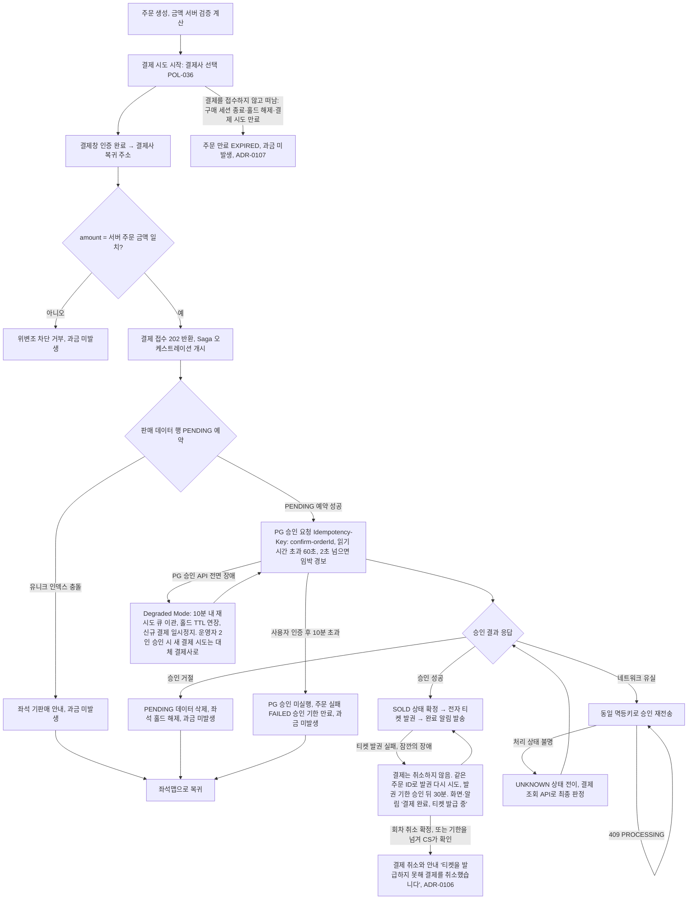

### F-04 공연 당일 입장(원문 §6 오프라인 전략)

인터넷 연결이 불안정한 오프라인 공연장에서도 입장이 멈추지 않게 한다. 모바일 기기는 기기 안에서 서명을 만들고, 스캐너는 기기 안에서 검증한다. 처리량은 구역별 스캐너 대수를 가장 붐비는 구간의 도착률에 맞춰 확보한다(offline-gate §0, ADR-0051 결정 14). 판정 순서의 정본은 offline-gate §6.4다.

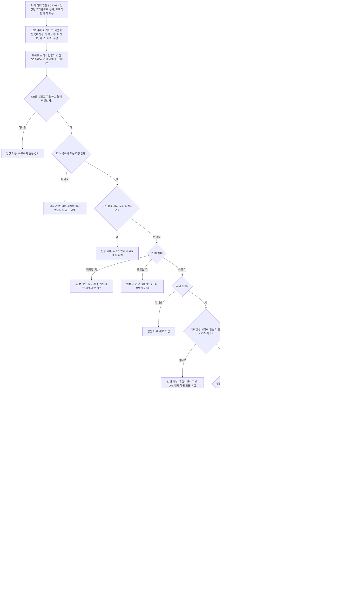

| 번호 | 갈래 | 조건 |
| --- | --- | --- |
| P1 | 입장 상태 판정 → 통과 처리 | 입장 모드에서 기록 없음, 재입장 허용 회차의 퇴장 뒤, 퇴장 모드에서 마지막 방향이 입장 |

### F-05 운영 명령(원문 §6 관제)

트래픽이 갑자기 늘거나 비상 상황이 생기면, 관제 콘솔에서 안전 한계와 2인 승인 절차를 거쳐 서비스를 멈추지 않은 채로 운영 명령을 내린다.

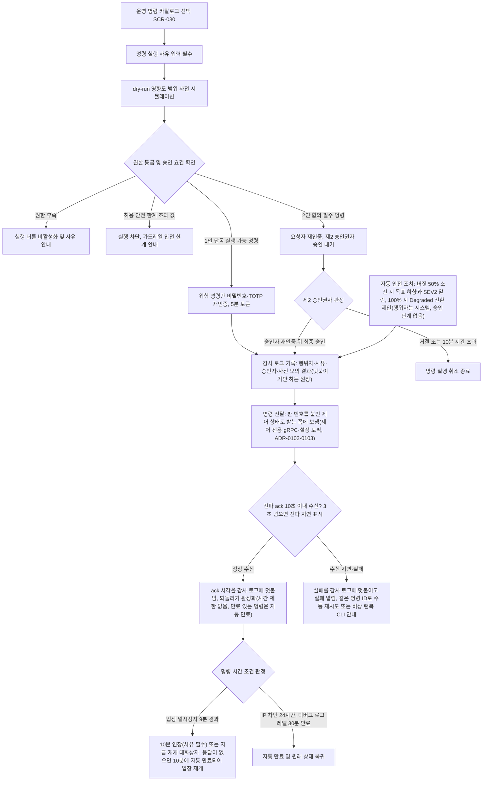

감사 로그는 명령을 받는 쪽에 보내기 전에 먼저 쓴다. ack를 받은 시각과 전달 실패도 같은 원장에 덧붙이므로, 실패한 명령도 기록이 남는다. 상태 이름과 전이는 정본 docs/features/control-tower.md §4(`APPROVED → DISPATCHED`는 감사 로그를 쓴 뒤)와 §7을 따른다(기술 검토 중간-107).

### F-06 추가 검증 큐(원문 §7 결정 5)

비정상 매크로를 찾는 탐지 모델에서 고위험 판정을 받은 트래픽은, 일반 대기열과 격리된 추가 검증 큐로 따로 보내 더 깊이 검증한다.

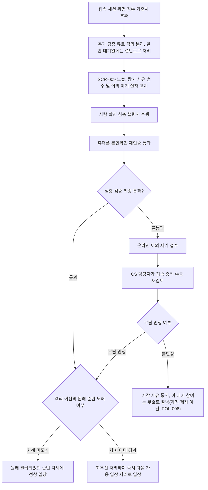

### F-07 법정 통보 처리(원문 §6 암표 방지, 운영 명령 10)

공연법 제4조의2에 따라 수사기관이나 신고기관이 매크로 암표 적발을 통보하면, 24시간 이내에 법정 조치를 마치고 감사 기록을 관리한다.

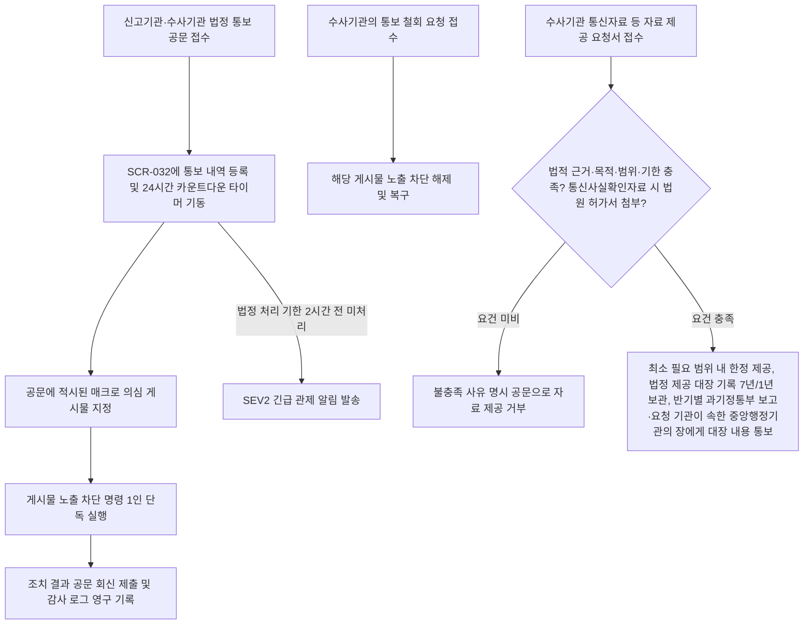

### F-08 티켓 양도(원문 §6 오프라인 전략 4, 계정·인증, ADR-0046)

개인 간의 무분별한 암표 거래는 막으면서 실수요자의 양도는 돕기 위해, 본인확인을 마친 회원 사이에서 양도를 한다. 받는 사람이 수락해야 티켓이 넘어간다. 취소와 환불은 결제자에게만 한다.

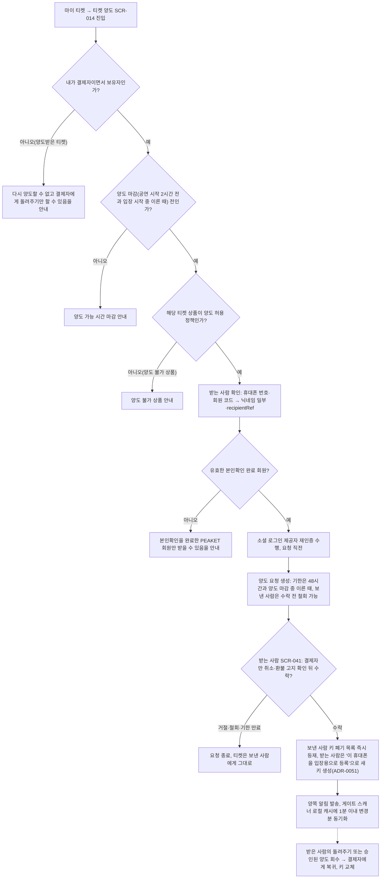

### F-09 스캐너 단말기 로그인(현장 스태프, POL-031)

현장 단말기의 분실과 부정 조작을 막으려고, 운영자가 등록한 기기(FR-065, SCR-053)와 승인된 현장 스태프 계정을 함께 확인한다. 스캐너는 여러 사람이 함께 쓰는 공용 기기라 아이디·비밀번호를 넣지 않는다. 그래서 입력 화면 엿보기, 비밀번호 공유, 기기에 남는 비밀번호가 생기지 않는다. 스태프는 자기 휴대폰의 PEAKET 로그인으로 스캐너 화면의 QR을 승인한다(RFC 8628 기기 승인 방식). 이렇게 받은 토큰(권한이나 상태를 증명하려고 주고받는 서명된 문자열)은 그 기기의 인증서에 묶인다(ADR-0051). 승인 화면 SCR-051은 QR을 찍은 스태프 본인의 휴대폰에 열리는 화면이고, 현장 책임자 계정에 자동으로 뜨지 않는다. 책임자가 대리 승인할 때만 책임자 휴대폰에서 같은 화면을 쓴다(추천 적용 2026-10-19, ADR-0066). 단계는 ① 초대 보내기(SCR-037) → ② 초대 수락(SCR-050, 본인확인·동의) → ③ 내 배정 확인(SCR-061) → ④ 스캐너 앱 열기(SCR-036, QR·확인 코드, 입장 시작 3시간 전부터) → ⑤ 내 휴대폰으로 QR 찍기(SCR-051 열림) → ⑥ 코드 대조 뒤 [로그인 승인] → ⑦ 스캐너 로그인·근무 준비(SCR-033) → ⑧ 스캔 시작(SCR-034)이다. ①~③은 공연 며칠 전, ④~⑧은 공연 당일이다. 초대부터 마감까지의 시간 순서는 offline-gate §0이 정본이다(ADR-0051).

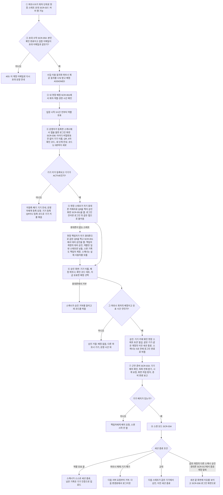

### F-10 예매 취소 및 환불(POL-032)

공정거래위원회 소비자분쟁해결기준을 그대로 따라, 취소 시점에 따라 다른 수수료를 공제한 뒤 자동으로 환불한다.

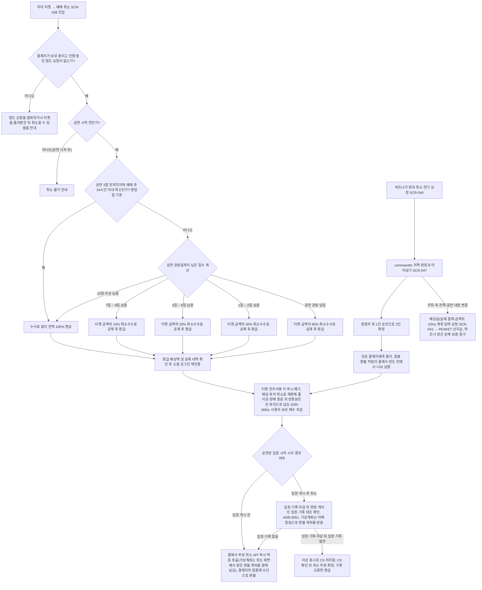

### F-11 소셜 계정 연결 및 병합(POL-034)

여러 소셜 로그인 채널을 쓰는 팬의 티켓이 여러 계정에 흩어지는 불편을 막고, 계정 탈취를 차단하는 안전한 계정 병합 흐름이다.

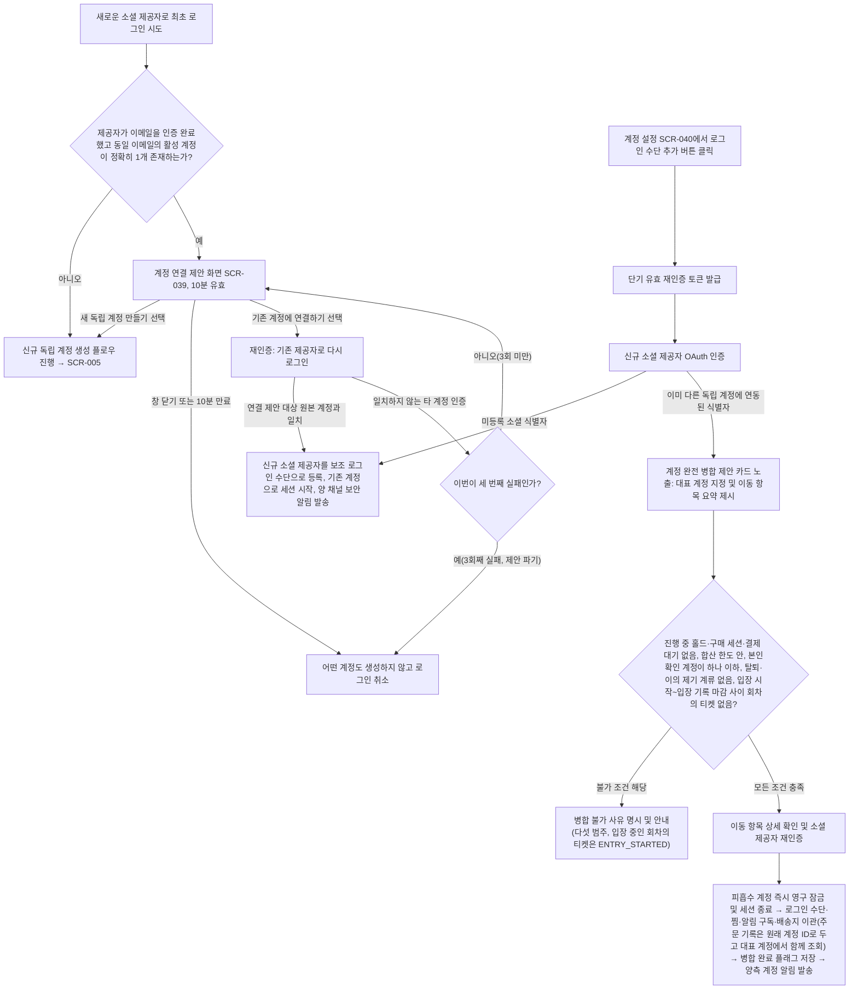

### F-12 예외 환불 승인(POL-038, ADR-0046)

정책 안의 직접 취소는 자동으로 처리한다. 정책 밖 환불만 요청자가 아닌 다른 승인자가 확인한다.

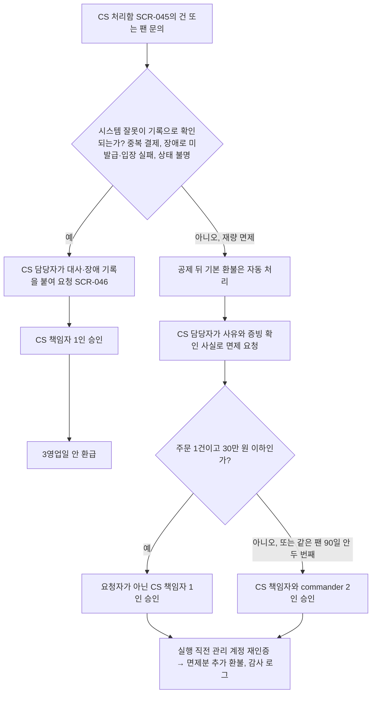

### F-13 정산 지급(POL-039, ADR-0047)

회차가 끝나면 결제사별 정산서를 만든다. 이의 기간과 지급 묶음 승인을 거친 뒤 결제사가 파트너 정산 계좌로 보낸다. PEAKET은 판매 대금을 받아 두지 않는다.

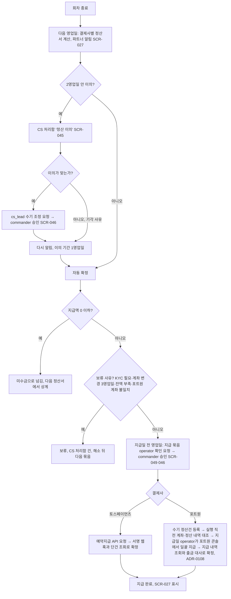

## 3. 화면설계서

각 화면은 5대 표준 UI 상태(기본 상태, 로딩, 빈 화면, 에러, 권한 없음)를 분명히 정한다. 여기 실은 문구 초안은 디자인 트랙의 UX 라이팅 가이드라인(`design/d2`)에 맞춰 쓴다.

### 3.1 소비자 웹

| ID | 화면명·목적 | 관련 | 진입 경로 | 구성 요소(중요도 순)와 동작 | 상태 | 표시 문구 초안 |
| --- | --- | --- | --- | --- | --- | --- |
| SCR-001 | 홈. 오픈 예정·판매 중 공연과 장르별 랭킹·테마를 둘러보고 주요 소식을 확인한다 | FR-003, FR-004, FR-019, FR-053, POL-037, POL-043 | 직접 접속, 프로모션 알림 링크, 전역 머리 로고 | 섹션 구성은 NOL 메인 구성을 따른다(소유자 결정 2026-10-14, ADR-0063). 구조(섹션 순서·배치·비율)만 따른다. NOL의 로고·이미지·문구·배지 이름·아이콘 그림·색은 쓰지 않고, NOL에만 있는 기능(포인트·결제 혜택, 타임딜·할인, 영상 클립, 쿠폰·특가)은 넣지 않는다(design/d1 §3). ① 오픈 예정 공연 가로 카드 줄(공연 하나에 카드 하나, ADR-0093. 포스터, 다음 오픈 일시, 공연명 2줄, 사전 셔플·선예매 같은 판매 정보 배지, 오픈 알림 받기 토글 버튼(그 공연에서 다음에 오픈하는 회차를 신청한다, ADR-0093). 토글은 카드 아래 꽉 찬 버튼이 아니라 글자 묶음 첫 줄(오픈 일시 오른쪽)의 종 아이콘 버튼으로 둔다(44px, `aria-pressed`, 신청되면 채운 종과 강조 배경, 이름은 '팬미팅 오픈 알림 받기'처럼 공연명을 담고 누른 뒤에도 같다, 추천 적용 2026-10-19, ADR-0066). 처음 켤 때 알림 권한을 미리 안내한다(CMP-068). 제목 옆 '전체보기'는 SCR-003 오픈 예정 필터) ② 통합 검색창(전역 머리에 있고, 소비자 웹에서 하나뿐인 검색 입력. 자동완성 창과 결과는 SCR-003) ③ 찜한 공연 작은 카드 줄(로그인한 경우만, 공연 단위) ④ 공식 굿즈 스토어 가로 띠 배너(가격을 보이면 SCR-015 ⑬ 표시 가격 규칙에 따라 배송비를 포함한 총금액, POL-016) ⑤ 하단 사업자 정보와 통신판매중개자(직접 팔지 않고 판매자와 구매자의 거래를 알선하는 사업자) 고지(공연과 상품을 함께 말하는 문장, POL-037), 구매안전서비스 줄(굿즈 택배 주문에 쓰는, 연동 결제사 토스페이먼츠의 결제대금예치와 서비스 가입 사실 확인 링크, POL-014), 분쟁 해결 기준 링크(CMP-058) ⑥ 큰 배너 슬라이드(운영자가 SCR-068 [홈 구성]에서 판매 승인된 공연 가운데 골라 순서와 노출 기간을 정한 배너. 이미지는 파트너 포스터가 아니라 운영자가 올린 가로형 배너 이미지와 대체 텍스트. 좌우 화살표, 'n / N', [일시정지], 5초 [가정] 자동 넘김, 포커스나 마우스가 올라가면 멈춤, POL-043) ⑦ 장르 바로가기 아이콘 타일 한 줄 10칸(정본 장르 7개 콘서트·뮤지컬·연극·클래식·페스티벌·팬미팅·기타(planning/03 §4 '장르') + 굿즈 스토어 + 공연장 + 전체 장르. 장르를 누르면 SCR-003 장르 필터, 굿즈 스토어는 SCR-015, 공연장은 공연장 필터를 연 SCR-003, 전체 장르는 장르 필터 없는 SCR-003, 추천 적용 2026-10-14, ADR-0063) ⑧ 장르별 랭킹(장르 칩 탭, 순위 숫자를 붙인 포스터 카드 줄. 순위는 어제 판매 매수 기준이다. 매일 09:30 [가정]에 하루 한 번 계산해 10:00 [가정]에 정적 파일로 만들어 사용자 가까운 곳에 파일을 복사해 두고 대신 응답하는 전송망인 CDN으로 낸다. 기준일이 2일 [가정] 넘게 묵으면 이 섹션을 숨긴다. 판매 승인된 공연만 넣고, 매진·판매 종료 공연도 '매진' 배지와 함께 넣는다. 섹션 제목 아래에 기준을 글로 적는다(법정 의무가 아닌 프로젝트 선택), POL-043) ⑨ 지금 판매 중(가로형 카드 3열 격자: 왼쪽 포스터, 오른쪽 '판매 중'·남은 판매 기간·공연명·장소·기간·최저가. 티켓은 예매 수수료가 없어(POL-032) 카드의 가격이 곧 총금액이다. 판매 중이고 잔여석이 있는 공연을 판매 종료가 가까운 순으로 놓는다. 회차의 판매 종료는 그 회차의 공연 시작 24시간 전(`starts_at` − 24시간, 소유자 결정 2026-10-14, ADR-0064)이고, 남은 판매 기간은 그 공연의 마지막 회차의 판매 종료까지다 [가정, 새 데이터 칸 없음, 추천 적용 2026-10-14, ADR-0063·ADR-0064]. 남은 기간은 글자로만 보이고 깜빡임이나 재촉 배지를 쓰지 않는다) ⑩ 테마 추천(운영자가 [홈 구성]에서 만든 테마마다 테마 이름 + 포스터 카드 줄, POL-043) ⑪ 공연장(원형 이니셜(로고 이미지 없음) + 이름 가로 줄, 누르면 SCR-003 공연장 필터). 위에서 아래 순서는 머리(②) → ⑥ → ⑦ → ① → ③ → ⑧ → ⑨ → ④ → ⑩ → ⑪ → ⑤이다. 모바일·태블릿도 같은 순서로 쌓되, 가로 줄은 가로 스크롤로, 장르 타일은 5×2 격자로 둔다. 영상 클립 섹션은 두지 않는다(피켓에 기능 없음). 섹션은 저마다 따로 그리고, 섹션 하나가 비면 그 섹션만 숨긴다(추천 적용 2026-10-14, ADR-0063). 100만 명이 한꺼번에 접속해도 엣지(CDN이 사용자 가까이에 둔 서버)에 복사해 둔 캐시가 바로 응답하도록 설계한다(배너·랭킹·테마도 정적 파일). | 로딩: 섹션마다 카드 스켈레톤 UI를 그린다. 빈 화면: 오픈 예정 공연이 없으면 "예정된 공연이 없습니다"를 보인다. 다른 섹션은 비면 그 섹션만 숨긴다(배너가 없으면 슬라이드 자리를 접는다). 에러: 마지막으로 정상이던 캐시(stale) 데이터를 보인다. 권한 없음: 로그인하지 않아도 똑같이 볼 수 있고, ③만 숨긴다. | "오픈 알림 받기"(종 버튼 이름), "오픈 알림을 신청했습니다", "오픈 알림을 껐습니다", "지금 판매 중", "전체보기", "어제 판매 매수 기준, 매일 오전 10시 갱신"(장르별 랭킹 제목 아래), "판매 중 · 12일 남음", "슬라이드 일시정지", "PEAKET은 통신판매중개자로서 공연과 상품 거래의 당사자가 아닙니다. 공연의 개최·변경·취소와 상품의 제공·품질에 따른 책임은 각 판매자에게 있고, 예매·주문 취소와 환불은 PEAKET이 처리합니다. 판매자 정보는 각 공연·상품 상세에 있습니다", "구매안전서비스: 굿즈 택배 주문은 토스페이먼츠 결제대금예치를 이용할 수 있습니다 ( 서비스 가입 사실 확인 › )" |
| SCR-002 | 공연 상세. 핵심 판매 조건을 알리고 대기열로 들어가도록 이끈다 | FR-003, FR-004, FR-002, FR-006, FR-016, FR-053, FR-070, POL-004, POL-024, POL-032, POL-037, POL-042, POL-044 | 홈, 검색 결과, 오픈 알림 링크 | ① 공연 기본 정보, 좌석 등급별 가격, 잔여 상태 요약 ② 대기열 정렬 방식 법정 고지 문구(같은 고지를 하는 3곳 중 첫 번째) ③ 본인확인 완료 여부와 [휴대폰 본인확인] 버튼(목적 문구는 버튼 위 한 줄. 누르면 본인확인기관 창이 바로 열리고 결과는 이 화면 위 대화상자로 보인다, SCR-006) ④ 핵심 판매 조건(1인 1순번 원칙, 인당 구매 매수 한도, 재입장 허용 여부, 양도 가능 마감 시각, 예매 취소 공제율 기준과 '공연일 10일 이내 취소 시 기준에 따른 공제 후 환불', POL-032 사전 고지) ⑤ 부정구매·부정판매 형사처벌·과징금 법정 고지(POL-024 라목) ⑥ 오픈 알림 구독 토글 ⑦ 로비 입장과 예매 진입 버튼(시각 조건에 따라 활성화가 바뀐다) ⑧ 셔플이 무작위인지 검증하는 링크(시드를 원래 값으로 되돌릴 수 없게 바꾼 해시를 확인) ⑨ 후기 섹션(제목 '후기'. 같은 공연의 모든 회차 후기를 모은 평균 별점·후기 수(ADR-0093), 최근 후기 2개 미리보기, [후기 n개 전체보기] → 후기 전체 모달, 섹션 머리 오른쪽 [후기 쓰기] → 후기 쓰기 모달. 쓸 자격이 없어도 버튼을 숨기지 않고, 누르면 이유를 알리는 대화상자를 보인다. 미리보기의 사진을 누르면 전체 모달을 그 후기의 사진 보기로 열고, 미리보기의 [신고]는 상세 위에 신고 모달(`?report=`)을 연다, SCR-016, POL-042, ADR-0066) ⑩ 판매자 줄('판매자: {상호}'와 공연용 통신판매중개자 고지 문장 한 줄, 본문에 늘 보인다)과 ⑯의 [판매자 정보] 모달(신원정보 7항목과 공연용 중개자 고지, CMP-058) ⑪ 회차 선택(같은 공연의 다른 회차로 주소를 바꾼다, CMP-066) ⑫ 찜 토글(공연 단위, ADR-0093)과 공유(기능 요구사항 FR-019) ⑬ 섹션 바로가기 탭(공연 정보 · 상세정보 · 판매 조건 · 장소 · 후기, 본문 위에서 스크롤을 따라 붙는다) ⑭ 상세정보 섹션(파트너가 SCR-021 1단계에서 올린 공연 설명 글(CMP-070)과 상세 이미지 0~10장(ADR-0062 결정 38)을 이어 보인다. 처음에는 높이 1,200px [가정]까지만 보이고 [상세정보 더보기]로 펼친다. 이미지마다 대체 텍스트를 두고, 이미지에만 있는 정보는 설명 글로도 적는다(웹 접근성 국제 기준 WCAG 1.4.5). 상세 이미지가 없으면 설명 글만 보인다) ⑮ 장소 섹션(공연장 이름·주소·[주소 복사], 공연장의 다른 공연 링크는 SCR-003 공연장 필터. 지도 그림은 외부 지도 서비스 연동이 기획에 없어 두지 않는다 [가정]) ⑯ 안내 모달 셋(본문 아래 줄 단추 '예매 안내사항'·'취소·환불 안내사항'·'판매자 정보'. 예매 안내사항: 접는 항목으로 예매 전 확인(본인확인 계정당 1회, 1인 1순번, 매수 한도, 사람 확인), 대기실과 순번(POL-004 표준 문구), 가상계좌 결제 안내(허용 공연만, POL-014), 모바일 티켓과 입장용 휴대폰 등록, 양도(결제자만·수락형·마감, POL-017), 부정구매·부정판매 처벌·과징금(POL-024 라목). 취소·환불 안내사항: POL-032 공제표 전체, 취소 방법·기한(공연 시작 전, 입장 시작 뒤 취소는 입장 기록 확인 뒤 환급), 환급 수단과 3영업일, 회차 취소·연기 때 환급과 배상, 미성년자 계약 취소(POL-038 ⑧). 판매자 정보: 신원정보 7항목과 공연용 중개자 고지(POL-037). 문장은 POL·FR·design/d5 정본에서 가져온다). 데스크톱은 2단으로 왼쪽 본문, 오른쪽 고정 예매 패널(⑦, ⑪, 가격 요약)이다. ②·④·⑤·⑩은 모달 안에만 숨기지 않고 본문에 늘 보인다. ⑯ 모달은 자세한 내용을 더 보는 곳이다(소유자 결정 2026-10-14, ADR-0063. 섹션 순서·높이·장소 섹션 세부는 추천 적용 2026-10-14, ADR-0063). ⑦ 버튼의 시각·상태별 표현은 design/d5-screen-blueprint.md §5.2에 모았다. 판매 승인 전 공연은 비공개 안내만 보인다(FR-052). 그 회차의 판매 종료(공연 시작 24시간 전, POL-030) 뒤에는 정렬 방식과 관계없이 ⑦ 자리에 '판매 종료' 상태("판매가 끝난 회차입니다"와 다른 회차 링크)를 보인다. 취소표 알림 신청도 받지 않는다(소유자 결정 2026-10-14, ADR-0064). 사전 셔플 공연도 오픈 뒤에는 다른 공연처럼 ⑦이 대기열 들어가기다(ADR-0064). 오픈 시점 이후에 도착한 팬에게는 이 화면에서 사람 확인(Cloudflare Turnstile)을 미리 통과해, 15분 동안 유효한 사전 검증 토큰을 받도록 안내한다. | 로딩: 정적 셸 구조를 바로 그린다. 빈 화면: 해당 사항이 없다. 에러: Origin(CDN 뒤에서 원본 파일을 주는 서버) 백엔드에 장애가 나면 잔여석 숫자 대신 '판매 중' 고정 기본 문구를 보인다(POL-029). 권한 없음: 로그인하지 않아도 모두 볼 수 있다. 예매 버튼을 누르면 로그인 페이지로 안내한다. 다른 기기·탭에서 이미 대기 중이면(로비·진입 409) 처음 기기에서 계속하라고 안내한다. 처음 기기를 쓸 수 없으면 기존 참가를 취소하고 다시 참가하게 한다(로비는 셔플 전이라 불리하지 않고, 대기열은 맨 뒤, ADR-0060). 후기 쓸 자격이 없으면 [후기 쓰기]를 누를 때 이유를 알리는 대화상자를, 로그인하지 않았으면 로그인 안내를 보인다(POL-042). 상세 이미지를 불러오지 못하면 그 자리에 대체 텍스트를 글로 보인다. | "오픈 전에 들어온 분은 오픈 시각에 무작위로 순번을 받습니다. 일찍 들어와도 유리하지 않습니다. 오픈 후에 오신 분은 그 뒤에 도착 순으로 섭니다.", "오픈 전에 들어온 분은 오픈 시각에 무작위로 순번을 받습니다. 일찍 들어와도 유리하지 않습니다. 오픈 후에 오신 분은 대기실 참가자 모두의 뒤에 도착 순으로 섭니다."(사전 셔플 공연, POL-004, ADR-0064), "판매가 끝난 회차입니다"(판매 종료, ADR-0064), "매크로 등으로 판매자가 정한 공정한 구입 과정을 우회하거나 방해하여 되팔 목적으로 입장권을 구매하는 부정구매와, 판매자의 동의 없이 상습 또는 영업으로 자신이 구입한 가격보다 비싸게 입장권을 판매하거나 알선하는 부정판매는 1년 이하의 징역 또는 1천만원 이하의 벌금에 처해질 수 있습니다(공연법 §41). 부정판매에는 판매금액의 50배 이하의 과징금이 부과될 수 있습니다(공연법 §4의4)."(POL-024 라목 원문), "본인확인이 필요합니다 · 휴대폰 본인확인", "상세정보 더보기", "예매 안내사항", "취소·환불 안내사항", "판매자 정보", "후기 쓰기", "후기 {n}개 전체보기", "공연이 끝난 뒤 이 회차를 예매하신 분만 후기를 쓸 수 있습니다", "판매자({상호})가 보낸 팬클럽 선예매 명단에 회원님이 있습니다. 이 명단은 선예매 자격 확인에만 쓰고, 이 공연의 판매 기간이 끝나고 1일 뒤 지웁니다."(선예매 대상 회원에게만, 출처·목적·파기 시점 고지, planning/03 §1.2 '판매 자격 명단') |
| SCR-003 | 검색. 공연명·아티스트·공연장(다른 이름 포함)으로 공연을 찾는다 | FR-003, POL-043, POL-045 | 전역 머리 검색창(자동완성 후보 선택·Enter·'전체 결과 보기'), 홈의 '전체보기'·장르 바로가기·공연장, 주 메뉴 '공연'·'오픈 예정'·'전체 장르' | ① 검색어 입력창: 화면 본문에는 두지 않고 전역 머리의 통합 검색창 하나만 쓴다. 모바일에서는 머리의 검색 아이콘을 누르면 화면 위쪽이 머리 검색창으로 바뀐다. 화면 안에 두 번째 입력을 만들지 않는다(소유자 결정 2026-10-14, ADR-0063) ⑤ 자동완성 창(머리 검색창 아래 드롭다운. 입력하기 전 포커스가 오면 ④ 최근 검색어, 한글 음절은 1자부터·로마자와 숫자는 2자부터 [가정] 후보 최대 8개 [가정](공연 5·아티스트 2·공연장 1 [가정], 구분 아이콘과 종류 글자, 입력과 일치한 부분 굵게, 공연이면 작은 포스터와 다음 오픈 일시), 맨 아래 "'{입력}' 전체 결과 보기". 조합 중인 글자('룸' → 루멘)·초성('ㄹㅁ')·다른 이름('올림픽체조경기장' → KSPO DOME)으로도 맞춘다. 키보드 ↑↓·Enter·Esc, ARIA combobox(listbox·option·aria-activedescendant). 한글을 조합하는 중에 눌린 Enter·화살표는 처리하지 않는다. 이전 비동기 요청은 취소한다, docs/features/search.md §3·§4) ② 검색 결과 리스트(공연 하나가 한 줄이고 누르면 대표 회차 상세, ADR-0093. 결과 수와 정렬: 정확도·오픈 임박·인기. 검색어가 없으면 기본이 오픈 임박이다. '인기'는 공연별 최근 7일 확정 판매 매수 [가정] 순으로 장르별 랭킹과 같은 집계다, POL-043) ③ 필터링 옵션(장르, 공연 일정(기간이 겹치는 공연), 예매 상태, 공연장, 아티스트, '지난 공연 포함') ④ 최근 검색어(이 기기에만 저장, 하나씩 지우기·전체 지우기) ⑥ 페이지 번호(이전 · 1 2 3 … n · 다음, 한 페이지 20개 [가정], 현재 페이지 `aria-current="page"`, 주소 `?q=&page=`) ⑦ 결과 0건 안내(로마자만인 입력은 한/영 변환 값으로 찾은 결과와 원래 값으로 찾기 링크, 비슷한 이름 '혹시 …', 필터가 있으면 필터를 뺀 결과 수와 [필터 풀기]) ⑧ 관련 공연(맨 위 결과가 아티스트·공연장으로 맞았으면 그 아티스트의 다른 공연·그 공연장의 오픈 예정 공연, 0건이면 오픈 예정 인기 공연, 6개 [가정]. 검색 기록은 쓰지 않는다)(추천 적용 2026-10-14, ADR-0063, 2026-10-27 ADR-0094) | 로딩: 검색 결과 영역에 스켈레톤 UI를 그린다. 빈 화면: "검색 결과가 없습니다"와 ⑦·⑧을 보인다. 자동완성 후보가 없으면 창에 "맞는 공연·아티스트·공연장이 없습니다"와 전체 결과 보기를 보인다. 에러: 네트워크 재시도 버튼을 둔다(검색 서버가 넘치면 CDN이 직전 결과를 보인다). 없는 페이지 번호로 들어오면 마지막 페이지를 보인다. 권한 없음: 제한이 없다. 이 화면은 검색 엔진 색인에서 뺀다(noindex). | "공연, 아티스트, 공연장 검색", "맞는 공연·아티스트·공연장이 없습니다", "'{입력}' 전체 결과 보기", "최근 검색어 전체 지우기", "검색 결과 {n}개", "'{바꾼 값}'(으)로 찾은 결과입니다 · '{입력}'(으)로 찾기", "혹시 '{이름}'을(를) 찾으셨나요?", "필터를 풀면 {n}개가 있습니다", "필터 풀기", "지난 공연 포함", "{아티스트}의 다른 공연", "{공연장}에서 열릴 공연", "오픈 예정 인기 공연"(조사는 앞말 받침에 맞춰 고른다) |
| SCR-004 | 로그인. 소셜 계정 전용 간편 로그인을 제공한다 | FR-001, FR-048, POL-019 | 인증이 필요한 보호된 화면에 들어갈 때 | ① 카카오, 네이버, 구글 원클릭 로그인 버튼(사용자가 직접 누를 때만 소셜 제공자 인증 화면으로 이동한다. 팝업 창은 쓰지 않는다(docs/features/identity.md §2, 추천 적용 2026-10-15, ADR-0065). 색·문구·크기는 각 제공자 가이드를 따르고, 세 버튼을 같은 비중으로 둔다) ② 개인정보 처리방침 안내 링크 ③ 처음 로그인할 때 새 제공자가 검증한 이메일과 같은 활성 계정이 정확히 1개 있으면(이메일 검증 정보를 주지 않는 네이버는 제안하지 않는다, POL-034) 새 계정을 바로 만들지 않고 계정 연결 제안(SCR-039)으로 보낸다. ④ 세션이 끝나서 온 경우의 사유 안내(원격 로그아웃, 보안 로그아웃, 계정 병합 등) | 로딩: 소셜 제공자 인증 창으로 이동하는 동안 버튼을 비활성화한다. 에러: "로그인에 실패했습니다. 다시 시도해 주세요" 알림을 보인다. 한 제공자에 장애가 있으면 그 버튼 아래에 "지금은 ○○ 로그인을 쓸 수 없습니다"를 보이고, 다른 제공자는 그대로 둔다. 권한 없음: 해당 사항이 없다. | "카카오 로그인", "네이버 로그인"(네이버 가이드 완성형 기본 문구, 2026-10-14 확인), "Google 계정으로 로그인"(제공자 가이드 문구의 현지화, 영어 원문 2026-07-07 갱신본 2026-10-14 확인), 영어·일본어·중국어 화면: "Login with Kakao", "Log in with NAVER", "Sign in with Google" |
| SCR-005 | 가입 완료 및 동의. 법정 필수 동의를 받고 본인확인을 권한다 | FR-001, FR-002, POL-023 | 첫 소셜 로그인을 마친 직후 | ① 만 14세 이상 이용 확인(자기 확인, 모든 제공자에 같은 방법. 예매 전 본인확인 때 생년월일로 다시 확인) ② 서비스 이용약관과 개인정보 수집·이용 필수 동의, 제3자 제공 사전 예고 ③ 선택 동의 항목(마케팅 알림, 휴대폰 번호 수집) ④ 서비스 닉네임 설정(이모지 입력 제한, 실시간 중복 검사) ⑤ 휴대폰 본인확인 권유(선택 단계, 건너뛰기 허용) ⑥ 개인정보 처리방침 링크(SCR-057) | 로딩: 닉네임 중복 검사 중에 인라인 스피너를 보인다. 에러: 필드마다 인라인 에러 메시지를 보이고, 첫 번째 오류 필드로 포커스를 자동으로 옮긴다. 만 14세 미만이면 계정을 만들지 않고 안내한다. 빈 화면·권한 없음: 해당 사항이 없다. | "입장권을 사려면 휴대폰 본인확인이 필요합니다. 지금 해 두면 오픈 때 바로 들어갑니다", "만 14세 미만은 가입할 수 없습니다. 예매 전 휴대폰 본인확인 때 생년월일로 한 번 더 확인합니다" |
| SCR-006 | 본인확인 흐름(기관 창·결과 대화상자·복귀 화면). 방송미디어통신위원회가 지정한 본인확인기관(정보통신망법 §23의3①) 모듈을 따로 된 화면 없이, 부르는 화면 위에서 연동한다(소유자 결정 2026-10-14, ADR-0063) | FR-002, POL-001 | 부르는 화면의 본인확인 버튼: 계정 설정(SCR-017), 가입 완료(SCR-005), 공연 상세(SCR-002 ③·⑦, 알림 링크도 공연 상세로), 로비·대기열 진입 차단(SCR-007·008), 추가 검증 재확인(SCR-009), 결제(SCR-011), 부스 재발급 대조(SCR-013), 스태프 초대 수락(SCR-050) | ① 목적 문구(부르는 화면의 본인확인 버튼 위 한 줄. 최초: 계정당 1회 인증과 1인 1계정 원칙, 추가 검증 재확인·부스 재발급 대조는 그 목적 문구) ② 본인확인기관 창(버튼을 누른 사용자 동작 안에서 팝업으로 바로 열어 팝업 차단을 피한다. 서버 응답을 받은 뒤에는 창을 자동으로 열지 않고 버튼을 보인다) ③ 결과 대화상자(부르는 화면 위. 완료되면 토스트 "본인확인을 마쳤습니다"를 띄우고 부르던 동작을 계속한다) ④ 복귀 화면 `/verify/return`(기관이 결과를 돌려주는 주소다. 팝업이면 팝업 안에서 결과를 넘기고 닫히고, 화면으로 보이는 것은 기관이 새 창 대신 페이지 이동으로 처리하는 모바일·일부 브라우저와 팝업이 막힌 때뿐이다. 돌아갈 화면 `next`는 시작 요청에 저장한 값만 쓴다. "본인확인 결과를 확인하는 중입니다" 진행 표시만 보인다. 결과를 받으면 `next` 화면으로 돌아가 그 화면 위에 결과 대화상자를 띄운다) | 로딩: 외부 본인확인기관 창의 응답을 기다리는 상태를 부르는 화면 위에 보인다. 에러: 외부 기관에 장애가 나면 "지금은 본인확인을 할 수 없습니다. 잠시 후 다시 시도해 주세요"를 보인다(이미 인증한 계정은 영향 없음). 본인확인 창을 닫으면 "본인확인을 마치지 못했습니다. 다시 시도해 주세요"와 [다시 시도]를 보인다(문구 정본 design/d5 §5.6). CI(본인확인 기관이 주는, 사람마다 하나인 연계정보)가 이미 다른 계정에 연동돼 있으면 "이미 다른 계정에서 본인확인한 분입니다. 그 계정으로 로그인해 주세요"를 보인다. 만 14세 미만으로 확인되면 '만 14세 미만은 피켓을 이용할 수 없습니다'를 보이고 계정을 정리한다. 부스 대조 불일치·동의 없음도 결과 대화상자로 보인다(문구는 design/d5 §5.6 상태 표). 권한 없음: 로그인하지 않았으면 로그인 페이지로 안내한다. | 위 안내 문구 준수, "본인확인 결과를 확인하는 중입니다"(복귀 화면) |
| SCR-007 | 로비(오픈 전 대기실). 참가 토큰을 받고 무작위 셔플을 기다린다 | FR-005, FR-050, POL-002, POL-004, POL-024, POL-030, POL-035 | 공연 상세 화면(로비 개방 시각 이후, 기본 T-10분) | ① 오픈 정각까지의 실시간 카운트다운 타이머(서버 시각과의 차이로 보정한 시각으로 남은 시간을 매번 다시 계산한다(docs/frontend.md §3.3). 그리기는 requestAnimationFrame, 기술 검토 낮음-133) ② 이용을 방해하지 않는 사람 확인(Turnstile) ③ 정렬 방식 표준 고지(POL-004, SCR-002 ②와 같은 문장)와 "순번은 오픈 시각에 무작위로 정해집니다" 핵심 원칙 고지(순번을 잘못 알지 않도록 어떤 숫자도 표시하지 않는다) ④ 부정구매·부정판매 형사처벌·과징금 법정 고지(POL-024 라목) ⑤ 운영 대기실 공지 배너 ⑥ 배터리 절약 모드(배터리 상태를 알 수 있는 브라우저(Chromium)에서 15% 이하이면 애니메이션 효과를 자동으로 끈다. 다른 브라우저는 움직임 줄이기 설정만 따른다, docs/frontend.md §1.5) ⑦ 셔플 검증용 공개 시드 해시값 표시 ⑧ 좌석 자동 배정 공연의 희망 조건 카드(SCR-008과 같음, CMP-057, ADR-0043) ⑨ 순번 공개 안내('오픈 뒤 잠시 안에 순번이 공개되고 사람마다 몇 초씩 나눠 받습니다'. 숫자 없이 쓰고, 공개 예정 시각은 참가 토큰 응답의 `shuffleResultAt`, ADR-0058) ⑩ 차례 알림 받기(웹 푸시 권한 사전 안내, CMP-068) | 로딩: 사람 확인이 진행되는 동안 로딩 표시를 보인다. 에러: 사람 확인에 실패하면 챌린지를 다시 하도록 안내한다. 위험 점수로 고위험 판정을 받으면 추가 검증 큐(SCR-009)로 격리한다. 권한 없음: 본인확인을 마치지 않은 사용자는 참가를 막는다. 이 화면에 [휴대폰 본인확인]을 보여, 그 위에서 본인확인 흐름(SCR-006)을 거치게 한다(ADR-0063). 다른 기기·탭에서 이미 참가했으면(409) 처음 들어온 곳에서 계속하라고 안내한다. 처음 기기를 쓸 수 없으면 기존 참가를 취소하고 이 기기에서 다시 참가하게 한다(셔플 전이라 불리하지 않다, ADR-0060). 다른 기기에서 취소된 참가는 '다른 기기에서 이 참가를 취소했습니다'를 보인다. 순번 발표가 늦으면 '순서 계산 중'을, 60초를 넘기면 지연 안내를 보인다(design/d5-screen-blueprint.md §5.7). | "오픈까지 09:58", "지금은 순번이 없습니다. 오픈 시각에 무작위로 정해지며 일찍 들어와도 유리하지 않습니다", "순서 발표가 늦어지고 있습니다. 참가는 그대로 유지되고, 발표되면 자동으로 이어집니다"(60초 넘게 지연, ADR-0060) |
| SCR-008 | 대기열(오픈 후). 앞선 대기 인원과 예상 시간을 확인하며 순번을 대기한다 | FR-006, FR-007, FR-008, FR-050, POL-004, POL-007, POL-008, POL-015, POL-024, POL-035 | 로비(T=0 셔플 완료 후), 오픈 시점 이후 신규 진입 | 기본 화면에는 ① 내 앞 대기 인원, ③ 진행 막대, ② 남은 예상 시간, ⑦ [대기 취소] 네 가지만 있다. 나머지는 생길 때만 뜬다(소유자 결정 2026-10-14, ADR-0063). ① 현재 내 앞 대기 인원수(크게 "앞에 3,214명", 정적 구간 데이터 파일로 계산, 늘 실제 값. 줄어들 때 숫자가 굴러가듯 바뀐다) ② 예상 대기 시간("약 2분", 앞선 대기 인원 ÷ 분당 차례 진행 속도) ③ 진행 막대(진행률 = (처음 받은 앞 인원 − 지금 앞 인원) ÷ 처음 받은 앞 인원, 0~100% 범위로 자르고, 처음 받은 앞 인원이 0이면 100%. 다른 엣지에서 더 오래된 대기 상태 파일을 받으면 그 파일을 버리고 이전 값을 둬 막대가 물러나지 않고 앞 인원도 늘지 않는다(대기열 저장소 장애 조치로 serving이 10초 [가정] 넘게 되돌아간 경우만 예외, docs/features/queue-admission.md §4, 추천 적용 2026-10-28, 기술 검토 낮음-105). 막대를 숨기거나 멈추지 않는다(추가 검증 복귀자는 빠진 번호를 다시 채우지 않으므로 다른 사람의 앞 인원을 늘리지 않는다). 새 값이 오면 이전 값에서 부드럽게 채워지고, 막대 위 '나' 표시가 앞으로 움직인다. 막대 안의 은은한 흐름 효과로 살아 있음을 보인다. `prefers-reduced-motion`·저전력이면 효과 없이 값만 바꾼다. `role="progressbar"`, `aria-valuenow`, `aria-valuetext`("앞에 3,214명, 약 2분 남음"), 화면의 글자를 소리로 읽어 주는 화면 낭독기의 알림은 1분에 한 번. 처음 받은 앞 인원은 탭의 세션 저장소에 두어 같은 탭에서 새로고침해도 남는다. 탭을 닫았다 다시 열거나 다른 탭·기기에서 열면 0%부터 시작한다, 추천 적용 2026-10-14, ADR-0063) ④ "현재 순번으로는 구매가 어려울 수 있습니다" 조건부 유의 경고(조건을 충족할 때만) ⑤ 운영 긴급 공지 배너(명령 7, 있을 때만) ⑥ 차례 임박 알림(브라우저 탭 제목 카운트다운, 효과음, Web Push) ⑦ 대기 취소 버튼 ⑧ 좌석 자동 배정 공연의 희망 조건 한 줄 요약("희망 R석 2매 [바꾸기]")과 [바꾸기]가 여는 시트(1순위 등급·매수·휠체어석 필요 여부, 선택: 2순위 등급·분리 좌석 허용. 차례 전까지 고칠 수 있고, 1순위 등급이 매진되면 요약 줄에 2순위 입력을 권한다. CMP-057). 등급별 매진 현황은 보이지 않는다(판매 일시정지·순서를 정하는 중·곧 입장·만료·다른 기기에서 취소·연결 확인 중·추가 검증 이동·이미 입장은 생길 때만 뜨고, 전석 매진은 SCR-018로 바뀐다). 차례가 오면 브라우저가 자동으로 예매 화면을 열고 입장을 확정한다. 좌석 자동 배정 공연은 이어서 희망 조건으로 배정을 자동 요청한다. 또 좌석 자동 배정 공연은 예상 대기가 10초 이내가 되면 그때부터 입장 확정 요청을 직접 보내 차례를 확인한다(직접 선택 공연에는 적용하지 않는다, ADR-0043). 서버가 '곧 입장' 상태로 응답하면, 지정된 지연 시간(Retry-After)이 지난 뒤 자동으로 다시 시도한다. 차례가 온 뒤 15분이 넘도록 들어오지 않으면 대기표 만료를 안내한다. ⑨ 화면 아래 작은 텍스트 링크 '순번 안내 ›'가 여는 시트(정렬 방식 표준 문구(POL-004)와 형사처벌·과징금 고지(POL-024 라목)를 접지 않고 그대로 싣는다. 라목은 공연 상세 SCR-002에서 이미 미리 알리고, FIFO 공연은 로비가 없어 이 시트가 POL-004의 대기실 고지 자리다, 소유자 결정 2026-10-14, ADR-0063) ⑩ 대기 취소 확인 대화상자 | 로딩: 첫 대기 상태 파일을 다 받을 때까지 "순번 확인 중" 메시지를 유지한다. 빈 화면: 해당 사항이 없다. 에러: 네트워크 폴링에 실패하면 마지막으로 받은 값을 그대로 두고 "연결 확인 중" 상태를 보인다. 백오프(재시도 간격을 점점 늘리는 것)와 Retry-After를 지킨다. 오프라인을 감지하면 연결 끊김 배너를 보인다. 권한 없음: 유효한 대기표 토큰이 없으면 공연 상세 화면으로 돌려보낸다. 입장 확정이 409(같은 사람이 이 회차에 다른 대기표로 이미 입장)를 받으면 이 대기표가 무효라고 알린다. 이미 입장한 기기나 탭에서 계속하라고 안내한다(ADR-0056). 오픈 직후 동시 도착 묶음 동안에는 '순서를 정하는 중'(202), 판매·입장 일시정지면 '판매가 잠시 멈췄습니다', 로그인이 만료되면 순번 유지 안내, 차례 전에 그 회차의 판매 종료(공연 시작 24시간 전)가 오면 '판매 시간이 끝났습니다'와 다른 회차 링크(ended)를 보인다. 판매가 열리는 시각 앞뒤로 접속이 몰리는 온세일 윈도우가 끝나도 판매는 끝나지 않는다(ADR-0063 결정 11, 판매 종료 시각은 소유자 결정 2026-10-14, ADR-0064). 만료된 사람은 사전 셔플 공연에서도 맨 뒤로 다시 줄을 설 수 있다. 판매 종료 뒤에는 다시 줄 서기 대신 판매 종료를 안내한다(ADR-0064). 다른 기기에서 대기를 취소하고 다시 참가했으면 이 대기표는 빠진 번호가 되고, '다른 기기에서 이 대기를 취소했습니다'를 보인다(ADR-0060). 내 대기 번호와 현재 입장 번호는 보이지 않는다(design/d5-screen-blueprint.md §5.8). | "앞에 3,214명", "약 2분", "앞에 3,214명, 약 2분 남음"(진행 막대 낭독), "순번 안내 ›", "희망 R석 2매 [바꾸기]", "곧 입장합니다", "차례가 지난 지 15분이 넘어 대기표가 만료됐습니다. 다시 줄을 서면 맨 뒤 순번을 받습니다", "이 회차에는 이미 입장했습니다. 같은 회차에는 다시 줄을 설 수 없습니다", "이미 다른 기기나 탭의 대기표로 입장했습니다", "판매 시간이 끝났습니다" |
| SCR-009 | 추가 검증. 사람 여부를 심층 확인하고 이의 제기를 접수한다 | FR-020, POL-006 | 로비와 대기열에서 고위험 트래픽으로 격리 판정을 받았을 때 | ① 격리 사유 범주 고지 ② 이용을 방해하지 않는 사람 확인의 심층 챌린지 ③ 휴대폰 본인확인 재인증 ④ 인증을 마치면 원래 받았던 순번을 보장한다는 안내 ⑤ 설명 요청·재검토 신청 양식(내용 0~1,000자, grapheme. 비우면 설명 요청, 쓰면 설명과 재검토. 한 대기 참여에 한 번)과 접수 처리 상태 ⑥ 개인정보 처리방침 링크 | 로딩: 심층 챌린지를 불러오는 동안 로딩 스피너를 보인다. 에러: 챌린지 검증에 실패하면 다시 시도하라는 안내를 보인다. 재검토 결과가 인정이면 원래 순번의 차례에 입장하고(차례가 지났으면 바로 입장), 기각이면 사유 범주와 함께 이 대기 참여가 끝난다고 안내한다(계정 제재는 아니다, POL-006). 권한 없음: 해당 사항이 없다. | "자동으로 확인된 사항이 있어 한 번 더 확인합니다. 통과하면 원래 순번의 차례에 입장합니다", "설명을 요청하거나 재검토를 신청할 수 있습니다" |
| SCR-010 | 좌석 선택. 5만석 대규모 캔버스 좌석맵과 웹 접근성 대안 UI를 제공한다 | FR-009, FR-010, FR-050, POL-011, POL-012, POL-035, NFR-020 | 대기열 통과 직후(입장 토큰 게이트 검증 통과) | ① 좌석맵 캔버스(HTML5 Canvas로 그리고, 상태는 색상과 시각 패턴으로 구분한다). 기본은 무대와 구역 배치도 전체를 화면 가득 보이고, 구역마다 등급 색과 상태(남은 좌석 많음·적음·매진, 숫자는 [가정] 기준의 대략값. 좌석이 보이지 않는 구역은 5초 [가정]마다 갱신하는, 그 시점의 전체 상태를 찍어 둔 구역 요약 스냅샷으로 받는다, docs/features/seat-hold §7)를 칠한다. 휠·핀치·[+]·구역 누르기로 확대한다. 구역이 화면 폭의 1/3 이상으로 보이는 배율 [가정]부터는 그 범위 구역들의 좌석이 나타나 고를 수 있다. 축소하면 좌석이 다시 구역 색으로 합쳐진다. 미니맵(지금 보는 범위)과 [전체 보기]를 둔다. 실시간 좌석 상태는 좌석이 보이는 구역만 구독한다(구역 단위 채널 `s:{event:E}:sec:{section}`, 소유자 결정 2026-10-14, ADR-0063. 배율 기준은 추천 적용) ② 웹 접근성 텍스트 목록(구역 → 열 → 좌석 번호를 키보드 방향키로 탐색, '자동 좌석 배정' 기능 지원) ③ 선택 좌석 요약 정보, 결제 예정 금액, 구매 한도 잔여량 ④ 좌석 홀드 유효시간 카운트다운 타이머(7분)와 1회 연장 버튼(3분) ⑤ 등급별 좌석 범례 ⑥ 좌석 홀드 버튼. 좌석을 누르면 바로 낙관적(Optimistic) 선택 상태로 보인다. 분산 잠금 경쟁에서 지면 선택을 되돌리고(롤백), 진동/흔들림 효과와 함께 가까운 대체 좌석을 추천한다. 다른 사람이 홀드한 좌석은 0.3초 이내에 바로 회색으로 바뀐다. 자동 배정(AUTO) 공연은 좌석 캔버스 대신 ⑦ 배정 결과(좌석·금액·홀드 남은 시간) 확인 → 결제 진행 또는 반납 UI(CMP-057 result)를 보인다. 희망 조건으로 배정되지 않았거나 반납했으면 남은 등급·매수 선택(CMP-057 manual)을 보인다(ADR-0043). ⑧ 등급 칩·연석 찾기(명령 9로 끌 수 있는 좌석 추천)·좌석 정보 팝오버 ⑨ 예매 그만두기(홀드를 풀고 구매 세션 종료) | 로딩: 좌석 스냅샷을 받는 동안 섹션 외곽선 와이어프레임을 보인다(전체 배치도의 구역 도형은 좌석맵 정적 파일에서 먼저 그린다). 빈 화면: 모든 등급 좌석이 매진되면 매진 전용 화면으로 바꾼다. 에러: WebSocket(연결을 열어 둔 채 서버와 브라우저가 주고받는 통신 방식) 연결이 끊기면 "실시간 연결 복구 중" 표시를 띄운다. 데이터 버전에 빈틈이 생기면 섹션 전체 데이터를 다시 받는다. 권한 없음: 유효한 입장 토큰이 없거나 유효시간이 만료됐으면 대기열 화면으로 되돌린다. 주문서를 만들기 전에 4분 [가정] 동안 아무 조작이 없으면 '1분 뒤 예매가 끝납니다' 경고와 [계속하기]를 보인다(WCAG 2.2.1 연장). 5분 동안 조작이 없거나 최대 체류 45분이 되면 구매 세션이 끝난다(POL-009). 차례 뒤 15분 안이면 같은 대기표로 다시 입장한다. 좌석 홀드와 최대 체류는 WCAG 2.2.1 필수 예외로 본다(W3C 해설의 온라인 티켓 구매 예, ADR-0060 상태 줄, 기술 검토 낮음-154). 판매 일시정지(423) 때는 홀드 버튼을 막는다. 그 회차의 판매 종료 뒤 새 홀드(410 sale-ended)면 홀드 버튼을 막고, 이미 고른 좌석은 남은 시간 안에 결제할 수 있다고 알린다(ADR-0064). | "이 좌석은 방금 다른 분이 선택했습니다. 가까운 좌석: B-13, B-14", "한 공연에서 최대 4매까지 구매할 수 있습니다", "남은 시간 06:59 · 1회 연장", "계속 예매하시겠어요? 1분 뒤 예매가 끝납니다", "전체 보기", "구역을 확대하면 좌석을 고를 수 있습니다" |
| SCR-011 | 주문 및 결제. 예매자 정보를 입력하고 전자결제를 한다 | FR-011, FR-053, POL-004, POL-013, POL-014, POL-023, POL-032, POL-036, POL-037 | 좌석 홀드 완료 직후 | ① 선택 좌석과 최종 결제 금액 요약(서버에서 다시 계산해 무결성을 지킨다) ② 예매자 인적사항 입력 폼(성명, 휴대폰 번호, 기존 저장 정보 자동 입력) ③ 판매자 제3자 제공 동의 체크박스(받는 자 '{판매자 상호}(이 공연의 판매자)', 목적 '공연 당일 현장 운영(예매 확인·좌석 안내)과 공연 진행 안내(일정 지연·현장 변경). 광고·홍보에는 쓰지 않습니다', 항목 '예매자 이름, 휴대폰 번호, 예매번호, 회차·좌석·매수', 보유 기간 '공연(회차)이 끝나고 1개월까지. 회차가 연기되면 바뀐 회차가 끝나고 1개월까지', 거부권과 불이익 '동의를 거부할 수 있습니다. 판매자가 공연 당일 예매를 확인하는 데 필요해, 동의하지 않으면 이 공연을 예매할 수 없습니다'. 받는 자·목적·보유 기간은 굵게, 개인정보 보호법 시행령 §17③, 추천 적용 2026-10-14, ADR-0062) ④ 정렬 방식과 공제율·환불 규정 재고지(공연 관람일 10일 이내 취소 시 차등 공제)와, 판매 조건(정렬 방식·1인 1순번·매수 한도·취소 규정)의 결제 직전 동의(필수, POL-004) ⑤ 결제 수단 선택(토스페이먼츠는 위젯 안, 포트원은 화면의 선택 목록. 수요가 몰리는 공연은 가상계좌 결제수단을 자동으로 숨긴다) ⑥ 결제 프레임(CMP-027): 결제 시도마다 정해진 결제사의 결제 UI. 토스페이먼츠는 주문서형 결제 위젯, 포트원은 ⑤에서 고른 결제수단의 결제창. 결제사 전환 뒤 다시 시도하면 다른 결제 대행사로 결제한다고 알린다(POL-036) ⑦ 좌석 홀드 남은 시간 표시 ⑧ 청약 확인 단계의 판매자 이름과 통신판매중개자 고지 문장(약관 링크로 대신하지 않고 본문에 표시, 글씨는 판매자 표시와 같거나 크게, CMP-058)과 판매자 신원정보 7항목(상호, 대표자, 주소, 전화, 전자우편, 사업자등록번호, 통신판매업 신고번호나 면제 근거)을 담은 작은 정보 상자(접지 않고 늘 보인다. 공연 상세는 판매자 줄과 [판매자 정보] 모달이라, 청약 전에 7항목을 본문으로 보이는 자리가 이 상자다. 전자상거래법 §20②은 청약이 이루어지기 전까지 제공하라고만 정하므로 이것으로 충족한다, 추천 적용 2026-10-14, ADR-0063). ⑨ 미성년자 계약 취소 고지(⑧ 아래·결제 버튼 위, 링크는 SCR-056 자주 묻는 질문, 전자상거래법 §13③). 같은 결제 요청이 두 번 처리되지 않도록 멱등키(Idempotency-Key) 헤더를 자동으로 붙인다. 새로고침하면 입력하던 드래프트(개인정보 제외)를 자동으로 되살린다(design/d2 §3.1). | 로딩: 결제 위젯을 준비하는 동안 로딩 상태를 보인다. 에러: 클라이언트와 서버의 금액이 다르면 "결제 정보가 변경되었습니다. 다시 확인해 주세요" 안내를 보인다. 결제창을 열기 전에 홀드가 만료되면 좌석 선택 화면으로 안내한다. 결제창을 연 뒤 만료되면 결제를 계속하고, 접수 때 좌석이 남아 있으면 확정한다(POL-012). 결제 시도 시작이 503(결제사 장애 때의 새 결제 일시 정지)이면 결제 버튼을 막고 홀드 타이머를 `holdRemainingSeconds`에서 멈춘 채 "결제가 잠시 멈췄습니다. 홀드 시간을 늘려 두었습니다"를 보이며, `Retry-After`가 지나면 버튼을 다시 켠다(ADR-0085). 판매 일시정지(423)면 결제 버튼을 막는다. 같은 주문의 결제창 단계 실패가 3회 [가정]를 넘으면(409) 이 주문으로는 더 결제할 수 없다고 알린다. 권한 없음: 본인확인 정보를 잃었으면, 결제 단계에서 다시 확인하려고 이 화면 위에서 본인확인 흐름(SCR-006, ADR-0063)을 거친다. | "결제 접수 후 확정까지 몇 초가 걸립니다", "좌석이 먼저 확정되지 않으면 결제되지 않습니다", "결제 대행사 장애로 다른 결제 대행사로 결제합니다", "만 19세 미만 미성년자가 법정대리인(부모 등)의 동의 없이 결제하면, 미성년자 본인이나 법정대리인이 이 계약을 취소할 수 있습니다." |
| SCR-012 | 결제 결과. 비동기 결제 확정을 대기하고 후속 여정을 안내한다 | FR-011, FR-014, FR-053 | PG 결제 접수(HTTP 202) 응답을 받은 직후 | ① 결제 접수 완료와 최종 발권 확정을 기다리는 상태(롱 폴링 방식) ② 발권이 성공으로 확정되면 티켓 정보 요약과 마이 티켓 이동 버튼 ③ 요금이 청구되지 않은 결제 실패 때 상세 사유 안내와 좌석 선택 화면 복귀 버튼 ④ 티켓 연동 부가 상품 추천(공연장 주차권, 공식 응원봉 등) ⑤ PWA(설치형 앱처럼 쓰는 웹 앱)를 홈 화면에 추가하는 바로가기 안내 ⑥ 예매 확인서의 판매자 정보와 통신판매중개자 고지(CMP-058) ⑦ 예매번호 표시와 복사 ⑧ 가상계좌 입금 대기(계좌, 금액, 입금 기한. 기한이 지나면 주문 취소, payment §6) | 로딩: "결제 확인 중" 진행 표시를 보인다(평시 3초 이내 확정이 목표, Degraded 상황에서는 최대 60초로 안내). 에러: UNKNOWN으로 끝내 확정되지 않으면 "결제 확인이 지연되고 있습니다. 결과가 확정되는 대로 알림으로 보내 드립니다"를 안내한다. 실패는 범주별 문구(design/d5-screen-blueprint.md §9.2)로 안내한다(design/d2 §4). 결제가 승인됐는데 발권이 늦어지면 "결제가 완료되었습니다. 티켓을 발급하고 있습니다. 발급되면 알림으로 알려 드립니다"를 보인다. 발권할 수 없어 결제를 취소한 경우(회차 취소 확정이나 CS 확인 뒤)는 "티켓을 발급하지 못해 결제를 취소(환불)했습니다"로 안내한다(추천 적용 2026-10-28, ADR-0106). 권한 없음: 해당 사항이 없다. | "좌석이 이미 판매되어 결제되지 않았습니다. 요금은 청구되지 않습니다" |
| SCR-013 | 마이 티켓(월렛). 오프라인 Dynamic QR 티켓을 보관 및 표시한다 | FR-012, FR-013, FR-014, FR-047, FR-053, FR-060, POL-018 | 결제 완료 결과 화면, 홈 네비게이션 | ① 보유 티켓 카드(공연명, 관람 일시, 좌석 번호, 전용 입장 게이트 구역) ② 15초마다 바뀌는 회전 Dynamic QR(기기 안의 개인키로 서명을 만들고, 완전히 오프라인으로 동작) ③ 양도하기, 티켓 연동 부가 상품 구매, 예매 취소 버튼(마감 규칙에 따라 비활성화, SCR-038) ④ 오프라인 동작 상태 배너와 중앙 서버와 마지막으로 동기화한 일시 ⑤ 홈 화면 추가(PWA 설치) 안내 ⑥ 티켓 수동 재동기화 버튼 ⑦ 양도 상태 표시(양도 요청 중·받은 티켓)와 받은 티켓의 '결제자에게 돌려주기' 버튼(취소·양도 버튼은 숨김, 입장 시작 뒤에는 돌려주기도 숨김, CMP-028·059) ⑧ 티켓 상세의 판매자 정보와 통신판매중개자 고지(CMP-058) ⑨ '이 휴대폰을 입장용으로 등록' 버튼(키는 이 버튼으로만 만든다. 데스크톱 브라우저로 보면 휴대폰 등록 안내를 먼저 보인다. iOS에서는 홈 화면에 추가한 앱에서 등록하라고 안내한다. 입장 시작 뒤 첫 등록은 소셜 재인증을 거친다) ⑩ 입장 시작 뒤 '부스 재발급' 요청(대조 목적 동의(목적 '입장이 시작된 뒤 이 티켓을 다시 받으려는 분이 티켓을 가진 계정의 본인인지 대조합니다', 항목 '휴대폰 본인확인 결과의 연계정보(대조한 뒤 바로 버립니다), 대조 결과(일치 여부)와 요청 일시. 이름·생년월일 등 다른 본인확인 결과는 받는 즉시 버립니다', 보유 기간 '연계정보는 저장하지 않습니다. 대조 결과는 공연(회차)이 끝나고 1년까지', 거부권과 불이익 '동의를 거부할 수 있습니다. 동의하지 않으면 부스에서 티켓을 다시 받을 수 없습니다. 입장 방법은 현장 직원에게 문의해 주세요'. 개인정보 보호법 §15②, 추천 적용 2026-10-14, ADR-0062) → 휴대폰 본인확인 → 부스 코드 QR 10분) ⑪ 로그아웃 때 '이 기기의 입장 키 지우기' 선택(기본은 유지)(ADR-0051) ⑫ 예매번호와 연동 부가 상품 표시 ⑬ 티켓 상태 배지(공연 취소·일정 변경·입장함·퇴장함·취소 무효·회수됨, planning/03 §2.5) | 로딩: IndexedDB(브라우저 안에 데이터를 저장하는 곳)에 둔 로컬 캐시를 가장 먼저 바로 그린다. 빈 화면: "아직 티켓이 없습니다" 메시지와 예매 바로가기를 보인다. 에러: 기기에 저장한 티켓 데이터를 잃으면(iOS Safari는 사파리를 쓴 날로 7일 동안 피켓과 상호작용이 없으면 저장소를 지운다. 홈 화면에 추가한 앱은 따로 센다, POL-018) 입장 시작 전에는 소셜 제공자 재인증 뒤 재발급을 안내한다(티켓당 24시간에 1회, 계정 이메일·이전 기기에 알림). 입장 시작 뒤에는 현장 부스 안내를 보인다(ADR-0050). 권한 없음: 로그인하지 않았으면 로그인 페이지로 안내한다. | "인터넷이 없어도 QR이 표시됩니다", "공연 전날 월렛을 한 번 열어 주세요", "입장 QR은 휴대폰에서 등록하세요", "부스 직원에게 이 화면을 보여 주세요" |
| SCR-014 | 티켓 양도. 본인확인 완료 회원에게 양도를 요청한다 | FR-013, FR-060, POL-017, POL-024 | 마이 티켓 상세 메뉴 | ① 양도 가능 마감 시각 고지(공연 시작 2시간 전과 입장 시작 중 이른 때, FR-013) ② 상품별 양도 허용 정책 고지 ③ 받는 사람 확인(휴대폰 번호 또는 회원 코드를 보내 닉네임 일부와 확인용 참조값을 받고, 그 참조값으로 요청한다. 시도 횟수를 제한한다. 회원 코드는 받는 사람의 계정 설정 프로필에 있다) ④ 소셜 로그인 제공자 재인증 폼(받는 사람을 확인한 뒤 요청 직전에 한다. 재인증을 요구하는 것은 프로그램끼리 요청과 응답을 주고받는 창구인 요청 API뿐이다. 재인증 토큰 5분이 확인 참조값 10분보다 짧다, transfer-refund §4. 추천 적용 2026-10-14) ⑤ 양도 요청 확인과 주의사항(받는 사람이 수락해야 넘어간다, 수락 기한은 48시간과 양도 마감 중 이른 때, 양도 요청 중에는 취소할 수 없다) ⑥ 진행 중인 양도 요청 상태와 철회 버튼(CMP-059) ⑦ 부정구매·부정판매 형사처벌·과징금 법정 고지(POL-024 라목, ⑤ 확인 바로 위) | 로딩: 받는 사람을 확인하는 동안 인라인 스피너를 보인다. 에러: 비회원, 양도 마감 시간 경과, 양도 불가 상품, 양도받은 티켓(재양도 금지)마다 전용 안내 문구를 보인다. 권한 없음: 결제자이면서 보유자인 유효 티켓일 때만 진입을 허용한다. | "회원에게만 양도할 수 있습니다", "공연 시작 2시간 전과 입장 시작 중 이른 때까지 양도할 수 있습니다", "받는 분이 수락하면 넘어갑니다" |
| SCR-015 | 굿즈 스토어 및 티켓 연동 부가 상품. 공식 MD와 부가 서비스를 구매한다 | FR-014, FR-015, POL-016 | 홈 메뉴, 매진 화면 링크, 마이 티켓(티켓 연동 부가 상품 연계 모드) | ① 상품 목록과 상세 페이지(유형별 속성과 규격 옵션) ② 장바구니 ③ 한정 수량 재고를 실시간으로 표시 ④ 수령 방식 선택(택배 배송, 현장 수령, 티켓 소지자 전용 수령 시간대 선택) ⑤ 주문과 전자결제(토스페이먼츠 연동. 판매자·수령 방식별로 따로 결제한다. 택배 묶음은 신용카드가 아닌 결제에서 결제대금예치를 고를 수 있다) ⑥ 인기 MD를 오픈할 때 따로 돌리는 대기열(SCR-008 컴포넌트 재사용) ⑦ 계정당 최대 구매 수량 제한 ⑧ 상품 상세·주문서의 판매자 정보와 통신판매중개자 고지(CMP-058, 상품용 문장, 판매자는 상품을 등록한 파트너) ⑨ 택배 배송지 입력(CMP-067)과 택배 묶음의 배송 정보를 판매자에게 제공하는 동의(필수) ⑩ 인기 MD 대기열 경로 /shop/[productId]/queue ⑪ 상품 상세의 취소·반품 사전 고지(POL-016 §1.4, 유형별 문장) ⑫ 주문서 결제 직전의 미성년자 계약 취소 고지(SCR-011 ⑨와 같은 문장) ⑬ 목록 카드의 표시 가격: 가격이 처음 보이는 곳이라 필수 비용을 포함한 총금액을 보인다. 택배만 되는 상품은 '배송비 포함 ₩총액'을 앞에 두고 상품가·배송비를 작게 보인다. 현장 수령(무료)도 되는 상품은 상품가와 '택배 배송비 ₩n 별도(현장 수령 무료)'를 함께 보인다. 홈 굿즈 띠 배너(SCR-001 ④)에 가격을 보일 때도 같다(전자상거래법 §21의2①1호, 전자상거래 소비자보호 지침 12. 가·나, POL-016, 추천 적용 2026-10-14, ADR-0063) ⑭ 목록 카드의 담기 버튼: 카드 아래를 꽉 채운 [장바구니 담기] 대신, 글자 묶음 첫 줄의 상품 이름(2줄 말줄임) 오른쪽 위에 장바구니 아이콘 버튼(44×44)을 둔다. 가격·배송비·판매자·배지 줄은 그 아래에서 두 칸을 다 쓴다. 버튼 이름에는 'LUMEN 공식 응원봉 장바구니에 담기'처럼 상품명을 담는다. 옵션이 있는 상품은 'LUMEN 투어 티셔츠 옵션 고르고 장바구니에 담기'로 대화상자를 연다고 알린다. 옵션이 없는 상품은 1개를 바로 담고 토스트로 알린다. 옵션(크기 등)이 있는 상품은 옵션 시트 '옵션 고르기'(옵션, 수량, [장바구니에 담기], [닫기])를 연다. 휴대폰에서는 바텀 시트로, 태블릿·데스크톱에서는 작은 대화상자로 연다. 머리의 장바구니 버튼도 같은 장바구니 아이콘으로 맞춘다. 상품 상세 아래쪽의 [장바구니]·[바로 구매] 글자 버튼은 카드가 아니므로 그대로 둔다(소유자 요청 2026-10-19, 배치는 추천 적용 2026-10-19, ADR-0066) | 로딩: 상품 목록 스켈레톤 UI를 그린다. 빈 화면: "판매 중인 상품이 없습니다"를 표시한다. 에러: 실시간 재고가 품절되면 "방금 품절되었습니다"를 안내한다. 주문서는 한정 재고 예약이 끝나는 시각(주문 뒤 15분 [가정])을 보이고, 그 안에 결제하지 않으면 "결제 시간이 지나 주문이 끝났습니다. 재고가 남아 있으면 다시 주문할 수 있습니다"를 안내한다(추천 적용 2026-10-28, ADR-0107). 품절 상품은 카드의 장바구니 아이콘 버튼을 비활성으로 두고 품절 배지를 설명으로 잇는다. 계정당 한도를 넘으면 "계정당 2개까지 살 수 있습니다"를 보인다(한도는 상품마다 정한다). 권한 없음: 티켓 소지자 전용인 티켓 연동 부가 상품이면, 티켓 소지자가 아닌 사람에게 차단 안내("이 상품은 티켓 보유자만 구매할 수 있습니다")를 보인다. | "장바구니에 담았습니다 ( 장바구니 보기 › )", "옵션 고르기", "티켓이 없어도 구매할 수 있습니다", "티켓 소지자 전용 수령 시간대", "신용카드가 아닌 결제(체크카드·계좌이체·가상계좌)는 결제대금예치(에스크로)를 고를 수 있습니다. 고르면 상품을 받고 구매를 확정할 때까지 토스페이먼츠가 대금을 보관합니다.", "배송비 포함 ₩38,000 (상품 ₩35,000 + 배송비 ₩3,000)", "₩35,000 · 택배 배송비 ₩3,000 별도(현장 수령 무료)" |
| SCR-016 | 후기(전체 모달·쓰기 모달). 공연 상세 위에 뜨는 모달에서 후기를 읽고 쓰고 사진을 올린다. 후기마다 [신고]로 운영팀에 신고하고, 암표·매크로는 신고기관 창구로 잇는다. 화면 표기는 '후기'다(소유자 요청 2026-10-19, ADR-0066). 기대평은 두지 않는다(소유자 결정 2026-10-14, ADR-0063) | FR-016, FR-070, POL-024, POL-042, POL-044 | 공연 상세 ⑨ 후기 섹션의 [후기 n개 전체보기]·[후기 쓰기]·후기 사진·[신고]. 모달 상태는 주소 `?reviews=all`·`?review=new`·`?report=[reviewId]`(전체 모달에서 연 신고는 `?reviews=all&report=[reviewId]`)로 남긴다 | ① 후기 전체 모달(제목 '후기'. 같은 공연의 모든 회차 후기를 모은다. 평균 별점·후기 수('후기 128'), 정렬은 최신·별점 높은 순·낮은 순, 목록은 무한 스크롤 대신 '더 보기'. 후기마다 작성자 표시(닉네임 첫 글자 + '**', 예: '김**')와 관람 회차('10월 24일 19:30 관람'), 별점(별 아이콘과 '5점 만점에 4점' 글자), 작성일, 본문, 본문 아래 사진 썸네일 줄(최대 3장, 72px 정사각)을 보인다. 이메일·전화번호·실명은 보이지 않는다. 목록에는 후기만 있다) ② 사진 보기(썸네일을 누르면 같은 모달 안의 내용을 큰 사진, ‹ ›, '1/3', 사진 설명, [목록으로]로 바꾼다. 공연 상세 미리보기의 사진을 누르면 전체 모달을 그 후기의 사진 보기로 연다. 모달 위에 모달을 겹치지 않는다) ③ 후기 쓰기 모달(제목 '후기 쓰기', 고칠 때는 '후기 고치기'. 위에서부터 노출 제한 고지 → 관람 회차(둘 이상일 때) → 별점(1~5 필수) → 본문(10~1,000자 [가정], NFC 정규화 뒤 grapheme 단위, 이모지 허용, 비속어와 매크로 키워드 실시간 차단) → 사진 → [등록] 순서다. 이미 쓴 회차면 고치기 모드로 연다) ④ 사진 칸('사진 (선택, 최대 3장)', 안내 글 '예매번호·이름 같은 개인정보가 보이는 사진…은 올리지 마세요'(POL-042 ⑥), [＋ 사진 추가 0/3], 썸네일 72×72 [가정]마다 [✕]와 사진 설명(선택, 100자 [가정]), 올리는 중에는 진행 막대와 '확인하는 중'. JPEG·PNG·WebP, 한 장 10MB, 짧은 변 320px 이상 [가정]. 서버가 사진을 검사하고 다시 인코딩하며 메타데이터를 지운다. QR 코드·바코드는 자동으로 거르지 않는다, 기술 검토 낮음-158) ⑤ 목록 위 신고 안내('후기마다 있는 [신고]를 누르면 피켓 운영팀에 신고할 수 있습니다. 암표나 매크로 프로그램은 정부 신고기관(한국콘텐츠진흥원)의 온라인 암표신고센터에도 신고할 수 있습니다.'와 ( 온라인 암표신고센터 ↗ ), POL-024 나목) ⑥ 후기마다(내 후기 제외) [신고](이미 신고한 후기는 비활성 [신고함], 비로그인이면 '로그인하면 신고할 수 있습니다' 대화상자) ⑦ 신고 모달('후기 신고'. 대상 상자, 사유 8종(필수, 칩 모양 라디오), 자세한 내용 0~500자 [가정], 늘 보이는 유의사항 6줄, [신고 보내기]·[닫기]. 암표·부정판매와 매크로 사유는 신고기관 배너와 [온라인 암표신고센터에 신고하기 ↗](게시물 주소 복사 뒤 새 창), 개인정보 노출·명예훼손은 본인 여부와 결과 받을 곳, 음란물·불법 촬영물은 확인할 때까지 바로 가린다는 경고. FR-070, POL-044) ⑧ 신고 확인 모달('이 내용으로 신고할까요?'. 대상·이유·자세한 내용 요약, '보낸 신고는 고치거나 취소할 수 없습니다. 사실과 다른 신고는 이용이 제한될 수 있습니다.', [신고합니다]·[다시 고치기]). 신고 모달은 전체 모달 자리에, 확인 모달은 신고 모달 자리에 바꿔 열어서 한 번에 대화상자가 하나만 보인다. 닫으면 전체 모달의 같은 위치나 상세로 돌아간다. 휴대폰에서는 전체 화면 시트로 연다 ⑨ 부정 게시물의 노출 제한을 미리 알리는 문구(쓰기 모달의 작성 칸 위) ⑩ 본인이 쓴 후기를 고치고 지우는 기능 ⑪ 가린 후기 자리의 공시 문구(POL-042 ⑦). 쓰는 자격은 그 회차의 공연 종료 예정 시각(`event.ends_at`)이 지난 뒤, 그 회차 티켓을 결제한 계정이다(취소·환불된 티켓만 가진 계정은 제외, 양도받은 사람은 쓰지 않는다). 한 계정이 한 회차에 쓰는 후기는 하나다. 쓰는 기한은 두지 않는다(POL-042). 배치와 상태는 design/d5-screen-blueprint.md §5.16에 있다 | 로딩: 후기 목록 스켈레톤 UI를 표시한다. 빈 화면: 후기 섹션과 전체 모달에 "아직 후기가 없습니다"를 표시한다. 기능을 끄면(운영 명령 9) "지금은 후기를 볼 수 없습니다"를 표시한다. 에러: 금칙어 입력을 감지하면 차단 사유를 안내한다. 통보로 차단한 글과 같은 내용이라 자동으로 숨긴 글은 작성자에게 '노출 제한'으로 보인다(POL-024 마목). 사진 오류는 썸네일 자리에(`role="alert"`) "JPEG·PNG·WebP 사진만 올릴 수 있습니다" / "한 장에 10MB까지 올릴 수 있습니다" / "사진이 너무 작습니다. 짧은 변이 320px 이상인 사진을 올려 주세요" / "올리지 못했습니다. 다시 시도해 주세요"를 보인다. 신고 입력 오류는 오류 요약과 첫 오류로 초점을 옮긴다("신고하는 이유를 골라 주세요" 등). 보내기에 실패하면 신고 모달로 돌아가 "신고를 보내지 못했습니다. 입력한 내용은 그대로 있습니다. 다시 시도해 주세요"를 보인다(입력은 브라우저 저장소에 남기지 않는다). 409는 "이미 신고한 후기입니다", 429는 "오늘은 더 신고할 수 없습니다. 내일 다시 시도해 주세요", 404는 "이미 지워졌거나 가려진 후기입니다"를 보인다. 권한 없음: 후기 조회는 누구나 가능하다. [후기 쓰기]와 [신고]는 숨기지 않는다. 비로그인이면 로그인 안내를, 쓰기 자격이 없으면 이유 대화상자를 보인다. | "공연이 끝난 뒤 이 회차를 예매하신 분만 후기를 쓸 수 있습니다", "이 회차에는 이미 후기를 쓰셨습니다. 쓴 후기를 고칠 수 있습니다", "아직 후기가 없습니다", "5점 만점에 4점", '매크로 등 공정한 구입 과정을 우회하거나 방해하는 프로그램의 유통, 부정구매, 부정판매(암표 판매)와 관련된 게시물은 사전 통보 없이 노출이 제한될 수 있습니다.'(POL-024 다목 원문), "사진은 3장까지 올릴 수 있습니다", "신고하는 이유를 골라 주세요 (필수)", "정부 신고기관에도 신고할 수 있습니다", "게시물 주소를 복사했습니다. 신고서에 붙여 넣어 주세요", "신고를 접수했습니다. 검토 결과는 알림으로 알려 드립니다.", "권리 침해 신고로 임시조치된 후기입니다(11/18까지)", "운영정책에 따라 가려진 후기입니다" |
| SCR-017 | 계정 설정. 본인확인 정보, 로그인 수단, 세션을 관리한다 | FR-002, FR-017, FR-048, POL-019, POL-023, POL-033, POL-034 | 헤더의 공통 메뉴(글로벌 네비게이션) | ① 휴대폰 본인확인 상태와 인증 일시 ② 지금 로그인해 있는 기기의 세션 목록과 원격 로그아웃(현장 스태프의 스캐너 세션도 함께 보이고 끝낼 수 있다, ADR-0051) ③ 로그인 수단 관리와 계정 병합 메뉴(SCR-040으로 이동) ④ 알림과 마케팅 정보 수신 동의 설정 ⑤ 개인정보 처리방침 전문 ⑥ 회원 탈퇴 신청(결제 데이터를 법에 따라 5년 분리 보관한다는 고지, 미사용 티켓 자동 취소와 예상 환급액 계산, 받은 티켓·양도 요청·가상계좌·입금 대기·양도 완료 티켓·굿즈 주문의 처리 안내(planning/03 §1.5), 가상계좌 환불 계좌 입력, 미리 양도하라는 권유, 탈퇴 즉시 재가입이 가능하다는 규칙 안내) ⑦ 프로필(닉네임 변경, 내 회원 코드, 연락처 변경(소셜 재인증), 저장된 예매자 정보) ⑧ 예매 제한 상태와 소명(예매 제한이나 양도 회수 대상이 된 팬이 사정을 설명하는 절차) 링크(SCR-042) | 로딩: 기기 목록에 로딩 스피너를 표시한다. 에러: 소셜 재인증 실패를 알린다. 결제 확정을 기다리는 주문이 있으면 "결제 결과가 나온 뒤 탈퇴가 처리됩니다"를 안내한다. 권한 없음: 비로그인 상태면 로그인 페이지로 보낸다. | "탈퇴하면 주문·결제 기록은 법에 따라 5년간 분리 보관 후 파기됩니다", "미사용 티켓 2장은 취소되고 예상 환급액은 ₩132,000입니다. 다른 분에게 넘기려면 탈퇴 전에 양도해 주세요(받는 분이 수락해야 넘어갑니다)" |
| SCR-018 | 매진 화면. 매진을 빠르게 알리고 취소표 알림으로 이어 준다 | FR-018, POL-015 | 대기열 폴링 응답, URL로 직접 들어온 경우(엣지 CDN의 차단 응답) | ① 전 등급 매진 안내 문구 ② 취소표 오픈 알림 받기 신청 버튼 ③ 같은 공연의 다른 회차 예매 바로가기 ④ 공식 굿즈 스토어로 가는 링크 ⑤ 대기열 폴링 네트워크 요청을 바로 멈춘다 ⑥ 판매 종료 뒤(공연 시작 24시간 전 뒤)에는 ②를 보이지 않고 ③만 보인다(취소표 알림 신청은 판매 종료와 함께 끝난다). 사전 셔플 공연의 오픈 뒤 '닫힘' 변형은 없앴다(오픈 뒤 진입을 받는다, 소유자 결정 2026-10-14, ADR-0064) | 로딩: 엣지가 정적 응답을 주므로 로딩 상태가 생기지 않는다. 에러: 알림 구독 처리에 실패하면 네트워크 재시도 버튼을 제공한다. 권한 없음: 해당 사항이 없다. | "매진되었습니다. 취소표가 나오면 알려 드릴까요?" |
| SCR-019 | 셔플 검증 페이지. 무작위 대기열 추첨이 공정했다는 증거를 공개한다 | FR-038, POL-005 | 공연 상세의 셔플 검증 링크, FAQ | ① 대기실을 여는 시점에 공개한 커밋(시드 해시)과, 쓸 drand 체인·라운드 번호·알고리즘 버전 ② 오픈 정각(T=0) 전체 참가자의 머클 트리 루트 해시 ③ 미리 알린 drand 라운드의 값과 서명(늦으면 '순서 계산 중', 비상 처리를 했으면 그 사유와 한계) ④ 최종 정렬 결과 파일을 내려받는 링크 ⑤ 온세일 윈도우가 끝난 직후(오픈 60분 뒤) 원본 시드 문자열 공개 ⑥ 내 순번 직접 검증기(본인의 참가 토큰 해시값을 넣는 폼. 동시 도착 묶음 참가자는 사전 검증 토큰 해시값을 넣는다) ⑦ 순번을 다시 계산하는 알고리즘의 자세한 설명서(재현 규격, ADR-0050 결정 7) ⑧ 동시 도착 묶음의 셔플 공개(오픈 10분 전 커밋, 2초 묶음의 시드·참가자 루트) ⑨ 같은 브라우저에 있는 참가 토큰·사전 검증 토큰 해시를 자동으로 채운다(FIFO 공연은 로비가 없어 ①~③ 없이 묶음 공개만 있다) | 로딩: 증거 데이터 파일의 로딩 상태를 표시한다. 빈 화면: 오픈 이전 시점에는 "셔플 전입니다" 상태를 보인다. 에러: 검증 파일이 유실되면 안내 메시지를 표시한다. 권한 없음: 누구나 자유롭게 조회 가능하다. | "누구나 공개된 시드·비콘·참가자 목록으로 전체 순서를 다시 계산할 수 있습니다" |
| SCR-038 | 예매 취소 및 환불. 취소수수료 규정을 알리고 환불을 실행한다 | FR-047, POL-014, POL-017, POL-032 | 마이 티켓 상세 메뉴 | ① 취소할 티켓을 고르는 체크박스(좌석 단위 개별 취소를 지원한다. 여러 장을 고르면 소셜 재인증 한 번으로 함께 취소한다. 이 요청을 받는 일괄 취소 API는 design/d5 §1.6에 있다) ② 법정 취소·환불 기준표(공연일까지 남은 일수, 예매 후 24시간 이내인지, 공제율과 적용하는 법적 근거) ③ 예상 환급 금액과, 원래 결제 수단으로 환불하는 방식을 밝힌다 ④ 입장 시작 뒤 취소할 때의 유의사항(티켓은 바로 파기된다. 환불은 입장 기록 마감(offline-gate §7.3) 뒤 현장 미입장을 확인하면 확정된다, POL-032) ⑤ 최종 취소 확인(소셜 제공자 본인 재인증) ⑥ 취소 접수 결과와 환불 진행 상태 표시 ⑦ 가상계좌 결제의 환불 계좌 입력(저장하지 않고 결제사 취소 요청에 바로 전달한다, CMP-062). 입장 시작 뒤 취소처럼 환급을 미루는 경우에는 계좌를 지금 받지 않고, 환급을 실행할 때 알림으로 받는다고 안내한다(ADR-0050). 결제자가 보유한 티켓만 이 화면으로 들어온다. 양도 요청 중이면 요청을 철회한 뒤 취소할 수 있다고 안내한다 ⑧ 연기 환급 모드(일정이 연기된 회차는 공제 없이 전액 환급한다. 신청 기한은 바뀐 공연이 시작하기 전까지다, POL-032) | 로딩: 공제율과 환급액을 실시간으로 계산하는 중에는 스켈레톤을 표시한다. 에러: 공연 관람 시작 시각이 지나면 "공연이 시작되어 취소할 수 없습니다"를 안내한다. PG사 취소 API가 늦어지면 자동 재시도 큐로 옮기고 "환급이 지연되고 있습니다"를 안내한다. 권한 없음: 본인 소유 티켓만 접근을 허용한다. | "공연 5일 전이라 입장료의 20%를 공제하고 환급합니다(소비자분쟁해결기준)", "예매 후 24시간 안이라 전액 환급됩니다" |
| SCR-039 | 계정 연결 제안. 같은 이메일로 계정이 여러 개 만들어지는 것을 막는다 | FR-001, FR-048, POL-034 | 새 소셜 제공자로 처음 로그인한 직후(계정 DB 생성 전) | ① 계정 중복 안내: 지금 시도한 이메일로 이미 가입한 계정이 있다고 알리고, 기존에 연동한 소셜 제공자 이름을 밝힌다(개인정보 보호를 위해 다른 채널의 닉네임이나 전체 이메일 주소는 마스킹한다) ② 기존 계정에 연결: 처음 가입한 제공자의 가이드 버튼(예: '카카오 로그인')을 누르면 재인증 화면으로 간다(ADR-0059 결정 6) ③ '새 계정 만들기' 버튼(따로 새 계정을 만든다) ④ 제안 유효 시간을 세는 카운트다운 타이머(10분)와 창 닫기 | 로딩: 기존 소셜 제공자의 인증 창으로 이동하는 중에는 화면 조작을 비활성화한다. 에러: 다른 계정으로 로그인하면 "다른 계정입니다. 처음 가입한 카카오 계정으로 로그인해 주세요"를 표시한다(3회 실패하면 제안이 만료된다). 시간이 만료되면 "시간이 지났습니다. 다시 로그인해 주세요"를 안내한다. 빈 화면·권한 없음: 해당 사항이 없다. | "이 이메일로 가입한 계정이 있습니다(카카오 로그인). 연결하면 다음부터 구글로도 같은 계정에 로그인되고 티켓과 주문은 그대로입니다" |
| SCR-040 | 로그인 수단 관리 및 계정 병합. 연동 채널과 데이터 병합을 처리한다 | FR-017, FR-048, POL-019, POL-034 | 계정 설정 ③ 로그인 수단 메뉴 | ① 연동된 소셜 로그인 수단 목록(제공자, 처음 연동한 일시, 최근 로그인 일시) ② 추가 연동 버튼(소셜 재인증 뒤 새 수단 등록) ③ 연동 해제 버튼(소셜 재인증 뒤 해제한다. 수단은 최소 1개 유지가 필수다. 마지막 1개는 버튼을 비활성화하고 사유를 알린다) ④ 계정 완전 병합 확인 카드: 남는 대표 계정을 밝히고, 흡수 계정에서 옮겨 오는 데이터 요약(로그인 수단, 배송지, 찜, 알림 구독. 흡수 계정의 주문 내역은 원래 기록 그대로 두고 대표 계정의 '내 주문'에 함께 보인다, POL-034, 기술 검토 중간-054), 대표 계정의 값을 그대로 쓰는 데이터(닉네임, 동의 내역), 병합 뒤 취소 불가 경고를 보인다 ⑤ 병합 불가 요건을 검사한 결과(다섯 범주: 진행 중인 홀드·구매 세션·결제 대기, 합산 한도 초과(공연별 매수·굿즈), 두 계정 모두 본인확인, 흡수될 계정의 탈퇴·이의 제기가 처리 중, 어느 계정이든 입장 시작부터 입장 기록 마감 사이인 회차의 티켓(차단 사유 `ENTRY_STARTED`, 병합 확인은 409). POL-034, planning/03 §2.8, ADR-0088 결정 1, 기술 검토 중간-107) ⑥ 최종 병합 실행(소셜 재인증) | 로딩: 계정 간 데이터 합산 요약을 계산하는 중에는 스켈레톤을 보인다. 에러: 재인증에 실패하면 에러를 안내한다. 병합을 비동기로 처리하다 늦어지면 "처리 중입니다. 완료되면 알림으로 안내해 드립니다"를 표시한다. 빈 화면: 로그인 수단이 하나만 연동된 기본 상태. 권한 없음: 로그인 세션이 필수다. | "구글 계정은 이미 다른 PEAKET 계정입니다. 두 계정을 합칠까요? 합치면 되돌릴 수 없습니다", "공연 X의 보유 매수가 한도 4매를 넘어 합칠 수 없습니다" |
| SCR-041 | 양도 받기. 양도 요청을 수락하거나 거절한다 | FR-060, POL-017 | 양도 알림 링크, 마이 티켓 | ① 보낸 사람 닉네임, 공연, 좌석, 수락 기한(결제 금액과 결제자 연락처는 보이지 않는다) ② 고지: 결제한 사람만 취소할 수 있고, 공연이 취소되면 환불도 결제한 사람에게 간다. 티켓값을 주고받았다면 두 사람이 직접 정산해야 한다 ③ 수락·거절 버튼(CMP-059). 수락하면 보낸 사람의 키가 폐기된다. 받는 사람은 '이 휴대폰을 입장용으로 등록'을 눌러 키를 만든다(POL-018, ADR-0051) | 로딩: 요청 상태를 확인하는 중에는 스켈레톤을 보인다. 에러: 기한 만료·철회·이미 처리된 요청에 각각 안내한다. 입장 시작부터 입장 기록 마감까지는 '입장이 시작되어 지금은 받을 수 없습니다'를 보인다(FR-060). 권한 없음: 지정된 받는 사람만 열 수 있다(본인확인 필요). | "받으면 이 티켓은 다시 양도할 수 없고 결제한 분에게 돌려주기만 할 수 있습니다", "공연이 취소되면 환불은 결제한 분에게 갑니다" |
| SCR-042 | 소명 제출. 예매 제한이나 양도 회수를 두고 사정을 설명한다 | FR-059, FR-061, POL-038 | 제한·회수 알림 링크, 계정 설정 | ① 제한이나 회수의 사유 범주와 기한(1일 이상) ② 소명 입력란(민감정보는 적지 말라는 안내) ③ 제출 결과와 처리 일정(CMP-063) | 로딩: 기본 로딩 표시. 빈 화면: 진행 중인 건이 없으면 안내한다. 에러: 기한이 지나면 CS 문의를 안내한다. 권한 없음: 본인 건만 보인다. | "건강 정보 같은 민감한 내용은 적지 않아도 됩니다", "기한 안에 소명하면 담당자가 검토합니다" |
| SCR-043 | 배상금 계좌 입력. 주최 측 귀책으로 회차가 취소되었을 때 받을 배상금의 계좌를 적는다 | FR-056, POL-014, POL-032 | 회차 취소 확정 알림 링크, 마이 티켓 | ① 배상 사유와 금액(실제 결제 금액의 10%) ② 계좌 입력(은행, 계좌번호, 예금주. 저장하지 않고 송금 요청에 바로 전달한다, CMP-062) ③ 송금 결과와 재입력 | 로딩: 송금을 요청하는 중이라고 표시한다. 에러: 계좌 오류면 다시 입력하라고 안내하고, 3회 실패하면 CS로 연결한다. 이미 지급된 배상금이면(409) "이미 지급된 배상금입니다"를 보인다. 권한 없음: 결제자 본인만 접근한다. | "계좌번호는 저장하지 않고 송금에만 씁니다", "분쟁해결기준에 따른 배상금입니다" |
| SCR-050 | 현장 스태프 초대 수락. 파트너의 회차 초대를 자기 PEAKET 계정으로 받는다 | FR-046, POL-031 | 초대 이메일 링크(토큰은 URL 조각 `#token=`에만 둔다. 화면은 서버가 그려 보내는 과정 없이 클라이언트에서 그린다. 화면 스크립트가 조각의 토큰을 읽은 뒤 바로 주소창에서 지운다. 로그인하러 갈 때 돌아갈 주소(`next`)에는 조각을 넣지 않고, 토큰은 그 탭의 세션 저장소에 잠시 둔다. docs/features/identity.md §6.1, 추천 적용 2026-10-15, ADR-0065) | ① 파트너 이름, 공연·회차, 역할(gate_staff·gate_lead), 권한 유효 시간 ② 수락 조건 안내(휴대폰 본인확인 완료, 이 계정의 검증된 이메일이 초대 이메일과 같아야 한다) ③ 수집·이용 동의(목적: 현장 검표 배정과 스캔 기록, 항목: 계정 ID·닉네임·역할·스캔 기록, 보유: 회차 종료 뒤 1년, 거부권과 불이익: 배정 불가) ④ 파트너 제공 동의(받는 자: 그 회차의 파트너, 목적: 현장 인력 관리, 항목: 닉네임·역할·수락 여부·스캔·예외 통과 건수, 보유: 회차가 끝나고 1년까지(배정 원장과 같다), 거부권과 불이익: 배정 불가). ③④는 따로 체크한다 ⑤ 수락·'수락하지 않기' 버튼(초대 거절 API가 없어 닫기만 한다, ADR-0051) | 로딩: 초대 정보를 조회하는 중에는 스켈레톤을 보인다. 에러: 만료되었거나 이미 쓴 초대는 "초대가 만료되었습니다. 파트너에게 다시 요청하세요", 이메일이 다르면 403 "이 계정 이메일로 다시 초대를 요청하세요"를 보인다. 이미 이 회차에 배정된 계정이면(409) 이미 배정되었다고 안내한다. 본인확인이 미완료면 이 화면 위에서 본인확인 흐름(SCR-006, ADR-0063)을 거친다. 네이버만 연결한 계정(검증된 이메일이 없다)은 카카오나 구글 로그인 수단을 연결하라고 안내한다(SCR-040). 권한 없음: 비로그인 상태면 로그인 뒤 돌아온다(주소의 조각은 이미 지웠으므로 같은 탭의 세션 저장소에 둔 토큰으로 이어 간다. 다른 탭에는 남기지 않는다). | "이 초대는 ○○○@○○.com(가림) 계정 이메일과 같아야 받을 수 있습니다", "동의하지 않으면 현장 스태프로 배정되지 않습니다" |
| SCR-051 | 스캐너 승인. 스캐너 화면의 QR을 스태프 본인의 휴대폰 카메라로 찍어 이 화면을 열고, 그 기기에 로그인시킨다. 현장 책임자 계정에 자동으로 뜨는 화면이 아니다. 책임자가 대리 승인할 때만 책임자 휴대폰에서 같은 화면을 쓴다(추천 적용 2026-10-19, ADR-0066) | FR-046, POL-031 | 스캐너 SCR-036의 QR(확인 코드는 URL 조각 `#code=`에만 둔다. SCR-050처럼 클라이언트에서 그린다. 화면 스크립트가 조각의 확인 코드를 읽은 뒤 바로 주소창에서 지우고, `next`에 넣지 않는다. 추천 적용 2026-10-15, ADR-0065) | ⓪ 맨 위 설명 '스캐너에 뜬 QR을 내 휴대폰 카메라로 찍으면 이 화면이 열립니다. 승인하면 그 스캐너가 내 계정(하늘 · 현장 책임자)으로 로그인됩니다.' ① '현장 스캐너에 로그인하려고 합니다' 안내 ② 기기 이름, 배정 파트너 ③ 확인 코드(8자, 스캐너 화면과 같은지 확인하라는 문구) ④ 지금 유효한 내 배정 목록(둘 이상이면 고르기, 예: 'LUMEN 콘서트 10/25 18:00 · 현장 책임자'와 'LUMEN 콘서트 10/26 17:00 · 현장 스태프') ⑤ 승인·거부 버튼([동문-03에 로그인 승인]) ⑥ 책임자에게만 '휴대폰 없는 스태프 대신 승인(일반 스태프 권한)' 선택을 보인다. 켜면 버튼이 [동문-03에 대리 로그인 승인]으로 바뀌고, 위에 경고 '대리 승인하면 이 스캐너는 내 계정(하늘)으로 로그인되지만 권한은 일반 스태프로 낮아집니다. 이 스캐너의 스캔 기록은 내 계정으로 남습니다'가 보인다(세션은 책임자 계정에 묶이고 역할만 `gate_staff`로 낮아진다. 스캔 기록도 책임자 계정으로 남는다. 스캐너는 실제로 기기를 쓰는 스태프가 누구인지 모른다, POL-031, ADR-0051) ⑦ 태블릿·데스크톱에서는 폭 480~560으로 가운데 정렬한다. 배치와 상태 문구는 design/d5-screen-blueprint.md §5.27에 있다 | 상태: 승인 대기(기본, 코드 대조), 로그인 필요("스캐너에 로그인하려면 먼저 이 휴대폰에서 피켓에 로그인하세요" [로그인]. 로그인 뒤 같은 탭으로 돌아와 이어 간다. 확인 코드는 탭의 세션 저장소에 둔다), 조회 중(기기 정보 조회), 배정 고르기(둘 이상), 대리 승인(책임자 화면), 승인됨("승인했습니다. 스캐너 화면을 확인하세요"), 거부함(스캐너는 새 코드를 띄운다). 에러: 코드가 만료되면 "스캐너에서 새 QR을 띄워 주세요", 시도가 초과되면 "잠시 뒤 다시 시도하세요"를 보인다. 권한 없음: 배정 없음·다른 파트너 기기·운영 시간 밖이면 이유를 보이고 승인 버튼을 숨긴다. | "스캐너 화면의 코드가 WDJB-MJHT와 같을 때만 승인하세요", "이 기기는 동문-03입니다", "승인했습니다. 스캐너 화면을 확인하세요" |
| SCR-054 | 관심 공연·알림 신청. 찜한 공연과 신청한 알림을 모아 보고 끈다 | FR-004, FR-018, FR-019 | 홈 ③, 계정 설정 ④, 셸 메뉴, 매진 화면 | ① 탭(관심 공연·알림 신청) ② 관심 공연 카드(공연 단위, ADR-0093. 공연, 다음 오픈 일시, 상태 배지, 찜 해제) ③ 알림 신청 목록(공연·회차, 오픈 알림·취소표 알림, 채널, 끄기) ④ 오프라인에서 누른 찜이 저장을 기다린다는 표시(FR-019) ⑤ 알림 권한 설정(CMP-068). 배치와 상태는 design/d5-screen-blueprint.md §5.28에 있다 | 로딩: 카드 스켈레톤. 빈 화면: "관심 공연이 없습니다", "신청한 알림이 없습니다". 에러: 재시도를 안내한다. 권한 없음: 비로그인이면 로그인으로 보낸다. | "연결되면 저장됩니다" |
| SCR-055 | 예매·주문 내역. 티켓·굿즈 주문의 결제·취소·환불·배송을 보고 예매 확인서를 다시 연다 | FR-015, FR-047, FR-053, FR-056, POL-016, POL-032, POL-037 | 셸 메뉴, 결제 결과(결과 불명·실패·입금 대기), 굿즈 주문 완료, 알림 링크 | ① 탭(전체·예매·굿즈) ② 주문 카드(주문번호, 공연·상품, 금액, 상태 배지: 결제 확인 중·결제 완료·결제 완료·티켓 발급 중·입금 대기·일부 취소·취소·환불 완료·환급 보류·결제 취소(발권 불가)(2026-10-28 '자동 취소'를 고침, ADR-0106)·배송 중·현장 수령. 굿즈·부가 상품 항목 배지: <배송 준비>·<배송 중>·<배송 완료>·<수령 대기 {수령 시간대}>·<수령함>·<사용 가능>·<입장 시작, 취소 불가>·<반품 요청>·<반품 도착 확인 중>·<반품 확인 중(분쟁)>·<미수령 취소>·<취소·환불 완료>, 결제대금예치 주문은 <결제대금예치>(POL-016 §1.4, POL-014)) ③ 주문 상세(예매 확인서): 예매번호 복사, 좌석·매수, 결제 수단 끝 4자리, '공연일 10일 이내 취소 시 기준에 따른 공제 후 환불' 사전 고지(POL-032), 판매자 정보와 통신판매중개자 고지(CMP-058 receipt) ④ 취소·환불 이력(공제, 환급액, 환급 예정 3영업일, 상태) ⑤ 배상 진행(SCR-043)과 지연 환급 계좌 입력(SCR-060) ⑥ 가상계좌 입금 안내(계좌, 금액, 기한) ⑦ 굿즈 배송 조회, 현장 수령 교환권, 주문 취소(발송·수령 전, 부가 상품은 입장 시작 전)·반품 요청(단순 변심 7일, 이상·다름 3개월, POL-016 §1.4), 결제대금예치 주문의 구매 확정 안내 ⑧ 이 주문으로 문의하기(SCR-056). 배치와 상태는 design/d5-screen-blueprint.md §5.29에 있다 | 로딩: 줄 스켈레톤. 빈 화면: "주문 내역이 없습니다". 에러: 재시도를 안내한다. 권한 없음: 본인 주문만 보인다. 비로그인이면 로그인으로 보낸다. 입금 기한이 지나면 "입금 기한이 지나 주문이 취소되고 좌석이 풀렸습니다"를 보인다. | "결과가 확정되면 알림으로 보내 드립니다. 중복 청구는 없습니다" |
| SCR-056 | 고객센터·문의(FAQ·문의하기·내 문의 내역·문의 상세). FAQ를 보이고, 문의·분쟁을 접수하고, 진행 경과와 답변을 알린다. 문의하기·내 문의 내역·문의 상세 페이지는 소유자가 요청했다(2026-10-19, 세부는 추천 적용, ADR-0066) | FR-057, FR-069, POL-004, POL-006, POL-037, POL-038, POL-044 | 셸 바닥글·메뉴, 소명·배상·주문·재발급 오류 안내, `/help` 맨 아래 [문의하기]와 ( 내 문의 내역 › ), 답변 알림 | ① FAQ 검색과 자주 묻는 질문(POL-004의 '일찍 접속했는데 왜 뒷순번인가', '추첨 조작 여부 검증 방법'과 셔플 검증 링크) ② `/help` 맨 아래 [문의하기] ( 내 문의 내역 › )와 그 위 한 줄 안내(답변 기한) ③ 문의하기(`/help/inquiries/new`, 제목 '문의하기'): 문의 유형(필수, 11개: 예매·결제, 취소·환불(사정이 있어 공제 면제를 요청), 양도, 입장·현장, 계정, 자동화된 결정(추가 검증) 설명·재검토, 공연(판매자) 관련 분쟁, 미성년자 계약 취소, 굿즈·상품, 게시물 조치 이의, 기타), 관련 주문(선택, '선택 안 함'·예매·굿즈 주문), 제목(필수 5~50자 [가정]), 내용(필수 10~2,000자 [가정], 글자 수, 도움말 '건강 정보 같은 민감한 내용과 계좌번호는 적지 않아도 됩니다. 필요하면 담당자가 따로 확인합니다.'), 정보 상자(내 문의 내역과 알림으로 답변한다, 첨부는 없다, 증빙은 담당자가 화면으로 확인하고 사본을 저장하지 않는다), 작은 개인정보 고지(동의 체크는 없다), [문의를 접수합니다]·[접수하지 않고 돌아가기]. 계정당 하루 10건 [가정]. 접수되면 별도 완료 화면 없이 바로 문의 상세로 가고, 그 위에 토스트 '문의를 접수했습니다. 접수 번호 Q-2610-0042'(`role="status"`)를 보인다 ④ 내 문의 내역(`/help/inquiries`, 제목 '내 문의 내역'): 오른쪽 위 [문의하기], 칩(전체·답변 기다리는 중·답변 완료·닫힘), 목록(휴대폰은 카드 줄, 데스크톱은 표: 상태 배지(접수됨·처리 중·답변 완료·닫힘)·유형·제목·'접수 10/14(수) · 답변 10/15(목)'·관련 공연·새 답변 배지, 줄 전체가 문의 상세로 가는 링크), 페이지 번호(한 페이지 20개 [가정], `aria-current="page"`), 아래 작은 글 '문의 기록은 처리가 끝나고 3년 동안 볼 수 있습니다.' ⑤ 문의 상세(`/help/inquiries/[id]`, 제목은 문의 제목): 머리(상태 배지·접수 번호·유형·접수 일시·관련 주문 ( 예매 확인서 보기 › ) SCR-055), 분쟁 유형이면 기한 상자(진행 경과 안내 기한 3영업일·결과 안내 기한 10영업일), 기록(시간 순: 내 문의 → 진행 경과 → 답변. 답한 사람은 개인 이름 대신 '피켓 고객센터'로 보인다), 닫히지 않았으면 추가 문의(10~2,000자 [가정]) [추가 문의 보내기]와 작은 글 '답변을 받은 뒤 14일 동안 추가 문의가 없으면 문의가 닫힙니다.' [가정]. 배치와 상태는 design/d5-screen-blueprint.md §5.30에 있다 | 로딩: 기본 로딩 표시. 빈 화면: "문의한 내역이 없습니다" [문의하기]. 에러: 입력 오류는 오류 요약("문의 유형을 골라 주세요" / "제목을 5자 이상 써 주세요" / "내용을 10자 이상 써 주세요")을 보이고 첫 오류로 초점을 옮긴다. 접수에 실패하면 "접수하지 못했습니다. 입력한 내용은 그대로 있습니다. 다시 시도해 주세요"를 보인다(입력 내용은 화면에만 두고 브라우저 저장소에는 남기지 않는다, asvs 14.3.3). 하루 한도에 걸리면 "오늘은 더 접수할 수 없습니다. 급한 일이면 내 문의 내역의 진행 중인 문의에 추가로 적어 주세요"를 보인다. 닫힌 문의는 "닫힌 문의입니다. 더 궁금한 점은 새로 문의해 주세요" [새로 문의하기]를 보인다. 권한 없음: FAQ는 누구나 보고, 문의 세 페이지는 로그인이 필요하다(비로그인이면 SCR-004를 거쳐 돌아온다). 없는 문의와 남의 문의는 똑같이 "문의를 찾을 수 없습니다"로 보여, 그 문의가 있는지 알리지 않는다. | "답변은 보통 3영업일 안에 드립니다. 분쟁 문의는 진행 경과를 3영업일, 결과를 10영업일 안에 알려 드립니다.", "답변은 '내 문의 내역'과 알림으로 알려 드립니다. 첨부 파일은 받지 않습니다. 증빙이 필요하면 담당자가 화면으로 확인하고 사본은 저장하지 않습니다.", "문의를 처리하려고 문의 내용, 계정 정보(닉네임·계정 이메일)와 고른 주문 정보를 씁니다. 문의 기록은 소비자 불만·분쟁 처리 기록으로 처리가 끝나고 3년 동안 보관한 뒤 지웁니다(전자상거래법 시행령 §6①4호).", "문의를 접수했습니다. 접수 번호 Q-2610-0042", FAQ 답변 5개(예매 취소 수수료·양도 방법·입장 QR·추가 검증·미성년자 계약 취소. 다섯째는 POL-038 ⑧의 안내, 추천 적용 2026-10-20, ADR-0073)는 design/d5 §5.30에 있다 |
| SCR-057 | 약관·정책 문서. 법정·운영 문서를 게시한다 | FR-053, POL-004, POL-006, POL-024, POL-037, POL-044 | 셸 바닥글, 로그인·가입·추가 검증·결제·계정 설정 화면 링크 | ① 문서 선택(이용약관, 개인정보 처리방침(자동화된 결정, 자동 수집 장치(쿠키: 브라우저가 사이트별로 저장했다가 요청마다 함께 보내는 작은 값)의 이름·목적·보관 기간·거부 방법을 담는다. 쿠키 동의 배너는 두지 않는다, ADR-0060), 분쟁 해결 기준, 판매 조건 공통(정렬 방식·1인 1순번·매수 한도), 운영정책(게시물 노출 제한, 게시물 신고·권리 침해 삭제 요청·임시조치의 내용과 절차. 정보통신망법 §44의2⑤, POL-044, ADR-0066), 사업자 정보, 보안 사고 안내(게시 중일 때만. 연락처를 모르는 회원 몫의 통지를 대신해 30일 이상 게시한다)) ② 시행일과 이전 버전 ③ 목차와 본문. 배치는 design/d5-screen-blueprint.md §5.31에 있다 | 로딩: 정적 문서. 에러: 없는 문서는 404로 안내한다. 빈 화면·권한 없음: 해당 사항이 없다. | — |
| SCR-058 | 외부 브라우저 전환 안내. 인앱 브라우저에서는 로비·대기열·입장 키 등록 전에 외부 브라우저로 옮긴다 | NFR-019 | 공연 상세 ⑦(로비 입장·대기열 들어가기), 마이 티켓 ⑨(입장용 휴대폰 등록) | ① 안내(이 브라우저에서는 대기실에 들어갈 수 없다) ② 이유와 기기별 기본 브라우저(대기 순번과 입장 키는 브라우저에 저장된다. 지원 브라우저는 NFR-019의 Chrome·Safari·Samsung Internet·Edge·Whale이다. 기기를 알아내면 그 기기 줄을 먼저 굵게 보인다) ③ 다른 브라우저로 열기(Android는 기본 브라우저로 바로 연다. iOS는 방법을 안내한다. Windows·Mac(PC용 메신저 안 브라우저 등)은 '기본 브라우저(Edge 등)로 열기'를 안내한다) ④ 주소 복사(추천 적용 2026-10-14, ADR-0063). 배치는 design/d5-screen-blueprint.md §5.32에 있다 | 로딩·빈 화면·에러·권한 없음: 해당 사항이 없다. | "이 앱 안의 브라우저에서는 대기실에 들어갈 수 없습니다", "대기 순번과 입장 키는 브라우저에 저장됩니다. 이 기기의 기본 브라우저에서 열어 주세요. iPhone·iPad는 Safari, Android는 Chrome이나 삼성 인터넷, Windows는 Edge나 Chrome, Mac은 Safari나 Chrome을 쓸 수 있습니다(Whale도 됩니다)." |
| SCR-059 | 시스템 안내 화면. 오류·요청 과다·판매 중단·오프라인·미지원을 같은 틀로 알린다 | NFR-015, NFR-019 | 어디서나 | ① 404 "주소를 찾을 수 없습니다" ② 500 일시 오류와 다시 시도 ③ 429·503 기다림과 자동 재시도(Retry-After) ④ 판매 일시 중단(클라우드 데이터센터가 모인 지역인 리전 장애 1단계. 앱 밖의 정적 파일로도 제공한다. 링크 ( 복구 소식 보기 ↗ )와 그 아래 작은 글 '피켓이 멈춰도 열리는 별도 안내 페이지에서 복구 진행 상황을 알려 드립니다(새 창)'. 이 링크는 클러스터 밖에 두는 공개 상태 페이지(ADR-0032)라 피켓 서버가 멈춰도 열린다. 판매 일시 중단 상태에만 둔다. 예전 이름 '서비스 상태'를 쉬운 말로 바꿨다, 추천 적용 2026-10-19, ADR-0066) ⑤ 오프라인 대체 화면(마이 티켓으로) ⑥ 지원하지 않는 브라우저. 오류 원인의 내부 정보는 보이지 않는다(웹 앱 보안 검증 항목 목록인 ASVS의 16.5.1). 파트너·관제·스캐너는 각 셸 안에서 같은 틀을 쓴다. 404·500·429·판매 일시 중단·오프라인·미지원 여섯 상태는 모두 따로 그려 검토한다(ADR-0066). 배치는 design/d5-screen-blueprint.md §5.33에 있다 | 화면 자체가 상태 안내다. | "일시적인 오류입니다. 잠시 후 다시 시도해 주세요", "복구 소식 보기", "피켓이 멈춰도 열리는 별도 안내 페이지에서 복구 진행 상황을 알려 드립니다(새 창)" |
| SCR-060 | 환불 계좌 입력(지연 환급). 바로 환급하지 못한 가상계좌 결제의 환불 계좌를 알림 링크로 받는다 | FR-047, POL-014 | 환불 계좌 요청 알림, 예매·주문 내역 | ① 환급 대상과 금액, 사유(입장 기록 없음 확인 등) ② 계좌 입력(은행, 계좌번호, 예금주. 저장하지 않고 환불 요청에 바로 전달한다, CMP-062 refund) ③ 결과. 배치는 design/d5-screen-blueprint.md §5.34에 있다 | 로딩: 요청 중이라고 표시한다. 에러: 계좌 오류면 다시 입력하게 한다. 권한 없음: 결제자 본인만 접근한다. | "계좌번호는 저장하지 않고 환불 요청에만 씁니다" |
| SCR-061 | 내 현장 배정. 수락한 현장 근무 배정과 권한 시간을 본다 | FR-046, POL-031 | 초대 수락 뒤, 셸 메뉴 '현장 근무' | ① 배정 카드(파트너, 공연·회차, 역할, 권한 유효 시간과 상태, 지금 로그인한 스캐너) ② 지난 배정 ③ 스캐너 로그인 방법 안내. 배치는 design/d5-screen-blueprint.md §5.35에 있다 | 로딩: 카드 스켈레톤. 빈 화면: "배정된 현장 근무가 없습니다". 권한 없음: 비로그인이면 로그인으로 보낸다. | "스캐너 화면의 QR을 휴대폰 카메라로 찍으면 승인 화면이 열립니다" |

### 3.2 파트너 콘솔

| ID | 화면명·목적 | 관련 | 진입 경로 | 구성 요소와 동작 | 상태 | 표시 문구 초안 |
| --- | --- | --- | --- | --- | --- | --- |
| SCR-020 | 파트너 로그인과 설정(내 계정·판매자 정보·정산 계좌·팀 계정) | FR-021, FR-052, FR-062, POL-019, POL-020, POL-037, POL-039 | 파트너 초대 이메일 링크, 콘솔 직접 접속, 셸 사용자 메뉴의 설정 | ① 업무용 이메일과 비밀번호(15자 이상, 문자 조합 강제는 없다, HIBP의 유출 비밀번호와 실시간 대조, POL-020) ② 인증 앱 코드(6자리) 입력 폼 ③ FIDO2/WebAuthn 패스키 등록(파트너 관리자는 활성화 때 필수. 정산 계좌 변경·명단 내려받기·역할 변경의 단계 인증에 쓴다, POL-020) ④ 초대 수락과 첫 인증 앱 등록을 하는 단계별 입력 화면 ⑤ 유휴 상태가 1시간 이상 이어지면 전체 세션을 만료하고 재인증을 요구한다 ⑥ 정산 계좌(`/settings/payout`): 은행·계좌 끝 4자리·예금주·'예금주 확인 완료'·지급 보류('없음' 또는 '10/20까지 보류(계좌 변경)')와 안내 '예금주가 판매자 상호나 대표자와 같은 계좌만 받습니다 · 바꾸면 3영업일 동안 지급이 보류됩니다'를 보인다. [계좌 바꾸기](파트너 관리자만) → TOTP(인증 앱이 시간에 따라 새로 만드는 일회용 코드) 재인증과 패스키 확인 → 정산 계좌 변경 대화상자(CMP-062) → 완료 ⑦ 내 계정(`/settings/account`): 프로필(이름 표시 '파트너 담당자'·가린 업무용 이메일·역할·소속) → 보안(비밀번호 마지막 변경과 [비밀번호 바꾸기], 인증 앱 다시 등록, 패스키(인증 앱을 대신하지 않는다. 패스키만으로는 로그인할 수 없고, 위험한 작업을 할 때 한 번 더 확인하는 데 쓴다), 복구 코드 남은 수와 다시 만들기, 로그인 기기 최대 2대와 [로그아웃]). 바꾸기는 모두 재인증(CMP-064 admin)을 거친 뒤 한다 ⑧ 판매자 정보(`/settings/seller`): 안내 '이 정보는 공연 상세·결제 직전·예매 확인서에 판매자 정보로 보입니다(전자상거래법 §20②).'와 신원정보 7항목(상호·대표자·주소·전화·전자우편·사업자등록번호·통신판매업 신고번호), '마지막 확인 10/1 · PEAKET 판매 승인에 쓰인 값'. [변경 요청](파트너 관리자) → 대화상자(바꿀 항목, 새 값, 근거 서류 참조(파일은 받지 않는다), 경고 '상호나 대표자를 바꾸면 PEAKET 운영자가 판매자 정보를 다시 확인합니다(POL-039). 확인이 끝날 때까지 지금 정보가 공연 상세와 결제 화면에 보입니다.'(공연의 판매 재승인이 아니라 운영자가 판매자 정보를 다시 확인하는 것이다. planning/03 §2.14와 같다), [변경을 요청합니다]) → 검토 중 배지(POL-037, 추천 적용 2026-10-19, ADR-0066) ⑨ 팀 계정(`/settings/team`, 파트너 관리자만 본다: 이름·가린 이메일·역할·상태·마지막 접속. 추가·삭제·역할 변경은 PEAKET 운영자에게 요청한다) ⑩ 설정 페이지 네 개는 왼쪽 설정 메뉴 3열(지금 메뉴는 `aria-current`)과 본문 9열로 나눈다. 태블릿은 설정 메뉴를 위쪽 탭 줄로 바꾸고, 휴대폰은 design/d5 §3.9 범위다(정산 계좌 바꾸기·판매자 정보 변경 요청은 안내 카드, 추천 적용 2026-10-19, ADR-0066). 파트너 계정 보안 설정 API는 design/d5 §1.6의 남은 결정이다 | 로딩: 인증을 검증하는 중에는 스피너를 표시한다. 에러: 인증 실패 횟수 카운트다운을 표시한다. 3회 [가정] 연속 실패한 뒤의 시도부터 사람 확인 챌린지를 붙이고, 5회 연속 실패하면 계정 잠금 안내를 보인다(비밀번호·인증 앱 코드·복구 코드 실패를 모두 센다). 권한 없음: 비활성화되거나 잠긴 계정이면 "운영자 확인 후 재초대됩니다"를 안내한다. 로그인 뒤 모든 파트너 화면에서 유휴 만료 2분 전 [가정]에 "2분 뒤 자동으로 잠깁니다" [계속 사용] 경고를 보인다(ADR-0060, WCAG 2.2.1 연장). 설정: 판매자 정보 변경을 검토하는 중이면 '검토 중 · 10/15 요청' 배지를 보인다. 실무자에게는 [변경 요청] 대신 "변경 요청은 파트너 관리자만 할 수 있습니다"를 보인다. 정산 계좌 예금주가 다르면 인라인으로 "예금주가 판매자 상호나 대표자와 같은 계좌만 받습니다"(422)를 보이고, 변경을 마치면 "변경했습니다. 10/20까지 지급이 보류됩니다"를 보인다. | "인증 앱의 6자리 코드", "이 정보는 공연 상세·결제 직전·예매 확인서에 판매자 정보로 보입니다(전자상거래법 §20②).", "상호나 대표자를 바꾸면 PEAKET 운영자가 판매자 정보를 다시 확인합니다(POL-039). 확인이 끝날 때까지 지금 정보가 공연 상세와 결제 화면에 보입니다.", "패스키는 인증 앱을 대신하지 않는 보조 수단입니다. 패스키만으로는 로그인할 수 없습니다" |
| SCR-021 | 공연 등록 위저드 | FR-022, FR-052, POL-003, POL-011, POL-018, POL-030, POL-032, POL-035, POL-037, POL-039 | 공연 관리 목록 위쪽의 등록 버튼 | 5단계로 된 단계별 입력 화면(1단계 기본 정보(공연명·공연장(목록에서 고르거나 새 공연장 요청)·아티스트(목록에서 고르거나 새 이름)·공연의 다른 이름(영문 표기 등 5개 [가정])·장르·관람 연령·러닝타임·공연 설명 리치 텍스트·포스터와 상세 이미지(JPEG·PNG·WebP, 한 장 10MB, 포스터 1장 가로 800px·세로 1,000px 이상 세로형, 상세 0~10장 가로 800px 이상, 긴 변 20,000px·4,000만 화소 이하, 장마다 대체 텍스트 필수, 이미지에만 있는 정보는 설명 글로도 적는다. 수치는 [가정], 추천 적용 2026-10-14, ADR-0062)·공연예술통합전산망 항목, CMP-069·070) → 2단계 회차(같은 공연장·같은 배치본. 판매 승인 뒤에도 더할 수 있고 더하면 재승인 대기, ADR-0093)·좌석 등급 가격·회차별 입장 정책(오픈 시각, 로비 개방(기본 10분), 입장 시작, 공연 종료 예정(필수), 재입장 허용 여부(기본값은 불허), 가상계좌 허용) → 3단계 좌석맵 연결 → 4단계 판매 정책과 DSL 규칙 → 5단계 판매자 정보·정산 계좌·판매 승인 요청). 자동 임시저장(Draft)과 폼 유효성 검사를 제공한다. 대기열 정렬 방식 선택(기본값: HYBRID. 고른 이름은 회차의 정렬 설정 두 값(로비 셔플·오픈 직후 묶음)으로 저장하고, 둘 다 끈 조합은 고를 수 없다(추천 적용 2026-10-28, ADR-0118). 팬에게 보일 설명 문구 미리보기를 지원한다. FIFO 선착순을 고르면 "선착순은 빠른 매크로에 취약합니다. 오픈 직후 동시 도착 구간 묶음이 적용되며, 추첨(하이브리드)을 권장합니다. 오픈 직후 약 20초 안에 순번이 정해지고, 그 뒤 차례대로 입장합니다" 경고 문구를 강제로 보인다(뒤 문장은 POL-004, 추천 적용 2026-10-28, 기술 검토 낮음-146)), 좌석 배정 방식(선택형 PICK 기본값, 자동 배정 AUTO, POL-035), 1인당 구매 매수 한도, 팬클럽 선예매 조건을 설정한다. 티켓 오픈 시각이 다른 공연과 5분 안이면 막고, 가장 가까운 가용 시각을 추천한다. 대형으로 승인된 공연과 30분 안이면 '판매 승인에서 대형으로 정해지면 바꿔야 할 수 있다'고 경고한다(30분 규칙은 판매 승인에서 막는다, POL-030). 5단계에서는 판매자 신원정보(상호, 대표자, 주소, 전화, 전자우편, 사업자등록번호, 통신판매업 신고번호나 면제 근거), 정산 계좌(결제사가 피켓 대신 파트너 정산 계좌로 판매 대금을 보내는 서비스인 결제사 지급대행 등록에 바로 넘기고 저장하지 않는다. 예금주는 상호나 대표자와 같아야 한다, CMP-062), 휠체어석 확인(공연장 배치도와 대조함 체크 필수, 기준 미달이면 이유 선택)을 확인하고 판매 승인을 요청한다. '주 1천만 원 이상 첫 지급에서 결제사 KYC 때문에 지급이 늦어질 수 있습니다'를 안내한다(POL-039, KYC는 고객 신원 확인 절차). 승인 전에는 공개되지 않는다. 승인 뒤 가격·회차·좌석 등급·좌석맵·판매 정책을 바꾸면 다시 승인을 받는다(FR-052, POL-037). 회차 취소·연기는 SCR-044에서 요청한다. | 로딩: 임시저장과 단계 전환 중에 로딩을 표시한다. 에러: 필드별 인라인 에러를 보인다. 다른 공연과 5분 안이면 "다른 공연과 5분 이상 떨어져야 합니다(가능: 20:05)"를 안내한다. 대형 공연과 30분 안이면 경고 "이 공연이 판매 승인에서 대형 공연(예상 대기 50만 명 이상)으로 정해지면 다른 대형 공연과 30분 이상 떨어져야 합니다. 그때 오픈 시각을 바꿔야 할 수 있습니다(가능: 20:30)"를 보인다(POL-030). 정비 창에 걸리면 "수요일 03:00~06:30에는 오픈할 수 없습니다"를 안내한다(POL-041). 반려되면 사유와 재요청 버튼을 보인다. 권한 없음: 파트너사 본인 테넌트 소속 공연만 편집을 허용한다. 판매 승인 요청(5단계)과 승인 뒤 재승인 대상 항목의 변경 저장은 파트너 관리자만 한다(실무자는 403, planning/03 §3). 티켓 오픈 뒤 정렬 방식을 바꾸려 하면 "온세일 중에는 바꿀 수 없습니다"를 보이고, 재입장 허용을 불허로 바꾸려 하면 "구매자에게 불리한 변경은 할 수 없습니다"를 알린다. | "기본값: 하이브리드(오픈 전 무작위 + 오픈 후 도착 순)" |
| SCR-022 | 좌석맵 에디터 | FR-023 | 공연 등록 위저드 3단계, 좌석 관리 메뉴 | ① 그림을 보며 편집하는 캔버스(Venue → Level → Section → Row → Seat 계층 트리)를 팬 좌석 선택(SCR-010)과 같은 두 층으로 나눠 편집한다. 배치 층: 무대·구역 도형 그리기(사각형·다각형·부채꼴, 2026-10-19에 곡선 띠 추가), 구역 이름·등급·입장 게이트, 구역 라벨 위치. 좌석 층: 구역을 확대해 행·좌석 배치 도구(행 수·좌석 수·간격·곡률·번호 매기기)와 개별 좌석 속성을 쓴다. 미리보기는 팬 화면처럼 전체 → 확대로 본다(소유자 결정 2026-10-14, ADR-0063. 도구 세부는 추천 적용). 큰 틀의 배치를 그리고 모양을 조절한 뒤, 그 안에 좌석을 개수대로 놓고 위치를 다듬도록 도구 막대를 네 단계 [① 배치 그리기] [② 좌석 채우기] [③ 좌석 다듬기] [미리보기]로 나눠 보인다(①은 배치 층, ②·③은 좌석 층. 소유자 요청 2026-10-19, 도구 세부는 추천 적용 2026-10-19, ADR-0066). [① 배치 그리기] 단계: 왼쪽 도구 세로 막대(선택·무대·사각형 구역·다각형 구역·부채꼴 구역·곡선 띠 구역, 아이콘과 글자 툴팁), 고른 도형의 손잡이(모서리 넷·변 가운데 넷·회전 하나, 다각형은 꼭짓점과 '＋ 꼭짓점 더하기', 부채꼴·곡선 띠는 안쪽·바깥 반지름과 시작·끝 각도), 정렬 안내선과 치수 표시('가로 24.0m · 세로 12.0m'), 격자 맞춤, 오른쪽 속성(이름·층·등급·입장 게이트·위치·크기·회전, 부채꼴·곡선 띠는 중심·반지름·각도, [좌우 대칭 복제]·[복제]·[지우기]). 키보드로는 화살표가 10cm, Shift+화살표가 1m [가정]씩 옮긴다. 끄는 조작은 모두 숫자 입력으로도 된다(WCAG 2.5.7). [② 좌석 채우기] 단계: 구역을 고르면 오른쪽 패널(좌석 수로 채우기 또는 행 수 × 행마다 좌석 수, 행 모양 직선·무대를 향한 곡선, 좌석 간격 50cm·행 간격 90cm·세로 통로 2개(폭 120cm)·행 이름 1열 또는 A·첫 번호·번호 방향, 값은 모두 [가정]) → [채우기 미리보기]로 흐린 좌석과 결과 줄(`role="status"`)을 보이고 → [이 구역에 채우기]. 이미 좌석이 있으면 지우고 채울지 묻는다. 위 막대에는 [템플릿 기본값으로 모든 구역 채우기]가 있다. [③ 좌석 다듬기] 단계: 좌석·행 고르기(누름, 끌어 상자 고르기, 행 이름 누르면 그 행 전체, Shift로 더하기)와 고른 것 막대(옮기기, 줄 맞추기, 간격 고르게, 통로 만들기, 지우기(기둥·카메라 자리), 좌석 넣기, 번호 다시 매기기), 속성(등급·휠체어석·판매 제외·입장 게이트). 오픈 뒤 도형·좌표 잠금 규칙은 그대로다 ② 좌석 데이터 가져오기(SVG, JSON, CSV 파일을 지원한다. 구역 도형과 좌석 좌표를 함께 받고, 행 단위 유효성 검사 결과 리포트를 준다) ③ 여러 단계 실행 취소/다시 실행(Undo/Redo, 200단계 [가정], docs/frontend.md §3.9) ④ 좌석 속성 패널(좌석 등급, 휠체어석 여부, 입장 게이트 구역 지정) ⑤ 시작과 좌석맵 템플릿: 좌석이 없으면 시작 화면 '어떻게 시작할까요?'를 보인다(카드 셋: [템플릿으로 시작](권장) '흔한 공연장 모양 10가지 중에서 고르고 고칩니다', [빈 캔버스에서 그리기] '무대와 구역을 처음부터 그립니다', [파일 가져오기] 'SVG·JSON·CSV 좌석맵 파일을 불러옵니다'). 템플릿 고르기 대화상자(데스크톱 폭 960, 칩 다섯(전체, 아레나·돔·경기장, 극장, 콘서트홀, 평면), 카드마다 개략도·이름·'기본 좌석 약 12,000석 · 3개 층 · 구역 24개'·한 줄 설명·[미리보기], 위 안내와 아래 스탠딩 안내) → 템플릿 설정(왼쪽 큰 미리보기, 목표 좌석 수와 구역 비율대로 나눈 표, 고를 수 있는 것, 등급 기본값, [이 템플릿으로 시작]·[다른 템플릿 고르기]) → [① 배치 그리기] 단계로 열고 배너를 보인다. 템플릿 10종·기본 좌석 수 [가정]·변형은 FR-023에 있고, 실제 공연장의 배치도가 아니다(추천 적용 2026-10-19, ADR-0066) ⑥ 휠체어석 기준 검사(수량 기준 미달·위치 확인·온라인 판매 없음 경고, design/d5 §6.5) ⑦ 내보내기(SVG, JSON, CSV) ⑧ 좌석 수·등급별 수·예상 매출 요약(FR-023)과 좌석 겹침 경고(좌석 중심 사이가 좌석 간격의 절반보다 가까울 때 [가정]. 저장은 막지 않는다) ⑨ 휴대폰에서는 미리보기와 요약 줄만 보인다. 편집·템플릿은 태블릿·데스크톱에서 한다(템플릿 고르기 자리에는 안내 카드를 둔다, design/d5 §3.9) | 로딩: 대용량 좌석 데이터를 파싱하는 진행률 막대를 표시한다. 빈 화면: 좌석이 없으면 시작 화면 '어떻게 시작할까요?'를 보인다(예전 '템플릿을 선택하거나 파일을 불러오세요' 안내를 바꿨다, ADR-0066). 에러: 파일 가져오기 검증에 실패하면 오류 행 번호와 원인 목록을 표시한다. 좌석이 속한 구역 도형 밖에 있으면 경고하고 저장은 막지 않는다(추천 적용 2026-10-14, ADR-0063). 좌석이 겹치면 요약 줄에 '확인 필요'로 경고하고 저장은 막지 않는다. 이미 좌석이 있는 배치본에 템플릿을 덮으려면 바꾸기 확인이 필요하다(없으면 409). 오픈 뒤 잠긴 배치본에는 템플릿에서 만들 수 없다(409). | "CSV 12행: 좌석 번호 중복", "휠체어석이 기준보다 8석 적습니다", "구역 도형 밖에 좌석 3석이 있습니다", "어떻게 시작할까요?", "템플릿은 흔한 공연장 모양을 본뜬 출발점이고 실제 공연장의 배치도가 아닙니다. 공연장에서 받은 좌석 배치도와 같게 고친 뒤 판매 승인을 요청하세요.", "스탠딩(정리번호 입장) 구역은 아직 지원하지 않아 플로어는 지정석으로 만듭니다(ADR-0051).", "템플릿 '실내 아레나 · 엔드 스테이지'로 시작했습니다. 공연장 배치도와 맞게 도형과 좌석을 고치세요.", "598석이 들어갑니다(목표보다 2석 적습니다). 도형을 넓히거나 좌석 간격을 줄이세요.", "이 구역의 좌석 420석을 지우고 새로 채웁니다", "좌석 3석이 겹칩니다" |
| SCR-023 | 상품 빌더 | FR-024, POL-016 | 굿즈·상품 관리 메뉴 | 탭 다섯 [상품 만들기] [상품 목록] [굿즈 주문 현황] [배송·반품 처리] [상품 정산]을 각각 한 페이지로 보인다(추천 적용 2026-10-19, ADR-0066). ① 상품 유형 선택(공식 MD 굿즈, 공연장 주차권, VIP 패키지 등) ② 유형에 따라 바뀌는 입력 폼(옵션 규격, 배송/현장 수령 여부(부가 상품은 현장·월렛 이용권만), 취소·반품 기준(PEAKET 공통, 읽기 전용)과 배송비·반품 배송비·반품 주소, 티켓 소지자 전용 연동 조건) ③ 한정 판매 재고 수량 설정 ④ 상품 공개 발행(캐시 무효화와 페이지 재검증을 일으킨다) ⑤ 굿즈 주문 현황 탭(개인정보 없이 집계한다, 권한 매트릭스 '파트너 R'. 위 안내, 기간·공연 고르기, 타일 4개(주문 수, 판매 수량, 수령 방식 택배·현장 수령 비율, 취소·반품), 상품별 표(상품·주문·수량·택배·현장 수령·취소·반품), 일자별 주문 차트와 표로 보기) ⑥ 배송·반품 처리 탭(택배 주문의 배송 정보는 동의 범위, 내려받기 사유, 송장 등록, 반품 도착 확인·거절, 현장 수령 처리. 탭은 두 역할 모두 쓰고, 배송 명단 내려받기는 파트너 관리자만 한다) ⑦ 상품 정산 탭(주별·결제 상점별 상품 정산서, 정산 대기 금액, 이의 제기는 파트너 관리자가 한다, POL-039 ②) ⑧ 상품 목록 탭(머리 [상품 만들기], 칩 전체·굿즈·티켓 연동 부가 상품, 상품 이름 찾기·상태·공연 고르기, 데스크톱은 표·휴대폰은 카드: 상품(작은 자리 그림과 이름)·유형·상태(판매 중·판매 전·품절·숨김)·표시 가격(총금액 규칙, SCR-015 ⑬)·재고(남은/전체)·판매 기간·연결 공연·[고치기]) | 로딩: 상품 정보를 저장하는 중에는 진행 표시를 보인다. 에러: 필수 필드가 빠지면 인라인 에러를 표시한다. 권한 없음: 본인 테넌트 상품으로 한정한다. | "VIP 패키지는 양도 불가가 기본입니다", "개인정보 없이 집계만 봅니다. 반품은 판매자가 도착을 확인한 건만 셉니다." |
| SCR-024 | 판매 정책 DSL 에디터 | FR-022, POL-011 | 공연 등록 위저드 4단계 | ① 규칙 종류별 폼(선예매 창·자격 명단·1인 한도, 등급 판매 여부, 취소 공제율 구간. 예: "팬클럽 선예매 기간 중에는 1인 2매로 제한"). 파트너는 JSON 규칙 텍스트를 직접 고치지 않는다. 저장 형식은 문법 1판 JSON 그대로다(design/d5 §6.7, 추천 적용 2026-10-28, 기술 검토 낮음-134) ② 규칙 평가를 미리 돌려 보는 시뮬레이션(화면 미리보기와 서버 강제가 같은 Zod 스키마와 평가 함수 `@peaket/validation`을 쓴다) ③ DSL 중첩 깊이(Depth) 제한 지침 ④ 판매 자격 명단(파트너 관리자: 회원 코드 CSV 올리기, 반영·오류 건수, 판매 시작 24시간 전 [가정] 잠금, 판매 기간 끝 + 1일 [가정] 파기) | 에러: 폼 검사에 실패하면 그 칸 옆에 오류와 수정 제안을 표시한다. 공제율 상한(POL-032)이나 양도 규칙(POL-017)을 넘는 규칙은 넘은 항목과 허용 범위를 보인다(1인 한도는 회차 1인 한도(POL-011) 안에서만 쓴다). 팬클럽 선예매 자격은 이 규칙으로만 판정한다. 팬 쪽 자격 확인 단계는 두지 않는다(ADR-0060). 팬클럽 회원 여부는 파트너가 올린 판매 자격 명단(팬이 팬클럽에 알려 준 PEAKET 회원 코드)으로 판정한다(추천 적용 2026-10-14, ADR-0062). | — |
| SCR-025 | 웹훅 연동 설정. 판매·취소·매진·정산 같은 일이 생기면 파트너 회사 서버로 바로 알려, 회계 시스템이나 사내 메신저가 콘솔을 계속 확인하지 않게 한다 | FR-025 | 파트너 콘솔 환경설정 | ⓪ 맨 위 정보 상자(웹훅이 무엇이고 무엇을 보내지 않는지, 쓰지 않아도 판매·정산에 영향이 없다는 내용)와 접는 상자 '이렇게 씁니다'(쓰임새 4개: 매출·회계 반영 `order.confirmed`·`order.cancelled`, 사내 메신저 알림 `event.sold_out`·`event.cancelled`·`event.postponed`, 자사 홈페이지·SNS 공지 갱신(같은 이벤트), 정산 통지·입금 확인 `statement.notified`·`payout.completed`·`payout.failed`. 이벤트 type은 회색 글자로 보인다, 추천 적용 2026-10-19, ADR-0066) ① 수신 엔드포인트(알림을 받을 주소) URL 설정(보안을 위해 https 프로토콜만 허용) ② HMAC(비밀 키로 만든 위조 확인용 값) 서명 비밀키 발급과 즉시 재발급 기능 ③ 웹훅 발송 실패의 재시도 현황과 DLQ(Dead Letter Queue, 처리에 실패한 메시지를 따로 모아 두는 큐) 모니터링 ④ 비밀을 재발급한 뒤 이전 비밀도 24시간 함께 유효하다는 표시(ADR-0053)와 실패 이벤트 다시 보내기 ⑤ 구독할 이벤트 고르기(8종, design/d5 §6.8). 본문에는 개인정보·좌석 번호가 없어 팬 관리(CRM)에는 쓸 수 없다. 파트너 서버가 PEAKET에 물어볼 서버용 API는 없다(나중 Phase로 미룸, planning/01 §5.2) | 에러: http 프로토콜로 입력하면 "https 주소만 등록할 수 있습니다" 에러를 보이고, 수신 실패 이벤트 목록을 제공한다. 권한 없음: 등록·비밀 재발급·다시 보내기는 파트너 관리자만 한다(실무자는 403, planning/03 §3). | "https 주소만 등록할 수 있습니다", "웹훅은 판매·취소·매진·정산 같은 일이 생기면 피켓이 파트너 회사의 서버 주소로 바로 알려 주는 기능입니다. 회계 시스템이나 사내 메신저가 콘솔을 계속 확인하지 않아도 됩니다. 이름·연락처·좌석 번호는 보내지 않습니다. 쓰지 않아도 판매와 정산에는 영향이 없습니다.", "이렇게 씁니다" |
| SCR-026 | 실시간 판매 현황 모니터링 | FR-026 | 공연 상세 모니터링 메뉴 | ① 실시간 판매 완료 수량, 잔여석 현황(다른 분이 홀드·결제 중인 좌석도 남은 좌석으로 센다. 홀드 수는 보이지 않는다, 추천 적용 2026-10-20, ADR-0073), 매진 예상 시각(최근 5분 [가정] 판매 속도로 계산한다. 판매가 없거나 판매 종료(공연 시작 24시간 전) 뒤면 표시하지 않는다), 대기열 진입 인원(누적)과 지금 대기 인원(통계는 관제와 같은 관제 실시간 표 `rt`의 잠정 숫자를 1분 안 지연으로 받는다, control-tower §11) ② 갱신 표시등 '마지막 갱신 n초 전'(1분 주기 REST 조회 `GET /v1/partner/events/{eventId}/live-snapshot`. 2026-10-28 SSE에서 바꿈, 추천 적용 2026-10-28, ADR-0133 낮음-024, docs/frontend.md §4.4.3) ③ 숫자마다 '잠정' 표시(확정 숫자는 판매 요약 리포트에서 본다) | 로딩: 처음 집계 데이터를 받는 진행 표시를 보인다. 에러: 조회가 두 번 잇달아 실패하거나 집계 시각이 3분 [가정]보다 오래되면 갱신 표시등을 경고로 바꾸고 마지막 값을 그대로 보인다. 권한 없음: 본인 테넌트 데이터로 한정한다. | "약 1분 지연된 집계입니다" |
| SCR-027 | 정산 리포트 및 예매자 명단 다운로드 | FR-027, FR-056, FR-062, FR-068, POL-023, POL-039, POL-040 | 공연 상세 정산 메뉴 | 탭 넷 [정산서] [판매 요약] [예매자 명단] [다운로드 이력]을 각각 한 페이지로 보인다(추천 적용 2026-10-19, ADR-0066). ① 최종 매출 정산 내역 요약과 파일 내보내기(CSV, XLSX, PDF 형식 지원) ② 예매자 명단 탭(보기와 내려받기 모두 파트너 관리자만 한다. 개인정보 제3자 제공 동의 범위 안의 항목만 마스킹해 보이고, 회차 종료 후 1개월까지 보인다. 위 안내, 찾기(예매번호)·회차·등급, 표: 예매자(김*민)·휴대폰(010-****-1234)·예매번호·회차·좌석·매수, [명단 내려받기] → 사유 대화상자 → 진행률. 실무자에게는 표 대신 잠금 카드 '예매자 명단은 파트너 관리자만 볼 수 있습니다'를 보인다(planning/03 §3, ADR-0062 결정 35)) ③ 개인정보 파일을 내려받을 때 사유를 넣는 모달(필수 입력) ④ 다운로드 이력 탭(파트너 관리자만: 위 안내와 표(일시(KST)·내려받은 사람(닉네임·역할)·사유·건수·형식·결과 완료·실패), 같은 기록이 PEAKET 접속기록에 최소 2년 이상 남는다. 실무자에게는 '다운로드 이력은 파트너 관리자만 볼 수 있습니다'를 보인다) ⑤ 판매 대금, 환급, 중개수수료, 배상 상계(줄 돈에서 받을 돈을 빼고 남는 만큼만 주고받는 것)·보증 충당·청구 내역(회차별) ⑥ 결제사별 정산서(상태, 지급 예정일, 지급 결과), 이의 제기(통지 뒤 2영업일), KYC 예고·보류 안내, 미수금(파트너에게서 돌려받을 돈) 상계 내역 ⑦ 판매 요약 탭(R3 확정 뒤: 판매량, 매진 시각, 등급별 매출, 환불 집계, PEAKET 권고 문장. 판매 5건 [가정] 미만 칸은 합친다, FR-068. 머리 확정 배지('확정 10/26(월) 10:00 KST'), 타일 4개(판매 매수·판매 금액·환불 매수·매진 시각), 등급별 표(판매·환불·순 판매·매출), 시간대별 판매 차트와 표로 보기, 권고 문장 상자, [내려받기 ▾ CSV·XLSX·PDF]. 확정 전에는 확정 전 상태를 보인다) ⑧ 이의 제기 대화상자(사유 코드 5종·설명, settlement §4.2)와 재통지 뒤 1영업일 이의 기간, 지급 연기·지급 실패 안내 ⑨ 휴대폰에서는 예매자 명단·다운로드 이력 탭을 안내 카드로 대신한다(design/d5 §3.9) | 로딩: 대용량 데이터를 스트리밍으로 만드는 진행률을 표시한다. 빈 화면: 다운로드 이력이 없으면 "내려받은 기록이 없습니다"를 보인다. 에러: 다운로드 사유가 비어 있으면 파일 다운로드를 차단한다. 명단 보유 기간(회차 종료 후 1개월)이 끝나면 명단 대신 기간이 끝났다는 안내를 보인다. | "다운로드 사유는 접속기록에 남습니다", "예매 때 받은 제3자 제공 동의 범위의 항목만 보입니다(예매자 이름·휴대폰 번호·예매번호·회차·좌석·매수). 회차가 끝나고 1개월까지 볼 수 있습니다.", "예매자 명단을 내려받은 기록입니다. 같은 기록이 PEAKET 접속기록에 2년 이상 남습니다.", "판매 5건 미만인 칸은 합쳐 보입니다" |
| SCR-037 | 현장 스태프 관리와 현장 운영 | FR-046, FR-066, POL-031 | 공연 관리 현장 운영 메뉴 | 스태프 탭: ① 관리할 공연 회차를 고르는 드롭다운 ② 현장 스태프 초대 폼(이메일 여러 개, 최대 200명 [가정], 역할 부여: gate_staff, gate_lead) ③ 배정된 현장 스태프 명단(닉네임, 맡은 역할, 초대 수락 여부·만료, 권한 유효 시간대, 재발송) ④ 현장 스태프 권한 즉시 회수 ⑤ 현장 스태프별 스캔 건수와 예외 통과 건수. 현장 운영 탭: 공연 당일 파트너(기획사) 사무실이나 현장 운영실에서 입장 현장을 실시간으로 보는 화면이다. 스캐너를 든 현장 책임자는 스캐너의 SCR-052에서 같은 정보의 일부를 본다. 맨 위에 설명, 시간 띠('입장 시작 16:30 · 지금 17:12 KST · 공연 시작 18:00 · 입장 기록 마감 예정 22:00'), 요약 타일 4개(기기 준비 6/7대 · 입장 1,204/2,288명(53%) · 거부 12건 · 이상 표시 3건(처리 대기 1))를 둔다. 그 아래에는 경보 배너 → 준비 점검 → 기기 배치 → 기기 준비 → 구역별 입장 → 사유별 건수 → 이상 표시 → 입장 기록 마감 순으로 둔다(추천 적용 2026-10-19, ADR-0066). ⑥ 기기 배치(이 파트너 기기마다 게이트 구역·모드, 구역별 티켓 수와 권장 기기 수. 행마다 [배치 바꾸기] → 시트(구역·모드·[바꾸기])) ⑦ 기기 준비 상태(로그인, 목록 일련번호, 마지막 동기화, 업로드 대기) ⑧ 구역별 입장 수와 거부·확인 필요 사유별 건수 표(사유·판정·건수 열. 판정 열은 거부와 확인 필요를 나눈다. 건수만 보이고 비율과 개인정보는 없다) ⑨ 이상 표시 목록(좌석 표시·종류·처리 결과, 10초 갱신 [가정]) ⑩ 입장 기록 마감 상태 ⑪ 동기화 2분 초과 경보 배너, 입장 30분 전 준비 점검(모든 기기·예비 기기·부스 회선), 미보고 기기 표시. 개인정보는 보이지 않는다(ADR-0051) | 로딩: 현장 스태프 목록에 로딩 스켈레톤을 표시한다. 빈 화면: "배정된 현장 스태프가 없습니다"를 안내한다. 에러: 초대 목록의 형식 오류 행을 표로 보인다(422, 한 번에 최대 200명 [가정]). 이미 배정된 계정인지는 초대받은 사람이 수락할 때 판정한다(SCR-050). 재입장 불허 회차에 퇴장 모드를 배치하면 422를 안내한다. 현장 운영 탭의 상태: 입장 중(기본), 입장 전 준비(입장 30분 전, 요약 타일 '입장 전'), 동기화 지연 경보, 배치 바꾸기 시트, 퇴장 모드 불가 오류, 입장 기록 마감 뒤, 이상 표시 없음. 권한 없음: 본인 테넌트 소속 공연으로 한정한다. | "해제하면 그 스캐너는 다음 요청부터 막히고 다음 동기화 때 로그아웃됩니다", "동문 구역: 티켓 1만 2천 장, 권장 기기 12대 [가정 기반]", "공연 당일 입장 현장을 실시간으로 봅니다. 스캐너 배치를 바꾸고, 기기 준비와 이상 표시를 확인합니다. 관람객 이름과 연락처는 보이지 않습니다.", "다음 동기화 때 그 스캐너에 적용됩니다" |
| SCR-044 | 회차 취소·연기 요청 | FR-055, POL-032, POL-038 | 공연 상세 회차 메뉴 | ① 취소 또는 연기 선택, 연기면 바뀐 일시 ② 사유와 증빙 참조(서류 종류·발급 번호 등을 글로 적는다. 파일은 받지 않는다, `evidenceRef`) ③ 귀책을 두고 파트너가 내는 의견(참고값이며 판정은 PEAKET 운영자가 한다) ④ 요청 상태(판정 대기, 판정 결과와 사유, 반려와 재요청, 확정, 환불 진행률. 연기면 팬 환급 신청 현황과 신청 기한, 배상은 대상 수·합계만 보인다) | 로딩: 기본 로딩 표시. 에러: 이미 요청 중인 회차이거나 공연 종료 뒤면 요청을 거부한다. 권한 없음: 소속 테넌트 회차만 다루고, 요청은 파트너 관리자만 한다(실무자는 403, planning/03 §3). | "취소 확정과 귀책 판정은 PEAKET이 합니다", "확정되면 예매자 전원에게 환불 일정이 안내됩니다" |
| SCR-062 | 파트너 홈·공연 목록. 할 일과 공연·회차, 판매 승인 상태를 본다 | FR-022, FR-052, FR-062, FR-067 | 로그인 직후, 셸 '공연 관리' | ① 할 일 카드(반려된 판매 승인, 정산 이의 기한, 미처리 이상 표시, 수락 안 한 스태프 초대) ② 새 공연 등록 버튼(SCR-021) ③ 공연 표(회차 수, 판매 승인 상태 초안·승인 대기·승인·반려와 사유, 첫 오픈, 판매 상태, 다음 할 일)와 필터 ④ 반려된 공연의 '고쳐서 다시 요청' ⑤ 긴급 공지 팝업(POL-022). 배치는 design/d5-screen-blueprint.md §6.2에 있다 | 로딩: 표 스켈레톤. 빈 화면: "등록한 공연이 없습니다". 에러: 재시도를 안내한다. 권한 없음: 소속 테넌트 공연만 보인다. | "반려 사유: 통신판매업 신고번호 누락"(예시) |
| SCR-063 | 공연 개요(회차 허브). 공연의 진행 단계와 회차를 보고 하위 화면으로 간다 | FR-022, FR-052, FR-055 | 공연 목록 | ① 진행 단계(등록 → 판매 승인 → 오픈 → 판매 → 입장 → 입장 기록 마감 → 정산) ② 회차 표(공연 시작, 입장 시작, 종료 예정, 판매율, 상태, 현장·회차 취소 바로가기) ③ 공연 문맥 탭(개요, 등록 정보, 좌석맵, 판매 정책, 판매 현황, 현장, 정산·명단, 회차 취소) ④ 승인 뒤 중요 항목을 바꾸면 재승인이 필요하고 오픈 예약이 멈춘다는 고지 ⑤ 판매자 고지 미리보기(CMP-058). 배치는 design/d5-screen-blueprint.md §6.3에 있다 | 로딩: 스켈레톤. 권한 없음: 소속 테넌트만 접근한다(아니면 404). | "승인 뒤 가격·회차·좌석 등급·좌석맵·판매 정책을 바꾸면 다시 판매 승인을 받습니다" |

### 3.3 관제 콘솔

| ID | 화면명·목적 | 관련 | 진입 경로 | 구성 요소와 동작 | 상태 | 표시 문구 초안 |
| --- | --- | --- | --- | --- | --- | --- |
| SCR-028 | 운영자 통합 로그인 | FR-028, POL-020 | 관제 전용 URL로 직접 접속(미리 허용한 IP와 사내 VPN 필수) | ① 사내 업무용 이메일과 비밀번호 ② TOTP 2차 인증(필수. 패스키는 TOTP를 대신하지 않고, operator·commander는 등록해 위험 명령·승인의 단계 인증에 쓴다, POL-020) ③ 부여된 운영 권한 역할 표시 ④ 초대 수락·인증 앱 등록·복구 코드 ⑤ 내 계정(/me: 비밀번호 변경, 인증 앱 다시 등록, 패스키, 복구 코드, 로그인 기기 2대. 바꾸기 전에 비밀번호·TOTP로 재인증한다, asvs 7.5.1) ⑥ 실패가 반복되면 사람 확인과 시간 잠금(본인이 업무 이메일 링크와 인증 앱 코드로 푼다. 보호 잠금만 재초대로 푼다, POL-020). 1시간 유휴면 세션이 끝나 비밀번호·TOTP로 다시 로그인한다 | 에러: 허용된 IP 대역 밖에서 접속하면 바로 차단 안내를 표시한다. 권한 없음: 관제 역할이 부여되지 않은 계정은 접근을 거부한다. 로그인 뒤 모든 관제 화면에서 유휴 만료 2분 전 [가정]에 경고와 [계속 사용]을 보인다(ADR-0060). | — |
| SCR-029 | 중앙 관제 대시보드. 온세일 진행 단계별 통합 패널과 공연 당일 입장 패널 | FR-029, FR-049, FR-051, FR-067, FR-068, POL-022, POL-040, NFR-009 | 로그인 직후 기본으로 들어오는 화면 | 온세일 단계 탭 4개와 공연 당일 입장 탭으로 이루어진다. ⑤ 입장 탭(공연 당일, ADR-0051): 로그인·준비 완료 기기 수, 마지막 동기화 뒤 지난 시간의 최대값과 2분 [가정] 넘은 기기 수(ADR-0049), 구역별 분당 입장 수, 거부 사유별 비율, 이상 표시 수(종류별), 부스 재발급·예외 통과 건수, 업로드 대기 건수, 입장 기록 마감 상태. 관제는 감시만 하고 현장 대응은 현장 책임자와 파트너가 한다. ① T-30분 사전 점검 탭: 필수 13항목(아마존 클라우드가 운영해 주는 쿠버네티스인 EKS의 노드·파드 프리워밍 완료, Redis·Kafka·PostgreSQL 헬스체크, 그 공연 결제사(ADR-0044)의 상태와 한도 초과 응답 없음, 본인확인·사람 확인 제공자 상태, 아마존 클라우드의 전송망인 CloudFront의 배포별 한도가 그 회차의 설계 피크 이상(ADR-0058), 대기실·공연 상세·결제 종합 합성 점검, 온콜 알림 채널 시험 발송, 노드 시계와 기준 시각의 차이(오프셋) 20ms 이하, 만료 경보 SEV2에 걸린 인증서 없음과 배치된 스캐너 기기 자격이 역할 유효 끝 뒤까지 유효(수명 비례, 기술 검토 중간-060), 마지막 교차 리전 백업 성공, 진행 중 배포 0건(대형·중형 공연은 필수, 소형 공연은 T-15분 자동 중단으로 대신하므로 판정에서 빼고 표시만 한다, ADR-0054 결정 10), 그 회차의 변경 동결 창 적용, 동결 창에 겹치는 예정 관리형 유지보수 없음)과 권고 2항목(CDN 엣지 캐시 적중률, 수요 예측 상단이 규모 등급 상한 이하. 넘으면 표시만 한다, ADR-0078), 그 공연의 결제사 지정 표시 → 최종 Go/No-Go 결정 체크리스트(필수 항목이 하나라도 실패하면 No-Go, ADR-0049)와 판정 대화상자(권고 실패 사유 기록, No-Go면 입장 일시정지와 공지로 시작, control-tower §2). 노드는 파드가 실행되는 서버 한 대, 파드는 앱이 실행되는 가장 작은 단위다. Redis·Kafka·PostgreSQL은 차례로 메모리에 데이터를 두는 빠른 저장소, 이벤트를 순서대로 쌓아 두고 여러 곳에 나눠 주는 메시지 시스템, 관계형 데이터베이스다. ② T=0 오픈 집중 모니터링 탭(오픈 후 첫 10분): 초당 진입 요청량(RPS)과 p99 응답 지연(요청 백 건 중 아흔아홉 건이 이 시간 안에 끝난다는 뜻), 로비 셔플 연산 완료 여부, serving 입장 번호 증가 속도, 대기 상태 조회 트래픽과 CDN 캐시 적중률, 에러 버짓(목표가 허용하는 실패의 총량) 소진 속도(Burn rate), 비정상 봇 차단 수치, 추가 검증 큐에 격리된 인원과 통과율. ③ 판매 진행 중 탭(비즈니스 숫자(퍼널·잔여석·판매 누적)는 확정 전이라 '잠정'으로 보인다, analytics §8.1. 입장 비율·빈자리 같은 제어 숫자와 결제·오류 같은 시스템 숫자는 잠정 표시를 하지 않는다. 퍼널 다섯 단계와 제어·시스템 숫자는 클러스터 안 Prometheus에서, 잔여석과 등급·구역별 상세는 관제 실시간 표에서 가져온다, observability §8. Prometheus는 지표를 모아 저장하는 도구다. 탭 머리에는 실시간 표 신선도 'n초 전'을 보인다, ADR-0071): 핵심 퍼널 전환율(입장 → 첫 홀드 성공 → 결제 접수 → 승인 → 발권, analytics F3 단계 이름), 입장 비율(불린 번호 가운데 입장 확정을 요청한 비율, 2026-10-28 ADR-0104로 '입장 전환 비율'에서 바뀐 이름)과 빈자리(입장 자리 = 동시 입장 목표 − 예매 단계 인원이며 좌석이 아니다, ADR-0005), 좌석맵 구역별 잔여석(판매 대상 − 판매 좌석, 홀드·결제 중 좌석 포함, ADR-0072) 실시간 히트맵, 결제사별 결제 승인 성공률·p99 지연·한도 사용률과 결제사 전환 상태(전환 후보 추천 포함), 사용자 여정별 잔여 에러 버짓과 남은 허용 실패 건수, 차례 전 입장 건수, 인프라 자원 포화도 요약(CPU 사용률, Redis 메모리, 메시지를 종류별로 모아 두는 통로인 Kafka 토픽의 Lag, Node.js 이벤트 루프 지연을 정상·주의·위험과 핵심 숫자로 보인다), RUM 성능 요약(조작에 화면이 반응하기까지 걸린 시간인 INP와 화면의 가장 큰 요소가 보이기까지 걸린 시간인 LCP의 p75), 배포 뒤 새로 생긴 오류 종류 수와 많이 난 오류 상위 5개, 느린 쿼리 상위 5개, 네트워크 정상·주의. 위젯마다 '자세히 보기 ↗'로 같은 회차·시간대의 Grafana(지표와 로그를 그래프로 보여 주는 도구. 오류 위젯은 앱 오류를 모아 알려 주는 서비스인 Sentry)를 새 탭으로 연다(ADR-0067). 위젯 아래 '판단:' 줄에는 이 숫자를 보고 할 일(명령 번호·런북·엔지니어 호출)을 적는다. 런북은 장애가 났을 때 따라 하는 절차서다. 운영 명령이 없는 RUM 요약·느린 쿼리·네트워크는 '진단 힌트' 묶음에 둔다. 결제사 위젯은 승인 호출 p99(경보 기준 2초. 호출은 끊지 않는다)와 결제 확정 소요 p99(재시도 포함, RB-07 전환 검토 5초)를 함께 보인다. 경보 패널은 맨 위 SEV1(장애 심각도 등급. 숫자가 작을수록 심각하다) 줄과 '이 회차 판단'·'플랫폼·위생·법정' 두 묶음으로 나뉜다. 자동 제어 입력이 끊기면 위 상태 바에 <입력 없음>과 배너를 띄운다(ADR-0069). ④ 온세일 종료 후 분석 탭: 공연 리포트(마감 단계 배지 R0 잠정·R1·R2·R3 확정, 결정 규칙 판정 표(걸림·경계·안 걸림·판정 보류와 사유), 핵심 지표 카드와 같은 규모 기준선(근거 강도 표시), 데이터 품질 상태, 지난 결정의 확인 줄)와 결정 기록 작성, 회차를 넘는 결정 기록 목록(commander, FR-068, ADR-0052), 최종 전석 매진 소요 시간, 봇 트래픽 점유율 하한선, 실서비스 봇 탐지 지표 하한선(허니팟 트랩 적중, 표본 수동 검토, 사후 라벨링)과 그림자 실행 판정의 비교 분석, 에러 버짓 최종 소진 내역, 내린 운영 명령과 관제 알림 타임라인 → 포스트모템 초안 자동 생성. 모든 패널에 SLO(팀이 정한 서비스 품질 목표) 기준선을 표시한다. 비즈니스 지표와 인프라 지표는 층을 나눈다. 야간 다크 모드를 기본으로 지원한다. | 로딩: 스켈레톤 UI를 대시보드 위젯 단위로 따로 적용한다(위젯 하나가 늦어져도 전체 화면 블로킹을 막는다). 빈 화면: 지금 모니터링 대상인 활성 공연이 없다. 에러: 관제 수집 서버에 장애가 나면 Degraded 상태로 바꿔 시스템 핵심 지표만 줄여 표시한다. 실시간 표 낡음: 판매 중 탭 머리의 신선도가 5초를 넘으면 경고 색으로 보인다. 3분 넘게 이어지면 실시간 표 위젯을 Prometheus 대체 표시로 바꾸고, <대체 표시> 배지를 달고 SEV3 경보를 낸다(ADR-0071). 거래 사건 끊김: 온세일 윈도우에서 거래 소스가 60초 [가정] 넘게 사건을 받지 못하면 판매 누적·잔여석 옆에 '거래 사건 끊김'을 보인다(docs/streaming.md §12, ADR-0072). 처리량 급감: 경보 패널 '이 회차 판단'에 SEV2와 RB-33을 띄운다(ADR-0070). 권한 없음: viewer 권한 계정은 제어 기능 없이 읽기 전용으로만 조회 가능하다. | "Go / No-Go", "버짓 소진 속도 3.2×" |
| SCR-030 | 운영 명령 하달 및 제어 | FR-030, FR-032, FR-051, POL-021, POL-036 | 대시보드 위쪽의 비상 제어 메뉴 | ① 운영 명령 목록 12종(로그인한 사람의 권한 등급에 맞는 명령만 활성화한다) ② 명령을 실행하는 사유를 자세히 적는 입력 폼(필수 입력 항목) ③ dry-run으로 영향 범위를 미리 시뮬레이션한 결과 창 ④ 파라미터 안전 한계(가드레일)를 자동으로 검증한다(예: 동시 입장 목표의 상한은 8,000과 그 공연 결제사 상한(POL-036) 중 낮은 값, 하한은 1,000과 결제사 상한의 절반 중 낮은 값 [가정]. 포트원 공연은 약 415~830명, 토스페이먼츠 공연은 1,000~5,000명, POL-021) ⑤ 비밀번호·TOTP 재인증(5분 재인증 토큰, 위험 등급 명령, control-tower §10) ⑥ 2인 합의(Dual-control) 실시간 승인 대기 창과 승인권자 서명 표시 ⑦ 명령 전파 결과 ack의 실시간 상태 ⑧ 되돌리기 버튼(시간 제한은 없다. 만료가 있는 명령은 자동으로 만료된다) ⑨ 트래픽 자동 조절 기능 일시정지 타이머(15분) ⑩ 입장 제어 자동화 긴급 정지(명령 11: 정상이면 조금씩 늘리고 나빠지면 크게 줄이는 조절 방식인 AIMD·에러 버짓 연동 감축·Degraded 후보 추천만 멈추고, 부하에 따라 서버 수를 자동으로 늘리고 줄이는 오토스케일은 제외한다. commander 1인이 긴급 실행하고, 다시 켤 때는 2인이 한다) ⑪ 적용 중 명령 패널(만료 카운트다운·되돌리기)과 내 승인 대기 목록 ⑫ 같은 회차·유형의 명령 잠금과 접속한 운영자 표시 ⑬ 보조 대화상자(입장 일시정지 만료 1분 전 연장·재개 확인, 자동 조절 15분 만료 확인, 버짓 100% 소진 때 Degraded 후보) ⑭ 명령 7은 승인된 공지 템플릿(SCR-068)에서 고른다 | 로딩: 여러 파드로 명령을 전파하는 중에는 진행 표시를 보인다. 에러: 전파 ack가 3초를 넘으면 '전파 지연'을 보인다. 10초 [가정]가 지나 시간 초과되면 수동 재시도와 비상 런북 CLI 명령을 안내한다(ADR-0073). 권한 없음: 권한이 부족하면 버튼을 비활성화하고 사유 툴팁을 표시한다. | "이 값은 안전 한계(1,000~5,000) 밖입니다", "두 번째 승인을 기다리는 중" |
| SCR-031 | 감사 로그 및 인시던트 리플레이 | FR-031 | 대시보드 감사 메뉴 | ① 운영 명령, 시스템 자동 안전 조치, Degraded Mode 전환의 이력 로그(실행자, 일시, 사유, 승인자, dry-run 결과 전문을 보존한다) ② 인시던트(대응이 필요한 장애나 보안 사건)를 다시 보는 타임라인 리플레이 플레이어(장애 주입 → 알림 발송 → 명령 하달 → 메트릭 회복 과정을 시간 순으로 맞춰 재생한다) ③ 특정 좌석·주문의 이벤트 변경 이력을 시각별로 찾아보는 검색 ④ 규제 기관 제출용 원본 로그 파일 내보내기 ⑤ 행위자 구분(사람·SYSTEM·런북 CLI)과 감사 체인 검증 상태 ⑥ 명단 다운로드 기록(사유·건수) 조회 ⑦ 공개 앵커 상태(일정 기간의 감사 기록을 묶어 피켓이 서명한 요약인 마지막 감사 체크포인트의 번호, 공개 타임스탬프 대기·완료)와 기록별 검증 묶음 내보내기(사유 필수, ADR-0075) | 로딩: 대용량 로그에 가상 스크롤(Virtual Scroll)을 적용한다. 빈 화면: 정한 조회 기간 안에 기록이 없다. 권한 없음: viewer와 CS 담당자에게는 조회 권한만 허용한다. | — |
| SCR-032 | 법정 조치 관리. 암표 게시물 차단, 자료 요청 대응, 보안 사고 신고·통지, 접속기록 점검 | FR-033, FR-034, FR-063, FR-064, POL-023, POL-024, POL-025 | 대시보드 컴플라이언스 메뉴 | ① 법정 통보 공문 등록 폼(발송 기관, 공식 접수 일시, 법정 처리 기한 24시간(문화체육관광부 고시 사항은 10시간) 카운트다운 타이머) ② 통보에 적힌 대상 게시글 선택, 노출 즉시 차단, 원상 복구 기능 ③ 차단 조치 결과를 회신한 공문 등록과 이력 보존 ④ 수사기관 자료 제공 요청서의 법적 요건을 검증하는 체크리스트(법적 근거, 요청 목적, 대상 범위, 제출 기한, 통신사실확인자료면 법원 허가서를 첨부했는지 확인) ⑤ 꼭 필요한 최소 제출 범위 선택, 자료 추출과 제출 이력 등록, 법정 제공 대장 관리(7년/1년 법정 보관) ⑥ 과학기술정보통신부 반기별 통계 보고서 현황 ⑦ 보안 사고 탭: 등록 폼(종류, 인지 시각, 대상 수, 민감정보·고유식별정보 여부, 외부 불법 접근 여부), 의무별 기한 카운트다운(침해사고 신고 24시간, 추가 사실 24시간, 이용자 통지, 피해구제 조치 14일, 정보주체 통지·유출 신고 72시간), 신고·통지 기록, 이용자 통지 문안 틀 채우기·미리보기(필수 칸이 비면 보내기를 막는다, control-tower §9.1) ⑧ 접속기록 점검 탭: 이번 달 정기 점검 진행 상황, 자동 탐지된 이상 건 목록, 건별 사유 확인과 사후조치 기록 ⑨ 통보로 차단한 게시물과 같은 내용을 막는 차단 지문 목록(철회하면 함께 복원한다) ⑩ 자료 제출 전 commander 승인 단계 ⑪ 점검 이상 건을 보안 사고로 등록 | 에러: 법정 처리 기한 2시간 전 시점에 미완료면 SEV2 긴급 알림을 화면에 띄운다. 보안 사고 기한은 24시간 기한이면 22시간이 지났을 때, 72시간 기한이면 60시간이 지났을 때 SEV2로 다시 띄운다. 권한 없음: 실행은 operator 등급 이상만 한다(조회는 planning/03 §3대로 viewer는 보안 사고, CS는 기관 요청·보안 사고를 본다). 보안 사고에 해당하는지 판단하는 일과 접속기록 정기 점검은 commander만 한다. 점검자는 자기 접속기록의 점검을 완료할 수 없다. | "통보 후 24시간 안에 처리해야 합니다(남은 시간 05:12)" |
| SCR-045 | CS 처리함. 사람이 판단할 건을 기한과 함께 처리한다 | FR-020, FR-054, FR-057, FR-062, FR-066, FR-069, FR-070, POL-006, POL-038, POL-039, POL-044 | 관제 콘솔 CS 메뉴 | ① 건 목록(결제 상태 불명, 환급 실패, 이상 표시, 환불 대기, 배상 대기, 남용 표시, 분쟁 접수, 미성년자 계약 취소, 추가 검증 이의, 판정 대기, 정산 이의, KYC 필요, 지급 요청 오류·실패·지연, 포트원 일괄 지급 실행, 미보고 스캐너, 예외 통과 사후 검토, 현장 판단 불가, 전산망 전송 실패, 일괄 환불·승인 업무 실행·양도 회수 실패, 분실 기기 기록 손실, 반품 처리 지연(3영업일, POL-016 §1.4). 종류별 기한과 처리는 design/d5-screen-blueprint.md §7.6에 있다)과 종류·기한 필터 ② 건마다 기한 배지(환급 3영업일, 분쟁 진행 경과 3영업일·결과 10영업일, 판정 1영업일, 추가 검증 이의 결과 10영업일, 현장 건 3영업일, 배상 대기 10영업일, 일반 문의 답변 3영업일 [가정], 게시물 신고 결과 3영업일 [가정], 권리 침해 삭제 요청과 불법 촬영물 신고 판단 1영업일 [가정], CMP-040) ③ 건 상세(결제자 이름·전화는 가려서 표시하고, 열람 사유를 기록한다) ④ 건에서 승인 업무 만들기(SCR-046) ⑤ 팬에게 진행 경과·결과 통지 ⑥ 추가 검증 이의 심사(접속 증적을 다시 검토한다 → 인정이면 원래 순번으로 복귀(차례가 지났으면 즉시 우선 입장), 기각이면 사유 통지, POL-006) ⑦ 예매 제한 목록과 해제(cs_lead) ⑧ 종류 필터의 '문의'·'게시물 신고'·'권리 침해 삭제 요청'. 문의 건 상세에는 문의 기록과 [답변 보내기]·[진행 경과 남기기]·[문의 닫기](FR-069)가 있다. 게시물 신고 건 상세에는 신고 수·사유별 수·후기 본문(사진 썸네일)과 [조치 없음]·[임시조치](끝 날짜, 30일 이내)·[노출 차단](사유 필수, FR-070, POL-044)이 있다. 처리 행동은 태블릿·데스크톱에서 하고, 휴대폰에서는 보기만 한다(design/d5 §3.9, 추천 적용 2026-10-19, ADR-0066) | 로딩: 가상 스크롤 목록 스켈레톤. 빈 화면: "처리할 건이 없습니다". 에러: 목록 조회에 실패하면 재시도를 안내한다. 권한 없음: 처리는 CS 담당자가 하고, operator·commander는 조회한다(planning/03 §3). | "기한 1영업일 남음", "진행 경과를 팬에게 알렸습니다" |
| SCR-046 | 승인 업무. 예외 환불·미성년자 계약 취소·양도 회수·예매 제한·지급 묶음·정산서 수기 조정을 요청하고 승인한다 | FR-058, FR-059, FR-061, FR-062, POL-038 | CS 처리함 건 상세, 승인 대기 알림 | ① 요청 작성(종류, 대상, 금액, 사유, 증빙 확인 사실. 증빙 파일은 저장하지 않는다) ② 서버가 정한 필요 승인 인원(1인·2인)과 승인자 목록 ③ 승인·반려(요청자는 승인 불가) ④ 실행 직전 관리 계정 재인증 ⑤ 실행 결과와 감사 기록(CMP-060) ⑥ 양도 회수의 조건 표시(피해자 본인확인 재확인, 소명 기간 1일 이상 지남, 입장 시작 전), 재량 면제의 '90일 안 두 번째' 자동 판정, 자동 기본 환불과 면제분 구분 | 로딩: 기본 로딩 표시. 에러: 자기 요청을 승인하려 하면 403을 안내하고, 권한 밖 승인도 403이다. 권한 없음: `cs_agent` 요청, `cs_lead` 1인 승인, commander 2인 승인. 양도 회수와 정산서 수기 조정은 `cs_lead`가 요청하고 commander가 승인한다. 지급 묶음과 계약 수수료율·보증 변경은 operator가 요청하고 commander가 승인한다. commander 역할의 부여·회수는 commander가 요청하고 다른 commander가 승인한다(ADR-0060). | "요청한 분은 승인할 수 없습니다", "30만 원을 넘어 두 분의 승인이 필요합니다" |
| SCR-047 | 회차 취소 판정·일괄 환불 | FR-055, FR-056, POL-032, POL-038 | CS 처리함의 판정 대기 건, 관제 콘솔 메뉴 | ① 파트너가 보낸 요청 내용과 증빙 ② 귀책 판정(주최 측 귀책, 불가항력, 공연 내용 변경)과 사유 ③ 미리보기(대상 주문 수, 환급 총액, 배상 대상과 총액, 결제사별 건수와 예상 소요 시간) ④ 판정한 사람 외 1인의 승인(2인 확정, CMP-060) ⑤ 일괄 환불 작업의 진행률, 일시정지·재개, 실패 건(CMP-061) ⑥ 반려와 재판정, 연기로 판정한 뒤의 처리(팬 통지와 환급 신청 기한), 통지 문안 미리보기, 대형·중형 온세일 윈도우와 겹쳐 새 환불 묶음을 미룬다는 표시, 실패 건의 CS 연결 | 로딩: 미리보기를 계산하는 중이라고 표시한다. 에러: 판정 없이 확정하려 하면 막는다. 오류율 초과로 자동 정지하면 알린다. 권한 없음: 판정은 commander, 제2승인은 operator 이상, viewer·CS는 조회. | "실행된 환불은 되돌릴 수 없습니다", "판정한 분은 두 번째 승인을 할 수 없습니다" |
| SCR-048 | 판매 승인. 파트너가 등록한 공연의 공개를 허락한다 | FR-052, POL-037, POL-039 | 관제 콘솔 판매 승인 메뉴 | ① 승인 대기 공연 목록 ② 확인 항목 6가지(판매자 신원정보와 사업자 진위, 아티스트·공연장 연결(파트너가 고르거나 적은 값을 기존 대상에 잇거나 새로 만들고, 아티스트·공연장·공연의 다른 이름을 고친다, ADR-0093·POL-045), 표시 사항(휠체어석 검사 결과와 파트너 확인 포함)과 공연예술통합전산망 항목, 판매 정책 상한, 결제사 지정(지정이 없으면 승인 때 플랫폼 기본값으로 고정, 결제사 기준 동시 입장 상한 표시, 바꾸려면 명령 12), 결제사 지급대행 등록과 정산 계좌 예금주 일치) ③ 승인 또는 반려(사유 필수). 판매 조건은 고칠 수 없다 ④ 재승인 대상(승인 뒤 바뀐 항목) 표시(CMP-060) ⑤ 회차마다 공연 규모(대형·중형·소형) 지정(수요 예측: 오픈 알림 구독 수, 예상 진입 인원의 중앙·상단, 비율에 쓴 지난 회차 수, 제안 등급. 대형이면 다른 대형 공연과 30분 간격을 지키는지 검사하고, 걸리면 승인 불가), 결제사 셀러·파트너 등록 상태, KYC 지연 안내 ⑥ 승인 뒤 회차의 [규모 올리기](T-30분 점검 전까지, 올리기만, 사유 필수. 대형으로 올릴 때 다른 대형과 30분 안이면 commander 간격 예외, ADR-0078) ⑦ 승인된 공연의 [판매 중지 요청]과 판매 중지된 공연의 [판매 재개 요청]·[회차 취소 요청](사유 필수. 요청은 operator 이상, 승인은 요청자가 아닌 commander, 회차 취소 요청은 commander, planning/03 §2.14, ADR-0123) | 로딩: 기본. 빈 화면: "승인 대기 공연이 없습니다". 에러: 신고번호·면제 근거가 없거나, 지급대행 등록이 끝나지 않았거나, 지정 결제사 채널이 준비되지 않았으면 승인 버튼을 비활성으로 둔다. 대형으로 고를 때 다른 대형 공연과 30분 안이면 승인 버튼을 비활성으로 두고 반려를 안내한다. 비슷한 지난 회차가 10개 미만이면 수요 예측에 '기본 비율'을 표시한다. 승인 뒤 예측 상단이 지금 등급의 상한을 넘으면 '규모 올리기 검토' 배너를 띄운다. T-30분 점검이 시작되면 [규모 올리기]를 비활성으로 둔다. 권한 없음: 승인·반려·규모 올리기는 operator 이상(간격 예외는 commander), viewer·CS는 조회. | "판매 조건은 파트너가 정합니다. 확인과 반려만 할 수 있습니다" |
| SCR-049 | 정산 지급. 지급일·결제사별 지급 묶음과 정산서·미수금을 관리한다 | FR-062, POL-039 | 관제 콘솔 정산 지급 메뉴 | ① 지급일·결제사·결제 상점별 지급 묶음 목록(건수, 합계, 상태, 승인 기한) ② 정산서 목록(종류: 회차·상품, 상태 필터: 이의, 보류, 실패, 미수금 이월)과 금액 항목 ③ 묶음 확인 요청(operator가 보류·이의 건의 제외 목록을 확인) → 승인 업무 SCR-046 ④ 포트원 일괄 지급 실행 기록(일괄 지급 ID를 입력하고 지급 내역 조회 결과와 대조) ⑤ 미수금 목록(원인, 남은 금액, 상계·보증·청구 상태) ⑥ 결제사의 지급 가능 잔액(토스페이먼츠는 잔액 조회 API를 쓴다. 포트원은 조회 API가 없어 operator가 확인을 요청할 때 콘솔 잔액을 적는다) ⑦ 정산서 상세와 지급 건(결제사 상태), 예약지급 취소(토스페이먼츠 REQUESTED 상태일 때만), KYC 보류 금액, 수기 조정 요청으로 들어가기(사유 코드 8종, 이의를 인정한 경우는 그 이의의 코드) | 로딩: 표 스켈레톤. 빈 화면: "오늘 처리할 지급 묶음이 없습니다". 에러: 잔액이 모자라면 묶음에 경고를 띄우고 지급일 연기를 안내한다. 권한 없음: viewer·CS는 조회, operator는 확인 요청·실행 기록, commander는 승인, `cs_lead`는 수기 조정 요청(planning/03 §3). | "지급한 돈은 결제사가 되돌려 주지 않습니다. 합계와 제외 목록을 확인하세요", "포트원 콘솔에서 일괄 지급을 실행한 뒤 일괄 지급 ID를 적어 주세요", "포트원 콘솔에서 지급 대행 계좌 잔액을 조회한 뒤 적어 주세요" |
| SCR-053 | 스캐너 기기 관리. 현장 스캐너 기기를 등록·배정·폐기한다 | FR-065, POL-031 | 관제 콘솔 메뉴 | ① 기기 목록(이름, 배정 파트너, 상태 ACTIVE·REVOKED·RETIRED, 기기 자격(기기 키 등록일, mTLS 선택지는 인증서 만료일), 마지막 연락, 지금 로그인한 세션) ② 기기 등록(이름과 배정 파트너를 넣으면 등록 코드(12자, 10분 1회용 [가정])와 QR을 표시하고, 스캐너가 그 코드로 기기 키를 묶는다. mTLS 선택지면 관리 앱 등록 절차를 시작한다, 기술 검토 중간-057) ③ 배정 파트너 변경 ④ 즉시 폐기(사유 필수, 그 기기의 스태프 세션 종료, RB-22 안내) ⑤ 등록·폐기 감사 이력(ADR-0051) ⑥ 회수한 기기의 재등록과 퇴역(RETIRED) 처리 | 로딩: 목록 스켈레톤. 빈 화면: "등록된 기기가 없습니다". 에러: 등록 코드가 만료되면 새 코드를 만든다(mTLS 선택지는 관리 앱 연동 실패 때 재시도를 안내한다). 권한 없음: viewer는 조회만, 등록·폐기는 operator 이상. | "폐기하면 이 기기의 다음 요청부터 막히고 로그인한 스태프 세션이 끝납니다", "등록 코드 만료까지 8분"(mTLS 선택지는 "인증서 갱신 예정 시각이 지났습니다") |
| SCR-064 | 관리 계정·세션 관리. 운영자·CS·파트너 관리 계정을 초대·관리하고 세션을 끝낸다 | FR-021, FR-028, FR-064, POL-019, POL-020 | 관제 콘솔 메뉴 | ① 탭(운영자·CS, 파트너 계정) ② 계정 표(가린 이메일, 역할, 소속, 상태 초대됨·활성·잠김·삭제, 마지막 접속, 인증 앱 등록 여부) ③ 초대(이메일 중복 확인. 운영자·CS는 역할을, 파트너 계정은 파트너사와 역할(파트너 관리자·파트너 실무자)을 정한다. 24시간 1회용 링크) ④ 상세: 활성 세션 강제 종료, 잠금 해제(재초대), 역할 변경, 삭제 ⑤ 접속기록 점검자와 가명정보(추가 정보 없이는 누구인지 알 수 없게 바꾼 정보) 취급자 지정 ⑥ 권한 변경·말소 이력. 배치는 design/d5-screen-blueprint.md §7.12에 있다 | 로딩: 표 스켈레톤. 에러: 재시도. 권한 없음: 파트너 계정 초대·잠금 해제·강제 종료는 operator 이상, 운영자·CS 역할의 부여·회수와 지정은 commander(planning/03 §3 권한 매트릭스, ADR-0060. commander 역할의 부여·회수는 다른 commander가 승인한다). 자기 계정의 역할은 바꿀 수 없다. | "보호 잠금은 재초대로만 풀립니다. 시간 잠금은 본인이 이메일 링크로 풉니다" |
| SCR-065 | 파트너사·계약 관리. 파트너의 계약 수수료율·보증, 판매자 정보, 결제사 등록, 공연정보 전송 기록을 관리한다 | FR-052, FR-054, FR-062, POL-037, POL-039 | 관제 콘솔 메뉴, 판매 승인 | ① 파트너 표 ② 계약 탭(중개수수료율, 계약 보증(회차 예상 매출의 10%), 변경 이력) ③ 판매자 정보 탭(7항목, 사업자 진위 확인 시각, 판매 승인 이력) ④ 결제사 등록 탭(토스페이먼츠 일반·에스크로 상점의 셀러 상태, 포트원 파트너, 정산 계좌의 은행과 끝 4자리, 변경 뒤 보류 기한) ⑤ 공연정보 전송 탭(회차별 1일 전송 기록, 원장 해시, 재시도·누락분). 배치는 design/d5-screen-blueprint.md §7.13에 있다 | 로딩: 스켈레톤. 권한 없음: 입력은 operator 이상, CS는 조회만. 계약 수수료율·보증을 바꾸려면 operator가 요청하고 commander가 승인한다(2인, SCR-046). 바뀐 수수료율은 승인 뒤 판매 승인을 받는 공연부터 쓴다(판매 승인 때 공연에 고정, ADR-0060). | — |
| SCR-066 | 팬 조회. 분쟁·예외 환불·양도 회수를 판단하려고 팬 계정의 이력을 본다 | FR-057, FR-058, FR-059, FR-064 | CS 처리함의 건 상세, 관제 콘솔 메뉴 | ① 찾기(주문번호·예매번호·회원 코드. 이름·전화로는 찾지 않는다) ② 계정 요약(닉네임, 상태, 본인확인 일시, 로그인 수단, 병합 이력, 예매 제한) ③ 탭(주문, 티켓, 양도, 대기 참여, 문의·건) ④ 가린 개인정보는 사유를 입력한 뒤 열람한다(접속기록에 남는다) ⑤ 이 계정으로 승인 업무 만들기(SCR-046). 배치는 design/d5-screen-blueprint.md §7.14에 있다 | 로딩: 스켈레톤. 빈 화면: "찾는 계정이 없습니다". 권한 없음: CS 담당자·operator·commander만(planning/03 §3). | "열람 사유는 접속기록에 남습니다" |
| SCR-067 | 봇 판정 표본 검토. 온세일이 끝난 뒤 통과 세션 표본을 사람이 검토한다 | FR-049, POL-006 | 관제 콘솔 메뉴, 대시보드의 종료 후 탭 | ① 회차 선택, 진행(검토 수/표본 200 [가정]), 기한(행동 신호 삭제 전, R2 마감 전) ② 세션 카드(가명 세션 ID, 위험 점수 범주, 행동 신호 요약 범주, 진입·홀드·결제 타임라인, 허니팟 접촉 여부) ③ 판정(사람·봇·판단 불가). 기록은 세션 ID와 판정 결과만 남긴다(POL-006) ④ 중간 결과(놓친 봇 비율 추정과 95% 구간, 잠정). 배치는 design/d5-screen-blueprint.md §7.15에 있다 | 로딩: 기본. 빈 화면: "검토할 표본이 없습니다". 권한 없음: CS 전담 인력. 개인 식별 정보와 판정 가중치는 보이지 않는다. | — |
| SCR-068 | 공지 관리. 대기실 공지 템플릿을 관리하고 파트너 긴급 공지를 보낸다. 홈의 배너와 테마도 구성한다 | FR-003, FR-030, POL-021, POL-022, POL-043 | 관제 콘솔 메뉴, 운영 명령 7 | ① 대기실 공지 템플릿 탭(제목, 4개 언어 문구, 승인 상태, 마지막 사용) ② 파트너 긴급 공지 탭(대상, 제목과 본문(형식은 POL-022), 채널(콘솔 팝업·이메일), 발송 이력) ③ 홈 구성 탭(소유자 결정 2026-10-14, ADR-0063. 세부는 추천 적용): 배너 목록(공연 고르기는 판매 승인된 공연만, 운영자가 올린 가로형 배너 이미지와 대체 텍스트 필수, 노출 시작·끝, 순서, 최대 10장 [가정])과 테마 목록(테마 이름, 판매 승인된 공연 목록과 순서, 노출 시작·끝, 테마 순서), [미리보기](홈의 슬라이드·테마 줄 모양), [게시](저장하면 홈 구성 정적 파일을 다시 만들어 CDN에 낸다), 변경 이력. operator 1인이 게시하고 감사 로그에 남는다(POL-043). 배치는 design/d5-screen-blueprint.md §7.16에 있다 | 로딩: 기본. 빈 화면: "승인된 템플릿이 없습니다", 홈 구성 탭은 "게시 중인 배너가 없습니다. 배너가 없으면 홈의 슬라이드 자리를 접습니다". 노출 기간이 끝났거나, 판매 승인이 풀렸거나, 회차가 모두 취소된 공연은 목록에 <노출 안 됨>으로 표시되고 홈에서는 자동으로 빠진다(그때 정적 파일을 다시 만든다). 권한 없음: 작성·발송과 홈 구성 게시는 operator, 템플릿 승인은 commander(ADR-0060), viewer는 [홈 구성] 탭만 본다(대기실 공지 템플릿·파트너 긴급 공지 탭은 권한 없음, planning/03 §3). | 초기 템플릿 5종(design/d5 §7.16, commander 승인 전 초안). 예: "접속이 많아 입장이 평소보다 늦어질 수 있습니다. 대기 순서는 그대로이며, 새로고침하지 않아도 자동으로 이어집니다". 홈 구성: "판매 승인된 공연만 고를 수 있습니다", "배너 이미지의 대체 텍스트를 적어 주세요", "게시하면 1분 안에 홈에 반영됩니다" [가정] |
| SCR-069 | 포렌식 리플레이. 지난 온세일의 좌석 상태 변화와 홀드·결제 흐름을 다시 보고 걸러 보면서 봇 후보를 찾아본다(1단계 합성 데이터 데모, 2단계 출시 뒤 선택, ADR-0080) | FR-071, POL-006, POL-027 | 1단계: 데모 공개 주소. 2단계: 관제 콘솔 메뉴, SCR-031·067에서 회차 넘김 | ① 머리(시나리오·시드·다시 만들기·파일 불러오기·내려받기) ② 좌석 리플레이(레이어 상태·경합·이탈, 구역 상자 고르기) ③ 타임라인(재생·배속·구간 고르기, 초당 막대) ④ 교차 필터 ⑤ 봇 후보 산점도와 기기 묶음 목록 ⑥ 상태 띠(이 기기에서 잰 값). 고르기는 모두 연결되고, 그림마다 표로 보기가 있다 | 만드는 중, 재생, 일시정지, 고름, 파일 거절, 사건 일부 버림, 복사 방식, 그래픽 대체, 돌릴 수 없음, (2단계) 권한 없음 | '후보 찾기용입니다. 봇 판정은 표본 검토(SCR-067)와 정해진 규칙(POL-006)으로 합니다', '이 파일은 열 수 없습니다(형식이 다릅니다)', '이 기기에서는 리플레이를 돌릴 수 없습니다' |

### 3.4 게이트 스캐너 PWA

| ID | 화면명·목적 | 관련 | 진입 경로 | 구성 요소와 동작 | 상태 | 표시 문구 초안 |
| --- | --- | --- | --- | --- | --- | --- |
| SCR-033 | 근무 준비(목록 받기·시계 보정) | FR-035, FR-046, POL-031 | 현장 스태프 단말기 로그인을 마친 직후(SCR-036) | ① 기기 이름과 기기 자격 상태(기기 키 등록됨, mTLS 선택지는 인증서) ② 이 기기의 배치(회차, 게이트 구역, 모드(입장·퇴장). 책임자·파트너가 정하고 일반 스태프는 바꾸지 못한다) ③ 회차 목록 전체 받기(티켓별 구역·좌석 표시·상태·유효 키·입장 상태, 폐기된 키, 마지막 변경 일련번호) ④ 서버와 단말기 사이의 시계 오차 보정 ⑤ 화면 꺼짐 방지(Screen Wake Lock) ⑥ 준비 완료 보고(목록 일련번호, 시계 오차, 큐 0건)(ADR-0051) ⑦ 새 앱 버전 적용(근무 준비 때만), 기기 자격 경고(기기 키가 폐기됐거나, mTLS 선택지에서 인증서 갱신 예정 시각이 지남), 목록 받기 제한 안내 | 로딩: 목록 내려받기 진행률 막대를 표시한다. 빈 화면: 배치가 없으면 "현장 책임자에게 기기 배치를 요청하세요"를 보이고 스캔으로 넘어가지 않는다. 에러: 기기 키가 등록되지 않았거나(mTLS 선택지는 인증서가 유효하지 않거나) 폐기된 기기면 "운영자에게 기기 등록을 요청하세요"를 안내한다. 권한 없음: 미등록 기기는 막는다. | "입장 시작 전에 목록을 내려받으세요", "준비 완료: 목록 #48213, 시계 오차 +0.4초" |
| SCR-034 | 티켓 스캔 및 입장 판정 | FR-035, FR-046, FR-066, POL-018 | 근무 준비를 마친 직후 | ① 카메라 뷰파인더 틀(QR은 Web Worker가 백그라운드에서 빠르게 읽는다) ② 화면 위쪽의 모드 표시(입장·퇴장, 퇴장 모드는 색과 글자로 크게) ③ 입장 판정 결과를 크게 표시(화면 절반 이상, design/d3. 통과: 녹색, 거부: 적색, 확인 필요: 황색. 색만이 아니라 아이콘·글자·소리·진동을 함께 쓴다) ④ 거부·확인 필요 사유 표시(판정 순서의 정본은 offline-gate §6.4, 사유 코드는 §6.5: 유효하지 않은 QR, 다른 회차·미발권, 취소·무효 티켓, 양도·취소·재발급된 티켓의 옛 QR, 키 미반영, 위조 의심, 유효시간이 지난 QR, 다른 게이트 구역, 이미 입장한 티켓의 시각·구역, 퇴장 기록 없음, 입장 기록 없음) ⑤ 오프라인일 때 기기 안에서 동작 중이라는 상태 배너와, 마지막 변경분을 받은 뒤 지난 시간 ⑥ 로그인한 현장 스태프의 닉네임과 역할. 현장 책임자에게만 '예외 통과'(좌석 표시로 기기 안 목록에서 찾기, 사유·메모)와 '확인 스캔' 모드가 보인다. 개인정보를 지키려고 관람객의 이름과 연락처는 전혀 보여 주지 않는다(ADR-0051) ⑦ 예외 통과 사유 5종(카메라 고장·방전·키 미반영·부스 두절·기타)과 메모 100자, 확인 스캔 '입장 기록 안 함', 세션 끝 화면 | 로딩: 카메라 장치 사용 권한을 기다리는 중이라고 표시한다. 에러: 카메라를 인식하지 못하면 일반 스태프에게는 '예비 기기로 바꾸거나 현장 책임자를 부르세요'를, 현장 책임자에게는 예외 통과 입력을 보인다. 판정 중 오류가 나면 통과가 아니라 '다시 찍어 주세요'로 끝낸다. 권한 없음: 해당 사항이 없다. | "통과", "다른 게이트 티켓입니다(서문)", "유효시간이 지난 QR입니다", "양도·취소·재발급된 티켓의 옛 QR입니다", "이미 입장한 티켓입니다(19:02, 동문)" |
| SCR-035 | 동기화 상태 및 이상 표시 | FR-036, FR-067 | 스캐너 위쪽의 동기화 아이콘 메뉴 | ① 기기 안 큐에 쌓인 미전송 스캔 건수와 마지막 업로드 시각 ② 마지막으로 변경분을 받은 시각과 반영한 서버 변경 일련번호(화면이 켜진 동안 60초마다) ③ 이 기기와 관련된 이상 표시 목록(서버 판정 결과) ④ '지금 동기화' 버튼 ⑤ 로그아웃·해제 뒤에도 남은 기록은 기기 인증으로 올라간다는 안내 | 에러: 네트워크가 끊겨 업로드에 실패하면 대기 건수를 보이고, 네트워크가 돌아오면 바로 다시 보낸다고 안내한다(일회성 Background Sync는 예비). | "업로드 대기 12건", "변경분 2분 넘게 못 받음" |
| SCR-036 | 현장 스태프 로그인(기기 승인). 여러 사람이 함께 쓰는 등록 단말기라 아이디·비밀번호를 넣지 않는다. 스태프 본인 휴대폰의 승인으로 사람을 확인한다(설명 보강은 추천 적용 2026-10-19, ADR-0066) | FR-046, POL-031 | 스캐너 앱을 켤 때, 세션 만료 직후, 교대 때. 로그인은 입장 시작 3시간 전부터 된다 | ⓪ 맨 위 제목 '현장 스태프 로그인'과 그 아래 안내 글 '이 스캐너는 여러 사람이 함께 쓰는 기기라 아이디와 비밀번호를 넣지 않습니다. 내 휴대폰으로 승인해 로그인합니다.', 단계 목록('① 내 휴대폰 카메라로 아래 QR을 찍습니다', '② 휴대폰에 나온 확인 코드가 이 화면의 코드와 같은지 봅니다', '③ 휴대폰에서 [로그인 승인]을 누르면 이 화면이 바로 넘어갑니다') ① 기기 자격 상태(기기 키, mTLS 선택지는 인증서)와 기기 이름·배정 파트너 표시 ② 일회용 QR 코드(확인 코드를 URL 조각에 담는다)와 8자 확인 코드(4자씩 하이픈으로 나눈다) 표시(5분, 만료되면 자동으로 다시 만든다) ③ 아래 작은 글 '휴대폰이 없으면 현장 책임자에게 대리 승인을 요청하세요 · 로그인은 입장 시작 3시간 전(10/25 13:30)부터 됩니다' ④ 승인 대기 상태(폴링, 타이머·대기 막대) ⑤ 승인이 끝나면 로그인한 계정의 닉네임, 담당 역할, 권한 유효시간을 표시한다. 대리 승인이면 '로그인했습니다 · 하늘(현장 책임자)의 대리 승인 · 일반 스태프 권한 · 22:00까지'로 보인다. 세션은 승인한 책임자 계정에 묶이고, 역할만 `gate_staff`로 낮아지며, 스캔 기록도 그 계정으로 남는다. 스캐너는 실제로 기기를 쓰는 스태프가 누구인지 모른다(POL-031, ADR-0051) ⑥ 안전 로그아웃 버튼(온라인이면 업로드 대기를 비운 뒤 끝낸다) ⑦ 세션 끝 화면(대표 문구 하나와 접은 목록 '다른 이유로 끝나는 경우': 역할 유효 끝, 권한 해제, 기기 폐기, 교대, 같은 계정의 다른 기기 승인, 휴대폰 SCR-017에서 종료, 계정 탈퇴. 승인 대기 중 slow_down이면 폴링 간격을 늘린다) ⑧ 코드 발급 한도(기기당 시간당 10회) 안내 ⑨ 기기 등록(기본안: 기기 등록 QR이나 등록 코드 XXXX-XXXX-XXXX, 대문자·하이픈·공백은 구분하지 않는다. 등록하면 기기 키가 기기 기록에 묶인다). 휴대폰 세로·가로와 태블릿에 같은 이름의 상태를 둔다. 배치는 design/d5-screen-blueprint.md §8.1에 있다 | 상태: 승인 대기(기본), 새 코드로 바뀜(`role="status"`), 승인 거부됨(새 코드를 띄움), 승인 완료, 승인 완료(대리 승인), 코드 발급 한도 초과, 미등록·폐기 기기, 기기 등록, 세션 끝. 로딩: 단말기 일회용 코드를 발급하는 중이라는 진행 표시를 보인다. 에러: 미등록·폐기 기기로 접속하면 "운영자에게 기기 등록을 요청하세요"를 표시한다. 승인이 거부되거나 코드가 만료되면 새 코드를 발급한다. 권한 없음: 배정 권한이 없는 계정이나 다른 파트너 계정으로 승인하려 하면 휴대폰에 "이 회차에 배정되지 않았습니다" 또는 "이 기기는 다른 파트너의 기기입니다"를 표시한다. | "현장 스태프 로그인", "이 스캐너는 여러 사람이 함께 쓰는 기기라 아이디와 비밀번호를 넣지 않습니다. 내 휴대폰으로 승인해 로그인합니다.", "확인 코드가 바뀌었습니다. 휴대폰에서 QR을 다시 찍어 주세요", "휴대폰에서 승인을 거부했습니다. 새 코드를 띄웠습니다", "근무 시간이 끝나 로그아웃되었습니다", "이 기기는 아직 등록되지 않았습니다. 운영자가 준 기기 등록 QR을 찍거나 등록 코드를 넣으세요", "로그인했습니다 · 하늘(현장 책임자)의 대리 승인 · 일반 스태프 권한 · 22:00까지" |
| SCR-052 | 현장 관리(현장 책임자 전용) | FR-036, FR-066, FR-067, POL-031 | 스캐너 메뉴(책임자 세션에서만 보인다) | ① 이 회차·이 파트너의 기기 목록(준비 상태, 마지막 동기화, 업로드 대기, 배치) ② 기기 배치 지정(게이트 구역, 모드. 온라인에서만) ③ 이상 표시 목록(중복 입장·퇴장 기록 없음·취소 뒤 입장·세션 밖 기록, 좌석 표시·구역·시각)과 처리 기록(정상 확인·부정 의심·판단 불가) ④ 확인 스캔 모드(입장 기록을 남기지 않는 판정, 좌석 확인용) ⑤ 부스 처리: 관객 화면의 부스 코드 QR을 찍으면 그 티켓의 새 키 등록을 10분간 허용한다 ⑥ 예외 통과 기록 목록(내가 한 것) ⑦ 입장 30분 전 준비 점검, 본인확인기관 장애 때 예외 통과 안내, 이상 표시 종류 전체(알고도 통과·시각 불확실·마감 뒤 도착·세션 밖 기록 포함) | 로딩: 기기 목록 스켈레톤. 빈 화면: "이상 표시가 없습니다". 에러: 오프라인이면 마지막으로 받은 목록과 '오프라인: 배치 변경·부스 허용은 연결된 뒤에 됩니다'를 보인다. 권한 없음: 일반 스태프 세션에는 메뉴가 없고, API는 403을 돌려준다 | "동문-03: 마지막 동기화 3분 전", "R구역 12열 7번: 중복 입장(동시)", "부스 허용 완료: 10분 안에 관객 휴대폰에서 등록하세요" |

## 4. 기준선 점검

2026-10-09에 다시 점검을 마쳤다(`00-summary §7`의 검토 질문과 결정 사항을 반영한 뒤의 기준). 2026-10-08 첫 점검 때는 해결이 안 된 [충돌] 항목 4건 때문에 v0.9로 판정했다.

| 점검 항목 | 결과 |
| --- | --- |
| 모든 Must FR이 화면이나 시스템 동작에 연결되는가 | 통과. FR-001~036과 FR-046~048은 SCR 화면 컴포넌트에 직접 연결된다(FR-046은 SCR-036·037·033·034, FR-047은 SCR-038·013, FR-048은 SCR-039·040·004·017). 백엔드 시스템 요건인 FR-037~045는 F-01~F-11 유저 플로우와 `docs/features`의 동작 명세에 빠짐없이 연결했다. Should 등급인 FR-049는 시스템 백엔드 동작을 정하고, 그 분석 결과를 SCR-029의 종료 후 분석 탭에 보여 준다. FR-050은 SCR-007·008·010에 연결된다(좌석 배정 방식의 선택은 SCR-021에서 한다). 2026-10-13에 더한 Must FR-052(SCR-021·048), FR-053(SCR-001·002·011·012·013), FR-055(SCR-044·047), FR-057(SCR-045)은 화면에, FR-054는 `docs/features/transfer-refund.md` §2.4 동작 명세에 연결된다. Should·Could인 FR-056·058~061은 SCR-027·041~043·046에 연결된다. Must FR-062(ADR-0047)는 SCR-027·045·046·049에 연결된다. Must FR-063·064(ADR-0049)는 SCR-032에 연결된다. Must FR-065(ADR-0051)는 SCR-053에, FR-066은 SCR-037·052에, FR-067은 SCR-029·035·052와 `docs/features/offline-gate.md` §7 동작 명세에 연결된다. FR-046은 SCR-050·051도 쓴다. 2026-10-13 전체 화면설계 전수조사(design/d5-screen-blueprint.md §1, ADR-0059)로 FR-004·018·019는 SCR-054, FR-053은 SCR-055·057, FR-057은 SCR-056·066, FR-021은 SCR-064, FR-049는 SCR-067에도 연결했다. 2026-10-19에 더한 Must FR-069(고객 문의)는 SCR-056·045에, FR-070(게시물 신고)은 SCR-016·002·045에 연결된다(ADR-0066). |
| 모든 NFR에 숫자 목표와 검증 방법이 있는가 | 통과. 모든 NFR(성능이나 보안 같은 품질 요구사항)에 숫자로 된 목표와 검증 방법이 정해져 있다. 단, NFR-023의 DORA 5대 지표는 고정 목표치 대신 조직 성숙도의 추세를 계속 기록하는 방식으로 설계했다(DORA 안내서의 공식 권고를 반영). |
| 상태 정의·권한 매트릭스·화면설계서가 서로 모순되지 않는가 | 통과(2026-10-19 기준, ADR-0066까지의 결정을 사람이 직접 대조했다). 그 뒤 결정(ADR-0067~0112)은 이 표로 다시 대조하지 않았다. 2026-10-28 기술 검토 중간-107에서 찾은 어긋남 둘(F-11·SCR-040의 병합 차단 조건에 ADR-0088 결정 1의 입장 중 티켓이 빠짐, F-05의 감사 로그 순서)은 고쳤다. planning/03 §2.6 명령 상태도와 정본(control-tower §4)의 차이는 기술 검토 낮음-131로 따로 고친다. 차단 조건 목록을 POL·상태도·화면에서 기계로 대조하는 검사는 review/open-items.md 51번에 남겼다. 대기열과 입장 자리 상태(POL-009)는 SCR-008·010의 화면 상태와 일치한다. 운영 명령의 상태 변화와 SCR-030, 티켓의 상태 변화(CancelRequested 포함)와 SCR-013·014·034·038, 주문 상태(PartiallyRefunded 포함)와 SCR-038, 현장 스태프 배정 상태와 SCR-036·037, 권한 매트릭스의 새 4개 행과 해당 화면의 권한 제어 규칙도 서로 일치한다. 2026-10-13에 더한 양도 요청·승인 업무·회차 취소 요청 상태(§2.9~2.11, planning/03)는 SCR-014·041·045~047과 맞췄고, 권한 매트릭스의 새 8개 행은 해당 화면의 권한 열과 맞췄다. 정산서 상태(§2.12)는 SCR-027·049와, 정산 지급 권한 5개 행은 SCR-020·027·046·049와 맞췄다. ADR-0051로 더한 현장 스태프 배정 만료(Expired)와 티켓 이상 표시가 해소되는 상태 변화는 SCR-037·050·052와 맞췄다. 권한 매트릭스에서 바뀐 현장 행들(기기 등록·폐기, 기기 배치, 예외 통과·이상 표시 처리·부스 허용)은 SCR-033·034·037·052·053과 맞췄다. ADR-0066으로 더한 후기의 상태 변화(신고 처리 노출 차단, 임시조치, 불법 촬영물 신고 즉시 가림, planning/03 §2.7)는 SCR-016·045와, 권한 매트릭스의 새 3개 행(좌석맵 템플릿, 고객 문의, 게시물 신고)은 SCR-022·056·016·045와 맞췄다. |
| 어드민·운영 기능이 빠지지 않았는가 | 2026-10-13에 다시 판정했다. 처음의 통과 판정은 맞지 않았다. CS 담당자가 조회만 할 수 있어서 예외 환불, 양도 회수, 회차 취소 판정·확정, CS 처리함, 판매 승인 화면이 없었다. ADR-0045·0046으로 파트너 화면 SCR-044, 관제 콘솔 SCR-045~048, 팬 화면 SCR-041~043을 더했다. 이로써 통과다. 그때(ADR-0047·0051 반영 뒤) 화면은 관제 콘솔 11개(ADR-0047로 SCR-049 정산 지급, ADR-0051로 SCR-053 스캐너 기기 관리 추가), 파트너 콘솔 10개 화면(SCR-037에 현장 운영 탭), 게이트 스캐너 5개 화면(ADR-0051로 SCR-052 현장 관리 추가)이었다. 2026-10-13 현장 입장 검토에서 휴대폰 쪽 초대 수락·스캐너 승인 화면이 흐름도에만 있고 화면 정의가 없던 것을 찾아 SCR-050·051을 더했다. 같은 날 전체 화면설계 전수조사(design/d5-screen-blueprint.md §1, ADR-0059)에서 IA의 `/accounts`가 SCR 없이 'SCR-017 관리자 보기'로만 적혀 있던 것을 비롯해 관리 계정·세션 관리, 파트너사 계약, 팬 조회, 봇 표본 검토, 공지 관리, 파트너 공연 목록·개요, 팬 쪽 문의·주문 내역·관심 공연·약관·외부 브라우저 안내·시스템 안내·지연 환급 계좌·내 현장 배정이 빠진 것을 찾아 SCR-054~068을 더했다. 그 결과 소비자 웹 35개(스태프 휴대폰 화면 3개 포함), 파트너 콘솔 12개, 관제 콘솔 16개, 게이트 스캐너 5개 화면이 되었다. 2026-10-21 ADR-0080으로 §3.3 관제 콘솔 표에 SCR-069(포렌식 리플레이. 1단계는 별도 데모 앱이다)를 더해, 지금은 관제 콘솔 17개, 모두 69개 화면이다. |
| 남은 [충돌] | 0건. C-01~C-05 문제는 2026-10-08 제품 소유자의 최종 결정에 따라 모두 해소했다(`00-diagnosis §5` 참조). |

**판정: 기획 v1.0** (2026-10-09). 판정 때(2026-10-09) `planning/` 디렉터리 아래 4개 문서에 남은 [가정] 값은 0개였다(표시 규칙을 안내하는 설명문 2곳은 값이 아니라 안내 문구다). 그 뒤 결정이 더해져 2026-10-13 현재 4개 문서의 가정 표시는 66곳이다(측정·시안에서 정할 값). 제품 소유자가 추천대로 정하라고 맡겨 추천안을 적용한 정책 수치에는 '추천 적용, 2026-10-09'라고 적었고, 그 목록은 `00-summary §6`에 자세히 있다. 법률·외부 규제 관련 항목은 판정 때 확인 필요 0건, 추정 4건, 해석 5건, 간주 6건이었다. 2026-10-13 전수 점검, 2026-10-14 추천 적용(`ADR-0062`), 화면 개편(`ADR-0063`) 뒤 확인 필요는 7건, 추정 8건, 해석 25건, 간주 7건이었다. 2026-10-19 화면 피드백(`ADR-0066`) 뒤에는 POL-027 목록 기준으로 확인 필요 8건(목록의 6건에 전기통신사업법 2건을 더한 수), 추정 8건, 해석 26건, 간주 7건이었다. 2026-10-20 장애 대응 지침 대조(`ADR-0070`) 뒤에는 해석이 27건(진단 증거의 장애 분석 이용)이 되었다. 같은 날 3차 전수 점검(`ADR-0073`)에서 목록 밖에 있던 확인 필요 3건(출연자 사진 처리 근거, 문의 속 민감정보, 최초 방문 쿠키 고지)을 넣어 확인 필요는 11건이 되었다. 2026-10-21 ADR-0080으로 1건을 더해 12건이 되었다. 2026-10-28 기술 검토 반영에서 1건(사전조치의무 대상, 중간-069)을 해석으로 옮기고 4건(백업 속 파기 중간-070, 골드 집계의 익명정보 낮음-047, 개인정보 보호 인증 의무 기준 낮음-123, 공연법 예외 입장권의 연계정보 낮음-138)을 더해 지금은 15건이고, 이를 관리하고 있다(`POL-027`). 해석은 같은 날 2건(관리 계정 시간 잠금 중간-052, 사전조치의무 대상 중간-069)이 더해져 29건이다. 이 항목들은 기획 판정 기준선이 아니라 서비스 출시 전 법률 검토 대상이다. 추정 8건 중 4건은 소유자 지시(2026-10-09)에 따라 정한 외부 결제 한도와 등록상표 관련 값이고(`ADR-0036`), 4건은 2026-10-14 추천 적용 때 둔 결제사 동작과 지급 기간 추정이다(`ADR-0062`). 판정 때 남은 미해결 질문은 없었다(`00-summary §7`).
