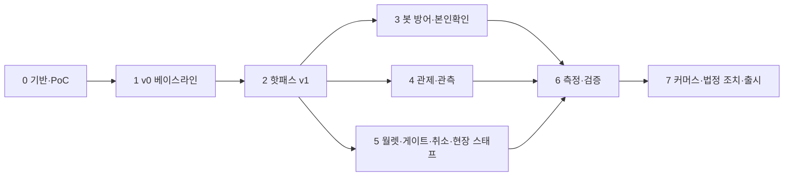

# 상세 WBS와 로드맵

- **독자와 용도**: 프로젝트 소유자가 단계·작업·추정·선행 관계·마일스톤을 보고 일정을 세우고 진행을 추적할 때 읽는다. 표 형식 원본은 `wbs/wbs.csv`이고, 이 문서의 작업 표와 같은 데이터로 만들었다(`tools/doc-check`가 두 파일의 ID·추정이 같은지 검사한다).
- **원문 출처**: 설계서 §16 로드맵(합계 29~41주, '8단계·단계마다 KPI 게이트' 도식, 본문 없음), §14 리드 역량 산출물, §15 리포·가상 팀, §10 KPI 10선, §7 상태('Phase 2 구현, Phase 6 측정'), §6 계정·인증 표('게이트 스캐너 Phase'), docs/architecture.md §9.3·9.4(검증·PoC).
- **기준 기획 버전**: v1.0 → **상세 WBS**(할 일을 잘게 나눈 작업 목록. 3레벨, 기간 ±20%). Phase 0~7 구성은 C-04 결정(2026-10-08)으로 채택했다.
- **작성일**: 2026-10-09. 착수일이 정해지면 누적 주를 달력 날짜로 바꾼다.

## 1. 전제

| 항목 | 값 | 근거 |
| --- | --- | --- |
| 인력 | 1인 풀타임 + AI 코딩 도구 | 원문 §16 |
| 투입 시간 | 주 40시간, 하루 8시간, 주 5일 | 2026-10-08 소유자 답변 |
| 추정 단위 | 레벨 3 작업의 일(day). 상위 레벨은 그 합계다. 범위는 추정의 ±20%다 | 템플릿 규칙(기획 v1.0 → ±20%) |
| 실행 방식 | 1인이라 차례대로 실행한다. Phase 3·4·5는 순서를 바꿀 수 있지만 동시에 하지 않는다 | 원문 §16, §7 아래 |
| 외부 기한 | 없다. 공연법 개정 시행일(2026-08-28)은 지났고, 출시 전 법정 조치 의무만 남았다 | 원문 §6 |
| 담당 역할 | 가상 팀(원문 §15): 프론트엔드 플랫폼, 대기열, 구매, 발권, 봇 탐지, 플랫폼, 커머스, 데이터, 아키텍처 그룹. 실제로 일하는 사람은 1인이다 | 원문 §15 |

## 2. 단계 요약

| Phase | 이름 | 추정(일) | 추정(주) | 범위(주, ±20%) | KPI 게이트 | 주 담당 역할 |
| --- | --- | --- | --- | --- | --- | --- |
| 0 | 기반·계약·PoC | 69.5 | 13.9 | 11.1~16.7 | M0: PoC 통과 기준 충족(docs/architecture §9.4 중 Phase 0 항목, wbs 0.5·0.9), 계약 v0 배포, 색·글자 크기·간격 같은 디자인 값에 이름을 붙여 정해 둔 디자인 토큰의 파이프라인, 공용 CI(코드를 올릴 때마다 자동으로 검사하고 빌드하는 과정)와 GitOps(배포 상태를 저장소에 적어 두고 클러스터를 그대로 맞추는 운영 방식) 승격 경로(서명과 출처 증명: 산출물이 어느 커밋에서 어떤 빌드 절차로 만들어졌는지 서명해 남긴 기록), 규칙 검사 명세 3개(0.9.1~0.9.3) 통과 | 플랫폼, 아키텍처 그룹, 프론트엔드 플랫폼 |
| 1 | v0 베이스라인(처음 만들 법한 단순한 설계) | 18.25 | 3.6 | 2.9~4.4 | M1: K1~K10 Before 수치와 무너지는 지점 기록 | 플랫폼, 대기열, 구매 |
| 2 | 온세일 핫패스(판매가 열리는 시각 앞뒤로 접속이 몰리는 기간에 요청이 가장 많이 지나는 경로) v1 | 115.5 | 23.1 | 18.5~27.7 | M2: K1(측정 규모 1천~10만. 100만 판정은 M6)·K2~K5 목표 달성, K7 이중 결제 0, 서비스 분리 효과 세 구성 수치, PG(온라인 결제를 대신 처리해 주는 결제사) 어댑터 계약 테스트 통과, 모델 기반 시험·장애 기록 검사 위반 0 | 대기열, 구매, 프론트엔드 플랫폼, 플랫폼 |
| 3 | 봇 방어·본인확인·계정 | 31.5 | 6.3 | 5.0~7.6 | M3: K6(1·2단계 등급별 탐지 95%·사람을 봇으로 잘못 잡는 오탐 상한 0.5%(판정용 947개)·적응 라운드 3회), ASVS(웹 앱 보안 검증 항목 목록) 근거 없는 미적용 0, 본인확인 실제 연동 | 봇 탐지, 플랫폼(identity) |
| 4 | 관제·관측(지표·로그·요청 기록으로 시스템 안을 들여다보는 일)·제어 평면·오토스케일(부하에 따라 서버 수를 자동으로 늘리고 줄이는 것) | 90.75 | 18.1 | 14.5~21.8 | M4: K8(10종 100%, 장애마다 탐지 60초, 명령 3초), K9(쿠버네티스에서 앱이 실행되는 가장 작은 단위인 파드의 확장 60초, 비용 추정), 장애가 났을 때 따라 하는 절차서인 런북 36종, 일부러 장애를 내고 대응을 연습하는 Game Day 26종, 분석 마감 품질(NFR-026. R3 정산서 대조는 M7), 관측 백엔드와 Sentry(앱 오류를 모아 알려 주는 서비스)의 운영 방식 판정(ADR-0067·0068) | 플랫폼, 데이터, 프론트엔드 플랫폼 |
| 5 | 월렛·오프라인 게이트·예매 취소·현장 스태프 | 57.75 | 11.6 | 9.2~13.9 | M5: K10(판정 150ms, 중복 입장 탐지 100%), 공제율 경계값 시험 통과, 현장 스태프 기기 승인 로그인과 기기 인증서 PoC(본 개발 전에 위험한 부분만 먼저 만들어 확인하는 시험) 판정, 승인 업무·일괄 환불 시험(R-T6~R-T9) 통과 | 발권, 구매, 프론트엔드 플랫폼, 플랫폼 |
| 6 | 측정·검증 | 15.25 | 3.0 | 2.4~3.7 | M6: KPI(성과를 재는 핵심 지표) 10선 After 기록, 100만 외삽(잰 범위의 결과를 식으로 늘려 그보다 큰 규모의 값을 구한 것) 보고서(실측·외삽·문서 인용을 구분), 비즈니스 KPI 실측 | 플랫폼, 대기열, 데이터 |
| 7 | 커머스·파트너 완성·법정 조치·출시 준비 | 50.25 | 10.1 | 8.0~12.1 | M7: 법정 조치 가~바 전부 갖춤(1·2호), 중개자 고지·공연예술통합전산망 전송, 정산 지급 시험(J-T1~J-T19), 산출물 10종(원문 §14), 법률 검토 목록 제출 | 커머스, 플랫폼, 프론트엔드 플랫폼 |
| 합계 | | **448.75** | **89.8** | **71.8~107.7** | | |

원문은 합계 29~41주(중앙값 35주)다. 작업별 일수를 모두 더한 상향식 합계는 448.75일(89.8주)이고, 그중 질문 답변과 추가 요청으로 늘어난 범위가 순 279.25일(55.9주, §6. 2026-10-13 100만 실측을 외삽 보고서로 바꿔 줄어든 2일 포함)이다. 원문 범위만 떼어 보면 169.5일(33.9주)로 원문 중앙값과 비슷하다.

## 3. 작업 분해(3레벨)

추정은 일 단위이고 범위는 ±20%다. 선행은 같은 표의 WBS ID다. 상태: 예정·진행·완료. 상위 행(레벨 1·2, wbs.csv)의 상태는 하위 작업을 모아 적는다. 모두 완료면 완료, 하나라도 진행이나 완료가 있으면 진행, 아니면 예정이다(추천 적용 2026-10-26).

### Phase 0 기반·계약·PoC (69.5일, 13.9주)

| WBS ID | 작업 | 산출물 | 담당 | 추정(일) | 선행 | 관련 ID | 상태 |
| --- | --- | --- | --- | --- | --- | --- | --- |
| **0.1** | **리포·CI 기반** | | 플랫폼 | **7.75** | | | |
| 0.1.1 | 리포 14개 뼈대(문서·공용 워크플로 저장소 포함), CODEOWNERS, 규칙 세트, GitHub 조직 설정 코드화, git flow 기본 가지·가지와 태그 규칙 세트·릴리스 봇(ADR-0074) | 리포 14개·조직 설정 코드 | 플랫폼 | 2 | - | ADR-0016, ADR-0054, ADR-0074 | 예정 |
| 0.1.2 | 공용 재사용 워크플로(검사·시험·빌드·SBOM·서명·출처 증명), GitHub Actions OIDC, 액션 SHA 고정·토큰 최소 권한, Renovate(새 버전 3일 대기), Changesets, 가지 규칙 검사·릴리스와 핫픽스 워크플로(ADR-0074) | 공용 CI 파이프라인 | 플랫폼 | 4 | 0.1.1 | ADR-0016, ADR-0054, ADR-0074 | 예정 |
| 0.1.3 | 문서 점검 스크립트 CI 연결(tools/doc-check) | 문서 리포 PR 검사 | 플랫폼 | 0.5 | 0.1.2 | 00-summary §8 | 예정 |
| 0.1.4 | 보안 검사 게이트(gitleaks CLI·Semgrep·CodeQL·의존성·이미지·IaC 검사), 취약점 조치 기한과 예외 만료, Scorecard, 프론트엔드 보안 규칙 검사(ESLint `react/no-danger`, Semgrep `innerHTML` 계열·창 메시지 수신기 출처 확인, ADR-0065) | 보안 CI 게이트 | 플랫폼 | 1.25 | 0.1.2 | ADR-0054, ADR-0065, POL-041 | 예정 |
| **0.2** | **계약(peaket-contracts)** | | 아키텍처 그룹 | **5** | | | |
| 0.2.1 | OpenAPI·AsyncAPI 계약 패키지와 breaking 검사 | 계약 v0 | 아키텍처 그룹 | 1.5 | 0.1.2 | docs/api/* | 예정 |
| 0.2.2 | proto·Avro·Schema Registry CI | 스키마 CI | 아키텍처 그룹 | 1 | 0.2.1 | ADR-0026 | 예정 |
| 0.2.3 | 화면이 쓰는 API 계약 보강: 194개 작업 operationId, `type` 목록(401 구분 포함. 4xx·5xx Problem 선언, 429·503 `Retry-After`, 401 `WWW-Authenticate`는 ADR-0081에서 함), `Date` 노출, 303 대신 2xx 본문, 구매 세션 MAC 입력과 서버 ECDH 공개키 JWK, 좌석 델타·SSE·Socket.IO 형식, 화면이 쓰는데 없는 읽기 경로 초안, 대기 상태 파일의 더할 칸, 굿즈 결제 경로 | 계약 보강판 | 아키텍처 그룹 | 2.5 | 0.2.1 | ADR-0079, docs/frontend.md §6.2 | 예정 |
| **0.3** | **서비스 템플릿(peaket-platform)** | | 플랫폼 | **12** | | | |
| 0.3.1 | 네 신호 계측, RFC 9457, deadline 전파, 로그 가명(로그 가명 키 HMAC, IP 앞부분만), 정규 로그 줄(요청 1건 1줄 필드와 표본 비율, ADR-0069), 지연 히스토그램 표준 칸 목록(SLO 기준값 포함)과 처리 중 요청 게이지(ADR-0077) | 템플릿 계측 | 플랫폼 | 3 | 0.2.1 | NFR-011, ADR-0053, ADR-0069, ADR-0077 | 예정 |
| 0.3.2 | 인증 가드, 종료 세션 목록, 멱등성, Outbox, Drizzle 설정, Outbox 일 파티션과 정리 잡, 파티션 미리 만들기·유일 확인 표 정리(ADR-0083), 자식 표 같은 범위 파티션·회차 범위 파티션·부모 표 ANALYZE·통계 스냅샷(ADR-0086), Redis Stream 정리(`XTRIM MINID`), CDC 슬롯 보존 WAL 지표(ADR-0070) | 템플릿 공통 모듈 | 플랫폼 | 2.5 | 0.3.1 | NFR-016, ADR-0011, ADR-0037, ADR-0070, ADR-0083, ADR-0086 | 예정 |
| 0.3.3 | 차단기, 구매 요청 인증 훅, gRPC 채널 생성 함수(재시도·헤지 정책 없음, 투명 재시도 유지, 부하 분산 프로필 `service`·`headless-round-robin`, ADR-0082) | 템플릿 장애 격리 | 플랫폼 | 1 | 0.3.2 | ADR-0009, ADR-0050, ADR-0082 | 예정 |
| 0.3.4 | DB 마이그레이션 실행기(트랜잭션 밖 단계, 잠금 대기 제한, 실행 잠금, DDL·DML 역할 분리, PgBouncer를 거치지 않는 직접 연결, ADR-0083), 마이그레이션 검사(Squawk, 직전 스키마·N-1 시험, 파티션 표 인덱스 절차와 PgBouncer `RECONNECT`, ADR-0086), 릴리스 플래그(OpenFeature·flagd 파일 모드) | 마이그레이션·플래그 공통 모듈 | 플랫폼 | 2 | 0.3.2 | ADR-0054, ADR-0083, ADR-0086, POL-041 | 예정 |
| 0.3.5 | 기능 설계서 9편의 운영 확인 계측 표(확인할 동작, 사건·필드, SLI, 대시보드 패널, 경보, 배포 뒤 확인 방법)와 서비스 템플릿 반영 | 운영 확인 계측 표 | 플랫폼 | 1.5 | 0.3.1 | ADR-0069, docs/architecture.md §8.4 | 예정 |
| 0.3.6 | 운영 진단 기본값: 프로브 세 종류(별도 포트, 공유 의존성 제외, 종료·진단 중 준비 해제)와 템플릿 시험, 진단 증거(치명 오류 보고서, 주석 신호 수집, 다음 시작 때 올림, `--disable-sigusr1`, 주석 반영 시간과 Argo Rollouts 파드 동작 확인), 시간 초과 기본값(풀 대기 한도·`maxLifetimeSeconds`, ioredis 명령 시간 초과·오프라인 큐 끔, `SET LOCAL` 왕복 비용 측정), NestJS 종료 설정(`enableShutdownHooks()`, gRPC `gracefulShutdown`)과 종료 중 진행 호출 시험(D-T27, ADR-0082) | 운영 진단 기본값 | 플랫폼 | 2 | 0.3.2 | NFR-027, ADR-0070, ADR-0082, docs/architecture.md §5 | 예정 |
| **0.4** | **환경(로컬·스테이징·데모)** | | 플랫폼 | **8.75** | | | |
| 0.4.1 | 로컬(kind/k3d, LocalStack, Strimzi)과 CI 구성 | 로컬 환경 | 플랫폼 | 1.5 | 0.1.2 | docs/infra.md §3 | 예정 |
| 0.4.2 | 스테이징 Terraform 모듈 코드와 정적 검사(생성·삭제 스크립트, TTL 자동 삭제, 적용은 선택 보정 때만), 계정 구조·상태 분리(S3 잠금 파일), 예산 경보·비용 이상 탐지, ArgoCD | 스테이징 코드·비용 상한 장치 | 플랫폼 | 3 | 0.4.1 | ADR-0031, ADR-0054, ADR-0057 | 예정 |
| 0.4.3 | 데모 재현 스크립트(로컬 kind 전체 기동·합성 데이터·시연 시나리오 재생), 임시 클라우드 데모 절차(TTL·예산 경보) | 데모 재현 스크립트 | 플랫폼 | 1 | 0.4.4 | ADR-0031, ADR-0057 | 예정 |
| 0.4.4 | GitOps 저장소(ApplicationSet·AppProject·환경 값·공용 차트), 승격 PR 자동화, Kyverno CEL 정책(서명·출처 검증, 오프라인 검증 PoC, 운영 오버레이 메시 필수 정책 D-T28·ADR-0082), 사람 접근(Identity Center·EKS 접근 항목·긴급 접근 경보), 출시 후보 데모 승격과 출시 태그 뒤 운영 승격(ADR-0074), 네임스페이스 지도와 `data`·`observability` 자원 할당량(ADR-0078) | GitOps·배포 정책·접근 통제 | 플랫폼 | 3.25 | 0.4.2 | ADR-0054, ADR-0074, ADR-0078, ADR-0082 | 예정 |
| **0.5** | **PoC 9건과 외부 한도 확인·추정** | | 각 팀 | **6** | | | |
| 0.5.1 | PoC: `INCR` 20만/s, Redis 클라이언트, Kafka 클라이언트(kafkajs와 Confluent 공식 클라이언트 비교) | PoC 결과 | 각 팀 | 1.5 | 0.4.1 | docs/architecture §9.4, ADR-0054 | 예정 |
| 0.5.2 | PoC: 게이트웨이 차단 상한, 메시 Istio 앰비언트(웨이포인트) vs 사이드카(선택, 하지 않으면 공식 측정 인용) | PoC 결과 | 각 팀 | 1.5 | 0.4.1 | ADR-0010, ADR-0082 | 예정 |
| 0.5.3 | PoC: 엣지 함수(AWS 계정이 있으면 무료 범위 함수 시험, 없으면 문서 확인), 셔플 100만, Turnstile 검증 지연 | PoC 결과 | 각 팀 | 1 | 0.4.1 | FR-038 | 예정 |
| 0.5.4 | PoC: 5만석 Canvas | PoC 결과 | 각 팀 | 1 | 0.6.1 | K5 | 예정 |
| 0.5.5 | 외부 한도 확인·추정 기록(포트원 웹훅 헤더 확인, 토스 운영 한도·포트원 승인 기한·호출 한도 추정)과 외부 한도 대조표(CDN 배포별 요청·전송, S3 접두사, KMS, 결제사, 사람 확인) | 추정 기록(ADR-0036)·외부 한도 대조표 | 각 팀 | 1 | - | ADR-0029, ADR-0036, ADR-0057, POL-027 | 진행 |
| **0.6** | **디자인 기반과 브랜드 자산** | | 프론트엔드 플랫폼 | **6.5** | | | |
| 0.6.1 | SEED 토큰(@seed-design/css) + tokens.json 피켓 확장 → Style Dictionary·Tailwind 4 테마·TS 상수, 대비 계산 CI | 토큰 파이프라인 | 프론트엔드 플랫폼 | 1 | 0.1.2 | design/d2 §5, ADR-0040 | 예정 |
| 0.6.2 | @seed-design/react 위 packages/ds 뼈대, Storybook, addon-a11y, 제3자 고지(Apache-2.0 NOTICE) | ds 뼈대 | 프론트엔드 플랫폼 | 1 | 0.6.1 | design/d2 §1.1, ADR-0040 | 예정 |
| 0.6.3 | 로고 워드마크·심벌, 파비콘·PWA 아이콘, KIPRIS 상표 검색 | 브랜드 자산 | 프론트엔드 플랫폼 | 1.5 | - | design/d1 §3 | 예정 |
| 0.6.4 | 프론트엔드 저장소 골격·공용 패키지: Turborepo + pnpm 공급망 설정(trustPolicy·allowBuilds·blockExoticSubdeps), api-client·telemetry·validation·console-contract·config 패키지, 대기실 경량 페이지 별도 빌드 자리, size-limit·Lighthouse CI 예산, 화면 묶음별 보안 헤더, 정적 자산 허용 확장자·숨김 소스 맵·SBOM, 서버 액션 암호화 키 형식 확인, Turborepo 원격 캐시 | peaket-frontend 골격 | 프론트엔드 플랫폼 | 3 | 0.6.2 | ADR-0079, docs/frontend.md §2.2 | 예정 |
| **0.7** | **기획 v1.0과 상세 WBS** | | 소유자 | **0** | | | |
| 0.7.1 | [충돌] C-01~C-05 해소, 질문 답변 반영, 기획 v1.0, 상세 WBS | 기획 v1.0, 이 문서 | 소유자 | 0 | - | 00-summary §7 | 완료 |
| **0.8** | **RFC와 표준 원문 확보** | | 아키텍처 그룹 | **2.5** | | | |
| 0.8.1 | RFC 3건 초안(온세일 핫패스, 봇 방어, 관제) | RFC 3건 | 아키텍처 그룹 | 2 | - | 원문 §14 | 예정 |
| 0.8.2 | ISO/IEC 25023 OBP 미리보기 확인(이용 약관 동의, 익명), 측정량 표 수준 대응 기입 | quality-requirements 갱신 | 아키텍처 그룹 | 0.5 | - | NFR 작성 원칙 3 | 완료 |
| **0.9** | **설계 규칙 모델 검사** | | 아키텍처 그룹 | **6.5** | | | |
| 0.9.1 | 규칙 모델 검사 도구 준비(Quint·TLC, CI 실행·결과 기록)와 대기열·입장 제어 명세(순번·세대 번호, 동시 도착 구간 묶음, 리더 교체·세대 확인, 1인 1순번 재확인): 차례 전 입장 0·같은 세대 순번 중복 0·옛 리더 쓰기 반영 한도 | 명세·검사 기록(대기열) | 아키텍처 그룹·대기열 | 3 | 0.1.2 | ADR-0002, ADR-0041, ADR-0056, ADR-0057 | 예정 |
| 0.9.2 | 좌석 명세(정렬 홀드, 만료·연장, 펜싱 토큰, 좌석 Redis 장애 전환과 DB 경로, 판매 확정): 오버셀 0·1인 한도 초과 0 | 명세·검사 기록(좌석) | 아키텍처 그룹·구매 | 1.5 | 0.9.1 | ADR-0014, ADR-0057 | 예정 |
| 0.9.3 | 결제 명세(결제 시도와 결제사 고정, 승인·결과 모름 해소, 웹훅 중복·지연, 보상·대사, 재시작): 이중 결제 0·결제사 바뀜 0·승인된 주문은 발권 또는 환불로 끝남 | 명세·검사 기록(결제) | 아키텍처 그룹·구매 | 2 | 0.9.1 | ADR-0015, ADR-0044, ADR-0057 | 예정 |
| **0.10** | **화면 프로토타입(P0)** | | 프론트엔드 플랫폼 | **14.5** | | | |
| 0.10.1 | 프로토타입 골격: Vite·React·TypeScript 앱 하나와 경로 묶음 넷(/web·/partner·/console·/scanner), 앱 셸 4종(CMP-065), SEED·tokens.json CSS 변수, openapi 응답 모양의 MSW 가짜 API, 데모 도구 막대, '예시 데이터' 띠, 가상 데이터 E-1~E-4 | prototype/ 골격(2026-10-22 저장소에서 지워짐) | 프론트엔드 플랫폼 | 3 | - | ADR-0059, ADR-0060, design/d5 §10 | 완료 |
| 0.10.2 | P0 소비자 화면 13개(SCR-001·002·004~008·010~013·018·051)와 시연 S1(팬 예매)·S4(선착순·자동 배정) | 소비자 P0 화면·시연 | 프론트엔드 플랫폼 | 6.5 | 0.10.1 | design/d5 §5·§10.6, ADR-0063, ADR-0066 | 완료 |
| 0.10.3 | P0 파트너·관제 화면 9개(SCR-020·021·026·037·062, SCR-028·029·030·048)와 시연 S6(등록과 판매 승인)·S7(T=0 관제) | 파트너·관제 P0 화면·시연 | 프론트엔드 플랫폼 | 3 | 0.10.1 | design/d5 §6·§7·§10.6 | 완료 |
| 0.10.4 | P0 스캐너 화면 3개(SCR-033·034·036)와 시연 S8(공연 당일 입장), 시연 녹화와 화면설계 피드백 목록(planning/04·design/d5 반영 항목. 피드백 목록은 design/d5 §10.7이다. prototype/ 폴더가 2026-10-22에 지워져 시연 녹화 방법은 소유자가 정한다, 00-summary §7 질문 44) | 스캐너 P0 화면·시연 녹화·피드백 목록 | 프론트엔드 플랫폼 | 2 | 0.10.2 | design/d5 §8·§10.6, ADR-0057 | 진행 |

### Phase 1 v0 베이스라인(처음 만들 법한 단순한 설계) (18.25일, 3.6주)

| WBS ID | 작업 | 산출물 | 담당 | 추정(일) | 선행 | 관련 ID | 상태 |
| --- | --- | --- | --- | --- | --- | --- | --- |
| **1.1** | **v0 모놀리스(v1과 같은 모듈 경계)** | | 대기열·구매 | **7.5** | | | |
| 1.1.1 | 대기열 v0: `ZRANK` 앞 인원을 조회마다 계산하는 대기 상태 API(JSON), v1과 같은 거리별 폴링 주기(ADR-0096) | v0 대기열 | 대기열·구매 | 2 | 0.3.3 | K1 | 예정 |
| 1.1.2 | 좌석 v0: `SELECT … FOR UPDATE` 홀드, 변경분 JSON을 모든 연결에 보내기, 메인 스레드 Canvas 좌석맵(ADR-0096) | v0 좌석 | 대기열·구매 | 2.5 | 0.3.3 | K2~K5 | 예정 |
| 1.1.3 | 결제·발권 v0: 동기 결제 체인(PG 시뮬레이터), 온라인 전용 검증 | v0 결제·입장 | 대기열·구매 | 2 | 1.2.3 | K7, K10 | 예정 |
| 1.1.4 | 레이트 리밋만, CPU HPA 배포 | v0 배포 | 대기열·구매 | 1 | 1.1.3 | K6, K9 | 예정 |
| **1.2** | **peaket-loadtest** | | 플랫폼 | **7** | | | |
| 1.2.1 | k6 오픈 모델(도착률) 시나리오, 부하 발생기 보정(PC 한계·`dropped_iterations`) | 부하 시나리오 | 플랫폼 | 2 | 0.4.1 | NFR-013, ADR-0057 | 예정 |
| 1.2.2 | 합성 봇 12칸 등급표(OAT 4유형 × 정교함 3단계, 사람 확인·본인확인 시뮬레이터), 판정용 사람 표본(947개 사전 등록, 1인 5세션, 층 할당, 동의·30일 삭제)과 조정용 표본, 라벨 데이터셋 | 봇 시뮬레이터·사람 세션 | 플랫폼 | 3.5 | 1.2.1 | POL-026, K6, ADR-0039, ADR-0048 | 예정 |
| 1.2.3 | 불변식 검사기 SQL, PG 시뮬레이터 어댑터 | 검사기·시뮬레이터 | 플랫폼 | 1.5 | 0.3.2 | K2, K7 | 예정 |
| **1.3** | **관측 최소** | | 플랫폼 | **1** | | | |
| 1.3.1 | 템플릿 대시보드, Grafana, web-vitals | 최소 대시보드 | 플랫폼 | 1 | 0.3.1 | NFR-012 | 예정 |
| **1.4** | **Before 측정** | | 플랫폼 | **2.75** | | | |
| 1.4.1 | Before 측정과 성능 장부 v0(인프라 스펙·스크립트·커밋 해시, 클라이언트·서버 지연 대조 `latency_crosscheck`, ADR-0077) | 성능 장부 Before | 플랫폼 | 2.75 | 1.1.4 | K1~K10, ADR-0077 | 예정 |

### Phase 2 온세일 핫패스 v1 (115.5일, 23.1주)

| WBS ID | 작업 | 산출물 | 담당 | 추정(일) | 선행 | 관련 ID | 상태 |
| --- | --- | --- | --- | --- | --- | --- | --- |
| **2.1** | **identity 최소** | | 플랫폼 | **5.75** | | | |
| 2.1.1 | 소셜 로그인(Auth.js → 내부 세션 생성), PKCE | 로그인 | 플랫폼 | 2 | 0.3.2 | FR-001, ADR-0011 | 예정 |
| 2.1.2 | 액세스·리프레시 토큰, 회전, 종료 세션 이벤트, 서명 키 3종(팬·관리·현장 스태프)과 typ·iss 검증, 쿠키 이름·속성(`__Secure-`·`__Host-` 접두사, Auth.js 쿠키 설정, 엣지 함수 쿠키 이름, ADR-0065) | 토큰 수명주기 | 플랫폼 | 2.75 | 2.1.1 | FR-017, POL-019, ADR-0050, ADR-0065 | 예정 |
| 2.1.3 | 본인확인 테스트 어댑터, `ticket:buy`, pid | 구매 권한 | 플랫폼 | 1 | 2.1.2 | FR-002, ADR-0006 | 예정 |
| **2.2** | **queue-svc·gw-queue** | | 대기열 | **8.75** | | | |
| 2.2.1 | 사전 검증 토큰(최초 발급 시각), 진입, 대기표, 세대 번호, 동시 도착 구간 묶음 셔플·결과 파일, 사전 요청 없는 진입·입장 확정(`text/plain`, ADR-0065) | 진입 경로 | 대기열 | 3.25 | 2.1.3 | FR-006, ADR-0002, ADR-0041, ADR-0065 | 예정 |
| 2.2.2 | 빠진 번호 비트맵, 대기 상태 파일, CDN 1초 캐시, 대기 순서 지표(차례 전 입장, 예상 대기 오차), 판매 종료까지 이어지는 대기열과 판매 종료 검사(ADR-0063·0064) | 대기 상태 전파 | 대기열 | 3.5 | 2.2.1 | FR-007, NFR-002, NFR-025, ADR-0049, ADR-0064 | 예정 |
| 2.2.3 | 적응형 폴링, `Retry-After`, 매진 엣지 응답(410), 도착 시각 쿠키(엣지 함수 HMAC, KeyValueStore 키, 한 번만 받기) | 폴링·매진 | 대기열 | 2 | 2.2.2 | FR-018, FR-043, ADR-0053 | 예정 |
| **2.3** | **admission-ctrl** | | 대기열 | **7.5** | | | |
| 2.3.1 | Lease 리더(리더 세대 펜싱, 교체 순서), serving 루프, 입장 비율, 리더 상태 Redis 보관 | 입장 제어 | 대기열 | 2.5 | 2.2.2 | FR-037, ADR-0056 | 예정 |
| 2.3.2 | AIMD, 안전 한계, 합산 상한, 오픈 간격 규칙 검사, 제어 입력 없음 판정·멈춤과 감축 확인 시간(ADR-0069), 예매 단계 지금 인원 게이지(`admission_slots_used`, ADR-0077) | 자동 제어 | 대기열 | 2 | 2.3.1 | POL-010, POL-030, ADR-0069, ADR-0077 | 예정 |
| 2.3.3 | 입장 확정(1인 1순번 재확인), 입장 토큰, 구매 세션 이벤트 | 입장 확정 | 대기열 | 2 | 2.3.1 | FR-008, ADR-0005, ADR-0056 | 예정 |
| 2.3.4 | 대기열·입장 제어 모델 기반 시험(fast-check 명령 순서·비동기 순서 뒤섞기, 0.9.1과 같은 동작 이름, 실패 순서는 회귀 시험으로) | 모델 기반 시험(대기열) | 대기열 | 1 | 2.3.3 | ADR-0056, ADR-0057 | 예정 |
| **2.4** | **로비·셔플** | | 대기열 | **5** | | | |
| 2.4.1 | 참가 토큰, commit-reveal(drand 체인·라운드·버전 공시, 재현 규격), 비콘 대기·비상 처리 | 셔플 | 대기열 | 2 | 2.3.3 | FR-005, FR-038, ADR-0050 | 예정 |
| 2.4.2 | 셔플 결과 파일 1,000개(회차별 S3 접두사), 결과 공개 예정 시각과 0~8초 분산 조회(404 캐시 1초, 지수 재시도), 분산 창 뒤 첫 serving 전진, 검증 페이지(SCR-019) | 검증 가능한 셔플 | 대기열 | 2 | 2.4.1 | POL-005, ADR-0058 | 예정 |
| 2.4.3 | 로비 참가 취소(DELETE …/lobby-participants/me)와 다른 기기에서 다시 참가: 참가 토큰 무효·q:lobby 제외·q:dup 삭제, 대기 취소의 q:dup 삭제, 처음 기기의 취소 안내, 만료 뒤 다시 줄 서기(410 때 q:dup 삭제, 이미 입장한 사람 409, 만료 화면 버튼, ADR-0062) | 다른 기기 다시 참가 | 대기열 | 1 | 2.4.1 | FR-007, POL-002, ADR-0060, ADR-0062 | 예정 |
| **2.5** | **purchase-svc inventory** | | 구매 | **8** | | | |
| 2.5.1 | 비트맵 Lua 홀드, 1인 한도, 펜싱 토큰 | Soft Hold | 구매 | 2 | 0.3.2 | FR-010, ADR-0014 | 예정 |
| 2.5.2 | TTL 7분·연장 3분, 만료 인덱스 정리, 새 결제 일시 정지 동안 결제 접수 전 홀드의 회수 건너뛰기와 다시 열릴 때 만료 시각 밀기(최대 체류 시각까지, ADR-0085) | 홀드 수명 | 구매 | 1 | 2.5.1 | POL-012, FR-042, ADR-0085 | 예정 |
| 2.5.3 | Hard Sale(활성 상태 부분 유니크), 한도 행, 홀드 원장 릴레이, 좌석 Redis 장애 때 DB 비상 경로의 트랜잭션 범위 잠금 대기(`SET LOCAL lock_timeout`, 못 얻으면 409)와 `seat_hold` 표별 청소 기준(ADR-0083) | Hard Sale | 구매 | 1.5 | 2.5.1 | docs/data.md §2, ADR-0083 | 예정 |
| 2.5.4 | 좌석 자동 배정(희망 조건 카드·차례 도래 자동 요청·차례 직전 직접 확인 → 1순위·2순위 연석 후보 → 같은 Lua 홀드, 재시도·수동 선택 전환) | 자동 배정 | 구매 | 2.5 | 2.5.1 | FR-050, POL-035, ADR-0041, ADR-0043 | 예정 |
| 2.5.5 | 좌석 모델 기반 시험(Lua 홀드·만료·판매 확정 SQL, 0.9.2와 같은 동작 이름) | 모델 기반 시험(좌석) | 구매 | 1 | 2.5.3 | ADR-0014, ADR-0057 | 예정 |
| **2.6** | **좌석 전파·좌석맵** | | 구매·프론트엔드 플랫폼 | **9** | | | |
| 2.6.1 | realtime-gw 섹션 구독, 250ms 델타, 버전 갭 복구, 좌석이 보이는 구역만 구독·해제와 구역 요약 스냅샷 5초 갱신(ADR-0063) | 좌석 델타 | 구매·프론트엔드 플랫폼 | 2.5 | 2.5.1 | NFR-004, ADR-0027, ADR-0063 | 예정 |
| 2.6.2 | 좌석맵 OffscreenCanvas·Worker, 색 + 패턴 토큰, 전체 배치 → 확대 좌석 두 단계 그리기, 미니맵·[전체 보기], 좌석맵 파일 두 층(ADR-0063) | 좌석맵 | 구매·프론트엔드 플랫폼 | 3.5 | 0.5.4 | FR-009, K5, ADR-0063 | 예정 |
| 2.6.3 | SeatList 접근성 대안, 자동 좌석 배정 | 접근성 대안 | 구매·프론트엔드 플랫폼 | 1.5 | 2.6.2 | NFR-020 | 예정 |
| 2.6.4 | 좌석 이진 형식(델타·스냅샷·구독) 해독기와 Worker 배열, 좌석 연결 상태 기계(하트비트·닫힘 코드·재연결), 하위 프로토콜 인증 PoC(안 되면 첫 메시지 인증), 좌석 라우트 COEP·SharedArrayBuffer·iOS OffscreenCanvas PoC | 좌석 해독기·연결 상태 기계 | 구매·프론트엔드 플랫폼 | 1.5 | 2.6.1 | NFR-004, ADR-0079, docs/frontend.md §4.4 | 예정 |
| **2.7** | **결제(Saga·PG 어댑터·결제사 선택)** | | 구매 | **12.75** | | | |
| 2.7.1 | booking Saga, Outbox, 202 접수, long polling | 결제 접수 | 구매 | 2 | 2.5.3 | FR-011, NFR-005 | 예정 |
| 2.7.2 | PG 포트, 토스 어댑터, 멱등키, UNKNOWN 해소, 채널 호출 상한 | 토스 결제 | 구매 | 2 | 2.7.1 | ADR-0015, ADR-0029, ADR-0036 | 예정 |
| 2.7.3 | 포트원 어댑터, 결과 코드 정규화, 계약 테스트 묶음(시뮬레이터·토스·포트원) | PG 호환 | 구매 | 2.5 | 2.7.2 | ADR-0029 | 예정 |
| 2.7.4 | 웹훅 2종(토스·포트원), 대사 배치, 가상계좌 입금 대기(기한 조회, 입금 전 취소, 입금 오류 되돌림과 티켓 무효·재발권, ADR-0062) | 웹훅·대사 | 구매 | 2.5 | 2.7.3 | FR-041, ADR-0062 | 예정 |
| 2.7.5 | 결제사 선택기(공연 지정·전환·플랫폼 기본), 결제 시도 API, 결제사별 접수 계약, 결제사 고정(조회·취소·웹훅·대사 라우팅), 결제사별 동시 입장 목표 상한, 이그레스 허용 목록, 신규 결제 진입 정지의 자동 해제와 429로 낮춘 채널 상한의 회차 유지(ADR-0078), 새 결제 일시 정지 조회(`GetNewPaymentPause`, ADR-0085) | 결제사 선택 | 구매 | 2.75 | 2.7.4 | FR-011, FR-051, POL-036, ADR-0044, ADR-0078, ADR-0085 | 예정 |
| 2.7.6 | 결제 모델 기반 시험(Saga·웹훅·결제사 고정, 0.9.3과 같은 동작 이름) | 모델 기반 시험(결제) | 구매 | 1 | 2.7.5 | ADR-0044, ADR-0057 | 예정 |
| **2.8** | **ticket-svc 발권 최소** | | 발권 | **1** | | | |
| 2.8.1 | ticket-svc 발권 최소(월렛 목록) | 발권 | 발권 | 1 | 2.7.2 | FR-012 | 예정 |
| **2.9** | **파트너 콘솔 최소** | | 프론트엔드 플랫폼·플랫폼 | **20.5** | | | |
| 2.9.1 | 공연 등록 위저드(회차, 입장 정책, 오픈 간격 규칙, 좌석 배정 방식, 선착순 경고, 1단계의 공연장·아티스트 고르기와 새 이름 요청·공연의 다른 이름, ADR-0093), 공연 이미지 기준과 올리기 API(형식·크기·해상도 검사, 메타데이터 제거·다시 인코딩, 파생본, 대체 텍스트, 순서, ADR-0062·0063) | SCR-021 | 프론트엔드 플랫폼·플랫폼 | 4.5 | 2.1.2 | FR-022, POL-018, POL-030, POL-035, ADR-0062, ADR-0063, ADR-0093 | 예정 |
| 2.9.2 | 좌석맵 import·검증, 에디터 네 단계·템플릿 10종·휠체어석 검사(ADR-0062·0063·0066), 도형·좌표를 함께 받는 가져오기, 공연용 배치본(공연장 틀 복제, 배치 버전), 도형 밖 좌석·오픈 뒤 도형 잠금 검사(ADR-0063) | SCR-022 | 프론트엔드 플랫폼·플랫폼 | 9.5 | 2.9.1 | FR-023, ADR-0062, ADR-0063, ADR-0066 | 예정 |
| 2.9.3 | 판매 정책 DSL, 정렬 방식, 판매 자격 명단(올리기·잠금·파기·진입 대조)과 규칙 문법 1판(ADR-0062) | SCR-024 | 프론트엔드 플랫폼·플랫폼 | 2.5 | 2.9.1 | FR-022, POL-003, ADR-0062 | 예정 |
| 2.9.4 | 파트너 홈·공연 목록(SCR-062)과 공연 개요(SCR-063) | 파트너 홈·공연 개요 | 프론트엔드 플랫폼·플랫폼 | 2 | 2.9.1 | FR-022, FR-052, FR-062, ADR-0059 | 예정 |
| 2.9.5 | 공연(회차 묶음) 데이터와 API(ADR-0093): `production`·`place`·`artist`·`production_artist`·`search_alias` 표와 회차 칸을 공연으로 옮기는 이전(migration), 공연 경로 API(등록·회차 더하기·이미지·좌석맵·판매 승인 요청·찜), 같은 배치본 검사, 대표 회차와 카드 판매 상태 계산, 후기 목록·요약의 공연 단위 모으기, 대기열·구매 경로가 읽는 회차 읽기 모델에 공연 승인 상태 싣기 | 공연 데이터·API | 플랫폼 | 2 | 2.1.2 | FR-003, FR-016, FR-019, FR-022, FR-052, ADR-0093 | 예정 |
| **2.10** | **소비자 웹 핵심 화면** | | 프론트엔드 플랫폼 | **21.25** | | | |
| 2.10.1 | SCR-001~006(홈, 상세, 검색, 로그인, 동의, 본인확인), 홈 섹션 구성(배너 슬라이드와 일시정지, 장르 타일, 랭킹, 테마, 찜·알림 신청 연결), 공연 상세 2단·상세정보 더보기·안내 모달, 머리 검색창 하나·자동완성 창(한글 조합 중 Enter 거르기, 일치 표시)·페이지 번호(ADR-0063), 검색 결과의 0건 제안·관련 공연·공연 카드(`ProductionCard`)·`/search` 정적 셸과 noindex(ADR-0093·0094), 소비자 웹 CSP(캐시 화면 SRI 해시 PoC, 개인 화면 nonce)와 위반 보고(ADR-0065) | 화면 6종 | 프론트엔드 플랫폼 | 7 | 0.6.2 | FR-001~004, ADR-0063, ADR-0065, ADR-0093, ADR-0094 | 예정 |
| 2.10.2 | SCR-007~012(로비, 대기열, 추가 검증 자리, 좌석, 결제(결제사별 결제 프레임), 결과), 대기열 화면 기본 네 가지(앞 인원·진행 막대·남은 시간·대기 취소)와 순번 안내 시트(ADR-0063), 결제창 복귀 착지(쿠키 없는 정적 셸)와 결제사 SDK 창 메시지 출처 확인(ADR-0065) | 화면 6종 | 프론트엔드 플랫폼 | 4.25 | 2.10.1 | FR-005~011, POL-036, ADR-0063, ADR-0065 | 예정 |
| 2.10.3 | SCR-017·018, 인앱 브라우저 감지·외부 브라우저 안내(SCR-058), Playwright 3엔진 매트릭스 | 화면·E2E 매트릭스 | 프론트엔드 플랫폼 | 1.5 | 2.10.2 | NFR-019 | 예정 |
| 2.10.4 | 프론트엔드 배포(정적 자산 30일 보존·버전 불일치 처리, 여러 파드 공유 캐시 처리기, MF 원격 목록), 지갑 PWA 서비스 워커 갱신 보류 | 프론트엔드 배포 구성 | 프론트엔드 플랫폼 | 1 | 2.10.2 | ADR-0054 | 예정 |
| 2.10.5 | 약관·정책 문서(SCR-057, 개인정보 처리방침의 쿠키 목록 포함)와 시스템 안내·판매 중단(SCR-059) | 정책 문서·시스템 안내 화면 | 프론트엔드 플랫폼 | 1 | 2.10.1 | FR-053, NFR-015, ADR-0060 | 예정 |
| 2.10.6 | 대기실 경량 페이지(`queue-room`) 빌드 체계: 로케일 셸 넷과 해시 자산, S3 `/_q/` 배포와 CloudFront Function 경로 바꿔 읽기 PoC, 상태표·폴러·시계 보정·탭 조정, 텔레메트리 lite, 인앱 브라우저 표지 실기 확인 | 대기실 경량 페이지 | 프론트엔드 플랫폼 | 1.5 | 0.6.4 | NFR-012, ADR-0079, docs/frontend.md §5.1 | 예정 |
| 2.10.7 | 구매 세션 서명기(IndexedDB 추출 불가 키, Web Locks 일련번호, 서버와 같은 시험 벡터), 결제창 이동 통일(토스 성공·실패 주소, 포트원 `forceRedirect`), 복귀 화면과 결과 확인 상태 기계 | 서명기·결제 복귀 | 프론트엔드 플랫폼 | 1.5 | 2.10.2 | ADR-0050, ADR-0079, docs/frontend.md §5.3 | 예정 |
| 2.10.8 | 검색 백엔드(docs/features/search.md, ADR-0094): 검색 포트 `SearchIndex`와 PostgreSQL·메모리 어댑터, 검색 읽기 모델(`search_document`·`search_term`·`search_version`, 카탈로그와 같은 트랜잭션)과 정규화·낱자·초성 칸, 자동완성 서버 메모리 사전(판 번호로 10초마다 갱신), 결과 순위·동점 깨기·쪽 상한, 결과 0건 제안(한/영 변환·바로잡기)과 관련 공연, 읽기 전용 복제본의 검색 전용 연결 묶음, CDN 캐시 키 정규화·무효화, 정규 로그 줄과 품질 사건 수, 골든 세트 CI와 시험(SR-T1~T12·T14·T15) | 검색·자동완성 API | 플랫폼·프론트엔드 플랫폼 | 3.5 | 2.9.5 | FR-003, NFR-028, POL-045, ADR-0094 | 예정 |
| **2.11** | **서비스 분리·배포 구성** | | 플랫폼 | **7.5** | | | |
| 2.11.1 | 서비스 분리, 게이트웨이 5개(호스트 분리), Envoy 정책, 게이트웨이 보안 헤더·CORS 허용 출처·Origin/Sec-Fetch 확인 규칙과 대기열 두 경로의 `text/plain` 수용(ADR-0065) | v1 경계 | 플랫폼 | 2.5 | 2.7.4 | ADR-0007, ADR-0008, ADR-0065 | 예정 |
| 2.11.2 | 메시(Istio 앰비언트 매니페스트·정책, STRICT·최소 TLS 1.3·`cacerts`, 코드·정적 검사만)·디스커버리, Redis 3클러스터, Aurora 4, MSK 2, TLS 기준(Aurora force_ssl·verify-full), KMS 키 다중 리전, 저장소 인증(ElastiCache RBAC, MSK IAM, MongoDB·ClickHouse TLS)과 CloudFront 원본 보호, CloudFront 배포 셋(공연 페이지·대기열 파일·대기열 API)과 배포별 한도 기록(로컬 kind 적용, AWS 모듈은 코드·정적 검사), PgBouncer 배치와 시간 초과(`query_wait_timeout`·`idle_transaction_timeout`·`query_timeout`), DB 역할 기본값(`statement_timeout`·`idle_in_transaction_session_timeout`), 운영 역할 `ops_signal`(ADR-0070), 화면 호스트 4개의 CloudFront 응답 헤더 정책(HSTS·nosniff·CSP 길이 점검)과 대기열 파일·API CORS(ADR-0065) | v1 배포 구성 | 플랫폼 | 5 | 2.11.1 | ADR-0010, ADR-0026, ADR-0050, ADR-0053, ADR-0058, ADR-0065, ADR-0070, ADR-0082 | 예정 |
| **2.12** | **After 측정** | | 플랫폼·각 팀 | **8.5** | | | |
| 2.12.1 | K1~K5 After 측정(K3에 합성 5년치 데이터의 실행 계획 회귀 시험, ADR-0086. 핫패스 트레이스의 ORM 구간 시간 기록, ADR-0037) | 성능 장부 After | 플랫폼·각 팀 | 2 | 2.11.2 | K1~K5, ADR-0037, ADR-0086 | 예정 |
| 2.12.2 | K7 장애 주입 1만 건, PG 한도 시뮬레이션(300·100 TPS)(서비스 분리 효과 비교는 2.12.5로 옮김) | 성능 장부 After | 플랫폼·각 팀 | 1 | 2.12.1 | K7, ADR-0036 | 예정 |
| 2.12.3 | 장애 주입 기록 검사(Toxiproxy로 Redis·PostgreSQL·결제 시뮬레이터 지연·끊김, 요청·응답 기록, 불변식 SQL 판정: 차례 전 입장·순번 중복·오버셀·한도 초과·이중 결제) | 기록 검사 결과 | 플랫폼·각 팀 | 2 | 2.12.2 | NFR-025, K7, ADR-0057 | 예정 |
| 2.12.4 | 검색 측정: 오픈 직전 검색 몰림과 무작위 입력(캐시 우회) 부하로 원본 p95·검색 연결 묶음 대기·요청 한도 확인(SR-T13), NFR-028 판정과 골든 세트 결과를 성능 장부에 적고 가정 수치(최소 길이·종류별 몫·캐시 수명·연결 묶음) 고치기, 엔진을 바꿀 조건 점검(ADR-0094) | 성능 장부 After(검색) | 플랫폼 | 1.5 | 2.12.1 | NFR-028, ADR-0094 | 예정 |
| 2.12.5 | 서비스 분리 효과 세 구성 비교(한 프로세스 합본·역할별 배포·10개 서비스를 같은 CPU·메모리 합계로, 합본 빌드와 갈래 스위치, 결제 접수 300 TPS에 진입 폭주 없음·100%·120% 겹치기, 3회 반복, Q-T3·V-T18, docs/verification.md §3.8) | 성능 장부 After(분리 효과) | 플랫폼·각 팀 | 2 | 2.12.1 | K1, ADR-0007, ADR-0096 | 예정 |

### Phase 3 봇 방어·본인확인·계정 (31.5일, 6.3주)

| WBS ID | 작업 | 산출물 | 담당 | 추정(일) | 선행 | 관련 ID | 상태 |
| --- | --- | --- | --- | --- | --- | --- | --- |
| **3.1** | **본인확인 실연동, 탈퇴, 계정 연결·병합** | | 플랫폼(identity) | **7** | | | |
| 3.1.1 | 본인확인 업체 실연동, 연계정보 HMAC(키 버전 조회)·pid 저장, 1인 1계정, 창구 4곳, 본인확인 생년월일로 만 14세 재확인(생년월일은 저장하지 않음, 미만이면 `under-14` 거절, ADR-0062), 본인확인 창 흐름(복귀 화면, 결과 조회, 팝업 차단 대체, ADR-0063) | identity 본인확인 | 플랫폼(identity) | 4 | 2.1.3 | FR-002, POL-001, ADR-0050, ADR-0062, ADR-0063 | 예정 |
| 3.1.2 | 탈퇴·재가입(미사용 티켓 취소 확인, 연계정보 즉시 파기), 탈퇴 때 받은 티켓·양도 요청·가상계좌 처리(ADR-0062) | 탈퇴 흐름 | 플랫폼(identity) | 1.5 | 3.1.1 | FR-017, POL-033, ADR-0062 | 예정 |
| 3.1.3 | 계정 연결·병합(가입 때 연결 제안, 기존 제공자 재인증, 병합 요약·한도 검사, 이벤트 이동, SCR-039·040) | 계정 연결·병합 | 플랫폼(identity) | 1.5 | 3.1.2 | FR-048, POL-034, ADR-0038 | 예정 |
| **3.2** | **trust-svc** | | 봇 탐지 | **8** | | | |
| 3.2.1 | 책임 연쇄, Turnstile 즉시 검증, 기기·IP/ASN 신뢰도, 최초 방문 쿠키(발급·HMAC 서명·나이), 행동 신호 요약 전송, 허니팟 기록 조건(ADR-0065) | trust-svc 1차 | 봇 탐지 | 3 | 2.4.2 | FR-039, ADR-0065 | 예정 |
| 3.2.2 | Redis 즉시 피처(회차별 기기 공유 수 HyperLogLog, 호스팅·프록시 대역 10초 진입 수), 행동 신호 발행 필드(회차·네트워크 유형), Bloom filter, 축소 운영(ADR-0071. 세션 윈도우·CEP는 쓰지 않음) | trust-svc 2차 | 봇 탐지 | 2.5 | 3.2.1 | FR-039, NFR-022, ADR-0071 | 예정 |
| 3.2.3 | 허니팟 신호, 새 규칙 그림자 실행, 허용 세션 표본 검토, 실서비스 하한 집계 | 실서비스 하한 추정 | 봇 탐지 | 1.5 | 3.2.2 | FR-049, ADR-0039 | 예정 |
| 3.2.4 | 봇 판정 표본 검토 화면(SCR-067): 표본 배정·검토 라벨 기록, 개인 식별 정보와 판정 가중치 가림 | 표본 검토 화면 | 봇 탐지·프론트엔드 플랫폼 | 1 | 3.2.3 | FR-049, ADR-0060 | 예정 |
| **3.3** | **추가 검증 큐** | | 봇 탐지·프론트엔드 플랫폼 | **2.5** | | | |
| 3.3.1 | 추가 검증 큐, 이의 제기, 추가 검증 화면(SCR-009), 추가 검증 통과자의 입장(격리 기록, 입장 확정 예외, ADR-0062) | 추가 검증 | 봇 탐지·프론트엔드 플랫폼 | 2.5 | 3.2.2 | FR-020, POL-006, ADR-0062 | 예정 |
| **3.4** | **구매 세션 소지 증명** | | 구매·플랫폼 | **1.5** | | | |
| 3.4.1 | 구매 세션 소지 증명(서버 ECDH 키, 요청 인증 키, 일련번호) | 구매 요청 인증 | 구매·플랫폼 | 1.5 | 2.5.1 | NFR-016, ADR-0050 | 예정 |
| **3.5** | **관리 계정** | | 플랫폼 | **6.5** | | | |
| 3.5.1 | 파트너·운영자 TOTP, PBKDF2 비밀번호와 KMS 페퍼, HIBP, 실패 제한, 인증 통제 문서(docs/security/auth-controls.md), 파트너·운영자 액세스 토큰 갱신 경로와 리프레시 쿠키(폴링이 유휴 만료를 늘리지 않게, ADR-0065) | 관리 계정 | 플랫폼 | 3.5 | 2.1.2 | FR-021, ADR-0033, ADR-0050 | 예정 |
| 3.5.2 | 침입차단·탐지, gw-ops 허용 IP·VPN, 위험 명령 재인증 | 접속 제한 | 플랫폼 | 1 | 3.5.1 | FR-028, POL-020 | 예정 |
| 3.5.3 | 관리 계정·세션 관리 화면(SCR-064)과 관리 API: 운영자·CS 초대, 역할 부여·회수(commander 역할은 2인 승인), 잠금 해제(재초대)·강제 종료·지정, 권한 변경 내역 3년 이상 보존, 파트너 관리자·실무자 역할과 마지막 관리자 보호(ADR-0062) | 관리 계정 화면·API | 플랫폼 | 2 | 3.5.1 | FR-021, FR-028, ADR-0060 | 예정 |
| **3.6** | **ASVS·보안 CI** | | 플랫폼 | **2** | | | |
| 3.6.1 | ASVS 추적 테스트 태그 수집 리포트, DAST(ZAP) 야간 점검, 보안 게이트 판정 검토(SAST·의존성·이미지 검사 게이트는 0.1.4), 권한 매트릭스 문서(docs/security/authz-matrix.md) | 보안 CI 판정 | 플랫폼 | 2 | 3.5.2 | NFR-016, ADR-0054 | 예정 |
| **3.7** | **K6 측정** | | 봇 탐지·대기열 | **4** | | | |
| 3.7.1 | K6 등급별 혼동 행렬과 95% 신뢰 구간(판정 강도 3종), 적응 라운드 3회(사전 등록·예산), 1장당 획득 비용과 웃돈 비교, 세 정렬 방식 1/100 비교, 봇 점유율 측정 | 봇 탐지 성능 | 봇 탐지·대기열 | 4 | 3.3.1 | K6, planning/01 §3.2, ADR-0039, ADR-0048 | 예정 |

### Phase 4 관제·관측·제어 평면·오토스케일 (90.75일, 18.1주)

| WBS ID | 작업 | 산출물 | 담당 | 추정(일) | 선행 | 관련 ID | 상태 |
| --- | --- | --- | --- | --- | --- | --- | --- |
| **4.1** | **관측 스택** | | 플랫폼 | **11.5** | | | |
| 4.1.1 | OTel 테일 샘플링, Prometheus/Mimir, Loki, Tempo, Pyroscope, 별도 노드 풀, 쿼리 통계(postgres_exporter `stat_statements` 상위 20개)·노드 네트워크 통계 수집, 직접 운영 시간 기록 시작과 시간 단가 고정(ADR-0067), 표본 비율 기록·경로별 최소 보존과 정규 로그 줄 저장 방식(ADR-0069), 쿠버네티스 이벤트 수집(OTel `k8sobjects` → Loki), 진단 증거 저장소(전용 S3·KMS 키, 14일 수명)와 증거 수집기(경보 웹훅 → DB·Redis 순간 상태)(ADR-0070) | 관측 스택 | 플랫폼 | 4.5 | 2.11.2 | docs/observability.md, ADR-0067, ADR-0069, ADR-0070 | 예정 |
| 4.1.2 | Dashboards as Code, 보존 설정(Mimir 테넌트 `raw` 90일·`agg5m` 13개월, 5분 집계 기록 규칙과 원격 쓰기 둘, ADR-0077), Grafana 조직 둘·팀·폴더·SSO 연결과 운영 사건 줄 주석 조회(ADR-0078) | 대시보드 | 플랫폼 | 2 | 4.1.1 | docs/observability.md §9, ADR-0077, ADR-0078 | 예정 |
| 4.1.3 | 서버 오류 묶기: Sentry Node SDK를 서비스 템플릿에 넣고 수집 설정 잠금(IP·요청 본문 끔, 쿠키·헤더·쿼리 문자열 거름, beforeSend 마스킹, accountRef만), 새 오류 종류·상위 오류 요약을 ops-svc로 가져오는 방식 결정(가격표상 API·외부 연동은 Team부터라 무료 등급 API 범위 확인, 연결 시험은 PC 직접 설치 Sentry로, ADR-0067 상태 줄) | 서버 오류 묶기 | 플랫폼 | 1 | 4.1.1 | ADR-0067, docs/observability.md §11 | 예정 |
| 4.1.4 | 수집기 2단 구성: 에이전트 DaemonSet, 게이트웨이 복제 3(trace ID 부하 분산 내보내기, 테일 샘플링, PII 2차 마스킹), 클러스터 수집기(리더 선출, `k8sobjects`), 접근 로그 두 갈래(법정 사본 → 접속기록 DB, IP 앞부분 사본 → Loki), 수집 대상 exporter(kube-state-metrics, YACE, MSK 열린 모니터링, ClickHouse Prometheus 노출 설정), 브라우저 수집 경로 `/_t/rum`·`/_t/csp`(쿠키 헤더 지움, 본문 64KiB, WAF 속도 제한), exemplar 저장과 Grafana 신호 연결, 수집기 자체 감시 경보, 게이트웨이 복제 변경 때 잃는 trace 비율 측정(ADR-0076), 관측 전용 Kafka(세 번째 MSK)와 Tempo 마이크로서비스 모드, Mimir 고전 구조·Loki 영역 인식 3중 복제, 관측 저장소 신호, Envoy 표준 칸 설정, 법정 접속기록 DB 표 설계, Loki 라벨 허용 목록(ADR-0077), Tempo 서비스 그래프(연결 게이지)와 노드 그래프(ADR-0078) | 수집기 구성 | 플랫폼 | 4 | 4.1.1 | ADR-0076, docs/observability.md §1·§5·§11, ADR-0077, ADR-0078 | 예정 |
| **4.2** | **알림과 운영 도구** | | 플랫폼 | **8.25** | | | |
| 4.2.1 | SLO recording rule, 번 레이트 알림(온세일 경보 시점 예산 소모 30% 이하), 에러 버짓 정책, 외부 의존·위생·현장·대기 순서·보안 사고 기한 경보, 예산 50% 감축 SEV2·ClickHouse 파트 수 SEV3(ADR-0077), 규모 올리기 검토·DLQ 적재 경보(ADR-0078) | 알림 규칙 | 플랫폼 | 3 | 4.1.1 | NFR-014, ADR-0049, ADR-0077, ADR-0078 | 예정 |
| 4.2.2 | Grafana Cloud IRM, Slack, GitHub Issues, Healthchecks.io 데드맨, Synthetic Monitoring, Upptime | 운영 도구 연동 | 플랫폼 | 1.5 | 4.2.1 | ADR-0032 | 예정 |
| 4.2.3 | 배포 기록과 DORA 5종 산출(ArgoCD 알림 → GitHub 배포 상태·Grafana 주석, 주간 보고), 파이프라인·변경 신호 경보 | 배포 기록·DORA 보고 | 플랫폼 | 1 | 4.2.2 | NFR-023, ADR-0054 | 예정 |
| 4.2.4 | 경보 품질: 경보 레이블(kind·journey)과 묶기·억제 규칙, 콘솔 접힌 줄 연동, 경보 규칙 단위 시험·경로 시험(alert-check CI), 경보 주석 검사(runbook·dashboard·explore URL), 실패 사건 조회 링크, 결제 확정 소요 지표, 처리량 급감·자원 누수 의심·CDC 슬롯 경보와 규칙 시험, 퍼널 기준선 게이지(ADR-0070), 지연 히스토그램 칸 검사(V-T16, ADR-0077), 월간 경보 위생 보고와 `ALERTS` 패널(ADR-0078) | 경보 품질 | 플랫폼 | 2.75 | 4.2.1 | NFR-023, POL-022, ADR-0069, ADR-0070, ADR-0077, ADR-0078 | 예정 |
| **4.3** | **관제 읽기 모델과 분석 저장소** | | 데이터·커머스 | **21.5** | | | |
| 4.3.1 | 관제 실시간 표 읽기 모델(`ops-rt` 원시 적재 작업자, `rt` 원시 표 다섯과 매개변수 뷰, ops-svc의 회차별 0.5초 조회와 결과 나눠 주기), 스트림 작업자 공용 소비 모듈(`@peaket/stream-worker`: 쓰기 성공 뒤 커밋, 파티션별 묶음과 `insert_deduplication_token`, 버리지 않는 다시 시도와 파티션 멈춤, 거절 기록, 지표), 작업자 네트워크 정책·보안 컨텍스트, 심장 박동 `rt-pulse`·신선도 지표, 원시 표 다시 채우기 명령, 파트너 판매 현황 SSE, 비즈니스 KPI 패널, '스트림 작업자' 대시보드(ADR-0071·0099) | 관제 읽기 모델 | 데이터·커머스 | 4.5 | 4.1.1 | NFR-009, FR-026, planning/01 §3.2, ADR-0071, docs/streaming.md, ADR-0072, ADR-0099 | 예정 |
| 4.3.2 | 공연 리포트(마감 단계 R0~R3), 결정 규칙 판정, 같은 규모 기준선, 파트너 판매 요약, 결정 기록 연결 | 공연 리포트·결정 기록 | 데이터·커머스 | 1.5 | 4.3.6 | ADR-0042, ADR-0052, FR-068, POL-040, planning/01 §3.2 | 예정 |
| 4.3.3 | 분석 이벤트 계약 보강(eventKey, 주문·결제·좌석·티켓·정산 필드, telemetry.purchase·telemetry.trust-verdicts 신설, 사람별 대기 기록), 발행 서비스 6곳, 계약 테스트, 텔레메트리 키 정정(ADR-0026 결정 1), `PipelinePulse`·`TrustCandidate`·`BehaviorSignal` 필드(ADR-0071), `SeatEvent` 등급·구역(ADR-0072), 퍼널 '처음' 표시(`OrderEvent.firstInStage`·`HoldAttempt.firstHeldInSession`, ADR-0099) | 분석 이벤트 계약 | 데이터·커머스 | 1.75 | 4.3.1 | ADR-0052, docs/api/asyncapi.yaml, ADR-0071, ADR-0072, ADR-0099 | 예정 |
| 4.3.4 | 원천 적재(원본 적재 작업자 `analytics-ingest`, 회차별 가명 키, 금지 필드 제거, 오프셋 대조, 기준 자료·운영 기록·비용·SLO 스냅샷), 쓰기 성공 뒤 커밋과 버리지 않는 다시 시도, 파티션별 오프셋 연속성 대조, 커밋 오프셋 재시작(ADR-0071·0099), 적재 거절 기록(`brz_rejected`)과 다시 적재 명령, 가명 키 실패 때 원문을 쓰지 않음(ADR-0072) | 브론즈 | 데이터·커머스 | 3 | 4.3.3 | ADR-0052, docs/features/analytics.md §3, ADR-0071, ADR-0072, ADR-0099 | 예정 |
| 4.3.5 | dbt 변환(staging, 실버, 골드 사실 14·차원 11, 지표 사전 31·규칙 판정, 품질 검사, 수요 예측 비율 뷰 `mtr_demand_ratio`, ADR-0078), 장르별 랭킹 일 집계 모델과 정적 파일 게시·실패 경보(ADR-0063) | 실버·골드·지표 뷰 | 데이터·커머스 | 5.25 | 4.3.4 | ADR-0052, NFR-026, docs/features/analytics.md §5·§6·§7, ADR-0063, ADR-0078 | 예정 |
| 4.3.6 | 마감 실행기(R0~R3·동결, 실시간·정산서 대조, 관제 보호 설정, 골드 판 바꾸기 ADR-0086), Iceberg 아카이브 PoC와 정리 설계(Glue 표 최적화, 파티션·파일 크기, ADR-0077) | 마감 실행기 | 데이터·커머스 | 1.5 | 4.3.5 | ADR-0052, NFR-026, POL-040, ADR-0077, ADR-0086 | 예정 |
| 4.3.7 | 분석 개인정보·보안(가명정보 처리 기록, 층별 ClickHouse 권한, 실버 조회 기록, ASVS 추적 표 검증, ClickHouse 백업 보관 7일 [가정] 확정) | 분석 보안 | 데이터·커머스 | 1 | 4.3.4 | docs/security/asvs/analytics.md, POL-027 | 예정 |
| 4.3.8 | 봇 대기 중 재평가: 재평가 작업자 `trust-reassess`(Redis 정렬 집합과 Lua 스크립트로 기기 공유 소급·행동 요약값 복제, 다시 읽을 때 후보 다시 내기, 행동 신호 원시 적재, 후보 토픽, ADR-0099), trust-svc 재평가 모드(끔·그림자·적용)와 격리 상한, queue-svc `IsolateWaiting`, 그림자 기간 표본 검토 연결 | 대기 중 재평가 | 봇 탐지 | 1.5 | 4.3.1 | FR-039, NFR-022, POL-006, ADR-0071, docs/streaming.md §5, ADR-0099 | 예정 |
| 4.3.9 | 관제 실시간 표 시험(NFR-009): 로컬에서 초당 3만 건을 한 회차에 몰아 심장 박동 종단 신선도·누락률 측정, `ops-rt` 파드 강제 종료 뒤 누적 정확성, 빈 파티션, ClickHouse 정지(V-T12~V-T15), 판매 좌석·금액 규칙의 골드 동일성(ST-T9)(ADR-0072), 입력을 늘려 한계 찾기(V-T19, ADR-0099) | 관제 실시간 표 측정 기록 | 데이터·커머스 | 1.5 | 4.3.1 | NFR-009, ADR-0071, docs/verification.md §3.7, ADR-0072, ADR-0099 | 예정 |
| **4.4** | **ops-svc와 제어 평면** | | 플랫폼 | **14.5** | | | |
| 4.4.1 | 명령 수명주기, 2인 승인, 이벤트 소싱 감사 로그와 키 건 해시 체인·5분 앵커·검증 잡, 결제사 지정 명령(12)과 결제 감내 모드(대체 결제사 전환), 감사 공개 앵커(서명한 머클 체크포인트·공개 타임스탬프·게시)와 공개 검증 도구(ADR-0075), 운영 사건 줄 `ops_event`(ADR-0078), 명령 3·11 사후 검토 보고서(기록·API·기한 경보, ADR-0062·ADR-0095), 2인 승인 시연(데모 승인자 계정, 데모 막대 버튼 둘, 데모 도우미, 데모 전용 이미지 금지 정책, C-T47, ADR-0095) | ops-svc 명령 | 플랫폼 | 6.75 | 2.3.1 | FR-030, FR-051, POL-021, ADR-0044, ADR-0053, NFR-017, ADR-0062, ADR-0075, ADR-0078, ADR-0095 | 예정 |
| 4.4.2 | TCP 제어 채널, 설정 이벤트, WAF·CDN API, 런북 CLI(KMS 2인 서명, 비상 Job과 메시 정책), 명령 3 판매 일시정지(전달 대상 셋과 ack, 대기 상태 파일 표시, 구매 세션 무활동 시간 멈춤, ADR-0062. commander 1인 실행과 런북 정지 묶음 한 명 서명, ADR-0095) | 제어 평면 | 플랫폼 | 3.5 | 4.4.1 | ADR-0022, ADR-0053, ADR-0062, ADR-0095 | 예정 |
| 4.4.3 | 변경 동결 달력(규모별 창 계산, ArgoCD 동기화 창·Karpenter 중단 예산 렌더링, 승격 게이트, 닫힘 실패·신선도 경보, 진행 중 롤아웃 자동 중단, T-30분 점검 항목), 배경 작업 미루기(온세일 윈도우, ADR-0069), 규모 올리기 때 창 다시 계산과 T-30분 점검의 수요 예측 상단 대조(ADR-0078) | 변경 동결 달력 | 플랫폼 | 2.75 | 4.4.1 | POL-028, POL-041, ADR-0054, ADR-0069, ADR-0078 | 예정 |
| 4.4.4 | 접속기록 전용 저장소(일반 3개월. 관리 계정 접속기록은 감사 저장소에 최소 2년 이상)와 보존 기간 만료 파기 배치(월 파티션 DROP, 파기 감사 로그) | 접속기록 저장·법정 파기 | 플랫폼 | 2 | 4.4.1 | FR-044, FR-045, NFR-017, NFR-018 | 예정 |
| **4.5** | **관제 콘솔** | | 프론트엔드 플랫폼 | **16.5** | | | |
| 4.5.1 | MF 호스트·팀 위젯, GraphQL·Socket.IO(동시 50명 설계 용량), 관제·파트너 콘솔 CSP와 보안 헤더(관제 `script-src 'self'`와 해시, 파트너 nonce, ADR-0065) | 관제 콘솔 골격 | 프론트엔드 플랫폼 | 2.5 | 4.4.1 | FR-029, C-02, ADR-0065 | 예정 |
| 4.5.2 | 대시보드 4단계(남은 허용 실패 건수, Go/No-Go 필수 판정), 명령·감사·리플레이·법정 조치 화면(SCR-028~032, 보안 사고·접속기록 점검 탭), 판단 요약 위젯(포화도·RUM 요약, 새 오류 종류·상위 오류, 느린 쿼리, 네트워크)과 위젯별 '자세히 보기' 링크(같은 회차·시간대의 Grafana·Sentry), 연결 판단 줄과 진단 힌트 묶음, 경보 패널 두 묶음·접힌 줄, 제어 입력 없음 표시, 명령 4·5 효과 줄(ADR-0069), 자동 조치 상태와 끝내는 조건 표시, 포스트모템 초안의 원인 유형 칸(ADR-0078), 보안 사고 이용자 통지 문안 미리보기·필수 칸 검사·게시 갈음(ADR-0062) | 관제 화면 | 프론트엔드 플랫폼 | 6.5 | 4.5.1 | FR-029~034, FR-063, FR-064, ADR-0062, ADR-0067, ADR-0069, ADR-0078 | 예정 |
| 4.5.3 | 공지 관리 화면(SCR-068): 대기실 공지 템플릿(commander 승인), 파트너 긴급 공지와 [홈 구성] 탭(배너·테마, ADR-0063) | 공지 관리 화면 | 프론트엔드 플랫폼 | 2 | 4.5.2 | FR-030, POL-022, ADR-0060, ADR-0063 | 예정 |
| 4.5.4 | 관제 콘솔 휴대폰·태블릿 배치: 셸(위 상태 바·요약 줄·아래 탭 막대·메뉴 서랍), 접힌 위젯 목록, 휴대폰 승인자 화면, 범위 밖 안내 카드, 이미 만든 화면(SCR-028~032·064·067·068)의 배치, 휴대폰·태블릿 뷰포트 E2E | 관제 반응형 | 프론트엔드 플랫폼 | 2 | 4.5.3 | NFR-019, ADR-0061 | 예정 |
| 4.5.5 | 관제 원격 위젯 계약(`@peaket/console-contract`), 원격 무결성(sha384)·계약 주판 확인·대체 카드(`createScript` PoC), 서비스 저장소의 원격 공용 빌드 워크플로와 `remotes.json` 배포, 원격 실패 지표. 콘솔의 켜 둔 동안 성능(ADR-0091): 화면별 늦게 싣기와 명령 화면·다음 단계 원격 미리 받기(`preloadRemote`도 무결성 확인을 거치는지 PoC), 위젯 구독 멈춤·재개(같은 구독 묶기, 유예 뒤 닫기, 숨긴 탭에서 쉬기, `collapsed`, 탭 제목의 수), Canvas 그래프(Chart.js)와 들고 있는 양의 상한, FE-T25·FE-T26 | 원격 위젯 계약·콘솔 실행 중 성능 | 프론트엔드 플랫폼 | 3.5 | 4.5.1 | FR-029, ADR-0079, ADR-0091, docs/frontend.md §4.5·§5.7 | 예정 |
| **4.6** | **오토스케일·카오스** | | 플랫폼 | **5.25** | | | |
| 4.6.1 | KEDA(cron 프리워밍·lag·Prometheus), Karpenter(설정 코드, 노드 기동은 문서 인용), Argo Rollouts, Chaos Mesh·Toxiproxy(로컬 대체 장애), 부하 관리 장치 임계 순서 설정 검사·과부하 503의 이상 파드 퇴출 제외 설정·KEDA fallback·오토스케일 정지 패치(ADR-0069), 메시 재시도 예산 값 확정(ADR-0082) | 오토스케일·카오스 | 플랫폼 | 2.5 | 2.11.2 | K9, ADR-0057, ADR-0069, ADR-0082 | 예정 |
| 4.6.2 | 워크로드별 배포 전략(카나리 분석 템플릿, 리더 인지 롤링·그림자 계산, 웹소켓 연결 비우기, 스트림 작업자 롤링, 롤백 창), 관리형 유지보수 창 고정, EKS 버전 올리기 연습, 스트림 작업자 판 올리기 시험(D-T20, ADR-0099) | 배포 전략·플랫폼 수명주기 | 플랫폼 | 2.75 | 4.6.1 | ADR-0054, ADR-0072, ADR-0099 | 예정 |
| **4.7** | **런북·Game Day·복원 연습** | | 플랫폼 | **9** | | | |
| 4.7.1 | 런북 36종, Game Day 26종(로컬 실행·대체 장애·모의 진행, 보안 사고 모의훈련·변경 안전 3종·자동 제어 안전 2종·장애 대응 3종·관측 스택 AZ 장애 G-26 포함), 인시던트 선언 기준과 포스트모템 탐지 경로 칸(ADR-0069), 원인 유형별 런북 색인과 RB-04·RB-11 갱신(ADR-0078), 복원 연습(로컬 PostgreSQL 시점 복원, 교차 리전 복원은 모의 진행) | 런북·타임라인 | 플랫폼 | 9 | 4.5.2 | K8, ADR-0031, ADR-0049, ADR-0054, ADR-0057, ADR-0069, ADR-0070, ADR-0072, ADR-0073, ADR-0077, ADR-0078 | 예정 |
| **4.8** | **K8·K9 측정과 관측 백엔드 판정** | | 플랫폼 | **3.75** | | | |
| 4.8.1 | K8·K9 측정(파드 확장은 로컬 실측, 노드 기동은 문서 인용), 온세일 1회·티켓 1,000장당 비용 추정(가격표·외삽 요청 수), 피크 노드·파드 추정 칸과 클러스터 하나 기준·파드 서브넷 IP(ADR-0078) | 비용 리포트(추정) | 플랫폼 | 1.25 | 4.7.1 | K8, K9, ADR-0057, ADR-0078 | 예정 |
| 4.8.2 | 관측 백엔드 비교 측정과 판정. 같은 데이터를 후보마다 보낸다(추적·로그는 게이트웨이 수집기, 지표는 Prometheus 원격 쓰기·Datadog 에이전트의 OpenMetrics 점검, ADR-0076): AWS 관리형 AMP·AMG(서울, 원격 쓰기·SigV4, 무료 등급·90일 체험), Datadog(무료 등급·14일 체험, 긁은 지표는 사용자 정의 지표로 셈, 체험이 끝나기 전에 연동 삭제). 우리 규모 비용 환산, 장기 조회 한도 확인, 운영 시간 집계, Sentry 오류 피크와 운영 방식 판정, 판정 규칙 R1~R3 적용과 기록, Datadog 이상 탐지 힌트 비교(Watchdog·이상 탐지 모니터를 사람을 부르지 않는 힌트로 켜고 Game Day 주입 장애를 우리 규칙보다 먼저 잡는지와 헛경보 수를 셈, ADR-0076 상태 줄), 직접 운영 비용에 관측 전용 Kafka 포함(ADR-0077) | 관측 백엔드 판정 | 플랫폼 | 2.5 | 4.8.1 | ADR-0067, ADR-0068, ADR-0076, ADR-0057, ADR-0077 | 예정 |

### Phase 5 월렛·오프라인 게이트·예매 취소·현장 스태프 (57.75일, 11.6주)

| WBS ID | 작업 | 산출물 | 담당 | 추정(일) | 선행 | 관련 ID | 상태 |
| --- | --- | --- | --- | --- | --- | --- | --- |
| **5.1** | **월렛 PWA** | | 발권·프론트엔드 플랫폼 | **6** | | | |
| 5.1.1 | 기기 키·회전 QR, Serwist·Dexie·persist | 월렛 | 발권·프론트엔드 플랫폼 | 2.5 | 2.8.1 | FR-012, ADR-0025 | 예정 |
| 5.1.2 | iOS 안내·재발급(재인증·24시간 1회·알림), 입장 시작 뒤 현장 부스 재발급, 홈 화면 추가, Web Push 권한(사용자 동작 뒤) | 월렛 보강 | 발권·프론트엔드 플랫폼 | 1.5 | 5.1.1 | NFR-019, POL-018, ADR-0050 | 예정 |
| 5.1.3 | 입장용 휴대폰 등록(버튼, 데스크톱 안내, 입장 시작 뒤 첫 등록 재인증·알림), QR v1(keyId)·키 증명 PoC(인식 시간·실패율), iOS 홈 화면 앱 키 유지 확인 | 입장용 휴대폰 등록 | 발권·프론트엔드 플랫폼 | 1 | 5.1.2 | FR-012, POL-018, ADR-0051 | 예정 |
| 5.1.4 | 월렛 서비스 워커(범위 `/my/tickets/`, Serwist 9 + Turbopack PoC, 킬 스위치), 로그아웃 정리 루틴(Clear-Site-Data, 다른 탭 알림, 입장 키 지우기 선택), iOS 7일 대비(열 때마다 저장소 유지 요청, 키 사라짐 안내) | 월렛 서비스 워커·로그아웃 정리 | 발권·프론트엔드 플랫폼 | 1 | 5.1.1 | FR-012, ADR-0079, docs/frontend.md §5.4 | 예정 |
| **5.2** | **양도** | | 발권 | **4** | | | |
| 5.2.1 | 양도 수락형: 요청·수락·거절·철회·기한 만료·돌려주기, 입장 중 동결(409 ENTRY_STARTED), 행 잠금·버전, 키 교체·폐기 목록, 제공자 재인증(SCR-014·041) | 양도 | 발권 | 3 | 5.1.1 | FR-013, FR-060, POL-017, ADR-0051 | 예정 |
| 5.2.2 | 입장·양도 명세와 검사(입장 시작부터 마감까지 소유권 이전 0, 두 스캔 기록이 올라오면 중복 입장 표시, 0.9.1 도구) | 명세·검사 기록(입장) | 발권 | 1 | 5.2.1 | ADR-0051, ADR-0057 | 예정 |
| **5.3** | **예매 취소·환불** | | 구매·발권 | **9.5** | | | |
| 5.3.1 | 공제율 계산(달력일, 영업일 24시간, 공휴일 달력), 견적 API | 취소 견적 | 구매·발권 | 1.5 | 5.2.1 | FR-047, POL-032 | 예정 |
| 5.3.2 | 취소 Saga(결제자 확인, 키 폐기, 취소표, 한도, PG 부분 취소, 가상계좌 환불 계좌 전달(지연 환급은 실행 때 재입력), 입장 뒤 보류와 입장 기록 마감 뒤 환급), SCR-038 | 예매 취소 | 구매·발권 | 3.5 | 5.3.1 | FR-047, POL-032, ADR-0050 | 예정 |
| 5.3.3 | 회차 취소 요청(SCR-044)·귀책 판정·2인 확정(SCR-047)·일괄 환불 작업(나눠 실행·일시정지·재개·진행률) | 회차 취소 처리 | 구매·발권 | 2.5 | 5.3.2 | FR-055, SCR-044, SCR-047 | 예정 |
| 5.3.4 | 배상 지급(대상·금액 산정, 계좌 입력 SCR-043, 송금 포트·시뮬레이터, 정산 상계·보증·청구 기록) | 배상 지급 | 구매·발권 | 1.5 | 5.3.3 | FR-056, POL-032 | 예정 |
| 5.3.5 | 지연 환급 계좌 입력 화면(SCR-060)과 계좌 입력 요청 재발송 | 환불 계좌 입력 화면 | 구매·프론트엔드 플랫폼 | 0.5 | 5.3.2 | FR-047, POL-014, ADR-0059 | 예정 |
| **5.4** | **스캐너 PWA** | | 발권 | **14** | | | |
| 5.4.1 | 스캐너: 근무 준비(배치 확인·목록 다운로드·시계 보정, 새 앱 버전은 이때만 적용), 오프라인 판정 10단계, 재입장 정책·퇴장 모드, 즉시 업로드·기기 인증 큐, 화면 켜진 동안 60초 변경분 타이머 | 스캐너 | 발권 | 3 | 5.1.1 | FR-035, FR-036, POL-018, ADR-0051, ADR-0054 | 예정 |
| 5.4.2 | 버전 벡터 동시 스캔, 취소 뒤 입장 표시, 관제 알림, 스캐너 동기화 신선도 지표 | 동기화·탐지 | 발권 | 2 | 5.4.1 | FR-036, POL-032, ADR-0049 | 예정 |
| 5.4.3 | 스캐너 기기 등록·배정·폐기(SCR-053), 기기 인증서 PoC(관리형 Android·크롬 설치형 PWA mTLS 5항목(교차 출처 요청 포함, ADR-0065), 실패 시 대안 B 기기 키·DPoP), 서버 요청마다 세션·기기 상태 확인, 스캐너 PWA 호스트, mTLS 쓰기 경로의 JSON·Origin 확인, 관리형 크롬 주소 허용 목록(ADR-0065) | 기기 등록·인증서 PoC | 발권·플랫폼 | 2.5 | 5.4.2 | FR-065, ADR-0051, ADR-0065 | 예정 |
| 5.4.4 | 회차 목록·변경분(서버 일련번호)·입장 상태 공유, 서버 판정 표 확장(두 칸 버전 벡터, 세션 밖 기록, 시각 불확실, 마감 뒤 도착), 입장 기록 마감·미보고 스캐너 | 목록·변경분·서버 판정·마감 | 발권 | 2 | 5.4.3 | FR-035, FR-036, FR-067, ADR-0051 | 예정 |
| 5.4.5 | 현장 관리(SCR-052): 기기 배치, 이상 표시 확인, 부스 재발급 허용(본인확인 대조), 예외 통과, 확인 스캔 | 현장 관리·예외 절차 | 발권 | 2 | 5.4.4 | FR-066, POL-031, ADR-0051 | 예정 |
| 5.4.6 | 스캐너 관리형 태블릿 배치(세로, 판정 영역 절반 이상 유지, 카드 2열), 스캐너 기기 관리 화면(SCR-053)의 휴대폰 배치, 태블릿 실기 점검(기기 인증서 5항목 포함) | 스캐너 태블릿 | 발권 | 1 | 5.4.5 | NFR-019, ADR-0061 | 예정 |
| 5.4.7 | 스캐너 Dexie 저장소, Worker 디코더 PoC(BarcodeDetector·zxing-wasm 판정 시간, 관리형 기기), 화면 유지(Wake Lock), 판정 지연 예산 측정, 텔레메트리 버퍼 | 스캐너 저장소·디코더 | 발권 | 1.5 | 5.4.1 | NFR-010, ADR-0079, docs/frontend.md §5.5 | 예정 |
| **5.5** | **현장 스태프 계정** | | 플랫폼(identity)·발권 | **6.25** | | | |
| 5.5.1 | ASVS 판정 갱신(docs/security/asvs/offline-gate.md), 현장 스태프 배정·초대(여러 명 초대, 24시간 1회 토큰, URL 조각) | 현장 스태프 배정 | 플랫폼(identity)·발권 | 1.5 | 3.5.1 | FR-046, ADR-0030, ADR-0051 | 예정 |
| 5.5.2 | 기기 승인 로그인(RFC 8628 방식, 8자 확인 코드·시도 제한), 현장 스태프 토큰(cnf 결속), 세션 1개·교대·대리 승인, 해제의 서버 확인, SCR-036·037 | 스캐너 로그인 | 플랫폼(identity)·발권 | 2.5 | 5.5.1 | FR-046, POL-031, ADR-0051 | 예정 |
| 5.5.3 | 휴대폰 화면: 초대 수락(SCR-050, 수락 조건·동의 2개), 스캐너 승인(SCR-051, 확인 코드 대조·회차 선택), 로그인된 기기의 스캐너 세션(SCR-017), `/staff/*` 클라이언트 렌더링과 URL 조각 토큰 지우기·`next` 규칙(ADR-0065) | 휴대폰 초대·승인 화면 | 플랫폼(identity)·프론트엔드 플랫폼 | 1.75 | 5.5.2 | FR-046, ADR-0051 | 예정 |
| 5.5.4 | 내 현장 배정 화면(SCR-061)과 초대 거절 | 내 현장 배정 화면 | 플랫폼(identity)·프론트엔드 플랫폼 | 0.5 | 5.5.3 | FR-046, POL-031, ADR-0059 | 예정 |
| **5.6** | **notify** | | 플랫폼 | **4.5** | | | |
| 5.6.1 | notify: 이메일·Web Push(VAPID)·문자 병행, 파트너 웹훅(Standard Webhooks 서명·비밀 교체 겹침, DLQ·SSRF), 웹훅 이벤트 8종과 구독 거르기, 알림 발신 이름·야간 규칙·중복 키 발송 기록·신청 알림 횟수 상한(ADR-0062) | 알림 | 플랫폼 | 3.5 | 2.11.2 | FR-040, ADR-0053 | 예정 |
| 5.6.2 | 관심 공연·알림 신청 화면(SCR-054): 찜·오픈 알림·취소표 알림 구독 목록과 해제, 오프라인 찜 동기화 | 관심 공연·알림 화면 | 플랫폼·프론트엔드 플랫폼 | 1 | 5.6.1 | FR-004, FR-018, FR-019, ADR-0059 | 예정 |
| **5.7** | **K10 측정·공연 당일 운영** | | 발권 | **2.5** | | | |
| 5.7.1 | K10 시나리오 6종 + 현장 스태프 해제·취소 뒤 입장·입장 중 돌려주기 시나리오, 스캐너 1대 처리량 | 성능 장부 | 발권 | 1 | 5.5.3 | K10 | 예정 |
| 5.7.2 | 공연 당일 관제 입장 탭(SCR-029), 파트너 현장 운영 탭(SCR-037), 신선도·중복 입장 급증 경보 | 당일 관제·현장 운영 | 발권·프론트엔드 플랫폼 | 1.5 | 5.4.5 | FR-066, FR-067, ADR-0049, ADR-0051 | 예정 |
| **5.8** | **CS 처리함·승인 업무** | | 플랫폼·프론트엔드 플랫폼 | **11** | | | |
| 5.8.1 | CS 처리함(자동 등록 종류는 transfer-refund §7.1 표, 분쟁 접수, 영업일 기한 알림, cs_lead 역할), SCR-045, 건 종류별 기한·재발송 일정과 실패한 승인 업무 재실행(ADR-0062) | CS 처리함 | 플랫폼·프론트엔드 플랫폼 | 2.5 | 4.4.1 | FR-057, POL-038, ADR-0062 | 예정 |
| 5.8.2 | 승인 업무(요청자·승인자 분리, 1인·2인 기준, 증빙 확인만, 실행 전 재인증), 예외 환불 2종, 양도 회수·소명(SCR-046·042), 미성년자 계약 취소 승인 업무와 전액 환급 경로(확인 목적 동의·만 나이 계산, ADR-0062) | 승인 업무 | 플랫폼·프론트엔드 플랫폼 | 3 | 5.8.1 | FR-058, FR-059, POL-038 | 예정 |
| 5.8.3 | 취소·양도 남용 표시와 예매 제한·소명(사람 확인) | 남용 제한 | 플랫폼·프론트엔드 플랫폼 | 1 | 5.8.2 | FR-061, POL-038 | 예정 |
| 5.8.4 | 팬 조회 화면(SCR-066: 가림·열람 사유·접속기록)과 고객센터·문의(SCR-056: 문의·분쟁 접수 → CS 처리함) | 팬 조회·고객센터 화면 | 플랫폼·프론트엔드 플랫폼 | 3.5 | 5.8.1 | FR-057, FR-064, ADR-0059, ADR-0060, FR-069, ADR-0066 | 예정 |
| 5.8.5 | CS 처리함·승인 업무·회차 취소 판정·팬 조회(SCR-045~047·066)의 휴대폰·태블릿 배치(휴대폰 승인·반려와 일괄 환불 일시정지, 가림 해제는 태블릿 이상) | CS·승인 반응형 | 플랫폼·프론트엔드 플랫폼 | 1 | 5.8.4 | NFR-019, ADR-0061 | 예정 |

### Phase 6 측정·검증 (15.25일, 3.0주)

| WBS ID | 작업 | 산출물 | 담당 | 추정(일) | 선행 | 관련 ID | 상태 |
| --- | --- | --- | --- | --- | --- | --- | --- |
| **6.1** | **100만 외삽과 보정** | | 플랫폼 | **4.25** | | | |
| 6.1.1 | 100만 외삽 보고서(부하 분해 표, 1천·1만·10만 v0·v1 실측과 설계 식 대조, 진입 용량 설계 식(진입 서버 1대 처리량 × 대수, 상한은 Redis 한 키)과 필요 대수, 진입 서버 비례 확인(6점 이상, USL은 보조), 점마다 호스트 지표 수집과 포화 점 제외, 외부 한도 대조표 갱신, 실측·외삽·문서 인용 표시), 선택 보정(환산 계수 1회, CloudFront 무료 범위 요청 묶기 확인) | 100만 외삽 보고서 | 플랫폼 | 4.25 | 4.8.1 | NFR-013, K1, ADR-0057, ADR-0096 | 예정 |
| **6.2** | **정렬 방식 비교** | | 대기열·봇 탐지 | **3** | | | |
| 6.2.1 | 세 정렬 방식 로컬 10만 규모 비교(3.7.1 1/100 비교 확장), ADR-0012 재검토 | 비교표·ADR | 대기열·봇 탐지 | 3 | 6.1.1 | ADR-0012 | 예정 |
| **6.3** | **Game Day 재실행과 목표 재설정** | | 플랫폼 | **4** | | | |
| 6.3.1 | Game Day 전체 재실행(로컬 실행·대체 장애·모의 진행), 포스트모템, SLO·세션 시간·비즈니스 KPI 최종 목표 ADR | ADR·포스트모템 | 플랫폼 | 4 | 6.1.1 | NFR-023, planning/01 §3.2 | 예정 |
| **6.4** | **용량·비용·전망 갱신** | | 플랫폼·데이터 | **2.5** | | | |
| 6.4.1 | 용량 산정서·200만 이론·1~3년 전망 갱신, 비용 리포트, DORA 추세 | 용량·비용 리포트 | 플랫폼·데이터 | 2.5 | 6.3.1 | NFR-021, docs/architecture §9.5 | 예정 |
| **6.5** | **장시간 시험** | | 플랫폼 | **1.5** | | | |
| 6.5.1 | 장시간 시험: 오래 떠 있는 서비스 5종을 로컬에서 하나씩 6시간 돌려 자원 기울기·재시작·p99 변화 판정(NFR-027), collect.py 기울기 계산, 누수 주입 판 대조(V-T10) | 장시간 시험 기록 | 플랫폼 | 1.5 | 6.1.1 | NFR-027, ADR-0070, docs/verification.md §3.6 | 예정 |

### Phase 7 커머스·파트너 완성·법정 조치·출시 준비 (50.25일, 10.1주)

| WBS ID | 작업 | 산출물 | 담당 | 추정(일) | 선행 | 관련 ID | 상태 |
| --- | --- | --- | --- | --- | --- | --- | --- |
| **7.1** | **shop·티켓 연동 부가 상품** | | 커머스 | **7** | | | |
| 7.1.1 | shop: MongoDB 상품 정의, 한정 재고, 티켓 연동 부가 상품, 수령 방식, 굿즈 택배 결제대금예치(별도 상점), 굿즈·부가 상품 취소·반품 상태 기계, 미수령 자동 취소(ADR-0062) | 커머스 | 커머스 | 5.5 | 2.7.4 | FR-014, FR-015, ADR-0062 | 예정 |
| 7.1.2 | 예매·주문 내역 화면(SCR-055): 티켓·굿즈 주문, 예매 확인서 다시 보기, 굿즈 주문 취소·반품(ADR-0062) | 예매·주문 내역 화면 | 커머스·프론트엔드 플랫폼 | 1.5 | 7.1.1 | FR-053, FR-047, ADR-0059, ADR-0062 | 예정 |
| **7.2** | **파트너 완성** | | 커머스·프론트엔드 플랫폼 | **18.25** | | | |
| 7.2.1 | 파트너: 상품 빌더, 웹훅, 정산·명단 내보내기(배상 명단 포함), 다운로드 이력·웹훅 목적(ADR-0066), 배송·반품 처리(송장, 도착 확인·거절, 배송 명단)와 상품 정산 탭(SCR-023, ADR-0062) | 파트너 완성 | 커머스·프론트엔드 플랫폼 | 4.5 | 7.1.1 | FR-024~027, ADR-0062, ADR-0066 | 예정 |
| 7.2.2 | 판매 승인 요청(판매자 신원정보·통신판매업 신고번호, 승인 전 비공개, 중요 항목 재승인)과 관제 콘솔 판매 승인 화면(SCR-021 5단계·048), 공연 단위 승인(공연의 회차를 함께 판정하고 규모는 회차마다, 아티스트·공연장 연결과 다른 이름 관리, ADR-0093), 수요 예측(구독 수 × 비율, 기본 비율)과 규모 올리기(간격 예외, ADR-0078), 판매 승인의 휠체어석 확인, 재승인 대기 중 판매 계속과 변경 취소, 승인 때 결제사 지정 고정(ADR-0062) | 판매 승인 | 커머스·프론트엔드 플랫폼 | 5 | 7.2.5 | FR-052, POL-037, ADR-0062, ADR-0078, ADR-0093 | 예정 |
| 7.2.3 | 정산 지급 ①: 정산서 계산·통지·이의·확정, 지급 묶음 2인 승인, 토스페이먼츠 지급대행(셀러 등록 JWE, 예약지급 분할·멱등, 서명 웹훅·단건 조회, KYC 보류), 미수금 상계, 상품 정산서(주·결제 상점 단위, 정산 기준일, 두 상점 셀러와 잔액·묶음, ADR-0062) | 정산 지급(토스페이먼츠) | 구매 | 3.5 | 7.2.2 | FR-062, POL-039, ADR-0062 | 예정 |
| 7.2.4 | 정산 지급 ②: 포트원 지급대행(예금주 조회, 파트너 등록, 수기 정산건, 지급 내역 동기화, 콘솔 실행 기록), 정산 계좌 변경(재인증, 예금주 일치, 3영업일 보류), 화면 SCR-020·027·049, CSV·XLSX 내려받기 수식 삽입 방어와 `Content-Disposition`(ADR-0065) | 정산 지급(포트원)·화면 | 구매·프론트엔드 플랫폼 | 1.75 | 7.2.3 | FR-027, FR-062, POL-039, ADR-0065 | 예정 |
| 7.2.5 | 파트너사·계약 관리 화면(SCR-065): 판매자 정보·결제사 등록, 수수료율·보증 변경 2인 승인, 판매 승인 때 수수료율 고정, 판매자 정보 변경 요청(재승인 아님, ADR-0066) | 파트너사·계약 화면 | 커머스·프론트엔드 플랫폼 | 1.5 | 5.8.2 | FR-062, POL-039, ADR-0060, ADR-0066 | 예정 |
| 7.2.6 | 파트너 콘솔 전 화면과 판매 승인·정산 지급·파트너사 화면(SCR-048·049·065)의 휴대폰·태블릿 배치(메뉴 서랍, 공연 문맥 탭 가로 스크롤, 표 → 카드, 범위 밖 안내 카드)와 뷰포트 E2E | 파트너 반응형 | 커머스·프론트엔드 플랫폼 | 2 | 7.2.4 | NFR-019, ADR-0061 | 예정 |
| **7.3** | **review·법정 통보·중개자 고지·전산망 전송** | | 플랫폼 | **7** | | | |
| 7.3.1 | review: 관람 후기(자격·회차당 하나), 신고 누리집 연결(부정판매 포함), 통보 차단·복구(24시간·고시 사항 10시간), 같은 내용 게시물 자동 차단(2호 마목), 과징금 고지, 후기 사진·일반 신고·운영자 조치(ADR-0066) | 법정 조치 나·다·마·바(1·2호) | 플랫폼 | 5 | 4.5.2 | FR-016, FR-033, POL-024, FR-070, POL-042, POL-044, ADR-0063, ADR-0066 | 예정 |
| 7.3.2 | 통신판매중개자 고지와 판매자 정보 표시(초기 화면·공연 상세·결제 직전·예매 확인서), 분쟁 해결 기준 게시 | 중개자 고지 | 플랫폼 | 0.5 | 7.2.2 | FR-053, POL-037 | 예정 |
| 7.3.3 | 공연예술통합전산망 1일 전송(어댑터·시뮬레이터, 대사 완료 원장 집계, 실패 재전송, 원장 해시) | 전산망 전송 | 플랫폼 | 1.5 | 2.7.4 | FR-054, POL-037 | 예정 |
| **7.4** | **법정 문서와 법률 검토** | | 플랫폼·소유자 | **3** | | | |
| 7.4.1 | 처리방침, 내부 관리계획(접속기록 점검 주기·이상 탐지 기준, 보안 사고 신고·통지 절차), 약관(정렬 방식·취소 공제 기준, 중개자 고지·책임 배분·분쟁 해결 기준), 법률 검토 목록(POL-027) | 법정 문서 | 플랫폼·소유자 | 3 | 7.3.1 | POL-023, POL-027, POL-032, POL-037, FR-063, FR-064 | 예정 |
| **7.5** | **국제화·접근성·브라우저 수동 시험** | | 프론트엔드 플랫폼 | **5.5** | | | |
| 7.5.1 | i18n 4개 언어, 접근성 수동 시나리오 3종, 브라우저 수동 3종, 콘솔 휴대폰·태블릿 실기(iOS Safari·iPadOS Safari·Android Chrome) | 번역·접근성·호환 보고 | 프론트엔드 플랫폼 | 2.5 | 2.10.3 | NFR-019, NFR-020, NFR-024, ADR-0061 | 예정 |
| 7.5.2 | 프론트엔드 성능·접근성 측정 캠페인: 경로별 번들 예산 확정, 좌석맵 INP 시나리오(CPU 4배), 콘솔 장시간·스트림 부하 시험(FE-T27, ADR-0091), 구매 경로 사전 요청 왕복, RUM 판 2 대조, FE-T1~FE-T24 결과를 asvs/frontend.md에 채우고 FE-T25~FE-T27은 측정 보고에 남김 | 프론트엔드 측정 보고 | 프론트엔드 플랫폼 | 3 | 7.5.1 | NFR-012, ADR-0079, ADR-0091, docs/frontend.md §5.8 | 예정 |
| **7.6** | **리드 산출물** | | 소유자 | **2.5** | | | |
| 7.6.1 | 기술 블로그 10편, 관제 데모 영상, 처음 일을 익히는 안내, RFC 정리, ADR 점검 | 산출물 10종 | 소유자 | 2.5 | 6.4.1 | 원문 §14 | 예정 |
| **7.7** | **포렌식 리플레이 1단계 데모** | | 프론트엔드 플랫폼 | **7** | | | |
| 7.7.1 | 합성 시나리오 생성기(프리셋 둘, 봇 등급표 12칸, 시드 재현), Arrow IPC 사건 형식(`peaket-forensics-v1`)과 검증·한도, 좌석 상태 체크포인트 재구성(`packages/seatmap` 재사용), FX-T1~T3 | 생성기·사건 형식 | 프론트엔드 플랫폼 | 2 | 2.6.4 | FR-071, ADR-0080, docs/features/forensic-replay.md §4 | 예정 |
| 7.7.2 | 리플레이 화면(SCR-069): 좌석맵 `replay` 변형(레이어 상태·경합·이탈, 구역 상자), 타임라인 `scrub`(재생·배속·구간), 비트마스크 교차 필터, 세 크기, 표로 보기·키보드 조작, FX-T4·T8 | 리플레이 화면 | 프론트엔드 플랫폼 | 3 | 7.7.1 | FR-071, CMP-021, CMP-039, docs/features/forensic-replay.md §2, ADR-0080 | 예정 |
| 7.7.3 | 봇 후보 패널(CMP-079 WebGL2 산점도와 2D 대체, 기기 묶음, 합성 정답 기준 정밀도·재현율, 고정 문구), 공유 메모리 있음·없음 두 경로, 성능 측정(FX-T5, 성능 장부), 정적 묶음과 공개 위치 헤더 점검, FX-T6·T7·T9 | 후보 패널·측정 보고 | 프론트엔드 플랫폼 | 2 | 7.7.2 | FR-071, CMP-079, docs/features/forensic-replay.md §7, ADR-0080 | 예정 |

## 4. 마일스톤

| 마일스톤 | 시점(누적 주) | 범위(주, ±20%) | 통과 기준 |
| --- | --- | --- | --- |
| M0 기반·계약·PoC | 13.9 | 11.1~16.7 | PoC 통과 기준 충족(docs/architecture §9.4 중 Phase 0 항목, wbs 0.5·0.9), 계약 v0 배포, 디자인 토큰 파이프라인, 공용 CI와 GitOps 승격 경로(서명·출처 증명), 규칙 검사 명세 3개(0.9.1~0.9.3) 통과 |
| M1 v0 베이스라인(처음 만들 법한 단순한 설계) | 17.6 | 14.0~21.1 | K1~K10 Before 수치와 무너지는 지점 기록 |
| M2 온세일 핫패스 v1 | 40.6 | 32.5~48.8 | K1(측정 규모 1천~10만. 100만 판정은 M6)·K2~K5 목표 달성, K7 이중 결제 0, 서비스 분리 효과 세 구성 수치, PG 어댑터 계약 테스트 통과, 모델 기반 시험·장애 기록 검사 위반 0 |
| M3 봇 방어·본인확인·계정 | 47.0 | 37.6~56.3 | K6(1·2단계 등급별 탐지 95%·사람 오탐 상한 0.5%(판정용 947개)·적응 라운드 3회), ASVS 근거 없는 미적용 0, 본인확인 실제 연동 |
| M4 관제·관측·제어 평면·오토스케일 | 65.1 | 52.1~78.1 | K8(10종 100%, 장애마다 탐지 60초, 명령 3초), K9(파드 확장 60초, 비용 추정), 런북 36종, Game Day 26종, 분석 마감 품질(NFR-026. R3 정산서 대조는 M7), 관측 백엔드와 Sentry의 운영 방식 판정(ADR-0067·0068) |
| M5 월렛·오프라인 게이트·예매 취소·현장 스태프 | 76.7 | 61.3~92.0 | K10(판정 150ms, 중복 입장 탐지 100%), 공제율 경계값 시험 통과, 현장 스태프 기기 승인 로그인과 기기 인증서 PoC 판정, 승인 업무·일괄 환불 시험(R-T6~R-T9) 통과 |
| M6 측정·검증 | 79.7 | 63.8~95.6 | KPI 10선 After 기록, 100만 외삽 보고서(실측·외삽·문서 인용을 구분), 비즈니스 KPI 실측 |
| M7 커머스·파트너 완성·법정 조치·출시 준비 | 89.8 | 71.8~107.7 | 법정 조치 가~바 전부 갖춤(1·2호), 중개자 고지·공연예술통합전산망 전송, 정산 지급 시험(J-T1~J-T19), 산출물 10종(원문 §14), 법률 검토 목록 제출 |

## 5. 의존 관계

Phase 3·4·5는 서로 독립이라 순서를 바꿀 수 있다(원문: 일정이 밀려도 핵심 결과물은 지켜진다). wbs.csv 레벨 1의 선행(4는 3 뒤, 5는 4 뒤)은 1인이 차례대로 일할 때의 기본 순서이지 기술 의존이 아니다. 다만 다음 선행 관계는 지킨다.
- 100만 외삽 보고서(6.1.1)는 관제(4)와 봇 방어(3)가 있어야 의미 있는 측정이다.
- 규칙 모델 검사(0.9)는 구현 전에 한다. 0.9.1이 도구와 CI를 만들고, 0.9.2·0.9.3·5.2.2가 그것을 쓴다. 모델 기반 시험(2.3.4·2.5.5·2.7.6)은 명세와 같은 동작 이름을 쓴다(ADR-0057).
- 현장 스태프 계정(5.5)은 관리 계정·ASVS 절차(3.5)가 먼저다. 봇 대기 중 재평가(4.3.8)는 trust-svc(3.2.2)와 표본 검토 화면(3.2.4)을, 관제 반응형(4.5.4)은 Phase 3 화면(SCR-064·067)을 쓰므로 Phase 4를 Phase 3보다 먼저 하면 이 둘은 Phase 3 뒤로 미룬다.
- 스캐너 기기 등록(5.4.3)의 기기 인증서 PoC가 실패하면 대안 B(기기 키·DPoP)로 바꾸고 ADR(아키텍처 결정과 그 이유를 남긴 기록)을 남긴다. 5.5.2의 토큰(권한이나 상태를 증명하려고 주고받는 서명된 문자열) 결속(`cnf`)도 인증서 지문에서 키 지문으로 바뀐다(ADR-0051). 공연 당일 관제 입장 탭(5.7.2)은 관제 콘솔(4.5)을 쓴다.
- 예매 취소(5.3)는 PG 어댑터(2.7)와 양도의 행 잠금(5.2)을 쓴다.
- CS 처리함·승인 업무(5.8)는 ops-svc의 2인 승인·감사 로그(4.4.1)를 쓴다. Phase 4를 먼저 하지 않으면 5.8을 Phase 4 뒤로 미룬다.
- 정산 지급(7.2.3·7.2.4)은 승인 업무(5.8)의 2인 승인과 CS 처리함을 쓰고, 판매 승인(7.2.2)이 정한 공연별 수수료율로 계산한다. 정산서 통지와 정산 리포트 화면(SCR-027)은 7.2.3·7.2.4가 만들고, 7.2.1의 내보내기 파일(CSV·XLSX·PDF, FR-027 Should)은 있으면 함께 쓴다. 파트너사·계약 화면(7.2.5)의 수수료율·보증 변경도 승인 업무(5.8.2)의 2인 승인을 쓴다. 결제사의 지급대행(결제사가 플랫폼 대신 파트너 정산 계좌로 판매 대금을 보내는 서비스) 계약이 7.2.3 전에 있어야 한다(2026-10-13 전수 점검에서 미룰 수 있는 7.2.1을 Must 작업의 선행에서 뺐다).
- 계정 연결·병합(3.1.3)은 본인확인(3.1.1)과 탈퇴(3.1.2) 뒤다. 대표 계정 규칙은 본인확인을 쓰고, 흡수 계정 파기는 탈퇴의 파기 절차를 쓴다.
- 실서비스 하한 추정(3.2.3)은 trust-svc 2차(3.2.2) 뒤이고, K6 측정(3.7.1)은 추가 검증 큐(3.3.1)와 3.2.3의 집계를 쓴다. 봇 등급표와 사람 세션(1.2.2)은 Phase 1에서 만들어 v0의 Before 측정에도 쓴다.

## 6. 질문 답변과 추가 요청으로 늘어난 범위(2026-10-08 답변, 2026-10-10·11·12·13·14·15·19·20·21·27 추가 요청)

| WBS ID | 작업 | 늘어난 일수 | 근거 |
| --- | --- | --- | --- |
| 0.1.3 | 문서 점검 스크립트 CI 연결(tools/doc-check) | 0.5 | 질문 15(점검 스크립트 저장소화) |
| 0.4.3 | 데모 환경(2026-10-13 데모 재현 스크립트와 임시 클라우드 데모 절차로 바꿈, ADR-0057) | 1 | 질문 10(데모 환경) |
| 0.5.5 | 외부 한도 확인·추정 기록(포트원 웹훅 헤더 확인, 토스 운영 한도·포트원 승인 기한·호출 한도 추정) | 0.5 | 질문 7·8(외부 한도 확인) |
| 0.6.3 | 로고 워드마크·심벌, 파비콘·PWA 아이콘, KIPRIS 상표 검색 | 1.5 | 질문 6(브랜드·로고) |
| 0.8.2 | ISO/IEC 25023 OBP 미리보기 확인(이용 약관 동의, 익명), 측정량 표 수준 대응 기입 | 0.5 | 질문 7(25023 원문) |
| 1.2.2 | 합성 봇 등급표, 사람 세션 수집(2026-10-11 600개 이상 → 2026-10-13 판정용 947개·층 할당·조정용 표본) | 2 | 추가 요청(봇 탐지 평가 방법 2026-10-11, 보완 2026-10-13) |
| 2.2.1 | 동시 도착 구간 묶음 셔플·결과 파일, 사전 검증 토큰 최초 발급 시각 | 1 | 추가 요청(선착순 속도형 봇 대책, 2026-10-11) |
| 2.5.4 | 좌석 자동 배정(등급·매수 → 연석 후보 → 같은 Lua 홀드) | 1.5 | 추가 요청(선착순 속도형 봇 대책, 2026-10-11) |
| 2.5.4 | 희망 조건 카드, 차례 도래 자동 요청, 차례 직전 직접 확인, 수동 선택 전환 | 1 | 추가 요청(자동 배정의 속도 경쟁 보완, 2026-10-12) |
| 2.3.2 | AIMD, 안전 한계, 합산 상한, 오픈 간격 규칙 검사 | 0.5 | 질문 12(오픈 간격 규칙) |
| 2.7.3 | 포트원 어댑터, 결과 코드 정규화, 계약 테스트 묶음(시뮬레이터·토스·포트원) | 2.5 | 질문 8(포트원 호환) |
| 2.7.5 | 결제사 선택기, 결제 시도 API, 결제사별 접수 계약, 결제사 고정, 결제사별 동시 입장 목표 상한 | 2.5 | 추가 요청(토스·포트원 동시 운영, 2026-10-13) |
| 2.9.1 | 공연 등록 위저드(회차, 입장 정책, 오픈 간격 규칙) | 0.5 | 질문 12·13(오픈 간격, 입장 정책) |
| 2.9.1 | 좌석 배정 방식 선택, 선착순 봇 취약 경고 | 0.5 | 추가 요청(선착순 속도형 봇 대책, 2026-10-11) |
| 2.10.2 | 결제 화면의 결제사별 결제 프레임(토스 주문서형 결제, 포트원 결제수단 선택·결제창) | 0.5 | 추가 요청(토스·포트원 동시 운영, 2026-10-13) |
| 2.10.3 | SCR-017·018, 인앱 브라우저 감지·외부 브라우저 안내, Playwright 3엔진 매트릭스 | 0.5 | 질문 14(브라우저 매트릭스) |
| 3.1.2 | 탈퇴·재가입(미사용 티켓 취소 확인, 연계정보 즉시 파기) | 1 | 질문 13(탈퇴·재가입) |
| 3.1.3 | 계정 연결·병합(가입 때 연결 제안, 기존 제공자 재인증, 병합 요약·한도 검사, 이벤트 이동, SCR-039·040) | 1.5 | 추가 요청(같은 이메일 계정의 연결·병합, 2026-10-10) |
| 3.2.3 | 허니팟 신호, 새 규칙 그림자 실행, 허용 세션 표본 검토, 실서비스 하한 집계 | 1.5 | 추가 요청(봇 탐지 평가 방법, 2026-10-11) |
| 3.7.1 | 등급별 혼동 행렬과 95% 신뢰 구간, 적응 라운드 3회, 1장당 획득 비용(2026-10-13 보완: 사전 등록, 판정 강도 3종, 웃돈 비교) | 2 | 추가 요청(봇 탐지 평가 방법 2026-10-11, 보완 2026-10-13) |
| 4.2.2 | Grafana Cloud IRM, Slack, GitHub Issues, Healthchecks.io 데드맨, Synthetic Monitoring, Upptime | 1 | 질문 10(운영 도구) |
| 4.3.1 | Flink → ClickHouse 읽기 모델, 파트너 판매 현황 SSE, 비즈니스 KPI 패널 | 0.5 | 질문 4(비즈니스 KPI 패널) |
| 4.3.2 | 공연 리포트(마감 단계)·결정 규칙 판정·기준선·파트너 판매 요약·결정 기록 연결 | 1.5 | 추가 요청(사후 분석 저장소, 2026-10-12. 원본 적재·마트는 2026-10-13에 4.3.4·4.3.5로 옮김) |
| 4.3.3 | 분석 이벤트 계약 보강, 발행 서비스 6곳, 계약 테스트 | 1.5 | 추가 요청(분석 저장소 보완, 2026-10-13) |
| 4.3.4 | 원천 적재(원본 적재 잡, 회차별 가명 키, 기준 자료·운영 기록·비용·SLO 스냅샷) | 2 | 추가 요청(분석 저장소 보완, 2026-10-13) |
| 4.3.5 | dbt 변환(실버, 골드 스타 스키마, 지표 사전·규칙 판정, 품질 검사) | 4.5 | 추가 요청(분석 저장소 보완, 2026-10-13) |
| 4.3.6 | 마감 실행기(R0~R3·동결, 대조), Iceberg 아카이브 PoC | 1 | 추가 요청(분석 저장소 보완, 2026-10-13) |
| 4.3.7 | 분석 개인정보·보안(가명정보 처리 기록, 권한, ASVS 추적 표 검증) | 1 | 추가 요청(분석 저장소 보완, 2026-10-13) |
| 4.4.1 | 결제사 지정 명령(12)과 결제 감내 모드(대체 결제사 전환) | 0.5 | 추가 요청(토스·포트원 동시 운영, 2026-10-13) |
| 4.7.1 | 런북 19종, Game Day 16종, PITR·교차 리전 복원 연습 | 0.5 | 질문 10(교차 리전 복원) |
| 5.3.1 | 공제율 계산(달력일, 영업일 24시간, 공휴일 달력), 견적 API | 1.5 | 질문 13(환불) |
| 5.3.2 | 취소 Saga(키 폐기, 취소표, 한도, PG 부분 취소, 입장 뒤 보류), SCR-038 | 2.5 | 질문 13(환불) |
| 5.3.3 | 회차 취소·연기 일괄 환급, 배상 대상 명단 | 1 | 질문 13(환불) |
| 5.5.1 | ASVS 재판정(V6·V7·V8·V9), 현장 스태프 배정·초대 | 1.5 | 질문 13(현장 스태프 계정) |
| 5.5.2 | 기기 승인 로그인(RFC 8628 방식), 현장 스태프 토큰, 해제 전파, SCR-036·037 | 2.5 | 질문 13(현장 스태프 계정) |
| 6.3.1 | Game Day 전체 재실행, 포스트모템, SLO·세션 시간·비즈니스 KPI 최종 목표 ADR | 0.5 | 질문 4(KPI 재설정) |
| 7.4.1 | 처리방침, 내부 관리계획, 약관(정렬 방식·취소 공제 기준), 법률 검토 목록(POL-027) | 0.5 | 질문 13(취소 공제 기준 고지) |
| 7.5.1 | i18n 4개 언어, 접근성 수동 시나리오 3종, 브라우저 수동 3종 | 0.5 | 질문 14(브라우저 수동 시험) |
| 5.2.1 | 양도 수락형(요청·수락·거절·철회·기한 만료·돌려주기), SCR-041 | 1.5 | 추가 요청(양도·취소·환불 승인 체계, 2026-10-13) |
| 5.3.2 | 결제자 확인, 가상계좌 환불 계좌 전달 | 0.5 | 추가 요청(양도·취소·환불 승인 체계, 2026-10-13) |
| 5.3.3 | 회차 취소 요청·귀책 판정·2인 확정·일괄 환불 작업 | 1.5 | 추가 요청(양도·취소·환불 승인 체계, 2026-10-13) |
| 5.3.4 | 배상 지급(계좌 입력, 송금 포트, 정산 상계 기록) | 1.5 | 추가 요청(양도·취소·환불 승인 체계, 2026-10-13) |
| 5.8.1 | CS 처리함(자동 등록, 분쟁 접수, 영업일 기한 알림) | 2 | 추가 요청(양도·취소·환불 승인 체계, 2026-10-13) |
| 5.8.2 | 승인 업무(예외 환불 2종, 양도 회수·소명) | 2.5 | 추가 요청(양도·취소·환불 승인 체계, 2026-10-13) |
| 5.8.3 | 취소·양도 남용 표시와 예매 제한·소명 | 1 | 추가 요청(양도·취소·환불 승인 체계, 2026-10-13) |
| 7.2.2 | 판매 승인 요청과 관제 콘솔 판매 승인 화면 | 1.5 | 추가 요청(판매 구조 판단과 법률 검토, 2026-10-13) |
| 7.2.3 | 정산 지급 ①(정산서, 지급 묶음 승인, 토스페이먼츠 지급대행, 미수금) | 2.5 | 추가 요청(정산 지급 방식 결정, 2026-10-13) |
| 7.2.4 | 정산 지급 ②(포트원 지급대행, 정산 계좌 변경, 화면) | 1.5 | 추가 요청(정산 지급 방식 결정, 2026-10-13) |
| 7.3.1 | 공연법 시행령 §3의3 2호 조치(부정판매 신고, 과징금 고지, 고시 사항 10시간, 같은 내용 게시물 자동 차단) | 1 | 추가 요청(판매 구조 판단과 법률 검토, 2026-10-13) |
| 7.3.2 | 통신판매중개자 고지와 판매자 정보 표시, 분쟁 해결 기준 게시 | 0.5 | 추가 요청(판매 구조 판단과 법률 검토, 2026-10-13) |
| 7.3.3 | 공연예술통합전산망 1일 전송 | 1.5 | 추가 요청(판매 구조 판단과 법률 검토, 2026-10-13) |
| 7.4.1 | 약관의 중개자 고지·책임 배분·분쟁 해결 기준 | 0.5 | 추가 요청(판매 구조 판단과 법률 검토, 2026-10-13) |
| 2.2.2 | 대기 순서 지표(차례 전 입장, 예상 대기 오차) | 0.5 | 추가 요청(관제 지표 보강, 2026-10-13) |
| 4.2.1 | 온세일 경보 창(경보 시점 예산 소모 30% 이하), 외부 의존·위생·현장·대기 순서·보안 사고 기한 경보 | 1 | 추가 요청(관제 지표 보강, 2026-10-13) |
| 4.5.2 | 남은 허용 실패 건수, Go/No-Go 필수 판정, 보안 사고·접속기록 점검 탭(SCR-032) | 0.5 | 추가 요청(관제 지표 보강, 2026-10-13) |
| 4.7.1 | 런북 2종(RB-20·21), 보안 사고 모의훈련(G-17) | 0.5 | 추가 요청(관제 지표 보강, 2026-10-13) |
| 5.4.2 | 스캐너 동기화 신선도 지표 | 0.5 | 추가 요청(관제 지표 보강, 2026-10-13) |
| 7.4.1 | 내부 관리계획의 접속기록 점검 주기·이상 탐지 기준과 보안 사고 신고·통지 절차 | 0.5 | 추가 요청(관제 지표 보강, 2026-10-13) |
| 2.1.2 | 토큰 서명 키 3종(팬·관리·현장 스태프), `typ`·`iss` 검증 | 0.5 | 추가 요청(암호 사용 검토, 2026-10-13) |
| 2.4.1 | 셔플 커밋에 drand 체인·라운드·버전 공시, 재현 규격, 비콘 대기와 비상 처리 | 0.5 | 추가 요청(암호 사용 검토, 2026-10-13) |
| 2.11.2 | TLS 기준 설정(Aurora `force_ssl`·`verify-full`, 최소 버전), KMS 키 다중 리전 | 0.5 | 추가 요청(암호 사용 검토, 2026-10-13) |
| 3.1.1 | 연계정보 HMAC 키 버전 조회, pid 저장 | 0.5 | 추가 요청(암호 사용 검토, 2026-10-13) |
| 3.5.1 | 관리자 비밀번호 KMS 페퍼 | 0.5 | 추가 요청(암호 사용 검토, 2026-10-13) |
| 5.1.2 | 티켓 재발급 제한(재인증·24시간 1회·알림)과 입장 시작 뒤 현장 부스 재발급 | 0.5 | 추가 요청(암호 사용 검토, 2026-10-13) |
| 5.3.2 | 지연 환급의 환불 계좌를 실행 때 다시 받기 | 0.5 | 추가 요청(암호 사용 검토, 2026-10-13) |
| 5.1.3 | 입장용 휴대폰 등록, QR v1(keyId)·키 증명 PoC, iOS 홈 화면 앱 키 유지 확인 | 1 | 추가 요청(현장 입장 검토, 2026-10-13) |
| 5.4.3 | 스캐너 기기 등록·폐기와 기기 인증서 PoC, 서버 요청마다 세션·기기 상태 확인 | 2 | 추가 요청(현장 입장 검토, 2026-10-13) |
| 5.4.4 | 회차 목록·변경분·입장 상태 공유, 서버 판정 표 확장, 입장 기록 마감 | 2 | 추가 요청(현장 입장 검토, 2026-10-13) |
| 5.4.5 | 현장 관리(기기 배치, 이상 표시 확인, 부스 재발급 허용, 예외 통과, 확인 스캔) | 2 | 추가 요청(현장 입장 검토, 2026-10-13) |
| 5.5.3 | 휴대폰 초대 수락·스캐너 승인 화면, 로그인된 기기의 스캐너 세션 | 1.5 | 추가 요청(현장 입장 검토, 2026-10-13) |
| 5.7.2 | 공연 당일 관제 입장 탭, 파트너 현장 운영 탭, 신선도·중복 입장 급증 경보 | 1.5 | 추가 요청(현장 입장 검토, 2026-10-13) |
| 0.3.1 | 로그 가명(로그 가명 키 HMAC, IP 앞부분만) | 0.5 | 추가 요청(암호 보강, 2026-10-13) |
| 2.2.3 | 도착 시각 쿠키(엣지 함수 HMAC, KeyValueStore 키, 한 번만 받기) | 0.5 | 추가 요청(암호 보강, 2026-10-13) |
| 2.11.2 | 저장소 인증(ElastiCache RBAC, MSK IAM, MongoDB·ClickHouse TLS)과 CloudFront 원본 보호 | 1 | 추가 요청(암호 보강, 2026-10-13) |
| 4.4.1 | 감사 로그 키 건 해시 체인, 5분 앵커, 검증 잡 | 1 | 추가 요청(암호 보강, 2026-10-13) |
| 4.4.2 | 런북 KMS 2인 서명, 비상 Job과 메시 정책 | 1 | 추가 요청(암호 보강, 2026-10-13) |
| 5.6.1 | 파트너 웹훅 Standard Webhooks 서명과 비밀 교체 겹침 | 0.5 | 추가 요청(암호 보강, 2026-10-13) |
| 0.1.1 | 리포 14개 뼈대(문서·공용 워크플로 저장소 포함), CODEOWNERS, 규칙 세트, GitHub 조직 설정 코드화 | 0.5 | 추가 요청(DevOps 상세 설계, 2026-10-13) |
| 0.1.2 | 공용 재사용 워크플로(검사·시험·빌드·SBOM·서명·출처 증명), GitHub Actions OIDC, 액션 SHA 고정·토큰 최소 권한, Renovate(새 버전 3일 대기), Changesets | 1.5 | 추가 요청(DevOps 상세 설계, 2026-10-13) |
| 0.1.4 | 보안 검사 게이트(gitleaks CLI·Semgrep·CodeQL·의존성·이미지·IaC 검사), 취약점 조치 기한과 예외 만료, Scorecard | 1 | 추가 요청(DevOps 상세 설계, 2026-10-13) |
| 0.3.4 | DB 마이그레이션 실행기(트랜잭션 밖 단계, 잠금 대기 제한, 실행 잠금, DDL·DML 역할 분리), 마이그레이션 검사(Squawk, 직전 스키마·N-1 시험), 릴리스 플래그(OpenFeature·flagd 파일 모드) | 2 | 추가 요청(DevOps 상세 설계, 2026-10-13) |
| 0.4.2 | 스테이징 Terraform 모듈(생성·삭제 스크립트, TTL 자동 삭제), 계정 구조·상태 분리(S3 잠금 파일), 예산 경보·비용 이상 탐지, ArgoCD | 1 | 추가 요청(DevOps 상세 설계, 2026-10-13) |
| 0.4.4 | GitOps 저장소(ApplicationSet·AppProject·환경 값·공용 차트), 승격 PR 자동화, Kyverno CEL 정책(서명·출처 검증, 오프라인 검증 PoC), 사람 접근(Identity Center·EKS 접근 항목·긴급 접근 경보) | 2.5 | 추가 요청(DevOps 상세 설계, 2026-10-13) |
| 0.5.1 | PoC: `INCR` 20만/s, Redis 클라이언트, Kafka 클라이언트(kafkajs와 Confluent 공식 클라이언트 비교) | 0.5 | 추가 요청(DevOps 상세 설계, 2026-10-13) |
| 2.10.4 | 프론트엔드 배포(정적 자산 30일 보존·버전 불일치 처리, 여러 파드 공유 캐시 처리기, MF 원격 목록), 지갑 PWA 서비스 워커 갱신 보류 | 1 | 추가 요청(DevOps 상세 설계, 2026-10-13) |
| 4.2.3 | 배포 기록과 DORA 5종 산출(ArgoCD 알림 → GitHub 배포 상태·Grafana 주석, 주간 보고), 파이프라인·변경 신호 경보 | 1 | 추가 요청(DevOps 상세 설계, 2026-10-13) |
| 4.4.3 | 변경 동결 달력(규모별 창 계산, ArgoCD 동기화 창·Karpenter 중단 예산 렌더링, 승격 게이트, 닫힘 실패·신선도 경보, 진행 중 롤아웃 자동 중단, T-30분 점검 항목) | 2 | 추가 요청(DevOps 상세 설계, 2026-10-13) |
| 4.6.2 | 워크로드별 배포 전략(카나리 분석 템플릿, 리더 인지 롤링·그림자 계산, 웹소켓 연결 비우기, Flink 세이브포인트 업그레이드, 롤백 창), 관리형 유지보수 창 고정, EKS 버전 올리기 연습 | 2.5 | 추가 요청(DevOps 상세 설계, 2026-10-13) |
| 4.7.1 | 런북 29종, Game Day 20종(보안 사고 모의훈련·변경 안전 3종 포함), PITR·교차 리전 복원 연습 | 1.5 | 추가 요청(DevOps 상세 설계, 2026-10-13) |
| 5.4.1 | 스캐너: 근무 준비(배치 확인·목록 다운로드·시계 보정, 새 앱 버전은 이때만 적용), 오프라인 판정 10단계, 재입장 정책·퇴장 모드, 즉시 업로드·기기 인증 큐, 화면 켜진 동안 60초 변경분 타이머 | 0.5 | 추가 요청(DevOps 상세 설계, 2026-10-13) |
| 2.3.1 | 리더 세대 펜싱, 교체 순서, 리더 상태 Redis 보관(Q-T30) | 0.5 | 추가 요청(리더 펜싱·1인 1순번 재확인, 2026-10-13) |
| 2.3.3 | 입장 확정 때 1인 1순번 재확인, 409와 빠진 번호(Q-T31) | 0.5 | 추가 요청(리더 펜싱·1인 1순번 재확인, 2026-10-13) |
| 0.9.1 | 규칙 모델 검사 도구 준비와 대기열·입장 제어 명세 | 3 | 추가 요청(트래픽·설계 증명 방법, 2026-10-13) |
| 0.9.2 | 좌석 명세 | 1.5 | 추가 요청(트래픽·설계 증명 방법, 2026-10-13) |
| 0.9.3 | 결제 명세 | 2 | 추가 요청(트래픽·설계 증명 방법, 2026-10-13) |
| 0.5.5 | 외부 한도 대조표(CDN 배포별 요청·전송, S3 접두사, KMS, 결제사, 사람 확인) | 0.5 | 추가 요청(트래픽·설계 증명 방법, 2026-10-13) |
| 2.3.4 | 대기열·입장 제어 모델 기반 시험 | 1 | 추가 요청(트래픽·설계 증명 방법, 2026-10-13) |
| 2.5.5 | 좌석 모델 기반 시험 | 1 | 추가 요청(트래픽·설계 증명 방법, 2026-10-13) |
| 2.7.6 | 결제 모델 기반 시험 | 1 | 추가 요청(트래픽·설계 증명 방법, 2026-10-13) |
| 2.12.3 | 장애 주입 기록 검사 | 2 | 추가 요청(트래픽·설계 증명 방법, 2026-10-13) |
| 5.2.2 | 입장·양도 명세와 검사 | 1 | 추가 요청(트래픽·설계 증명 방법, 2026-10-13) |
| 6.1.1 | 100만 동시 대기 실측 1~2회(6일)를 100만 외삽 보고서와 선택 보정(4일)으로 바꿈 | -2 | 질문 24와 검증 방법(인프라는 설계만, 2026-10-13, ADR-0057) |
| 2.4.2 | 셔플 결과 공개 예정 시각과 0~8초 분산 조회, 404 캐시 1초, 분산 창 뒤 첫 serving 전진 | 0.5 | 추가 요청(CloudFront 배포 한도, 질문 25, 2026-10-13) |
| 2.11.2 | CloudFront 배포 셋(공연 페이지·대기열 파일·대기열 API)과 배포별 한도 기록 | 0.5 | 추가 요청(CloudFront 배포 한도, 질문 25, 2026-10-13) |
| 3.5.1 | 인증 통제 문서(auth-controls.md) 작성 | 0.5 | 전수 정합성 점검(2026-10-13): 예정 문서에 작업이 없었음 |
| 3.6.1 | 권한 매트릭스 문서(authz-matrix.md) 작성 | 0.5 | 전수 정합성 점검(2026-10-13): 예정 문서에 작업이 없었음 |
| 4.4.4 | 접속기록 전용 저장소와 보존 기간 만료 파기 배치(FR-044·045) | 2 | 전수 정합성 점검(2026-10-13): Must(법정) 요구에 작업이 없었음 |
| 0.10.1 | 프로토타입 골격(앱 하나, 앱 셸 4종, SEED·tokens.json, MSW 가짜 API, 데모 도구 막대) | 3 | 추가 요청(전체 화면설계, 질문 26, 2026-10-14), ADR-0059·0060 |
| 0.10.2 | P0 소비자 화면 13개와 시연 S1·S4 | 4.5 | 추가 요청(전체 화면설계, 질문 26, 2026-10-14), ADR-0059·0060 |
| 0.10.3 | P0 파트너·관제 화면 9개와 시연 S6·S7 | 3 | 추가 요청(전체 화면설계, 질문 26, 2026-10-14), ADR-0059·0060 |
| 0.10.4 | P0 스캐너 화면 3개와 시연 S8, 시연 녹화와 피드백 목록 | 2 | 추가 요청(전체 화면설계, 질문 26, 2026-10-14), ADR-0059·0060 |
| 2.4.3 | 로비 참가 취소와 다른 기기에서 다시 참가 | 0.5 | 추가 요청(전체 화면설계, 질문 26, 2026-10-14), ADR-0060 |
| 2.9.4 | 파트너 홈·공연 목록(SCR-062)과 공연 개요(SCR-063) | 2 | 추가 요청(전체 화면설계, 질문 26, 2026-10-14), ADR-0059·0060 |
| 2.10.5 | 약관·정책 문서(SCR-057)와 시스템 안내(SCR-059) | 1 | 추가 요청(전체 화면설계, 질문 26, 2026-10-14), ADR-0059·0060 |
| 3.2.4 | 봇 판정 표본 검토 화면(SCR-067) | 1 | 추가 요청(전체 화면설계, 질문 26, 2026-10-14), ADR-0059·0060 |
| 3.5.3 | 관리 계정·세션 관리 화면(SCR-064)과 관리 API | 1 | 추가 요청(전체 화면설계, 질문 26, 2026-10-14), ADR-0059·0060 |
| 4.5.3 | 공지 관리 화면(SCR-068) | 1 | 추가 요청(전체 화면설계, 질문 26, 2026-10-14), ADR-0059·0060 |
| 5.3.5 | 지연 환급 계좌 입력 화면(SCR-060) | 0.5 | 추가 요청(전체 화면설계, 질문 26, 2026-10-14), ADR-0059·0060 |
| 5.5.4 | 내 현장 배정 화면(SCR-061) | 0.5 | 추가 요청(전체 화면설계, 질문 26, 2026-10-14), ADR-0059·0060 |
| 5.6.2 | 관심 공연·알림 신청 화면(SCR-054) | 1 | 추가 요청(전체 화면설계, 질문 26, 2026-10-14), ADR-0059·0060 |
| 5.8.4 | 팬 조회(SCR-066)와 고객센터·문의(SCR-056) | 2 | 추가 요청(전체 화면설계, 질문 26, 2026-10-14), ADR-0059·0060 |
| 7.1.2 | 예매·주문 내역 화면(SCR-055) | 1 | 추가 요청(전체 화면설계, 질문 26, 2026-10-14), ADR-0059·0060 |
| 7.2.5 | 파트너사·계약 관리 화면(SCR-065) | 1 | 추가 요청(전체 화면설계, 질문 26, 2026-10-14), ADR-0059·0060 |
| 4.5.4 | 관제 콘솔 휴대폰·태블릿 배치와 뷰포트 E2E | 2 | 소유자 결정(콘솔·스캐너 세 크기, 2026-10-14), ADR-0061 |
| 5.4.6 | 스캐너 관리형 태블릿 배치, 스캐너 기기 관리 휴대폰 배치, 태블릿 실기 점검 | 1 | 소유자 결정(콘솔·스캐너 세 크기, 2026-10-14), ADR-0061 |
| 5.8.5 | CS·승인·회차 취소 판정·팬 조회 화면의 휴대폰·태블릿 배치 | 1 | 소유자 결정(콘솔·스캐너 세 크기, 2026-10-14), ADR-0061 |
| 7.2.6 | 파트너 콘솔과 판매 승인·정산 지급·파트너사 화면의 휴대폰·태블릿 배치와 뷰포트 E2E | 2 | 소유자 결정(콘솔·스캐너 세 크기, 2026-10-14), ADR-0061 |
| 7.5.1 | 콘솔 휴대폰·태블릿 실기 점검 | 0.5 | 소유자 결정(콘솔·스캐너 세 크기, 2026-10-14), ADR-0061 |
| 2.4.3 | 만료 뒤 다시 줄 서기(410 때 중복 확인 키 삭제, 이미 입장한 사람 409, 만료 화면 버튼, Q-T35) | 0.5 | 추천 적용(미정 항목, 2026-10-14), ADR-0062 |
| 2.7.4 | 가상계좌 입금 대기(기한 조회, 입금 전 취소, 입금 오류 되돌림과 티켓 무효·재발권, P-T36) | 1 | 추천 적용(미정 항목, 2026-10-14), ADR-0062 |
| 2.9.1 | 공연 이미지 기준(형식·크기·해상도 검사, 메타데이터 제거, 파생본, 대체 텍스트) | 1 | 추천 적용(미정 항목, 2026-10-14), ADR-0062 |
| 2.9.2 | 휠체어석 기준 검사(수량·위치·온라인 판매 경고) | 0.5 | 추천 적용(미정 항목, 2026-10-14), ADR-0062 |
| 2.9.3 | 판매 자격 명단(올리기·잠금·파기·진입 대조)과 규칙 문법 1판(Q-T36) | 1 | 추천 적용(미정 항목, 2026-10-14), ADR-0062 |
| 3.1.1 | 본인확인 생년월일로 만 14세 재확인(미저장, under-14, I-T42) | 0.5 | 추천 적용(미정 항목, 2026-10-14), ADR-0062 |
| 3.1.2 | 탈퇴 때 받은 티켓·양도 요청·가상계좌 처리(I-T43) | 0.5 | 추천 적용(미정 항목, 2026-10-14), ADR-0062 |
| 3.3.1 | 추가 검증 통과자의 입장(격리 기록, 입장 확정 예외, Q-T34) | 0.5 | 추천 적용(미정 항목, 2026-10-14), ADR-0062 |
| 3.5.3 | 파트너 관리자·실무자 역할과 마지막 관리자 보호(I-T44) | 1 | 추천 적용(미정 항목, 2026-10-14), ADR-0062 |
| 4.4.1 | 명령 11 사후 검토 보고서(기록·API·기한 경보) | 0.5 | 추천 적용(미정 항목, 2026-10-14), ADR-0062 |
| 4.4.2 | 명령 3 전달 대상 셋과 ack, 대기 상태 판매 일시정지, 구매 세션 무활동 시계 정지 | 0.5 | 추천 적용(미정 항목, 2026-10-14), ADR-0062 |
| 4.5.2 | 보안 사고 이용자 통지 문안 미리보기·필수 칸 검사·게시 갈음 | 0.5 | 추천 적용(미정 항목, 2026-10-14), ADR-0062 |
| 5.6.1 | 파트너 웹훅 이벤트 8종과 구독 거르기, 알림 발신 이름·야간 규칙·중복 키 발송 기록·신청 알림 횟수 상한 | 1.5 | 추천 적용(미정 항목, 2026-10-14), ADR-0062 |
| 5.8.1 | CS 처리함 종류별 기한·재발송 일정, 승인 업무 재실행(R-T20) | 0.5 | 추천 적용(미정 항목, 2026-10-14), ADR-0062 |
| 5.8.2 | 미성년자 계약 취소 승인 업무와 전액 환급 경로, 확인 목적 동의·만 나이 계산 | 0.5 | 추천 적용(미정 항목, 2026-10-14), ADR-0062 |
| 7.1.1 | 굿즈 택배 결제대금예치(별도 상점), 굿즈·부가 상품 취소·반품 상태 기계, 미수령 자동 취소 | 2.5 | 추천 적용(미정 항목, 2026-10-14), ADR-0062 |
| 7.1.2 | 굿즈 주문 취소·반품 요청 화면(SCR-055) | 0.5 | 추천 적용(미정 항목, 2026-10-14), ADR-0062 |
| 7.2.1 | 파트너 배송·반품 처리(송장, 도착 확인·거절, 배송 명단), 상품 정산 탭(SCR-023) | 1.5 | 추천 적용(미정 항목, 2026-10-14), ADR-0062 |
| 7.2.2 | 판매 승인의 휠체어석 확인, 재승인 대기 중 판매 계속과 변경 취소(R-T18), 승인 때 결제사 지정 고정(R-T19) | 2 | 추천 적용(미정 항목, 2026-10-14), ADR-0062 |
| 7.2.3 | 상품 정산서(주·결제 상점 단위, 정산 기준일, 두 상점 셀러와 잔액·묶음, J-T18) | 1 | 추천 적용(미정 항목, 2026-10-14), ADR-0062 |
| 0.10.2 | 프로토타입을 화면 개편에 맞춤(홈 새 구성, 공연 상세 상세정보·후기 모달·안내 모달, 본인확인 흐름, 대기열 네 가지·진행 막대, 좌석 전체 배치 → 확대) | 1.5 | 소유자 피드백(화면 개편, 2026-10-14), ADR-0063 |
| 2.10.1 | 홈 NOL 구성 섹션·배너 슬라이드(일시정지)·장르 타일·랭킹·테마(+1.5), 공연 상세 2단·상세정보 더보기·안내 모달 셋(+1), 머리 검색창 하나·자동완성 창(당시 이름 연관 검색어)·페이지 번호(+0.5) | 3 | 소유자 피드백(화면 개편, 2026-10-14), ADR-0063 |
| 2.10.2 | 대기열 기본 네 가지와 진행 막대(보간·'나' 표시·모션 축소·1분 낭독), 순번 안내 시트 | 0.5 | 소유자 피드백(화면 개편, 2026-10-14), ADR-0063 |
| 2.6.1 | 좌석이 보이는 구역만 구독·해제, 구역 요약 스냅샷 5초 갱신 | 0.5 | 소유자 피드백(화면 개편, 2026-10-14), ADR-0063 |
| 2.6.2 | 전체 배치 → 확대 좌석 두 단계 그리기, 미니맵·[전체 보기], 좌석맵 파일 두 층 | 1 | 소유자 피드백(화면 개편, 2026-10-14), ADR-0063 |
| 2.9.2 | 좌석맵 에디터 두 층(도형 그리기·행 배치 도구), 공연용 배치본, 도형·좌표 포함 가져오기, 도형 밖 좌석 검사 | 2 | 소유자 피드백(화면 개편, 2026-10-14), ADR-0063 |
| 4.5.3 | [홈 구성] 탭(배너·테마 편집·미리보기·게시·이력, 배너 이미지 올리기, 홈 구성 API·감사 로그) | 1 | 소유자 피드백(화면 개편, 2026-10-14), ADR-0063 |
| 4.3.5 | 장르별 랭킹 일 집계 모델과 정적 파일 게시(매일 10:00 [가정], 실패 경보) | 0.5 | 추천 적용(화면 개편, 2026-10-14), ADR-0063 |
| 7.3.1 | 관람 후기(기대평 없앰): 자격 판정(회차·결제자·종료 예정 시각), 회차당 하나, 전체·쓰기 모달, 작성자 가림, ASVS 추적 표(catalog-review) 판정 갱신 | 1 | 소유자 피드백(화면 개편, 2026-10-14), ADR-0063 |
| 2.9.1 | 공연 이미지 올리기 API(형식 검사·다시 인코딩·파생본·대체 텍스트·순서) | 0.5 | 추천 적용(화면 개편, 2026-10-14), ADR-0063 |
| 2.9.2 | 공연용 배치본(공연장 틀 복제, 배치 버전), 오픈 뒤 도형 잠금 검사 | 0.5 | 추천 적용(화면 개편, 2026-10-14), ADR-0063 |
| 2.10.1 | 찜 목록·알림 신청 상태 조회와 찜 해제·알림 끄기를 홈에 연결 | 0.5 | 추천 적용(화면 개편, 2026-10-14), ADR-0063 |
| 2.2.2 | 판매 종료까지 이어지는 대기열(키 수명 판매 종료 TTL, 입장 확정 때 중복 확인 키 삭제, 판매 종료 상태) | 0.5 | 추천 적용(화면 개편, 2026-10-14), ADR-0063 |
| 3.1.1 | 본인확인 창 흐름(복귀 화면이 기관 값을 같은 출처 스크립트로 넘김, 결과 조회, 팝업 차단 대체) | 0.5 | 소유자 피드백(화면 개편, 2026-10-14), ADR-0063 |
| 2.2.2 | 판매 종료(공연 시작 24시간 전) 검사: 진입·입장 확정·홀드·주문·취소표 알림 410, 진행 중 세션 허용, 사전 셔플 공연의 오픈 뒤 진입(로비 참가자 뒤 도착 순) | 0.5 | 소유자 결정(판매 종료, 2026-10-14), ADR-0064 |
| 0.1.4 | 프런트엔드 보안 규칙 검사(ESLint react/no-danger, Semgrep innerHTML 계열·message 수신기 origin 확인) | 0.25 | 추천 적용(웹 프런트엔드 보안, 2026-10-15), ADR-0065 |
| 2.10.1 | 소비자 웹 CSP(캐시 화면 SRI 해시 PoC, 개인 화면 nonce), CSP 위반 보고 수집 | 0.5 | 추천 적용(웹 프런트엔드 보안, 2026-10-15), ADR-0065 |
| 2.11.1 | 게이트웨이 보안 헤더·CORS 허용 출처·Origin/Sec-Fetch 확인 규칙, 대기열 두 경로 text/plain 수용 | 0.5 | 추천 적용(웹 프런트엔드 보안, 2026-10-15), ADR-0065 |
| 2.11.2 | 화면 호스트 4개 CloudFront 응답 헤더 정책(HSTS·nosniff·CSP 길이 점검), 대기열 파일·API CORS | 0.5 | 추천 적용(웹 프런트엔드 보안, 2026-10-15), ADR-0065 |
| 2.2.1 | 사전 요청 없는 진입·입장 확정(text/plain), 브라우저 시험 Q-T41 | 0.25 | 추천 적용(웹 프런트엔드 보안, 2026-10-15), ADR-0065 |
| 2.1.2 | 쿠키 이름·속성(__Secure-·__Host- 접두사, Auth.js cookies 설정, 엣지 함수 쿠키 이름) | 0.25 | 추천 적용(웹 프런트엔드 보안, 2026-10-15), ADR-0065 |
| 3.5.1 | 파트너·운영자 액세스 토큰 갱신 경로와 리프레시 쿠키, 폴링이 유휴 만료를 늘리지 않게 | 0.5 | 추천 적용(웹 프런트엔드 보안, 2026-10-15), ADR-0065 |
| 3.2.1 | 최초 방문 쿠키(발급·HMAC 서명·나이), 행동 신호 요약 전송, 허니팟 기록 조건 | 0.5 | 추천 적용(웹 프런트엔드 보안, 2026-10-15), ADR-0065 |
| 4.5.1 | 관제·파트너 콘솔 CSP와 보안 헤더(관제 script-src 'self'와 해시, 파트너 nonce) | 0.5 | 추천 적용(웹 프런트엔드 보안, 2026-10-15), ADR-0065 |
| 5.4.3 | 스캐너 PWA 호스트, mTLS 쓰기 경로 JSON·Origin 확인, 교차 출처 인증서·크롬 허용 목록 PoC | 0.5 | 추천 적용(웹 프런트엔드 보안, 2026-10-15), ADR-0065 |
| 5.5.3 | /staff/* 클라이언트 렌더링, URL 조각 토큰 지우기·next 규칙 | 0.25 | 추천 적용(웹 프런트엔드 보안, 2026-10-15), ADR-0065 |
| 7.2.4 | CSV·XLSX 내려받기 수식 삽입 방어와 Content-Disposition | 0.25 | 추천 적용(웹 프런트엔드 보안, 2026-10-15), ADR-0065 |
| 2.10.2 | 결제창 복귀 착지(쿠키 없는 정적 셸)와 결제사 SDK 창 메시지 출처 확인 | 0.25 | 추천 적용(웹 프런트엔드 보안, 2026-10-15), ADR-0065 |
| 7.3.1 | 후기 사진(검사·다시 인코딩·QR 거르기·파생본)과 후기 신고(사유 8종·확인 모달·횟수 제한), 운영자 후기 조치(임시조치·노출 차단·통지·공시) | 1.5 | 소유자 피드백(화면 12건, 2026-10-19), ADR-0066 |
| 5.8.4 | 문의 목록·상세·추가 문의(support 모듈), CS 처리함 답변·진행 경과·닫기 | 1.5 | 소유자 피드백(화면 12건, 2026-10-19), ADR-0066 |
| 2.9.2 | 좌석맵 에디터 네 단계(도형 손잡이·안내선·치수, 좌석 채우기 자동 배치, 좌석 다듬기, 겹침 검사)와 좌석 템플릿 10종 제작·템플릿 API·템플릿에서 만들기 | 5 | 소유자 피드백(화면 12건, 2026-10-19), ADR-0066 |
| 7.2.1 | 명단 다운로드 이력 화면·API, 웹훅 목적 안내 | 0.5 | 소유자 피드백(화면 12건, 2026-10-19), ADR-0066 |
| 7.2.5 | 파트너 판매자 정보 보기·변경 요청(재승인 아님, 운영자가 판매자 정보를 다시 확인) | 0.5 | 소유자 피드백(화면 12건, 2026-10-19), ADR-0066 |
| 0.10.2 | 프로토타입: 카드 아이콘 버튼, 후기 이름·사진·신고 모달 흐름 | 0.5 | 소유자 피드백(화면 12건, 2026-10-19), ADR-0066 |
| 4.1.1 | 쿼리 통계·노드 네트워크 통계 수집, 직접 운영 시간 기록 시작과 시간 단가 고정 | 0.5 | 소유자 승인(관제 콘솔과 관측 도구, 2026-10-19), ADR-0067 |
| 4.1.3 | 서버 오류 묶기(Sentry Node SDK, 수집 설정 잠금, 콘솔 요약 연결) | 1 | 소유자 승인(관제 콘솔과 관측 도구, 2026-10-19), ADR-0067 |
| 4.5.2 | 판단 요약 위젯과 위젯별 '자세히 보기' 링크 | 1 | 소유자 승인(관제 콘솔과 관측 도구, 2026-10-19), ADR-0067 |
| 4.8.2 | 관측 백엔드 비교 측정과 판정(Datadog 전환 여부, Sentry 운영 방식) | 1.5 | 소유자 승인(관제 콘솔과 관측 도구, 2026-10-19), ADR-0067 |
| 4.8.2 | 비교 후보에 서울 리전 AWS 관리형(AMP·AMG) 추가: 원격 쓰기·SigV4 연결, 비용 환산, 장기 조회 한도 확인 | 0.5 | 소유자 요청(관측 스택 선택 근거, 2026-10-20), ADR-0068 |
| 0.3.1 | 정규 로그 줄(요청 1건 1줄 필드와 표본 비율) | 0.5 | 소유자 승인(관제 원칙 점검, 2026-10-20), ADR-0069 |
| 0.3.5 | 기능 설계서 9편의 운영 확인 계측 표와 템플릿 반영 | 1.5 | 소유자 승인(관제 원칙 점검, 2026-10-20), ADR-0069 |
| 2.3.2 | 제어 입력 없음 판정·멈춤과 감축 확인 시간 | 0.5 | 소유자 승인(관제 원칙 점검, 2026-10-20), ADR-0069 |
| 4.1.1 | 표본 비율 기록·경로별 최소 보존과 정규 로그 줄 저장 방식 | 0.5 | 소유자 승인(관제 원칙 점검, 2026-10-20), ADR-0069 |
| 4.2.4 | 경보 레이블·묶기·억제와 콘솔 접힌 줄, 경보 규칙·경로 시험 CI, 주석 검사, 실패 사건 조회 링크, 결제 확정 소요 지표 | 1.5 | 소유자 승인(관제 원칙 점검, 2026-10-20), ADR-0069 |
| 4.4.3 | 배경 작업 미루기(온세일 윈도우) | 0.5 | 소유자 승인(관제 원칙 점검, 2026-10-20), ADR-0069 |
| 4.5.2 | 연결 판단 줄과 진단 힌트, 경보 패널 두 묶음, 제어 입력 없음 표시, 명령 4·5 효과 줄 | 1 | 소유자 승인(관제 원칙 점검, 2026-10-20), ADR-0069 |
| 4.6.1 | 부하 관리 장치 임계 순서 검사, 과부하 503 퇴출 제외 설정, KEDA fallback, 오토스케일 정지 패치 | 0.5 | 소유자 승인(관제 원칙 점검, 2026-10-20), ADR-0069 |
| 4.7.1 | 런북 RB-30, Game Day G-21·G-22, 인시던트 선언 기준과 탐지 경로 칸 | 1 | 소유자 승인(관제 원칙 점검, 2026-10-20), ADR-0069 |
| 0.3.2 | Outbox 일 파티션과 정리, Redis Stream 정리, CDC 슬롯 지표 | 0.5 | 소유자 승인(장애 대응 지침 대조, 2026-10-20), ADR-0070 |
| 0.3.6 | 운영 진단 기본값(프로브 세 종류, 진단 증거 수집, 시간 초과 기본값) | 2 | 소유자 승인(장애 대응 지침 대조, 2026-10-20), ADR-0070 |
| 2.11.2 | PgBouncer 배치와 시간 초과, DB 역할 기본값, 운영 역할 ops_signal | 0.5 | 소유자 승인(장애 대응 지침 대조, 2026-10-20), ADR-0070 |
| 4.1.1 | 쿠버네티스 이벤트 수집, 진단 증거 저장소와 증거 수집기 | 1 | 소유자 승인(장애 대응 지침 대조, 2026-10-20), ADR-0070 |
| 4.2.4 | 처리량 급감·자원 누수 의심·CDC 슬롯 경보와 규칙 시험, 퍼널 기준선 게이지 | 0.5 | 소유자 승인(장애 대응 지침 대조, 2026-10-20), ADR-0070 |
| 4.7.1 | 런북 RB-31~33, Game Day G-23~25 | 1.5 | 소유자 승인(장애 대응 지침 대조, 2026-10-20), ADR-0070 |
| 6.5.1 | 장시간 시험(NFR-027) | 1.5 | 소유자 승인(장애 대응 지침 대조, 2026-10-20), ADR-0070 |
| 4.3.1 | Flink 실행 기반, 관제 실시간 잡 ops-rt 재설계(누적 덮어쓰기·1초 칸·심장 박동), 시작값 PoC | 1.5 | 소유자 승인(Flink 설계 검증, 2026-10-20), ADR-0071 |
| 4.3.4 | 싱크 버림 경보, 파티션별 오프셋 연속성 대조, 커밋 오프셋 재시작 | 0.5 | 소유자 승인(Flink 설계 검증, 2026-10-20), ADR-0071 |
| 4.3.8 | 봇 대기 중 재평가(trust-reassess, 재평가 모드·격리 상한, IsolateWaiting) | 1.5 | 소유자 승인(Flink 설계 검증, 2026-10-20), ADR-0071 |
| 4.3.9 | 관제 실시간 표 시험(NFR-009, V-T12~V-T15) | 1 | 소유자 승인(Flink 설계 검증, 2026-10-20), ADR-0071 |
| 4.3.1 | 공용 모듈·Flink 잡 차트·네트워크 정책·보안 컨텍스트, 좌석 판매 상태·첫 홀드 연산자, Flink 잡 대시보드 | 1 | 소유자 요청(Flink 상세 설계, 2026-10-20), ADR-0072 |
| 4.3.4 | 적재 거절 기록과 다시 적재 명령, 가명 키 실패 때 원문을 쓰지 않음 | 0.5 | 소유자 요청(Flink 상세 설계, 2026-10-20), ADR-0072 |
| 4.6.2 | Flink 세이브포인트 호환 시험(D-T20) | 0.5 | 소유자 요청(Flink 상세 설계, 2026-10-20), ADR-0072 |
| 4.7.1 | 런북 RB-34(Flink 잡 복구) | 0.25 | 소유자 요청(Flink 상세 설계, 2026-10-20), ADR-0072 |
| 4.7.1 | 런북 RB-35(셔플 비콘 지연과 비상 셔플)·RB-36(불변식 위반 의심 대응) | 0.5 | 소유자 요청(전체 정합성 점검, 2026-10-20), ADR-0073 |
| 0.1.1 | 기본 가지 develop, main·develop·릴리스·핫픽스 가지와 v* 태그 규칙 세트, 릴리스 봇 GitHub 앱(git flow) | 0.5 | 소유자 결정(git flow, 2026-10-20), ADR-0074 |
| 0.1.2 | 가지 규칙 검사(branch-policy), 릴리스·핫픽스 시작·마무리 워크플로(버전 계산, 변경 기록, 병합 결과 트리 검사, 태그, GitHub Release, 역병합 PR) | 1.5 | 소유자 결정(git flow, 2026-10-20), ADR-0074 |
| 0.4.4 | 출시 후보 데모 승격과 출시 태그 뒤 운영 승격 PR, 계약 저장소 develop·main의 Pact 대조 | 0.5 | 소유자 결정(git flow, 2026-10-20), ADR-0074 |
| 4.4.1 | 감사 공개 앵커(잎 솔트, 서명한 머클 체크포인트, OpenTimestamps 공개 타임스탬프·완료 확인, 공개 게시), 공개 검증 도구 audit-verify, SCR-031 검증 묶음 내보내기, 시험 C-T38~C-T42 | 2 | 소유자 승인(감사 공개 앵커, 2026-10-21), ADR-0075 |
| 4.1.4 | 수집기 2단 구성(에이전트·게이트웨이·클러스터), 접근 로그 두 갈래, 수집 대상 exporter, 브라우저 수집 경로, 신호 연결, 수집기 자체 감시 | 2.5 | 소유자 승인(관측 레퍼런스 대조, 2026-10-21), ADR-0076 |
| 4.8.2 | Datadog 이상 탐지 힌트 비교(Watchdog·이상 탐지 모니터, 기준선 24시간, Game Day 재실행과 탐지 시각·헛경보 집계, 판정 기록) | 0.5 | 소유자 결정(머신러닝 이상 탐지 확인, 2026-10-21), ADR-0076 |
| 0.3.1 | 지연 히스토그램 표준 칸 목록(SLO 기준값 포함)과 처리 중 요청 게이지 | 0.5 | 소유자 승인(관측 책 대조, 2026-10-21), ADR-0077 |
| 1.4.1 | 클라이언트·서버 지연 대조(`latency_crosscheck`) | 0.25 | 소유자 승인(관측 책 대조, 2026-10-21), ADR-0077 |
| 4.1.2 | Mimir 테넌트 둘(원본 90일·5분 집계 13개월), 5분 집계 기록 규칙과 원격 쓰기 둘 | 0.5 | 소유자 결정(관측 책 대조, 2026-10-21), ADR-0077 |
| 4.1.4 | 관측 전용 Kafka와 Tempo 마이크로서비스 모드, Mimir 고전 구조·Loki 3중 복제, 관측 저장소 신호, Envoy 표준 칸, 법정 접속기록 DB 표, Loki 라벨 | 1.25 | 소유자 결정(관측 책 대조, 2026-10-21), ADR-0077 |
| 4.2.1 | 예산 50% 감축 SEV2, ClickHouse 파트 수 SEV3 | 0.25 | 소유자 승인(관측 책 대조, 2026-10-21), ADR-0077 |
| 4.2.4 | 지연 히스토그램 칸 검사(V-T16) | 0.25 | 소유자 승인(관측 책 대조, 2026-10-21), ADR-0077 |
| 4.3.6 | Iceberg 정리 설계(Glue 표 최적화, 파티션·파일 크기) | 0.5 | 소유자 승인(관측 책 대조, 2026-10-21), ADR-0077 |
| 4.7.1 | Game Day G-26(관측 스택 AZ 하나 장애) | 0.5 | 소유자 승인(관측 책 대조, 2026-10-21), ADR-0077 |
| 0.4.4 | 네임스페이스 지도와 `data`·`observability` 자원 할당량 | 0.25 | 소유자 승인(AIOps 대조, 2026-10-21), ADR-0078 |
| 2.7.5 | 신규 결제 진입 정지의 자동 해제, 429로 낮춘 채널 상한의 회차 유지 | 0.25 | 소유자 승인(AIOps 대조, 2026-10-21), ADR-0078 |
| 4.1.2 | Grafana 조직 둘·팀·폴더·SSO 연결, 운영 사건 줄 주석 조회 | 0.5 | 소유자 승인(AIOps 대조, 2026-10-21), ADR-0078 |
| 4.1.4 | Tempo 서비스 그래프(연결 게이지)와 노드 그래프 | 0.25 | 소유자 승인(AIOps 대조, 2026-10-21), ADR-0078 |
| 4.2.1 | 규모 올리기 검토·DLQ 적재 경보 | 0.25 | 소유자 승인(AIOps 대조, 2026-10-21), ADR-0078 |
| 4.2.4 | 월간 경보 위생 보고와 `ALERTS` 패널 | 0.5 | 소유자 승인(AIOps 대조, 2026-10-21), ADR-0078 |
| 4.3.5 | 지표 31(수요 예측 오차)과 수요 예측 비율 뷰 | 0.25 | 소유자 승인(AIOps 대조, 2026-10-21), ADR-0078 |
| 4.4.1 | 운영 사건 줄 `ops_event` | 0.25 | 소유자 승인(AIOps 대조, 2026-10-21), ADR-0078 |
| 4.4.3 | 규모 올리기 때 동결 창 다시 계산, T-30분 점검의 수요 예측 상단 대조 | 0.25 | 소유자 승인(AIOps 대조, 2026-10-21), ADR-0078 |
| 4.5.2 | 자동 조치 상태와 끝내는 조건 표시, 포스트모템 초안의 원인 유형 칸 | 0.5 | 소유자 승인(AIOps 대조, 2026-10-21), ADR-0078 |
| 4.7.1 | 원인 유형별 런북 색인, RB-04·RB-11 갱신 | 0.25 | 소유자 승인(AIOps 대조, 2026-10-21), ADR-0078 |
| 4.8.1 | 피크 노드·파드 추정 칸, 클러스터 하나 기준과 파드 서브넷 IP | 0.25 | 소유자 승인(AIOps 대조, 2026-10-21), ADR-0078 |
| 7.2.2 | 수요 예측(구독 수 × 비율, 기본 비율)과 규모 올리기(간격 예외) | 1 | 소유자 승인(AIOps 대조, 2026-10-21), ADR-0078 |
| 0.2.3 | 화면이 쓰는 API 계약 보강 | 2.5 | 추가 요청(프론트엔드 상세 설계, 2026-10-21, 세부는 추천 적용), ADR-0079 |
| 0.6.4 | 프론트엔드 저장소 골격·공용 패키지 | 3 | 추가 요청(프론트엔드 상세 설계, 2026-10-21, 세부는 추천 적용), ADR-0079 |
| 2.6.4 | 좌석 이진 형식·Worker 해독기·연결 상태 기계 | 1.5 | 추가 요청(프론트엔드 상세 설계, 2026-10-21, 세부는 추천 적용), ADR-0079 |
| 2.10.6 | 대기실 경량 페이지 빌드 체계 | 1.5 | 추가 요청(프론트엔드 상세 설계, 2026-10-21, 세부는 추천 적용), ADR-0079 |
| 2.10.7 | 구매 세션 서명기·결제 복귀 통일·결과 확인 상태 기계 | 1.5 | 추가 요청(프론트엔드 상세 설계, 2026-10-21, 세부는 추천 적용), ADR-0079 |
| 4.5.5 | 관제 원격 위젯 계약·무결성·대체·원격 배포 | 2 | 추가 요청(프론트엔드 상세 설계, 2026-10-21, 세부는 추천 적용), ADR-0079 |
| 5.1.4 | 월렛 서비스 워커·로그아웃 정리·iOS 7일 안내 | 1 | 추가 요청(프론트엔드 상세 설계, 2026-10-21, 세부는 추천 적용), ADR-0079 |
| 5.4.7 | 스캐너 저장소·디코더 PoC·화면 유지·텔레메트리 버퍼 | 1.5 | 추가 요청(프론트엔드 상세 설계, 2026-10-21, 세부는 추천 적용), ADR-0079 |
| 7.5.2 | 프론트엔드 성능·접근성 측정 캠페인 | 2 | 추가 요청(프론트엔드 상세 설계, 2026-10-21, 세부는 추천 적용), ADR-0079 |
| 7.7.1 | 합성 생성기·사건 형식·좌석 상태 재구성 | 2 | 소유자 승인(포렌식 리플레이, 2026-10-21, 세부는 추천 적용), ADR-0080 |
| 7.7.2 | 리플레이 화면(타임라인·교차 필터·세 크기) | 3 | 소유자 승인(포렌식 리플레이, 2026-10-21, 세부는 추천 적용), ADR-0080 |
| 7.7.3 | 봇 후보 패널·성능 측정·정적 묶음 | 2 | 소유자 승인(포렌식 리플레이, 2026-10-21, 세부는 추천 적용), ADR-0080 |
| 4.5.5 | 콘솔의 켜 둔 동안 성능: 화면별 늦게 싣기·미리 받기, 위젯 구독 멈춤·재개, Canvas 그래프와 들고 있는 양의 상한, FE-T25·FE-T26 | 1.5 | 소유자 요청(콘솔 실행 중 성능, 2026-10-27, 숫자는 추천 적용), ADR-0091 |
| 7.5.2 | 콘솔 장시간·스트림 부하 시험(FE-T27)과 Lighthouse CI의 콘솔 대상 | 1 | 소유자 요청(콘솔 실행 중 성능, 2026-10-27, 숫자는 추천 적용), ADR-0091 |
| 2.9.1 | 공연 등록 1단계의 공연장·아티스트 고르기와 새 이름 요청, 공연의 다른 이름 | 0.5 | 소유자 결정(공연 엔터티, 2026-10-27, 세부는 추천 적용), ADR-0093 |
| 2.9.5 | 공연(회차 묶음)·공연장·아티스트·다른 이름 데이터와 이전, 공연 경로 API, 대표 회차·카드 판매 상태, 후기의 공연 단위 모으기 | 2 | 소유자 결정(공연 엔터티, 2026-10-27, 세부는 추천 적용), ADR-0093 |
| 7.2.2 | 공연 단위 판매 승인, 아티스트·공연장 연결과 다른 이름 관리 | 0.5 | 소유자 결정(공연 엔터티, 2026-10-27, 세부는 추천 적용), ADR-0093 |
| 2.10.1 | 자동완성 창(한글 조합 중 Enter 거르기·일치 표시), 결과 0건 제안·관련 공연, 공연 카드, `/search` 정적 셸·noindex | 0.5 | 소유자 결정(검색 재설계, 2026-10-27, 세부는 추천 적용), ADR-0094 |
| 2.10.8 | 검색 백엔드(검색 포트, 검색 읽기 모델, 메모리 사전, 순위·0건 제안·관련 공연, 연결 묶음, CDN 캐시 키, 골든 세트 CI) | 3.5 | 소유자 결정(검색 재설계, 2026-10-27, 세부는 추천 적용), ADR-0094 |
| 2.12.4 | 검색 측정(오픈 직전 몰림·무작위 입력 부하, NFR-028 판정, 엔진을 바꿀 조건 점검) | 1.5 | 소유자 결정(검색 재설계, 2026-10-27, 세부는 추천 적용), ADR-0094 |
| 4.4.1 | 2인 승인 시연(데모 승인자 계정, 데모 막대 버튼 둘, 데모 도우미, 데모 전용 이미지 금지 정책, 시험 C-T47) | 0.5 | 소유자 결정(2인 승인 시연, 2026-10-27, 세부는 추천 적용), ADR-0095 |
| 2.12.2 | 서비스 분리 효과 비교를 2.12.5로 떼어 냄 | -0.5 | 소유자 결정(증거 실험 설계, 2026-10-27, 세부는 추천 적용), ADR-0096 |
| 2.12.5 | 서비스 분리 효과 세 구성 비교(합본 빌드와 갈래 스위치, 3구성 × 3단계 × 3회 측정과 기록) | 2 | 소유자 결정(증거 실험 설계, 2026-10-27, 세부는 추천 적용), ADR-0096 |
| 6.1.1 | 진입 용량 설계 식, 점마다 호스트 지표 수집과 포화 점 제외 | 0.25 | 소유자 결정(증거 실험 설계, 2026-10-27, 세부는 추천 적용), ADR-0096 |
| 4.3.1 | Flink 실행 기반·시작값 PoC를 빼고 공용 소비 모듈·실시간 원시 표·매개변수 뷰·회차별 캐시를 넣음 | -1 | 소유자 결정(Flink를 빼고 B안, 2026-10-27, 세부는 추천 적용), ADR-0099 |
| 4.3.3 | 퍼널 '처음' 표시(`OrderEvent.firstInStage`·`HoldAttempt.firstHeldInSession`) | 0.25 | 소유자 결정(Flink를 빼고 B안, 2026-10-27, 세부는 추천 적용), ADR-0099 |
| 4.3.9 | 관제 실시간 표 한계 찾기(V-T19) | 0.5 | 소유자 결정(Flink를 빼고 B안, 2026-10-27, 세부는 추천 적용), ADR-0099 |
| 4.6.2 | 세이브포인트 업그레이드·호환 시험을 빼고 스트림 작업자 판 올리기 시험(D-T20)을 넣음 | -0.25 | 소유자 결정(Flink를 빼고 B안, 2026-10-27, 세부는 추천 적용), ADR-0099 |
| 합계 | | **279.25** | 약 55.9주 |

## 7. 남은 결정과 외부 확인

| 항목 | 상태 | 막는 작업 | 하지 못했을 때 |
| --- | --- | --- | --- |
| 토스 운영 승인 한도 | 추정 300 TPS(초당 처리 건수. POL-027, ADR-0036) | 없다. 1~3년 전망의 합산 동시 입장 상한 확대는 한도 협의 뒤 | 상한을 5,000으로 두고 겹치는 공연이 나눠 쓴다(docs/architecture §9.5) |
| 포트원 승인 기한·호출 한도 | 추정 10분·초당 50건(ADR-0036). 웹훅(일이 생기면 상대 서버가 우리 주소를 불러 알려 주는 방식) 서명 헤더는 확인했다 | 없다 | 추정 상한(초당 50건, 동시 입장 약 830명)으로 운영하고, 실제 한도를 확인하면 상한을 다시 정한다(ADR-0044) |
| 'PEAKET'·'피켓' 상표 | 추정(포트폴리오 기간에는 이름을 유지한다) | 0.6.3 KIPRIS 검색 | 실서비스 전 이름 재검토 |
| 법률 검토(간주 7·해석 27, 확인 필요 12, 추정 8) | 출시 전 외부 검토를 받는다. 해석 6건과 확인 필요 2건은 2026-10-13 판매 구조 판단과 정산 지급 결정에서(ADR-0045~0047), 확인 필요 1건은 같은 날 관제 지표 보강에서(ADR-0049), 해석 1건과 확인 필요 1건은 같은 날 분석 저장소 보완에서(ADR-0052), 해석 1건은 같은 날 전수 정합성 점검의 표기 정정(data-classification 1번)에서 나왔다. 2026-10-14 미정 항목 추천 적용(ADR-0062)에서 간주 1건, 해석 11건, 확인 필요 3건, 추정 4건이 더해졌고, 결제대금예치 확인 필요 1건은 해석으로 옮겼다(POL-027). 같은 날 화면 개편(ADR-0063)에서 확인 필요 1건(공연 포스터·상세·홈 배너의 출연자 사진 처리 근거, data-classification 23번)이 더해졌다. 2026-10-19 화면 피드백(ADR-0066)에서 해석 1건(일반 문의 기록도 3년 보존, data-classification 24번)과 확인 필요 2건(전기통신사업법 §22의5 조치의무사업자 해당 여부, 같은 조 ②·시행령 §30의6 사전조치의무 대상 여부)이 더해졌고, 확인 필요 수는 POL-027 목록 기준으로 다시 셌다(그전 요약 문서의 7건은 목록 6건과 어긋나 있었다). 2026-10-20 장애 대응 지침 대조(ADR-0070)에서 해석 1건(진단 증거의 장애 분석 이용, data-classification 25번)이 더해졌다. 같은 날 3차 전수 점검(ADR-0073)에서 POL-027 목록이 ADR-0063의 출연자 사진 항목을 빠뜨린 것을 찾아 넣고, 문의에 스스로 적은 민감정보와 최초 방문 쿠키(브라우저가 사이트별로 저장했다가 요청마다 함께 보내는 작은 값) 고지 방식 2건을 더해 확인 필요가 11건이 되었다. 2026-10-21 포렌식 리플레이(ADR-0080)에서 가명정보를 봇 판정 규칙 개선에 쓰는 처리 목적 1건이 더해져 12건이다 | 7.4.1 | 뒤집히면 ADR로 설계를 바꾼다 |
| 정산 지급 계약 조건 | 연동 결제사인 토스페이먼츠·포트원의 지급대행으로 정했다(ADR-0047). KYC(고객 신원 확인 절차) 보완·승인 보류 때의 기간, PEAKET 몫을 받는 방식, 포트원 지급 생성 API(프로그램끼리 요청과 응답을 주고받는 창구)는 공개 문서에 없다. 토스페이먼츠 지급대행 이용료(월 300,000원, 월 1,000건 초과 건당 100원, 부가세 별도)와 서류가 갖춰진 KYC 심사 2영업일은 공개 안내가 있어서 실제 계약 조건만 확인한다(2026-10-14 확인, ADR-0062) | 7.2.3 전 계약 확인 | 조건이 맞지 않으면 ADR로 다시 정한다(직접 지급은 2026-12-17 이후에만) |
| 스캐너 기기 인증서(mTLS) | 관리형 Android와 크롬 설치형 PWA(설치형 앱처럼 쓰는 웹 앱)에서 인증서 자동 선택, 서비스 워커 업로드, 갱신, 폐기 반영, 스캐너 PWA에서 `scanner-api`로 가는 교차 출처 요청의 인증서 전달 다섯 항목을 PoC로 확인한다(ADR-0051·0065) | 5.4.3 | 대안 B(기기 키·DPoP)로 바꾸고 ADR을 남긴다 |
| QR 키 증명과 iOS 키 유지 | 키 증명을 붙인 QR의 인식 시간·실패율, iOS 홈 화면 앱에서 기기 키가 유지되는지 PoC로 확인한다(ADR-0051) | 5.1.3 | 키 증명을 쓰지 않고 오프라인 스캐너의 새 키 거부를 남는 한계로 둔다. iOS 키가 지워지면 입장 시작 전 재발급이나 부스 재발급으로 처리한다 |
| CloudFront 배포 한도(review R-58) | 정했다(ADR-0058): 배포 셋, 배포마다 설계 피크의 1.5배 [가정] 이상 상향 요청, 셔플(순번을 무작위로 섞는 것) 결과 분산 조회. 상향 승인 여부와 처리 기간은 출시 준비 때 확인한다 | 없다(포트폴리오 기간 밖. 출시 준비 때 운영 계정을 만들면서 상향을 요청한다) | 승인 전에는 공연 페이지 피크(초당 요청 수 30만 RPS)를 기본 한도(25만)로 받지 못한다. 넘었을 때의 동작은 AWS 문서에서 확인하지 못했다 |
| 본인확인 대행업체 선정·계약 | 비교 분석은 쓸 예정이다(docs/architecture.md 작성 예정 과제) | 3.1.1 본인확인 실제 연동(M3) | 시뮬레이터로 개발하고, M3의 실제 연동 기준은 계약 뒤로 미룬다 |
| 문자·알림톡 발송 대행 선정·계약 | 쓸 예정이다(docs/architecture.md 작성 예정 과제) | 5.6.1 문자 병행 | 이메일·Web Push만으로 안내하고 iOS 안내 누락을 남는 한계로 둔다 |
| 선택 클라우드 보정(ADR-0057) | 선택이다. 지출 상한 안이고, 소유자에게 AWS 계정이 있는지는 아직 모른다 | 6.1.1의 선택 부분만 | 처리량은 실측(PC)과 외삽으로만 표시한다 |
| 조회 시점 집계의 비용 | 관제 실시간 표를 읽을 때마다 원시 사건(대형 회차 판매류 약 27만 행)을 SQL로 센다. 회차당 조회 p95가 0.25초 [가정] 안인지와 한계 지점은 측정 전이다(ADR-0099) | 4.3.1·4.3.9 | 중복에 안전한 숫자를 머티리얼라이즈드 뷰(들어오는 순간 미리 합산해 두는 기능)로 미리 합산하고, 그래도 넘으면 스트리밍 엔진(Flink SQL·관리형 Flink·RisingWave)을 다시 비교한다(docs/streaming.md §4.8·§16) |
| 스트림 작업자의 MSK IAM·처리량·읽기 전용 루트 | MSK(AWS가 운영해 주는 Kafka)의 JavaScript IAM 서명 도구가 EKS(AWS가 운영해 주는 쿠버네티스)의 Pod Identity 자격으로 재인증을 이어 가는지(review/tech-review.md 높음-26), Node.js 소비자 하나가 파티션당 처리량을 내는지, 작업자가 읽기 전용 루트 파일 시스템에서 도는지 PoC로 확인한다(ADR-0099) | 0.5.1·4.3.1 | 역할을 맡는 방식(`generateAuthTokenFromRole`, 고정 세션 이름)이나 IRSA로 바꾸고, 처리량이 모자라면 복제를 파티션 수까지 늘린다 |
| 프론트엔드 PoC(ADR-0079, docs/frontend.md §6.3) | 좌석 WebSocket(연결을 열어 둔 채 서버와 브라우저가 주고받는 통신 방식) 하위 프로토콜 인증, 대기실 경로 바꿔 읽기(AWS의 CDN인 CloudFront가 제공하는 CloudFront Function), 관제 원격 무결성(`createScript`), 월렛 서비스 워커(Serwist 9 + Turbopack), 스캐너 디코더 판정 시간, 좌석 라우트 COEP·iOS OffscreenCanvas를 PoC로 확인한다 | 2.6.4, 2.10.6, 4.5.5, 5.1.4, 5.4.7 | 표의 대체 방식(첫 메시지 인증, 회차 경로마다 셸 미리 올리기, 받아서 원래 값으로 되돌릴 수 없게 바꾼 고정 길이 값인 해시를 확인한 뒤 실행, 워커 따로 빌드, 메인 스레드 판독, SharedArrayBuffer 없이 메시지)으로 바꾸고 ADR을 남긴다 |
| 포렌식 리플레이 1단계 공개 위치 | 응답 헤더 CSP(페이지가 실행할 수 있는 스크립트의 출처를 정하는 브라우저 규칙)·COOP·COEP·nosniff·HSTS·frame-ancestors를 정할 수 있는 정적 호스팅이 조건이다. 어디에 둘지는 출시 준비 때 소유자가 정한다(ADR-0080 결정 2) | 7.7.3의 공개 | 녹화 영상과 재현 스크립트로 보여 준다(ADR-0057과 같은 방식) |
| 포렌식 리플레이 2단계 | 출시 뒤 선택. 착수 조건은 넷이다(추가 정보 없이는 누구인지 알 수 없게 바꾼 가명정보의 처리 목적 법률 검토, 보안 추적 표 재판정, `HoldAttempt` 좌석 번호 계약 보강, 새 ADR, ADR-0080 결정 3). WBS 밖(추정 8~12일) | 없다 | 1단계만 둔다 |

2026-10-09에 해소한 것: ISO/IEC 25023 측정량 ID는 원문을 사지 않고, OBP 미리보기 목차의 측정량 표 수준까지만 대응시키기로 했다(0.8.2 완료). ADR-0017의 선택 근거는 ADR-0034로 보완했다. 같은 날 ORM을 TypeORM으로 바꿨다가 Drizzle(조건까지 타입 검사되는 SQL형 쿼리 도구)로 되돌렸다(ADR-0035·0037, 0.3.2에 설정 반영). 포트원 웹훅 서명 헤더를 확인했고, 나머지 외부 한도와 상표는 추정으로 정했다(ADR-0036. 그때 0.5.5를 마쳤고, 2026-10-13에 외부 한도 대조표가 더해져 다시 진행 중이다).

## 8. 리스크와 버퍼

- 1인 프로젝트라 일을 동시에 하는 것이 불가능하다. 그래서 가상 팀으로 나눈 것은 리포·CODEOWNERS·배포 경계를 재현하려는 것이지 일정을 줄이는 수단이 아니다.
- 100만은 실측하지 않고 외삽한다(ADR-0057). 선택 보정을 하면 AWS 시험 정책 확인과 예산 경보·TTL(자원을 쓸 수 있는 시간. 지나면 지운다)이 먼저다.
- 법률 검토(POL-027 해석·간주 항목)는 출시 전(7.4.1에서 목록을 낸 뒤)에 외부 검토를 받아야 한다. 뒤집히면 ADR로 설계를 바꾼다(01-overview 리스크). 외부 한도·상표·결제사 동작 추정 8건은 실제 값이 나오면 바꾼다(ADR-0036·0062).
- 버퍼: 따로 버퍼 작업을 두지 않고 ±20% 범위 안에서 흡수한다. 범위를 넘으면 Phase 7의 커머스(7.1), 파트너 판매 현황·리포트(7.2.1, Should·Could), 포렌식 리플레이 데모(7.7, Could, ADR-0080)를 출시 뒤로 미룬다. 판매 승인(7.2.2)과 정산 지급(7.2.3·7.2.4)은 Must이고 M7 기준이어서 미루지 않는다. 파트너사·계약 화면(7.2.5)도 정산 지급이 쓰는 계약 수수료율을 다루므로(FR-062 Must) 미루지 않는다. 7.1을 미루더라도 7.1.2 예매·주문 내역 중 티켓 주문과 예매 확인서 다시 보기(FR-053 Must(법정))는 출시 전에 만들고, 굿즈 주문 부분만 7.1.1과 함께 미룬다(2026-10-13 전수 점검). 7.2.5는 판매 승인 때 공연에 수수료율을 고정하므로(ADR-0060) 7.2.2보다 먼저 한다. 5.6.2 관심 공연·알림 신청 화면 중 오픈 알림 구독과 해제(FR-004 Must)는 미루지 않고, 찜 목록과 오프라인 찜 동기화(FR-019 Could)만 미룰 수 있다. 미룬 작업은 선행 사슬에서 빼고 다음 작업을 당긴다(7.1.1·7.2.1을 미루면 7.1.2의 티켓 부분은 7.1.1을 기다리지 않는다).
